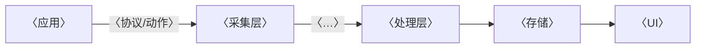

# 笔记骨架模板

`〈〉` 为待填槽位。可整段复制到草稿再逐节填。单篇正文目标 250–450 行；超过则拆 `###`。

```text
---
tags:
  - 〈所属分类〉
  - 〈组件/主题名〉
  - 〈教学|面试|实战〉
created: 〈YYYY-MM-DD〉
status: 已整理
---

# 〈📖〉〈标题：技术名 + 本篇视角〉

> 基于 〈官方文档 / 版本号〉 整理，重点是〈本篇的取舍：不讲 X，只讲 Y〉。
> 〈免责/安全提示：示例密钥仅限本地、示例未实测需标注〉。

## 1. 现状痛点：没有它时会遇到什么

〈不出现该组件名，先描写故障。3–5 个痛点，每个一段，用具体现象与量级〉

**痛点 A — 〈一句话现象〉**
〈触发条件 → 观察到的后果 → 为什么业务代码扛不住〉

**痛点 B — …**

> 这些痛点的共同结构：〈归纳一句，作为引出方案的钩子〉。

## 2. 引出〈主角〉：它解决哪一层问题

〈主角〉把〈痛点 A/B/C〉收敛为〈核心机制〉，但它的定位只到〈抽象层/协议层/传输层〉。

| 〈主角〉负责 | 〈主角〉不负责 |
|---|---|
| 〈职责 1〉 | 〈易被误以为它做了、其实没有的事 1〉 |
| 〈职责 2〉 | 〈…〉 |

**它不管的部分去哪了**：〈点名 2–3 个候选方案，并说明本篇后续由谁接手〉。

## 3. 〈第二层〉：与主角的分工（无第二层则删本节）

〈主角〉只到〈协议/抽象〉为止，落地还需要一个承担〈存储/展示/告警〉的角色——〈第二层〉。

- 〈第二层〉接管：〈…〉
- 〈第二层〉不接管：〈…〉（仍由〈主角〉/其他组件负责）
- 两者接口：〈具体协议、端口、导出方式〉

⚠️ 常见错位期待：〈读者容易以为 X 由 A 负责，实际由 B 负责〉。

## 4. 完整数据流：从〈起点〉到〈终点〉



逐段走查（每段说清"谁发起、传什么、这段会在哪失败"）：

1. **〈A→B〉**：〈机制〉。风险：〈延迟/丢失/重复/背压〉。
2. **〈B→C〉**：…
3. **〈C→D〉**：…

## 5. 能力边界：哪些自动获得，哪些必须应用配合

| 信号/能力 | 开箱可用 | 需改动 | 具体改动点 |
|---|---|---|---|
| 〈Trace 传播〉 | 部分 | 是 | 〈加 instrumentation、传递 context〉 |
| 〈Metrics 基础指标〉 | 是 | — | 〈无需改代码〉 |
| 〈业务自定义指标〉 | 否 | 是 | 〈埋点位置、命名规范、基数控制〉 |

**必须应用配合的三件事**（写死，不留模糊空间）：
1. 〈改动 1：改哪个文件/哪类代码，付出什么代价〉
2. 〈…〉

## 6. 场景与对比

适合：〈场景列表，每条附判据〉
不适合：〈场景列表，每条说明为什么会失败〉

| 维度 | 〈本篇主角〉 | 〈对比项 1〉 | 〈对比项 2〉 |
|---|---|---|---|
| 定位 | | | |
| 运维成本 | | | |
| 可靠性语义 | | | |
| **选它的代价** | | | |

## 7. 最小实战：〈一句话目标〉

版本假设：〈镜像 tag / SDK 版本〉。〈若未实测，明确写「以下按 vX 文档编写，未实际验证」〉

### 7.1 〈起服务〉
```bash
〈命令〉
# 预期：〈可验证的输出/状态〉
```

### 7.2 〈服务端配置与发布〉
```yaml
〈配置〉
```

### 7.3 〈客户端订阅/消费〉
```js
〈代码〉
```

### 7.4 验证链路
```bash
〈命令〉
# 预期输出：〈…〉
```

## 8. 一句话总结

> 〈主角〉是〈类别〉，解决〈哪一段问题〉，不解决〈哪些〉；适合〈场景〉，不适合〈场景〉。

## 参考资料

- 〈官方文档标题〉：<url>（对应版本 〈vX.Y〉）
- 相关笔记：[[〈相邻笔记基名〉]]
```

## 变体：逐层引出（多技术栈串联）

当一个主题需要串起 2+ 层（如 OTel → SigNoz、Ingress → Service → Pod），把第 2、3 节改为**同构小节**，每层固定三行，读者可预测结构：

```text
### 〈层名〉
- **接管**：〈职责〉
- **不接管**：〈点名易误解项〉
- **交接点**：〈与下一层的具体接口〉
```

层数 ≥3 时在开头放一张「层 × 接管 × 不接管」总表，再逐层展开。

## 变体：面试/速查向

若 `tags` 含 `面试`：痛点节压缩为 3 行，主体改为「问题 → 30 秒答案 → 追问点」三段式卡片，每节末尾加 `**高频追问**：〈…〉`；实战节保留最小命令片段，删背景推导。
