---
tags:
  - k8s
  - architecture
  - component
  - 面试
created: 2026-11-13
status: 已整理
---

# Kubernetes 架构与核心组件

> 面向面试：一篇讲清 K8s 架构全景、8 个核心组件、Pod 创建全链路、三大设计思想、对象模型，附高频问答。

## 一、K8s 是什么

一句话：**K8s 是一个声明式的容器编排系统**——你告诉它「要运行什么、运行几个」，它负责把容器调度到合适的机器、启动、看护、故障自愈。

三个关键词：

- **声明式**：描述「期望状态」，不描述「怎么做」。
- **容器编排**：跨多机管理容器生命周期。
- **自愈**：实际偏离期望时，自动收敛回去。

## 二、架构全景

集群 = **控制平面（Control Plane，大脑）** + **节点（Node，手脚）**。控制平面 5 个组件，节点 3 个组件。

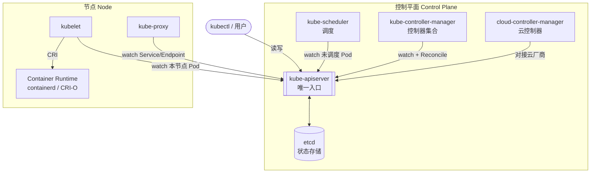

两条铁律（面试必答）：

1. **只有 apiserver 直接读写 etcd**——其他组件永远不碰 etcd。
2. **组件之间不直接通信**，全靠 watch apiserver 交换状态。（唯一例外：kubelet 通过节点本机 CRI 接口调容器运行时，属节点内部接口。）

## 三、控制平面组件

总表：

| 组件 | 职责 | 为什么这么设计 |
|---|---|---|
| **kube-apiserver** | 唯一入口；认证/鉴权/准入/持久化 | 单一入口才能统一鉴权审计；自身无状态，可水平扩展 |
| **etcd** | 分布式 KV（Raft），集群状态唯一事实来源 | 单一数据源，状态不漂移；也是**唯一需备份**的组件 |
| **kube-scheduler** | 给「未调度」Pod 选节点，只写 `nodeName` | 决策与执行分离，调度逻辑可独立演进、可换自定义调度器 |
| **kube-controller-manager** | 一堆控制器，把实际调向期望 | 控制器模式：每种资源一个循环，职责单一可组合 |
| **cloud-controller-manager** | 云厂商相关控制器 | 核心与厂商解耦；本地/私有集群没有这个组件 |

### 1. kube-apiserver —— 唯一入口

所有读写都经过它，它是唯一能操作 etcd 的组件。自身**无状态**，可水平扩容。

**一次写请求的完整流程：**

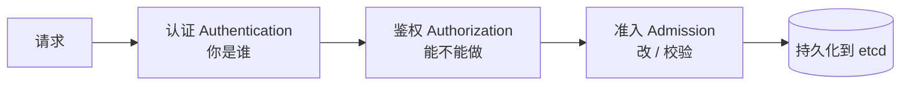

准入内部又分三步（顺序重要）：

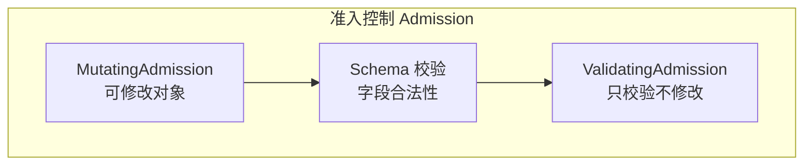

- **认证**：识别身份（客户端证书、token、OIDC 等）。
- **鉴权**：RBAC / Node / Webhook，判断有无权限。
- **准入**：可拦截或改写请求——`ResourceQuota`、`LimitRange` 是内置准入器；webhook 是自定义扩展点。**先 Mutating 再 Validating**，因为校验必须在改写之后。

**为什么是唯一入口：**

| 设计 | 收益 |
|---|---|
| 单一数据入口 | 统一认证、鉴权、审计（audit log） |
| 无状态 | 数据在 etcd，apiserver 随意扩缩 |
| 解耦 | 组件只依赖 API，换掉 etcd 组件无感知 |

**cacher：保护 etcd 的缓存层。** apiserver 为每类资源维护一个 watch cache（cacher），客户端的 watch 实际是从缓存读，避免频繁打 etcd。这是 List-Watch 能扛大规模的基础。

### 2. etcd —— 唯一有状态组件

分布式一致性 KV 存储（基于 **Raft**），集群状态的**唯一事实来源**。整个集群里只有它有状态。

集群里所有对象最终都以 key-value 形式存在 etcd：

```
/registry/pods/default/nginx
/registry/deployments/default/myapp
/registry/services/default/nginx
```

**Raft 如何保证强一致：**

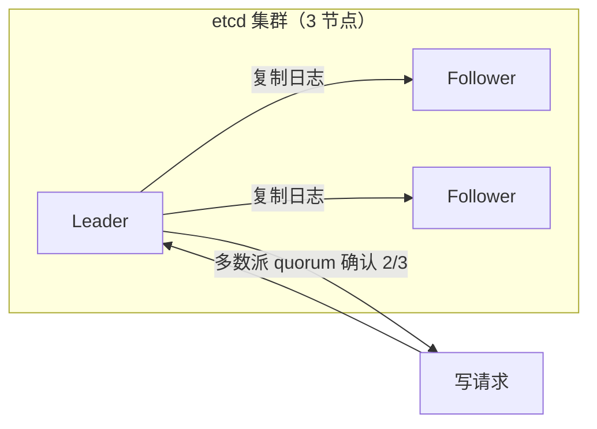

- 一个 Leader 接写请求，复制到**多数派（quorum）**即返回成功。
- 节点数通常**奇数**（3 或 5），可容忍 `(n-1)/2` 个故障：3 容忍 1，5 容忍 2。奇数节点在同等容错下省一台。

**watch：K8s 事件驱动的基石。** etcd 原生支持 watch，但 **K8s 组件从不直接 watch etcd**。正确链路是两层：

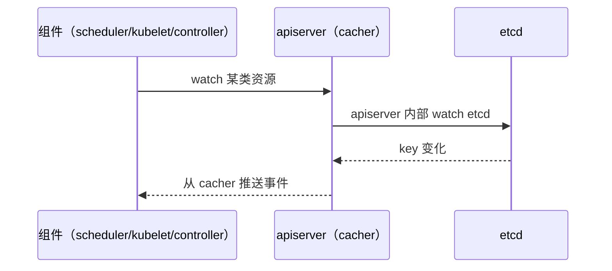

> ⚠️ **易错点**：组件 watch 的是 **apiserver**（更准确地说是它的 cacher 缓存），不是 etcd；只有 apiserver 自己 watch etcd。完整链路是 `etcd → apiserver(cacher) → 组件`。

**运维要点：** etcd 丢了集群状态就丢了，所以唯一必须备份的组件；写密集+强一致，生产建议 SSD 独立部署，别和 apiserver 抢资源。

### 3. kube-scheduler —— 决策者

只做一件事：**给「未调度」的 Pod 挑一个合适的节点**。注意它**不启动容器**，只做决策——把节点名写回 Pod 的 `spec.nodeName`。

**调度流程：两阶段**

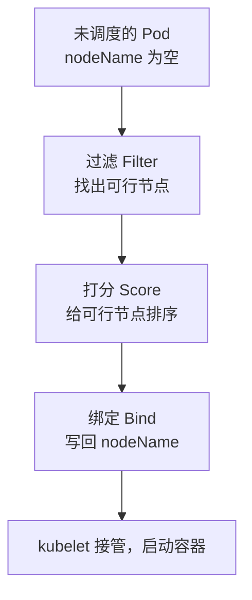

- **过滤**：排除资源不足、污点不匹配、nodeSelector/亲和性不满足的节点。
- **打分**：对剩余节点排序（资源越均衡分越高、镜像已缓存加分、同应用 Pod 尽量分散等）。
- **绑定**：写回 `nodeName`，交给目标节点的 kubelet。

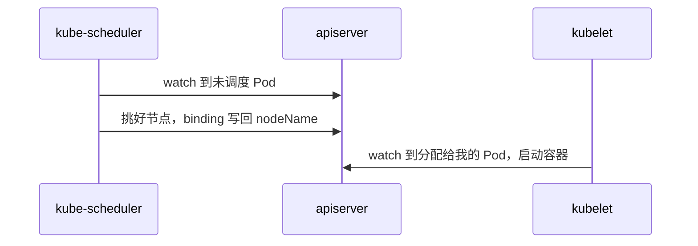

**架构思想——决策与执行分离**：scheduler 不碰节点、不启动容器，只改一行字段。真正的执行由 kubelet 完成。这样调度逻辑可独立演进、可换自定义调度器，执行层无感知。

**可插拔调度框架**：现代调度器基于 **Scheduling Framework**，把流程拆成多个**扩展点**（Filter、Score、Bind、Reserve 等），可插入自定义插件实现专属策略。

**高可用**：多副本时用 **Leader Election（抢 Lease 锁）**，同一时刻只有一个 scheduler 在决策，Leader 挂了由其他副本接管，避免重复调度。

### 4. kube-controller-manager —— 控制器集合

**一堆控制器的集合**：一个进程里运行几十个控制器，每个负责一种资源，不断把实际状态调到期望状态。

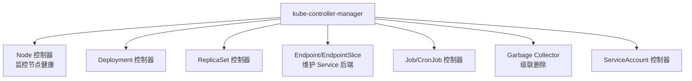

每个控制器的内部结构都一样：

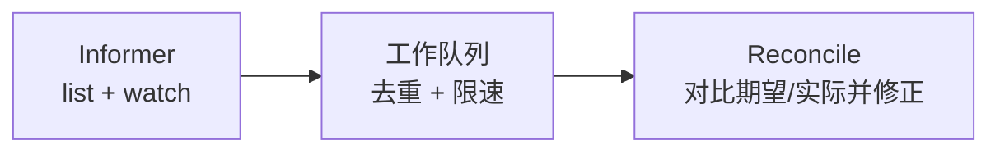

**为什么合在一个进程**：部署简单，不用为每个控制器单独部署、扩缩容；控制器彼此独立，必要时也能拆出来单独跑。

**Leader Election**：多副本时也用抢 Lease 选 Leader，只一个实例在工作——既高可用又不重复干活。

### 5. cloud-controller-manager —— 云厂商解耦

把**依赖云厂商**的控制循环从核心 kube-controller-manager 拆出来，单独运行。**本地/私有集群没有这个组件。**

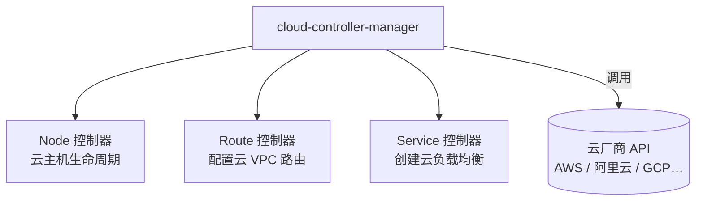

- 云主机被销毁 → CCM 把节点从集群摘掉。
- `type: LoadBalancer` 的 Service → CCM 调云 API 建真正的云 LB。

**架构思想——核心与厂商解耦**：K8s 核心不用维护各家云的代码；云厂商独立发版 CCM、不受核心发布节奏约束；用户跨云迁移只换 CCM，核心组件不变。

## 四、节点组件

总表：

| 组件 | 职责 |
|---|---|
| **kubelet** | 节点「工头」：watch 本节点 Pod → 调 CRI 拉容器 → 跑探针 → 上报状态 |
| **kube-proxy** | 维护节点网络规则（iptables/IPVS），实现 Service 负载均衡 |
| **Container Runtime** | 真正跑容器（containerd/CRI-O；dockershim 1.24 移除） |

### 6. kubelet —— 节点工头

每个节点上的 agent，控制平面只做决策，真正把 Pod 跑起来、看护起来的是它。

**三大接口解耦：**

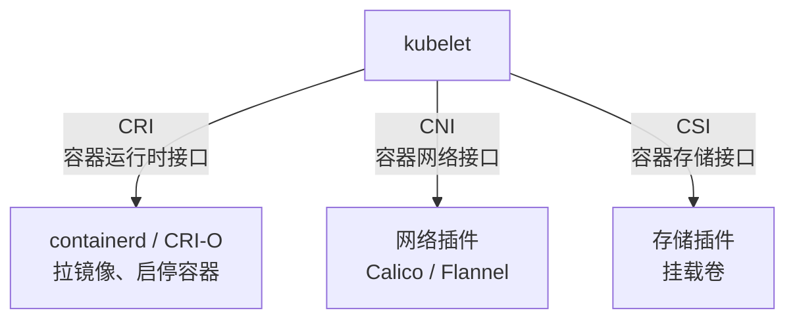

| 接口 | 管什么 | 为什么拆接口 |
|---|---|---|
| **CRI** | 容器（拉镜像、创建/销毁） | 不绑定 Docker，可换 containerd/CRI-O |
| **CNI** | 网络（给 Pod 配 IP、网卡） | 网络方案可插拔 |
| **CSI** | 存储（挂载持久卷） | 存储后端可插拔 |

> 📌 三个接口让 K8s 成为「可插拔」系统——换运行时、换网络、换存储都不影响 kubelet 本身。

**核心工作循环：**

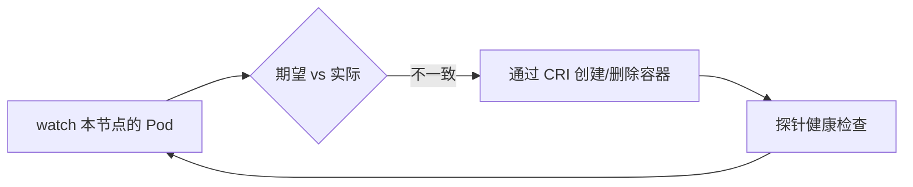

只认「分配给我这个节点」的 Pod（按 `nodeName` 过滤）；持续上报容器状态、节点资源、健康信息到 apiserver。

**健康检查探针：**

| 探针 | 作用 | 失败后果 |
|---|---|---|
| **liveness** | 容器还活着吗 | 失败 → 重启容器 |
| **readiness** | 能接流量吗 | 失败 → 从 Service 摘除 |
| **startup** | 启动完成了吗 | 未完成前暂不启用前两者 |

> ⚠️ startup 探针专为慢启动应用设计——它保护 liveness 在启动期不被误判触发重启。

**架构思想——节点自治**：每个节点有自己的 agent，即使控制平面短暂故障，已运行的 Pod 仍由 kubelet 看护（不会因为 apiserver 挂了就丢 Pod）。

### 7. kube-proxy —— 网络规则维护者

在节点上**实现 Service 抽象**：监听 Service/Endpoint 变化，把「访问虚拟 IP → 转发到某个 Pod」的规则写到内核。

**它其实不「代理」流量：**

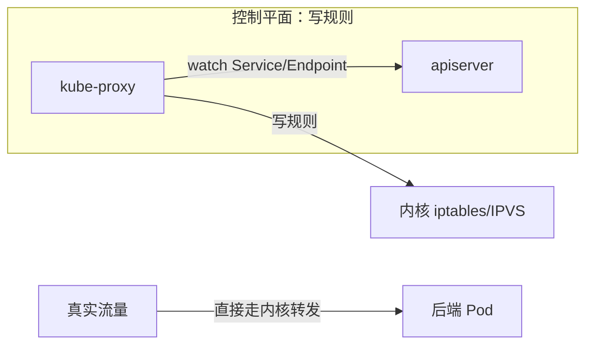

**架构思想——控制与数据分离**：kube-proxy 只写规则，真实流量由内核直接转发，**不经过 kube-proxy 进程本身**——所以它挂了短时间内流量也不断（规则还在内核里）。

**三种工作模式：**

| 模式 | 原理 | 状态 |
|---|---|---|
| **userspace** | 用户态代理 | 已废弃 |
| **iptables** | 规则链转发 | 默认 |
| **IPVS** | 内核哈希表四层 LB | 大集群/高并发更优 |

> ⚠️ 规则多时 iptables 性能下降（线性匹配），IPVS 用哈希查找更稳。

### 8. Container Runtime —— 真正跑容器

通过 **CRI** 标准接口被 kubelet 调用，负责拉镜像、创建/销毁容器。

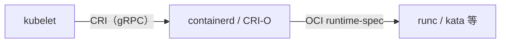

- **containerd**：CNCF 项目（源自 Docker），目前最主流。
- **CRI-O**：Red Hat 主导，专为 K8s 的轻量实现。

**两个标准：**

| 规范 | 定义什么 | 谁定义 |
|---|---|---|
| **CRI** | kubelet 与运行时的接口 | Kubernetes |
| **OCI** | 镜像格式 + 运行时规范 | 开放容器倡议 |

**dockershim 的移除：** 早期通过 **dockershim** 适配层支持 Docker，但 Docker 引擎过重。**K8s 1.24 起移除 dockershim**，统一走 CRI 标准。

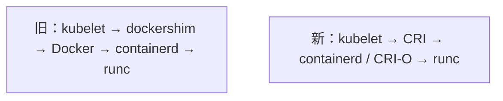

### RuntimeClass：按 Pod 选运行时

CRI 之上还能再分一层：同一集群里不同 Pod 用不同运行时。`RuntimeClass` 是集群级对象，Pod 用 `spec.runtimeClassName` 选择；类的 `scheduling`（nodeSelector / tolerations）保证 Pod 落到装了对应 handler 的节点。

| 运行时 | 隔离级别 | 场景 |
|---|---|---|
| runc | 共享内核，namespace + cgroup | 默认，性能最好 |
| **kata-containers** | 轻量 VM，独立内核 | 多租户、不可信工作负载 |
| **gVisor** | 用户态内核拦截 syscall | 沙箱，兼容性略差 |

> 📌 私有化平台要跑客户提交的工作负载或 AI 推理代码时，用 RuntimeClass 把不可信 Pod 放进沙箱，比只靠 SecurityContext 更硬（连 [[06-配置与安全]]）。代价是启动慢、有性能损耗，且节点必须预装对应 runtime handler。

## 五、一个 Deployment 怎么跑起来 🎯

面试高频题：「描述一个 Deployment 从提交到运行的完整过程」。

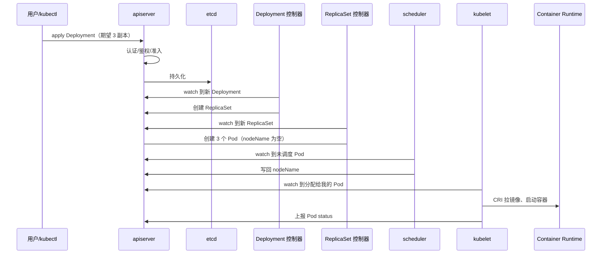

一句话：**每层只管自己的「期望 vs 实际」，靠 watch 解耦，靠写期望驱动下一层**。

## 六、三大设计思想（面试加分）

### 思想 1：声明式 API —— spec / status

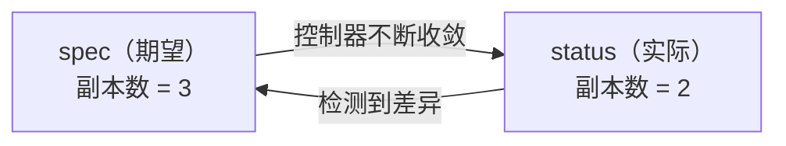

- 你只写 **spec**（期望），系统维护 **status**（实际）。
- 两者有偏差 → 系统就动作。**这就是「自愈」的根源。**
- `kubectl apply`（声明式，生产用）vs `create`/`run`（命令式）。

### 思想 2：控制循环 Reconcile

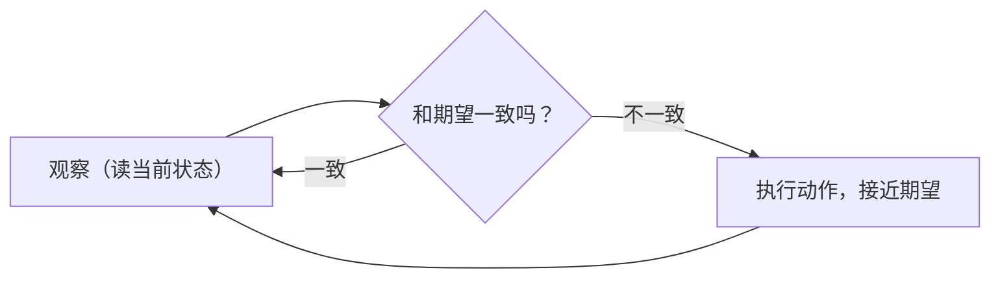

两个要点：

- **level-triggered**（基于当前状态，不是基于事件）→ 即使错过事件，下次循环也会发现差异。
- **幂等** → 多做一次不会出错，所以能反复重试、不怕崩溃重启。

控制器分层协作（每层只管自己的「期望 vs 实际」）：

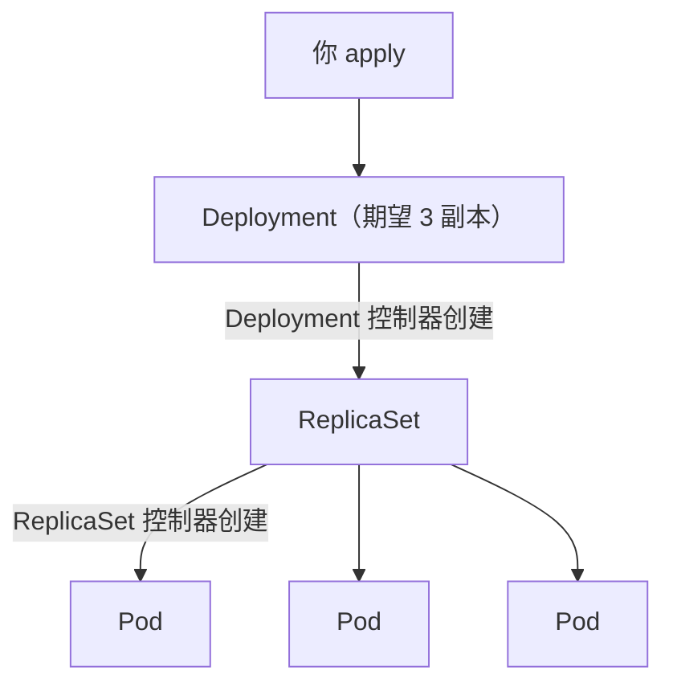

### 思想 3：一切经 apiserver + List-Watch

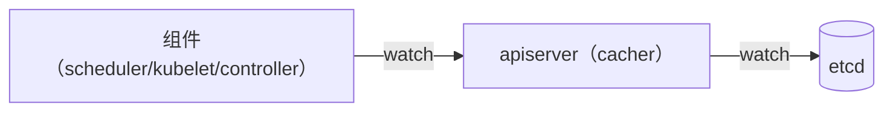

- 组件不轮询、不直连 etcd。
- apiserver 用 **cacher** 缓存服务 watch 请求，保护 etcd 不被打爆。

> ⚠️ **易错点**：组件 watch 的是 **apiserver**，不是 etcd；只有 apiserver 自己 watch etcd。完整链路是 `etcd → apiserver(cacher) → 组件`。

## 七、对象模型

K8s 里**一切皆对象**，统一五字段：

```mermaid
flowchart LR
    OBJ["K8s 对象"] --> AV["apiVersion<br/>group/version"]
    OBJ --> KIND["kind<br/>资源类型"]
    OBJ --> META["metadata<br/>名字/标签等"]
    OBJ --> SPEC["spec<br/>期望（你写）"]
    OBJ --> STATUS["status<br/>实际（系统写）"]
```

- **status 永远由系统维护，你只写 spec。**
- **namespace**：对象所属的命名空间，决定资源的**作用域与隔离边界**。同名资源可在不同 namespace 并存；集群级资源（Node、PV、StorageClass）没有 namespace。系统默认 namespace：`default`（用户默认）、`kube-system`（控制面组件）、`kube-public`（公共资源）。
- **labels**：用于 selector 筛选——Service / Deployment 靠它找 Pod。
- **annotations**：只存附加信息，不能筛选。
- **ownerReferences**：父子关系，级联删除（Deployment → ReplicaSet → Pod）。
- **resourceVersion**：etcd 维护的全局递增版本号，用于乐观并发（更新带版本，冲突返回 409）。

## 八、面试高频问答 🎯

**Q1：apiserver 为什么是唯一入口？**
统一鉴权/审计，自身无状态可水平扩展，组件解耦不关心存储细节。

**Q2：组件怎么感知变化？会轮询 etcd 吗？**
不轮询。用 List-Watch：先 List 建基线再 Watch 收增量。**watch 的是 apiserver（cacher），不是 etcd**；只有 apiserver 自己 watch etcd。

**Q3：为什么 etcd 要奇数节点？**
Raft 需要多数派（quorum）确认。奇数节点在同等容错下省一台：3 节点容忍 1 故障，4 节点也只能容忍 1，浪费一台。

**Q4：哪个组件最需要高可用备份？**
etcd。它是唯一有状态组件，状态丢了集群就没了——所以唯一必须备份的也是它。其他控制平面组件无状态，多副本即可。控制平面 HA = etcd Raft + apiserver 水平扩 + CM/Scheduler Leader Election。

**Q5：scheduler 和 kubelet 怎么分工？**
scheduler 决策（选节点、写 `nodeName`），kubelet 执行（拉容器、跑探针）。**决策与执行分离**，scheduler 换掉 kubelet 无感。

**Q6：kube-controller-manager 为什么把一堆控制器放一个进程？**
部署简单，控制器彼此独立可单独拆分运行。多副本时用 Leader Election 避免重复操作。

**Q7：kube-proxy 挂了流量会断吗？**
不会立即断。kube-proxy 只写规则到内核，真实流量走内核转发不经过它；进程挂了规则还在，直到规则因过期或下次同步被清理才可能出问题。

**Q8：kubelet 和控制平面失联，节点上的 Pod 会怎样？**
Pod 短期内继续运行——kubelet 节点自治，本机看护已分配 Pod。但有上限：默认超过 `--node-monitor-grace`（约 40s）控制平面才标记节点 NotReady，Pod 的某些操作（如重建）会受影响；已运行容器不会立即被杀。

**Q9：为什么 1.24 移除 dockershim？归根结底为了什么？**
Docker 引擎功能超出容器运行所需、太重。统一到 CRI 标准接口，让运行时可插拔——普通容器 runc、安全容器 kata、机密计算容器都能接入，生态百花齐放。

**Q10：CRI、CNI、CSI 分别解决什么？**
CRI（kubelet→运行时，管容器）、CNI（kubelet 协调网络插件，配 Pod IP）、CSI（kubelet 调用存储插件，挂卷）。三个接口让运行时/网络/存储都解耦、可插拔。

**Q11：Pod 挂了会自愈吗？K8s 怎么实现自愈？**
Pod 本身**不自愈**。靠上层控制器（Deployment 等）发现副本不足后重建 Pod。kubelet 只看护已分配到本节点的 Pod，进程崩了靠 liveness 探针重启容器。控制器持续把 status 拉向 spec，这才是自愈的根源。

**Q12：声明式和命令式区别？**
命令式说「怎么做」，声明式说「要什么」。`apply` 声明式、`create` 命令式；生产一律用 `apply`。

**Q13：控制循环为什么必须幂等？**
控制器会崩、会重启、事件会丢；只有幂等才能反复重试而不产生副作用，这是自愈可恢复的根基。

## 九、关联

- 下游 → [[02-工作负载资源]]、[[03-服务与网络]]、[[04-存储]]、[[05-调度与资源管理]]、[[06-配置与安全]]、[[07-API 与 Watch 机制]]、[[08-集群运维]]、[[09-生态与工具]]
- 机制深入 → [[07-API 与 Watch 机制]]（List-Watch、Informer、Reconcile、resourceVersion、准入控制）
- 资源生命周期 → OwnerReference、Finalizer（见 [[07-API 与 Watch 机制]]）