---
tags:
  - k8s
  - workload
  - 面试
created: 2026-11-14
status: 已整理
---

# Kubernetes 工作负载资源

> 面向面试：一篇讲清 Pod、探针、容器编排模式、5 类工作负载控制器（Deployment/StatefulSet/DaemonSet/Job/CronJob），附选型决策与高频问答。

## 一、工作负载资源全景

K8s 里「跑什么、怎么跑」由**工作负载资源**定义。所有工作负载最终都落到 **Pod**——Pod 是最小调度单元，上层控制器负责管 Pod 的副本数、更新、有序启停等。

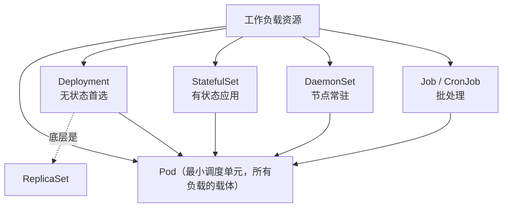

> 📌 **Pod 不自愈**——节点故障或 Pod 被删后，重建它的是上层控制器。所以实际几乎不直接用裸 Pod，而是用上层负载包着。

## 二、Pod —— 最小调度单元

注意：最小单元是 **Pod 不是容器**。一个 Pod 里可以跑多个紧耦合的容器。

### Pod 内共享

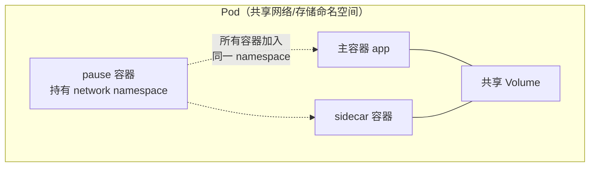

| 共享 | 说明 |
|---|---|
| **网络命名空间** | 同一 IP、同一组端口空间，容器间用 `localhost` 互通 |
| **存储卷** | Pod 定义的 Volume 所有容器都能挂载 |
| **IPC** | 可用进程间通信 |

> ⚠️ `pause` 容器是 K8s 偷偷加的「基础设施容器」，唯一作用是**持有 network namespace**——让 Pod 里其他容器死后重启还能接回原来的网络空间。

**为什么不直接调度容器？** 容器组合是常见模式（主应用 + 日志 sidecar + 配置 sidecar）。把一组紧耦合容器放进一个 Pod，它们天然共享网络和存储、调度上作为一个整体（同生共死）。Pod 这层抽象就是为**容器组合**而存在的。

### Pod phase 状态机

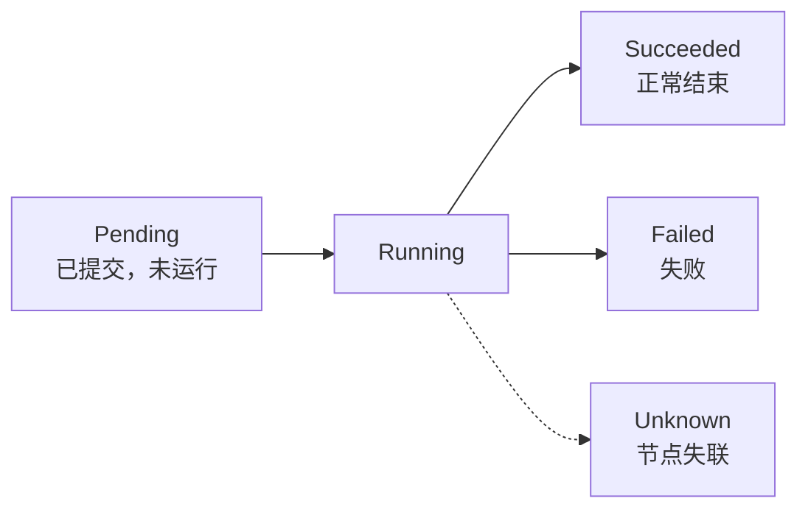

| phase | 含义 |
|---|---|
| Pending | 已写入 etcd，等调度或拉镜像 |
| Running | 至少一个容器在跑 |
| Succeeded / Failed | 所有容器都结束（成功/失败） |
| Unknown | 通常节点失联，apiserver 拿不到状态 |

### Downward API：让 Pod 知道自己是谁

容器常需要自身元数据（Pod 名、namespace、IP、节点名、labels、limits），但**不该让业务容器反过来调 apiserver**（要权限、要网络、还会放大控制面压力）。Downward API 由 kubelet 在启动时直接注入：

| 方式 | 能注入什么 | 限制 |
|---|---|---|
| `fieldRef` | `metadata.name`、`metadata.namespace`、`status.podIP`、`spec.nodeName`、`spec.serviceAccountName` | 环境变量**注入后不更新** |
| `resourceFieldRef` | 本容器 `requests/limits` 的 CPU / 内存 | 常用于把内存 limit 传给 JVM 堆或 Go 的 `GOMEMLIMIT` |
| labels / annotations 卷 | Pod 的标签与注解 | **卷方式会随对象更新**（label 改了文件内容跟着变）|

> 📌 会变的用**卷**、不变的用**环境变量**。日志采集器给日志打 `pod_name` / `namespace` 标签就靠它（连 [[08-集群运维]] 日志链路）。

## 三、Pod 生命周期与探针

理解探针是写出「能在 K8s 上平稳运行的应用」的关键。生命周期由 **phase 状态机 + 探针 + 重启策略 + 钩子**共同决定。

### 三种探针

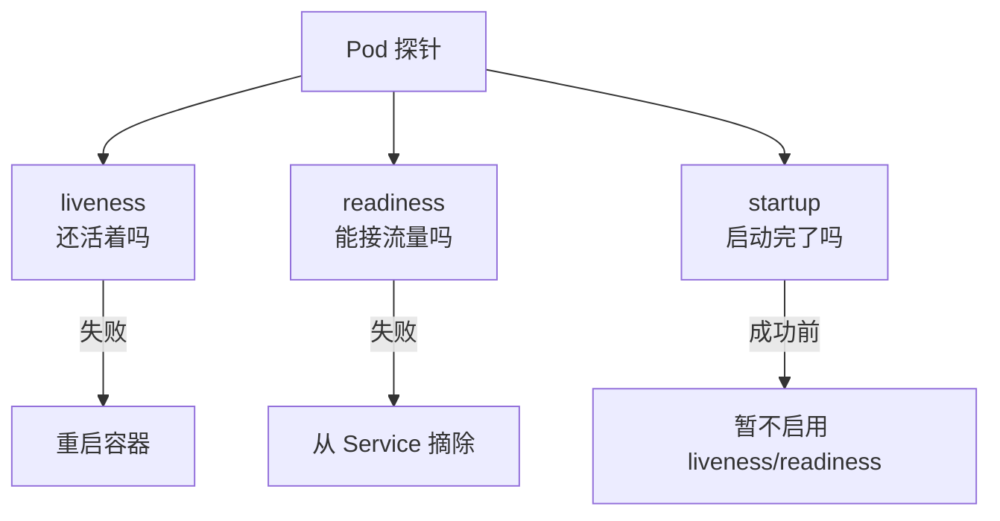

| 探针 | 失败后果 | 解决什么问题 |
|---|---|---|
| **liveness** | 重启容器 | 进程死锁/假死，但端口还在 |
| **readiness** | 从 Service 端点摘除 | 应用活着但还没准备好接流量（如还在加载） |
| **startup** | 失败也重启，但**成功前禁用** liveness/readiness | 慢启动应用，避免被 liveness 误杀 |

> ⚠️ **readiness 失败不重启**——它只控制「要不要把流量导过来」，容器本身不动。

### 探针检查方式

| 方式 | 判定 |
|---|---|
| `httpGet` | HTTP 请求 2xx/3xx 视为成功 |
| `tcpSocket` | TCP 连接建立即成功 |
| `exec` | 容器内执行命令，退出码 0 成功 |
| `gRPC` | 调用 gRPC Health Checking Protocol（1.23 alpha / 1.24 beta 默认开 / **1.27 GA**） |

> 📌 经验：readiness 用应用自己的 `/ready` 端点；liveness 用 `/health` 或简单 TCP 探测；慢启动应用务必配 startup。

### 重启策略（restartPolicy）

| 策略 | 行为 | 适用 |
|---|---|---|
| **Always**（默认） | 容器退出就重启 | Pod 默认 |
| **OnFailure** | 只在非 0 退出时重启 | Job |
| **Never** | 不重启 | Job |

> ⚠️ **Job** 要求 `Never` 或 `OnFailure`，不能 `Always`——跑完就重启不符合批处理语义。

### 容器优雅退出

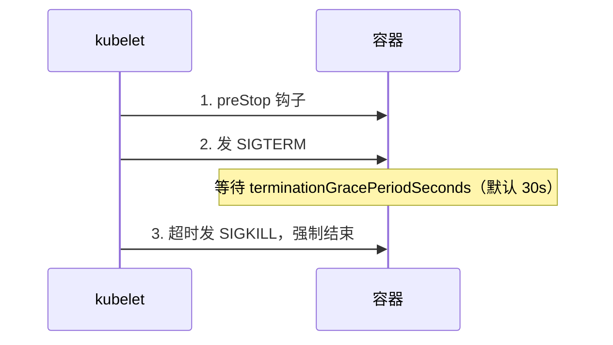

> ⚠️ 应用必须**捕获 SIGTERM 优雅退出**：停止收新请求、处理完在途请求再退。否则 30s 后被强杀，丢数据。配合 `preStop` 钩子可以做「先摘流量、再退出」。
>
> ⚠️ **preStop 的执行时间也算在 gracePeriod 内**——如果 preStop 阻塞太久，留给 SIGTERM 优雅退出的时间就不够了。生产实践：preStop 用于「等摘流量」（如 `sleep 5s` 让 Service 端点更新），真正退出靠应用处理 SIGTERM。

## 四、Init 容器与 Sidecar 模式

Pod 里除了主容器，还有两类辅助容器：**Init 容器**（启动前初始化）和 **Sidecar**（与主容器并行辅助）。两者解决「主容器不该干的事」。

### Init 容器：先初始化，再跑主容器

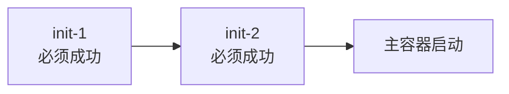

- **顺序执行**：init 容器一个个跑，前一个成功（exit 0）才跑下一个。
- **必须成功**：任一 init 失败，整个 Pod 按重启策略重来。
- 典型用途：等依赖就绪、拉配置、做数据迁移、注册到服务发现。
- init 容器和主容器**不共享启动时机，但共享 Volume**——init 写的文件主容器能读到。

### Sidecar：和主容器并行跑

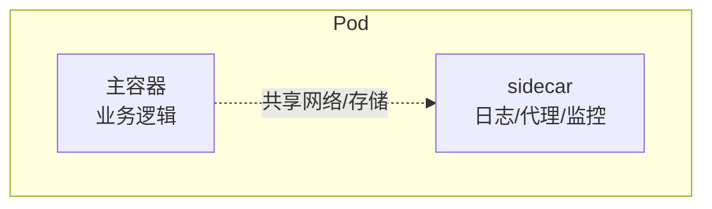

sidecar 和主容器**并行**运行，提供辅助能力：日志采集、Service Mesh 代理（Envoy）、配置热加载。主容器专注业务，sidecar 专注横切关注点。

### 原生 sidecar（1.28 alpha → 1.29 beta → 1.33 GA）

旧式 sidecar（普通容器）有痛点：启动/退出顺序无法保证——sidecar 可能在主容器之后才启动，主容器退出时 sidecar 还在跑导致 Pod 迟迟不结束。

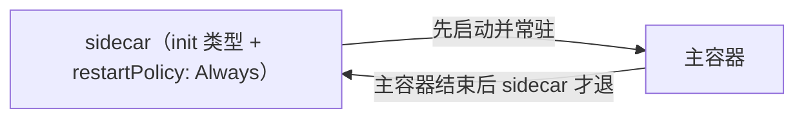

把 sidecar 写成 `restartPolicy: Always` 的 **init 容器**——它**先于主容器启动、后于主容器退出**，启动/退出顺序问题被根治。新写法推荐用这个。

## 五、ReplicaSet —— 副本数保证

ReplicaSet（RS）保证一组 Pod 的期望副本数：少了补、多了删。它是 ReplicationController（RC）的升级版，RC 已废弃。

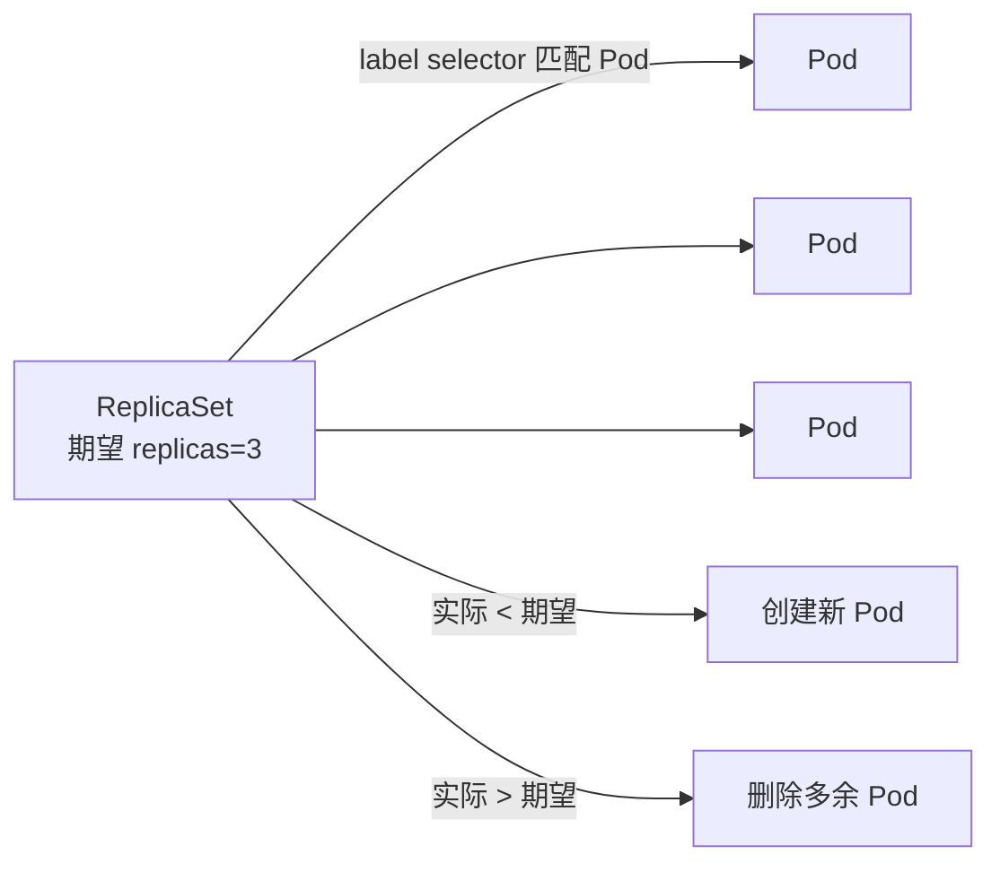

- RS 定义 `replicas`（期望数）+ `selector`（label 找 Pod）+ `template`（Pod 模板）。
- 控制器循环不断比对「期望 vs 实际」，差就补/删。

### RC vs RS

| | ReplicationController | ReplicaSet |
|---|---|---|
| selector | 只支持**等值**（`env=prod`） | 支持**集合**（`env in (prod,staging)`） |
| 状态 | 已废弃 | 是 Deployment 的底层 |
| 直接使用 | 不推荐 | 生产基本不直接用 |

> 📌 **不要直接用 RS**——用 Deployment。Deployment 包了 RS 并额外提供滚动更新和回滚。RS 只是 Deployment 的实现细节。

## 六、Deployment —— 无状态首选

最常用的无状态工作负载：管理 ReplicaSet，提供滚动更新和回滚。你写 Deployment，它帮你管 RS 和 Pod。

### 层级关系

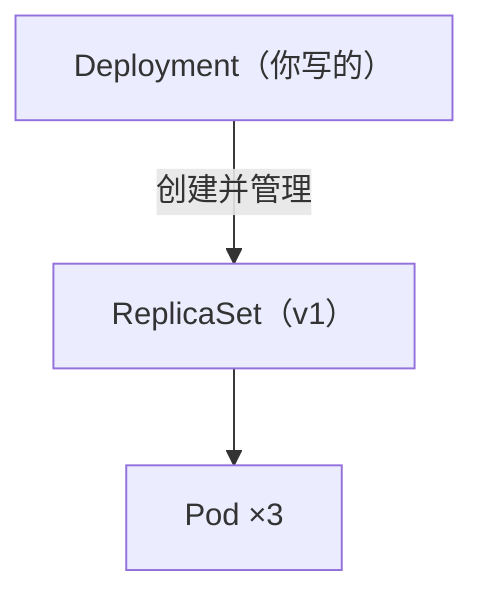

> 你永远只操作 Deployment，不碰 RS。

### 滚动更新

改 Pod 模板（比如换镜像版本），Deployment 会**新建一个 RS，逐步把流量从旧 RS 切到新 RS**：

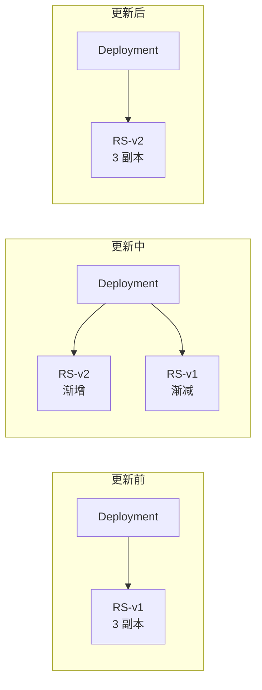

两个关键参数（`strategy.rollingUpdate`）：

| 参数 | 默认 | 作用 |
|---|---|---|
| **maxSurge** | 25% | 最多比期望多几个——控制新 Pod「冒头」速度 |
| **maxUnavailable** | 25% | 最多比期望少几个——控制旧 Pod「退场」速度，保证更新期间有足够可用副本 |

### 回滚

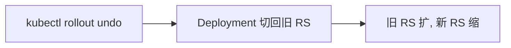

- Deployment 保留多个历史 RS（`revisionHistoryLimit`，默认 10）。
- `kubectl rollout undo` 可指定回到某个 revision。
- ⚠️ **只有改 Pod 模板才产生新版本**；改 replicas 等不产生新 RS，不能回滚。

### 更新策略

| 策略 | 行为 |
|---|---|
| **RollingUpdate**（默认） | 滚动，平滑切换 |
| **Recreate** | 先全删旧 Pod 再建新的——有停机，适合不能多版本并存 |

## 七、StatefulSet —— 有状态应用

给**有状态应用**（数据库、消息队列等）用：提供**稳定的网络标识 + 稳定的存储 + 有序的启停**。Deployment 做不到这三点。

### 三大特征

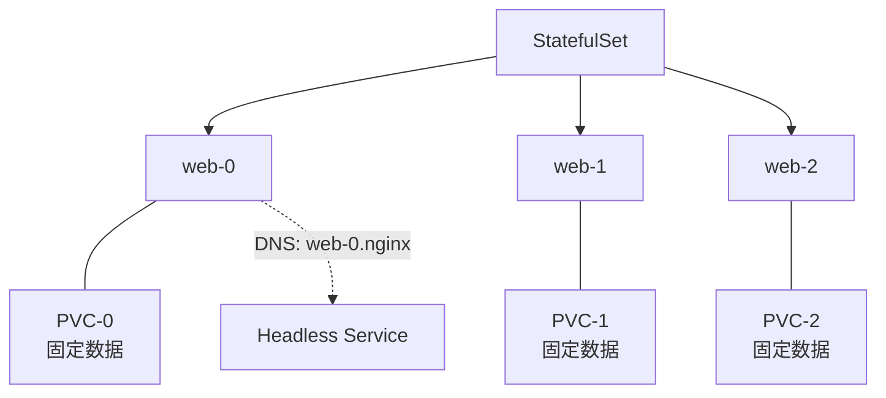

1. **稳定网络标识**：Pod 名固定为 `<statefulset>-<序号>`（web-0、web-1…），配合 **Headless Service**（`clusterIP: None`），每个 Pod 有独立 DNS（`web-0.nginx`），客户端能直连特定 Pod。
2. **稳定存储**：通过 `volumeClaimTemplates`，每个 Pod 绑定**自己的 PVC**。Pod 重启后接回原来的数据卷，不丢数据。
3. **有序启停**：

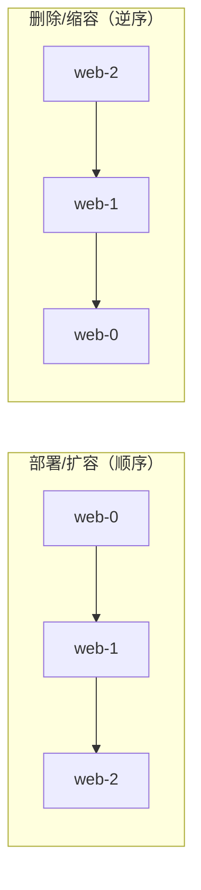

- 默认 `podManagementPolicy: OrderedReady`：必须前一个就绪才创建下一个。
- 改成 `Parallel` 可并行创建（但网络标识和存储仍稳定）。

### Deployment vs StatefulSet

| | Deployment | StatefulSet |
|---|---|---|
| Pod 名 | 随机后缀 | 固定有序号 |
| 存储 | 共享/无状态 | 每个 Pod 独立 PVC |
| 启停 | 并行 | 有序（默认） |
| 适用 | Web/API 等无状态 | 数据库、主从集群 |

> ⚠️ **不要用 StatefulSet 跑无状态应用**——它的有序特性是开销，无状态用 Deployment 更简单。

## 八、DaemonSet —— 节点常驻

保证**每个（符合条件的）节点上正好跑一个 Pod 副本**。新节点加入自动跑，节点移除自动删——天然跟随节点。

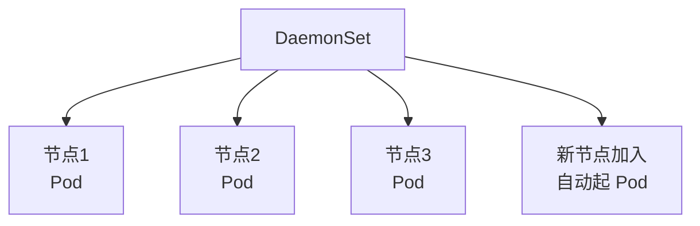

**典型用途**（都是「节点级常驻」场景）：

- **日志采集**：fluentd / filebeat
- **监控**：node-exporter
- **网络**：CNI 插件（如 Calico）、kube-proxy
- **存储**：分布式存储客户端（如 Ceph）

**怎么限制节点**（默认所有节点都跑）：

- `nodeSelector` / `nodeAffinity`：指定节点标签。
- `tolerations`：容忍污点（让 Pod 跑到被 tainted 的节点，比如 master）。

**更新策略：**

| 策略 | 行为 |
|---|---|
| **RollingUpdate**（默认） | 滚动更新节点上的 Pod |
| **OnDelete** | 手动删一个旧 Pod 才会创建新的——适合严格控制节奏 |

## 九、Job 与 CronJob —— 批处理

Deployment 这类是「一直跑」的常驻服务；Job / CronJob 是 **「跑完即停」** 的批处理工作负载。

### Job：一次性任务

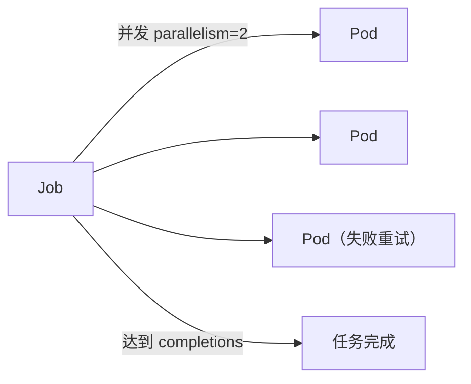

| 参数 | 含义 |
|---|---|
| **completions** | 总共要成功完成几次（如 5 次备份） |
| **parallelism** | 并发跑几个 Pod |
| **backoffLimit** | 失败重试上限（默认 6），超了 Job 标记失败 |
| **activeDeadlineSeconds** | 最长运行时间，超时强制停 |

> ⚠️ Job 的 Pod `restartPolicy` 只能是 **`Never`** 或 **`OnFailure`**，不能 `Always`——否则跑完又重启，违背批处理语义。

完成判定：成功数 ≥ `completions`（不设 completions 时，至少一个 Pod 成功即完成）。

### CronJob：定时任务

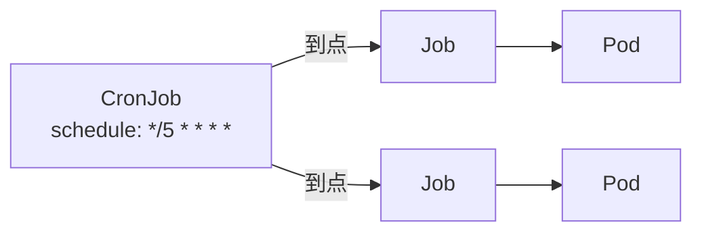

- `schedule`：标准 **cron 表达式**（分 时 日 月 周）。
- `jobTemplate`：每次触发生成的 Job 模板。

**三个要注意的点：**

| 问题 | 参数 | 说明 |
|---|---|---|
| 任务重叠 | `concurrencyPolicy` | `Allow`（默认）/ `Forbid`（上次没跑完不新建）/ `Replace`（停掉旧的再建） |
| 错过执行 | `startingDeadlineSeconds` | 错过这么久就不再补跑 |
| 历史堆积 | `successfulJobsHistoryLimit` / `failedJobsHistoryLimit` | 保留多少历史 Job，默认 3/1 |

> ⚠️ **时区**：CronJob 默认按 kube-controller-manager 的时区（通常 UTC）。K8s 1.25+ 支持 `timeZone` 字段，建议显式指定（如 `Asia/Shanghai`），免得半夜被吵醒。

### Job 进阶：Indexed Job 与 podFailurePolicy

| 能力 | 用途 |
|---|---|
| `completionMode: Indexed` | 给每个 Pod 注入 `JOB_COMPLETION_INDEX`，做数据分片并行处理（批处理 / AI 训练常见）|
| `podFailurePolicy` | 按退出码或 Pod 条件区分「重试」与「直接判 Job 失败」——例如 `DisruptionTarget`（节点被抢占 / 驱逐）不计入 `backoffLimit`，避免基础设施抖动吃掉重试预算 |
| `successPolicy` | 指定部分索引成功即算 Job 成功 |

> ⚠️ 这几个字段是较新版本才逐步稳定的，用前 `kubectl explain job.spec.podFailurePolicy` 确认目标集群支持；私有化交付必须对照客户集群版本矩阵（连 [[08-集群运维]] 版本偏差）。

## 十、选型决策表 🎯

面试常考：「什么场景用什么工作负载？」

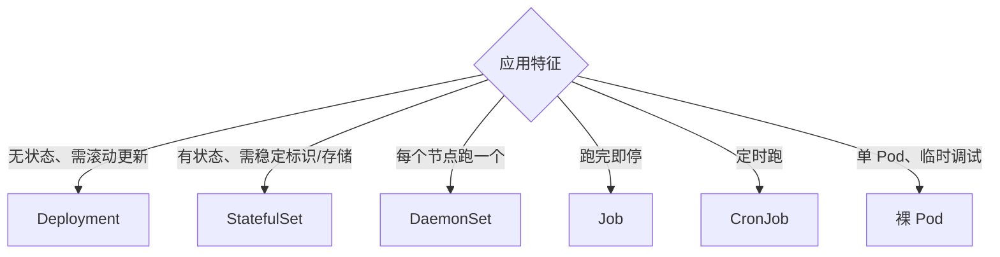

| 场景 | 选什么 |
|---|---|
| Web/API、微服务无状态服务 | Deployment |
| MySQL 主从、Redis Cluster、ZooKeeper | StatefulSet |
| 日志/监控/网络插件（节点级） | DaemonSet |
| 数据备份、数据迁移 | Job |
| 定时报表、定时清理 | CronJob |
| 临时调试 | 裸 Pod（不推荐生产用） |

## 十一、面试高频问答 🎯

**Q1：Pod 和容器什么关系？为什么最小调度单元是 Pod 不是容器？**
Pod 里可跑多个紧耦合容器，它们共享网络/存储/IPC，调度上同生共死。容器组合（主应用+sidecar）是常见模式，Pod 这层抽象就是为容器组合而存在。

**Q2：Pod 挂了会自愈吗？**
Pod 本身不自愈。节点故障或 Pod 被删后，重建它的是上层控制器（Deployment/StatefulSet 等）。kubelet 只看护已分配到本节点的 Pod，进程崩了靠 liveness 探针重启容器。

**Q3：liveness、readiness、startup 三种探针区别？**
liveness 失败重启容器（解决死锁假死）；readiness 失败从 Service 摘流量但不重启（解决未就绪）；startup 成功前禁用 liveness/readiness（保护慢启动应用）。

**Q4：readiness 失败会重启容器吗？**
不会。readiness 只控制「要不要把流量导过来」，容器本身不动。这是和 liveness 的关键区别。

**Q5：容器关闭时发生了什么？应用要做什么？**
kubelet 先执行 `preStop` 钩子，再发 SIGTERM，等待 `terminationGracePeriodSeconds`（默认 30s），超时发 SIGKILL。应用必须捕获 SIGTERM 优雅退出——停收新请求、处理完在途请求再退，否则被强杀丢数据。

**Q6：Deployment 怎么做滚动更新？maxSurge 和 maxUnavailable 各控制什么？**
改 Pod 模板时 Deployment 新建一个 RS，逐步把流量从旧 RS 切到新 RS。maxSurge 控制最多比期望多几个（新 Pod 冒头速度），maxUnavailable 控制最多比期望少几个（旧 Pod 退场速度，保证可用副本数）。默认都 25%。

**Q7：Deployment 怎么回滚？什么操作不能回滚？**
`kubectl rollout undo` 可指定 revision，Deployment 切回旧 RS（旧 RS 扩、新 RS 缩）。历史 RS 保留数由 `revisionHistoryLimit`（默认 10）控制。⚠️ 只有改 Pod 模板才产生新版本，改 replicas 等不产生新 RS，不能回滚。

**Q8：StatefulSet 和 Deployment 区别？什么场景用 StatefulSet？**
StatefulSet 提供稳定网络标识（Pod 名固定 + Headless Service 独立 DNS）、稳定存储（每 Pod 独立 PVC）、有序启停。Deployment 都做不到。用于数据库、主从集群等有状态应用。⚠️ 无状态应用不要用 StatefulSet，有序特性是开销。

**Q9：StatefulSet 的 Pod 名为什么固定？怎么实现每 Pod 独立 DNS？**
Pod 名格式 `<statefulset>-<序号>`（web-0、web-1…）。配合 Headless Service（`clusterIP: None`），每个 Pod 有独立 DNS（`web-0.nginx`），客户端能直连特定 Pod——这是主从选举、数据分片直连的基础。

**Q10：DaemonSet 典型用途？怎么只在某些节点跑？**
节点级常驻场景：日志采集（fluentd）、监控（node-exporter）、网络插件（Calico/kube-proxy）、存储客户端。用 `nodeSelector`/`nodeAffinity` 指定节点标签，用 `tolerations` 容忍污点（如跑到 master）。

**Q11：Job 的 Pod 为什么不能用 restartPolicy: Always？**
Job 是「跑完即停」语义，Always 会让容器退出后重启，违背批处理语义。只能用 `Never` 或 `OnFailure`。失败重试由 `backoffLimit`（默认 6）控制，超了 Job 标记失败。

**Q12：CronJob 默认什么时区？怎么避免半夜被吵醒？**
默认按 kube-controller-manager 的时区（通常 UTC）。K8s 1.25+ 支持 `timeZone` 字段，建议显式指定（如 `Asia/Shanghai`）。

**Q13：原生 sidecar（1.33 GA）解决了什么问题？**
旧式 sidecar 是普通容器，启动/退出顺序无法保证——sidecar 可能晚于主容器启动，或主容器退出后 sidecar 还在跑导致 Pod 不结束。原生 sidecar 把它写成 `restartPolicy: Always` 的 init 容器，先于主容器启动、后于主容器退出，根治顺序问题；且 Job 不会因 sidecar 常驻而不完成。

> ⚠️ **版本演进**：1.28 alpha（需 `SidecarContainers` feature gate、默认关闭）、1.29 beta（默认开启）、**1.33 GA**。1.28 别在生产依赖其终止语义；升级时控制面与所有 kubelet 都要兼容。

## 十二、关联

- 上游 → [[01-架构与组件]]（Pod 创建全链路、控制器机制）
- 调度 → [[05-调度与资源管理]]（PDB、滚动更新保护）
- 网络 → [[03-服务与网络]]（Service、Headless Service、Endpoint）
- 存储 → [[04-存储]]（PV/PVC、StatefulSet volumeClaimTemplates）
- 机制 → [[07-API 与 Watch 机制]]（Deployment→RS→Pod 级联删除靠 OwnerReference，探针只改 status）
- 排障 → [[08-集群运维]]（CrashLoopBackOff / Pending / Evicted 的定位路径）