---
tags:
  - k8s
  - network
  - 面试
created: 2026-11-14
status: 已整理
---

# Kubernetes 服务与网络

> 面向面试：一篇讲清 K8s 网络模型、CNI、Service、Endpoint、kube-proxy 转发、CoreDNS 服务发现、Ingress/Gateway API、NetworkPolicy，附高频问答。

## 一、为什么需要 Service

Pod IP 是易变的——重建就变。Service 提供**稳定的访问入口**：一个不变的虚拟 IP（ClusterIP），背后负载均衡到一组 Pod。

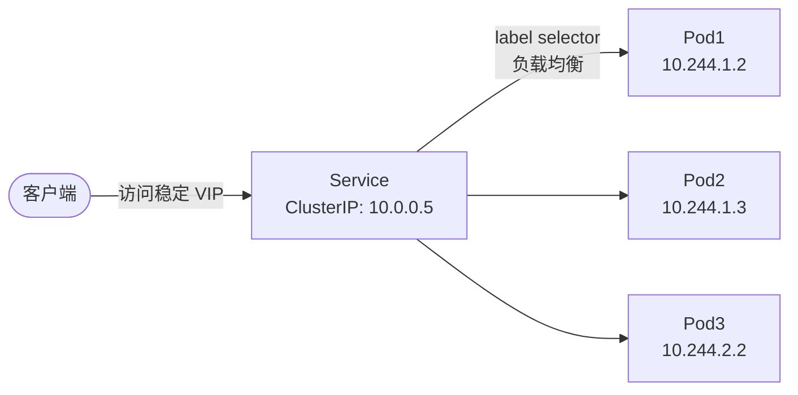

一句话理解整个网络栈：**Pod 网络解决「Pod 能互通」，Service 网络解决「Pod IP 变了还能找到它」，DNS 解决「不用记 IP」，Ingress 解决「按域名/路径分流」。**

## 二、Pod 网络模型与 CNI

K8s 网络的核心模型很简洁：**每个 Pod 一个独立 IP，Pod 间直接通信无需 NAT**。实现这套模型的就是 CNI（Container Network Interface）插件。

### K8s 网络的三层

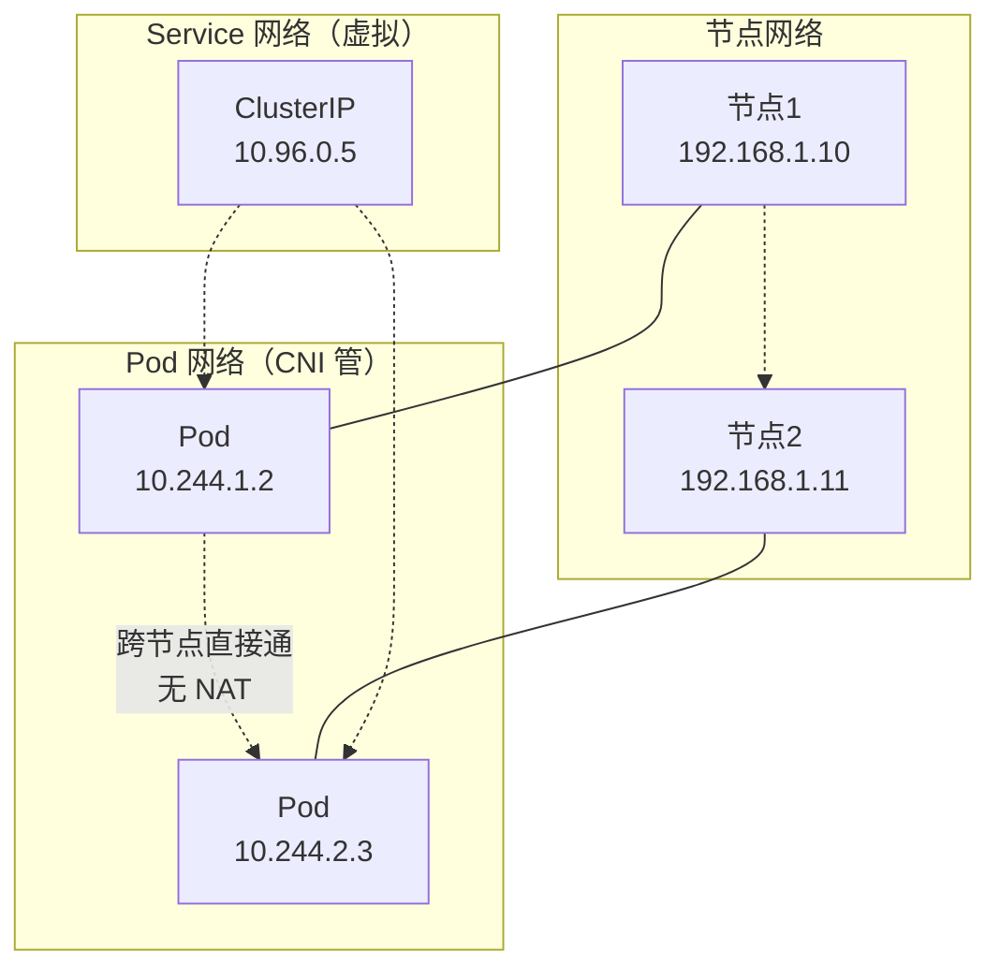

| 网络 | 性质 |
|---|---|
| **节点网络** | 机器之间真实互通的底层网络 |
| **Pod 网络** | CNI 给每个 Pod 分配的 IP 段，跨节点也要直接通 |
| **Service 网络** | 虚拟 IP，只在 kube-proxy 规则里存在，不对应任何网络接口 |

### K8s 网络模型的四条要求

1. Pod 间跨节点通信**无需 NAT**。
2. 节点上的代理（如 kubelet）能和本节点所有 Pod 通信。
3. 容器内看到的自己 IP，和别的容器看它的 IP 一致（无 NAT 转换）。
4. Service 提供稳定虚拟 IP。

### CNI：谁来给 Pod 配网络

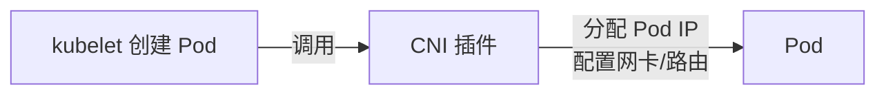

| CNI | 跨节点方案 | 特点 | NetworkPolicy |
|---|---|---|---|
| **Flannel** | VXLAN 隧道 | 简单易用，功能基础 | ❌（需额外组件） |
| **Calico** | BGP 路由 | 性能好，支持策略 | ✅ |
| **Cilium** | eBPF | 性能最佳，可观测性强，支持 L7 策略 | ✅ |

> 📌 跨节点 Pod 通信两种主流方式：**覆盖网络**（VXLAN 隧道，封装解封装有开销）和**路由**（BGP/原生路由，性能更好）。

## 三、Service —— 稳定访问入口

### 四种类型

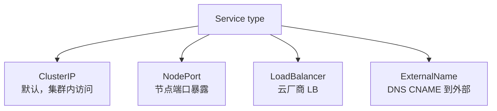

| 类型 | 暴露范围 | 说明 |
|---|---|---|
| **ClusterIP** | 集群内 | 默认；只在集群内可访问的虚拟 IP |
| **NodePort** | 集群外（节点 IP:端口） | 每个节点开一个端口（默认 30000–32767） |
| **LoadBalancer** | 公网 | 调云 API 建一个真正的云 LB（由 cloud-controller-manager 完成） |
| **ExternalName** | 外部服务 | 返回 DNS CNAME，**不代理流量**，把外部服务包装成 K8s Service |

> ⚠️ 类型是**层层叠加**的：LoadBalancer 自动包含 NodePort，NodePort 自动包含 ClusterIP。
>
> ⚠️ **ClusterIP 是虚拟 IP，ping 不通**——它没有对应任何网络接口，只在 kube-proxy 的转发规则里存在。访问它会被 DNAT 到后端 Pod。

### externalTrafficPolicy：要不要保留客户端源 IP

NodePort / LoadBalancer 收到外部流量时，是否跨节点转发由 `externalTrafficPolicy` 决定：

| 值 | 行为 | 源 IP | 代价 |
|---|---|---|---|
| **Cluster**（默认）| 可转发到任意节点的健康 Pod，可能多一跳并做 SNAT | **丢失**（看到的是节点 IP）| 负载均衡更均匀 |
| **Local** | 只转发到**本节点**的 Pod，不做 SNAT | **保留客户端 IP** | 没 Pod 的节点直接丢流量；Pod 分布不均会导致负载倾斜 |

> 📌 需要真实客户端 IP（审计、限流、WAF、灰度）就设 `Local`，但必须配合 **DaemonSet 或反亲和把 Pod 铺到每个节点**，且让云 LB 健康检查只打在有 Pod 的节点上，否则部分请求直接失败。
> ⚠️ 还有个 `internalTrafficPolicy`（集群内流量，1.24+）语义类似，别和外部这个混了。

### sessionAffinity：会话保持

默认 Service 负载均衡是随机的（每次请求可能打到不同 Pod）。设 `sessionAffinity: ClientIP` 可让**同一客户端 IP 的请求固定打到同一 Pod**（默认保持 10800s）。适用于有会话状态的应用（如带 session 的旧应用）。

### Headless Service

设 `clusterIP: None` 就是 Headless Service——**没有虚拟 IP**，DNS 直接返回后端 Pod IP 列表，客户端自己选 Pod 直连。[[02-工作负载资源]] 里的 StatefulSet 必须配 Headless Service，这样每个 Pod 才有稳定 DNS。

## 四、Endpoint / EndpointSlice —— Service 怎么找 Pod

Service 用 selector 选 Pod，但「后端到底是哪些 Pod、IP 是多少」这个事实由 **Endpoint / EndpointSlice** 记录。它是 Service 和 Pod 之间的「电话簿」。

### 三者关系

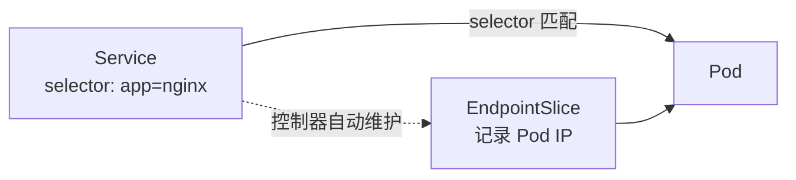

- Service 定义 `selector`，**EndpointSlice 控制器**（在 controller-manager 里）自动把匹配且就绪的 Pod IP 写进 EndpointSlice。
- Service 的 ClusterIP 流量，最终由 kube-proxy 按 EndpointSlice 里的 IP 列表转发。

### Endpoints vs EndpointSlice

| | Endpoints（旧） | EndpointSlice（新） |
|---|---|---|
| 结构 | 一个对象装所有后端 | **分片**，每片最多 100 个端点 |
| 规模 | 大集群时单个对象过大、更新成本高 | 增量更新，支持万级 Pod |
| 多协议 | 不支持 | 支持 IPv4/IPv6/FQDN |
| 状态 | 旧资源，仍兼容 | **1.21+ 成为默认** |

> 📌 现代 K8s 默认用 EndpointSlice，Endpoints 只是兼容遗留。新东西一律按 EndpointSlice 理解。

### readiness 决定「在不在列表里」

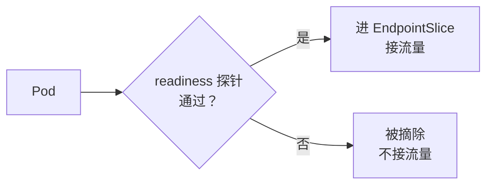

> 这就是 readiness 探针的实际作用——它直接决定 Pod 进不进 Service 后端列表，从而控制流量。

### 无 selector Service：包装外部服务

Service 不写 selector，再手动创建 Endpoint 指向外部 IP——就能把**集群外的服务**（如托管数据库）包装成一个 K8s Service，集群内像访问本地服务一样访问它。

## 五、kube-proxy 与 Service 转发

Service 只是定义，真正执行转发的是每个节点上的 kube-proxy。它 watch Service 和 EndpointSlice 变化，把转发规则写进内核。

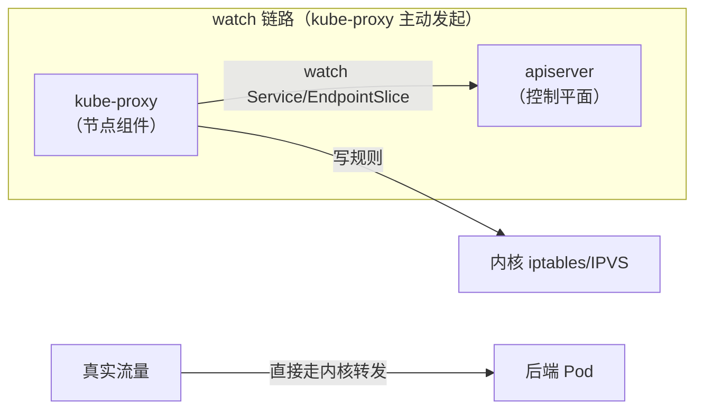

| 模式 | 原理 | 状态 |
|---|---|---|
| **userspace** | 用户态代理 | 已废弃 |
| **iptables** | 规则链转发（随机选后端） | 默认 |
| **IPVS** | 内核哈希表四层 LB（支持多种调度算法） | 大集群/高并发更优 |

> ⚠️ **kube-proxy 只写规则，真实流量走内核转发不经过它**——所以它挂了短时间内流量也不断（规则还在内核里）。规则多时 iptables 性能下降（线性匹配），IPVS 用哈希查找更稳。

## 六、CoreDNS 与服务发现

K8s 集群内置 DNS（**CoreDNS**，旧的 kube-dns 已淘汰），服务发现靠它完成：把 Service 名解析成 ClusterIP，应用直接用服务名访问。

### 解析流程

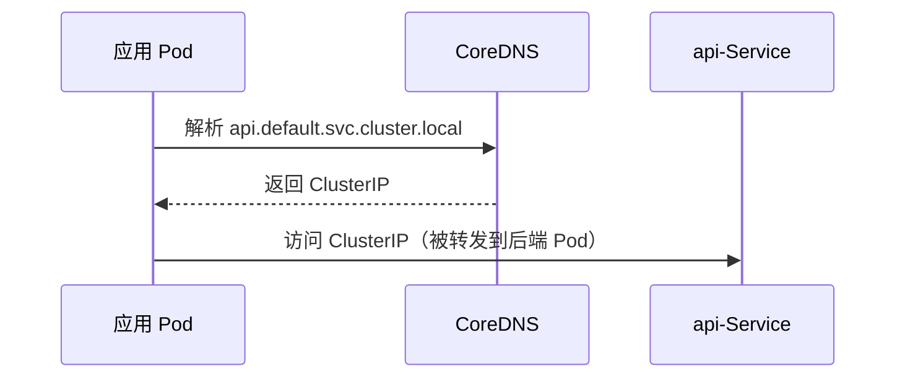

### DNS 命名规则

```
<service>.<namespace>.svc.cluster.local                          # Service
<pod-name>.<headless-service>.<namespace>.svc.cluster.local     # 仅 StatefulSet 的 Pod
```

- **同 namespace**：直接用 `api` 即可解析（有搜索域补全）。
- **跨 namespace**：用全名 `api.prod.svc.cluster.local`。

### StatefulSet Pod 级 DNS

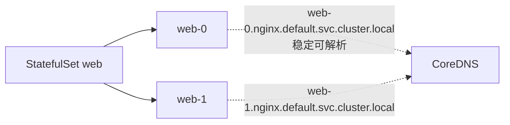

> 普通 Pod 也有 DNS（`<pod-ip>.<namespace>.pod.cluster.local`，IP 里的 `.` 换成 `-`），但 Pod 重建 IP 变了就没意义。只有 **StatefulSet 的 Pod**（稳定名 + Headless Service）DNS 才真正可用——这是主从选举、数据分片直连的基础。

### CoreDNS 本身是个 Pod

CoreDNS 以 Deployment 形式跑在 `kube-system` 命名空间，配置在 ConfigMap 里。每个 Pod 启动时 kubelet 自动把 CoreDNS 的 ClusterIP 写进 `/etc/resolv.conf`，所以应用开箱就能用服务名。

### dnsPolicy 与 ndots 坑

Pod 的 DNS 行为由 `dnsPolicy` 字段控制：

| dnsPolicy | 含义 |
|---|---|
| `ClusterFirst`（默认） | 集群内域名走 CoreDNS，外部走上游 |
| `ClusterFirstWithHostNet` | hostNetwork Pod 用集群 DNS |
| `Default` | 继承节点 DNS 配置 |
| `None` | 自定义 dnsConfig |

> ⚠️ **ndots 坑**：默认 `/etc/resolv.conf` 里 `ndots:5`，短域名（如 `api`）少于 5 个点时会**先拼搜索域**（`api.default.svc.cluster.local`）再尝试原样。导致跨 namespace 访问 `api.prod` 时会先查 `api.prod.default.svc.cluster.local`（不存在）再查 `api.prod.svc.cluster.local`——多一次无效查询。生产建议：跨 namespace 用**全限定名**（带 `.svc.cluster.local`）或用 `.` 结尾避免多次解析。

### NodeLocal DNSCache：大规模集群的 DNS 优化

万级 Pod 集群里，所有 DNS 查询都打 CoreDNS + 走 conntrack 会成瓶颈（UDP conntrack 竞争、解析延迟抖动）。做法是用 DaemonSet 在**每个节点**跑一个本地缓存：

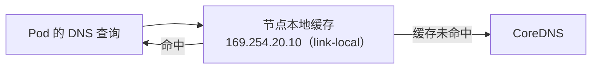

| 收益 | 说明 |
|---|---|
| 降延迟 | 命中时不出节点 |
| 减 conntrack | 绕过 DNAT 到 ClusterIP 的 UDP 连接跟踪，消除竞态丢包 |
| 减 CoreDNS 压力 | 缓存吸收大量重复查询 |

> ⚠️ 它需要修改 Pod 的 DNS 配置指向 link-local IP（通常由 DaemonSet 或 CNI 配合完成），**不是装上就自动生效**；部署前先确认与现有 CNI、NetworkPolicy 是否冲突。

## 七、Ingress 与 Gateway API —— 七层路由

Service（ClusterIP/NodePort）是四层（IP+端口）暴露；**Ingress / Gateway API** 提供**七层（HTTP 域名/路径）路由**——一个入口按域名或路径分发到不同 Service。

### Ingress：当前主流

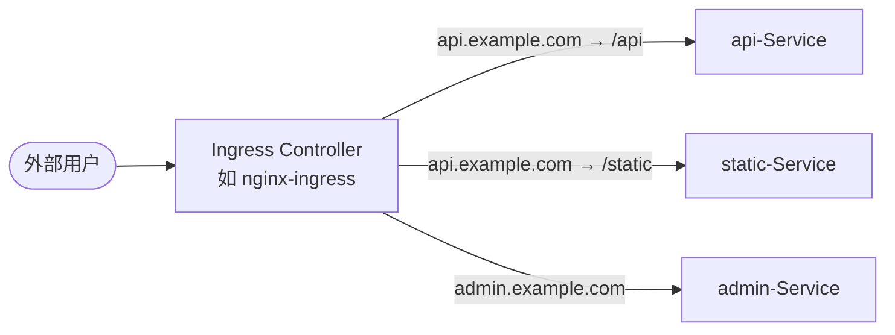

- **Ingress 是资源**（声明路由规则），**Ingress Controller 是实现**（真正干活的进程，如 nginx-ingress、traefik、haproxy-ingress）。**K8s 不自带 Controller，需自己装。**
- Ingress 只支持 **HTTP/HTTPS**。

### Ingress 的局限

- 只能 HTTP/HTTPS，不能 TCP/UDP/gRPC 路由。
- 角色耦合：集群管理员和应用开发者都在同一个 Ingress 资源上改，权限难分。

### Gateway API：继任者

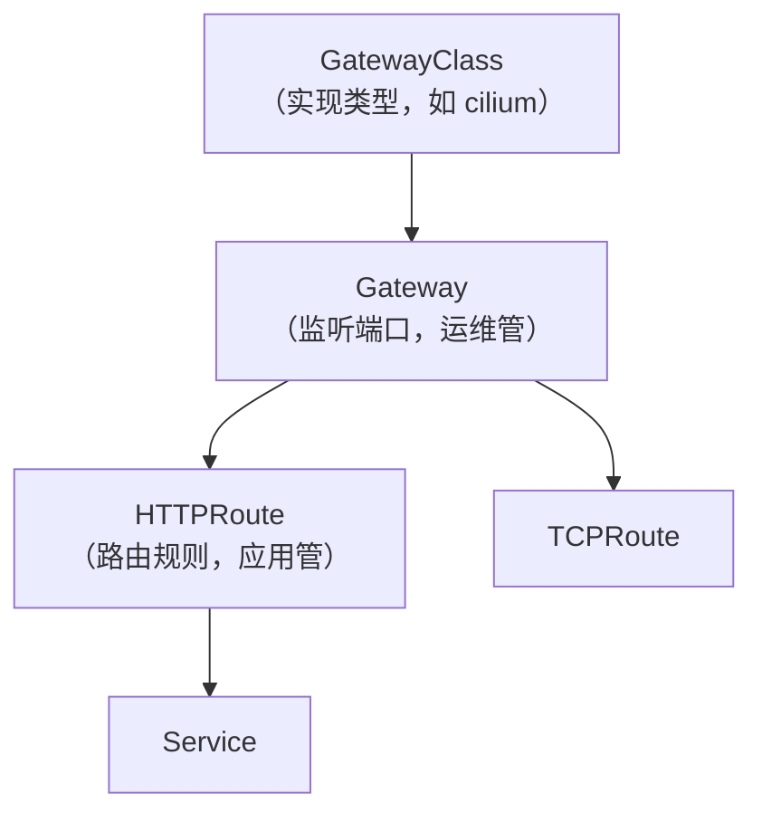

用**多个资源 + 角色分离**解决 Ingress 局限：

| 资源 | 谁管 | 干什么 |
|---|---|---|
| **GatewayClass** | 平台 | 声明用哪种实现（Cilium、Envoy…） |
| **Gateway** | 运维 | 监听哪些端口/协议 |
| **HTTPRoute / TCPRoute / GRPCRoute** | 应用 | 路由到自己的 Service |

> ⚠️ **版本敏感性**：Gateway API v1.0（2023.10）起 **Gateway 和 HTTPRoute 进入 GA**；v1.2（2024）GRPCRoute GA；**TCPRoute/UDPRoute/TLSRoute 仍在实验阶段**。
>
> 📌 Gateway API 更通用（HTTP/TCP/gRPC 都能路由）、角色清晰，是 Ingress 的官方继任方向。新项目建议直接用，老项目继续用 Ingress 也没问题。

## 八、NetworkPolicy —— Pod 间访问控制

K8s 默认**所有 Pod 之间网络全通**。NetworkPolicy 用来给 Pod 加**网络访问控制**（类似云平台的安全组）。

### 两种方向

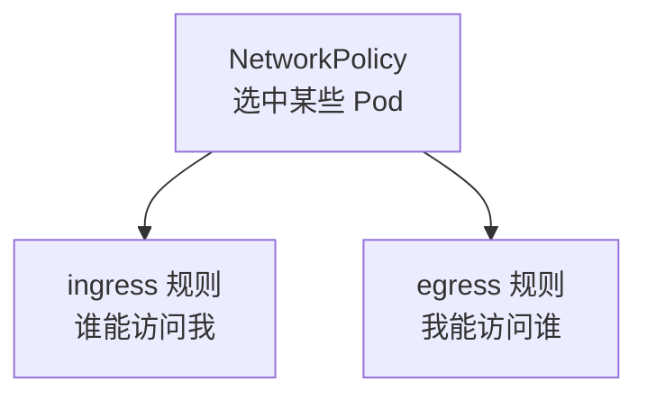

> ⚠️ **一旦某 Pod 被 NetworkPolicy 选中**，对它来说该方向就变成 **默认拒绝**，只有规则里明确允许的才通。没被选中的 Pod 仍全通。

### 规则里怎么描述「来源/目标」

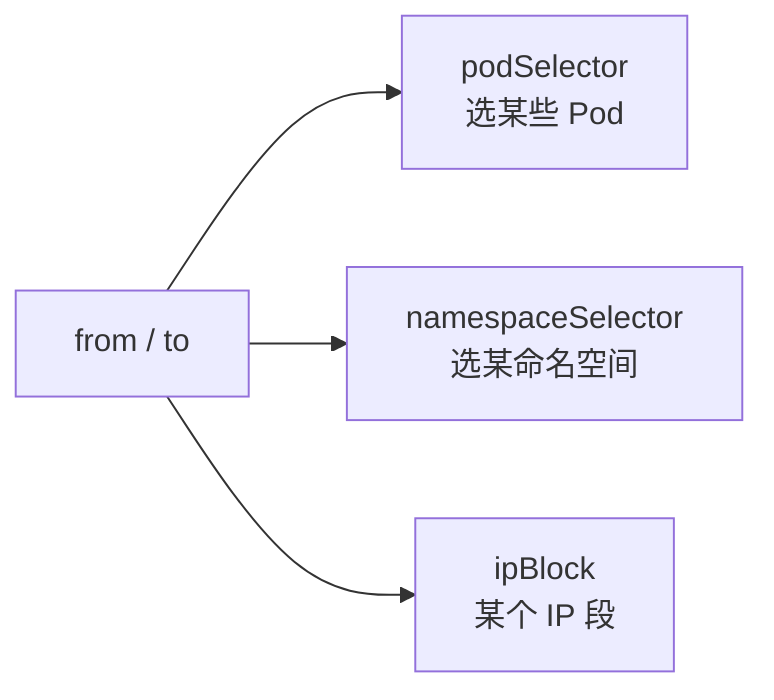

可组合：比如「只允许带 `app=frontend` 标签的 Pod，且来自 `prod` 命名空间」访问。

### 常见模式

| 模式 | 做法 |
|---|---|
| **默认 deny all** | 选 Pod + ingress/egress 都留空 → 全部禁止，再按需开白名单 |
| **数据库只允许应用访问** | 选 db Pod，ingress from app Pod |

### ⚠️ 依赖 CNI 支持

NetworkPolicy 是 K8s API，但**执行靠 CNI 插件**：

| CNI | NetworkPolicy | 备注 |
|---|---|---|
| Calico | ✅ | |
| Cilium | ✅ | 还支持 L7 策略 |
| Flannel | ❌ | 需额外组件 |

> 选 CNI 时如果需要网络隔离，必须选支持 NetworkPolicy 的。

## 九、面试高频问答 🎯

**Q1：为什么需要 Service？直接用 Pod IP 不行吗？**
Pod IP 易变（重建就变），客户端没法跟着变。Service 提供稳定 ClusterIP，背后用 label selector 负载均衡到一组 Pod，Pod 漂移/扩缩时 EndpointSlice 自动更新后端列表。

**Q2：ClusterIP 能 ping 通吗？**
不能。ClusterIP 是虚拟 IP，不对应任何网络接口，只在 kube-proxy 的转发规则里存在。访问它会被 DNAT 到后端 Pod，但 ping（ICMP）没有对应处理所以不通。

**Q3：Service 四种类型区别？**
ClusterIP（默认，集群内虚拟 IP）、NodePort（每节点开端口 30000-32767）、LoadBalancer（调云 API 建云 LB）、ExternalName（返回 DNS CNAME，不代理流量，包装外部服务）。类型层层叠加：LoadBalancer ⊃ NodePort ⊃ ClusterIP。

**Q4：Headless Service 是什么？什么时候用？**
`clusterIP: None` 的 Service，没有虚拟 IP，DNS 直接返回后端 Pod IP 列表，客户端自己选 Pod 直连。StatefulSet 必须配 Headless Service——这样每个 Pod 才有独立稳定 DNS（web-0.nginx），用于主从选举、数据分片直连。

**Q5：Endpoints 和 EndpointSlice 区别？为什么要有 EndpointSlice？**
Endpoints 是旧资源，一个对象装所有后端，大集群时单个对象过大、更新成本高。EndpointSlice 分片（每片最多 100 端点）、增量更新、支持 IPv4/IPv6/FQDN，1.21+ 成为默认。万级 Pod 场景只有 EndpointSlice 扛得住。

**Q6：Service 流量实际由谁转发？kube-proxy 挂了会断吗？**
由每个节点上的 kube-proxy 把转发规则写进内核（iptables/IPVS），真实流量走内核转发不经过 kube-proxy 进程。所以 kube-proxy 挂了短时间内流量不断（规则还在内核里），直到规则因过期或下次同步被清理才可能出问题。

**Q7：iptables 和 IPVS 模式怎么选？**
iptables 规则链线性匹配，Service 多时性能下降；IPVS 用内核哈希表查找，支持多种调度算法（rr/lc/sh 等），大集群、高并发更优。生产大集群建议 IPVS。

**Q8：Ingress 和 Service 区别？**
Service 是四层（IP+端口）暴露，Ingress 是七层（HTTP 域名/路径）路由。Ingress 本身只是声明路由规则的资源，真正干活的是 Ingress Controller（如 nginx-ingress），K8s 不自带。Ingress 只支持 HTTP/HTTPS。

**Q9：Gateway API 相比 Ingress 解决了什么？**
三个问题：① 只能 HTTP/HTTPS，不能 TCP/gRPC；② 角色耦合（管理员和应用开发者挤在一个资源上改）；③ 扩展性差。Gateway API 用 GatewayClass/Gateway/HTTPRoute 多资源 + 角色分离解决，是官方继任方向。Gateway 和 HTTPRoute 已 GA（v1.0），TCPRoute 等仍实验中。

**Q10：K8s 网络模型的核心要求？**
四条：① Pod 间跨节点通信无需 NAT；② 节点能和本节点所有 Pod 通信；③ 容器内看到的自己 IP 和别人看到的一致；④ Service 提供稳定虚拟 IP。实现这套模型靠 CNI 插件。

**Q11：CNI 怎么选？Flannel/Calico/Cilium 区别？**
Flannel（VXLAN 隧道，简单但功能基础、不支持 NetworkPolicy）；Calico（BGP 路由，性能好、支持 NetworkPolicy）；Cilium（eBPF，性能最佳、可观测性强、支持 NetworkPolicy + L7）。需要网络隔离就别选 Flannel；追求性能和可观测选 Cilium；通用稳妥选 Calico。

**Q12：NetworkPolicy 默认行为是什么？**
K8s 默认所有 Pod 间全通。一旦某 Pod 被 NetworkPolicy 选中，对它来说该方向（ingress 或 egress）就变成默认拒绝，只有规则明确允许的才通。没被选中的 Pod 仍全通。注意 NetworkPolicy 依赖 CNI 支持，Flannel 不支持。

**Q13：CoreDNS 怎么工作？应用怎么发现 Service？**
CoreDNS 以 Deployment 跑在 kube-system，配置在 ConfigMap。kubelet 给每个 Pod 的 `/etc/resolv.conf` 写入 CoreDNS 的 ClusterIP。应用访问 `api.default.svc.cluster.local` 时，CoreDNS 返回 Service 的 ClusterIP（Headless 则返回 Pod IP 列表）。同 namespace 直接用服务名即可（搜索域补全）。

## 十、关联

- 上游 → [[01-架构与组件]]（kube-proxy 组件详解）、[[02-工作负载资源]]（StatefulSet 用 Headless Service）
- 调度 → [[05-调度与资源管理]]（拓扑分布、NetworkPolicy）
- 安全 → [[06-配置与安全]]（NetworkPolicy 与 PSA 协同）
- 七层入口 → Ingress Controller 选型、Gateway API
- 机制 → [[07-API 与 Watch 机制]]（EndpointSlice 由控制器 watch 维护）
- 排查 → [[08-集群运维]]（DNS 不通、Service 无后端、日志链路）