---
tags:
  - k8s
  - storage
  - 面试
created: 2026-11-14
status: 已整理
---

# Kubernetes 存储

> 面向面试：一篇讲清 Volume 类型、CSI 接口、PV/PVC 模型、StorageClass 动态供给、StatefulSet 存储模板、快照与备份，附选型与高频问答。

## 一、为什么需要存储

Pod 是易逝的——重建后容器里的文件就没了。但很多应用（数据库、消息队列）要存数据，数据需要**独立于 Pod 的生命周期**。K8s 存储体系解决的就是「Pod 里怎么挂存储」和「数据怎么活过 Pod」。

一句话心智：**Volume 解决「Pod 里怎么挂」，PV/PVC 解决「数据怎么持久」，StorageClass 解决「持久卷怎么自动建」，CSI 解决「K8s 怎么对接各种存储」。**

## 二、Volume 类型

Pod 里挂存储的最小单位是 Volume。常见类型：

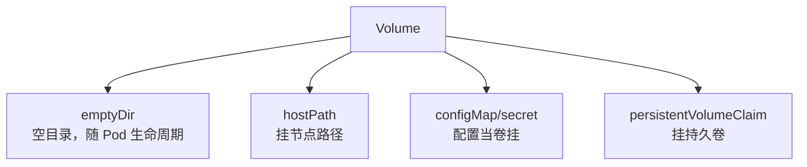

| 类型 | 生命周期 | 用途 |
|---|---|---|
| **emptyDir** | 随 Pod（Pod 删了就没） | 临时缓存、容器间共享文件 |
| **hostPath** | 在节点磁盘上 | 慎用！挂节点路径，安全风险大（生产基本禁用） |
| **configMap / secret** | 随引用的对象 | 把配置/密钥以文件形式挂进容器 |
| **persistentVolumeClaim** | 独立于 Pod | 持久数据（→ [[#四、PV 与 PVC]]） |

> ⚠️ emptyDir 默认存在节点磁盘；设 `medium: Memory` 就是 tmpfs（内存），快但占内存。
>
> ⚠️ emptyDir、hostPath、容器可写层都算 **ephemeral storage（临时存储）**，总量受节点限制。节点磁盘紧张时，按 QoS 等级和 eviction 阈值驱逐 Pod——这是生产 Pod 被 Evicted 的常见原因。

### subPath：同一卷挂不同路径

一个 Volume 可以用 `subPath` 挂到容器的不同路径——比如一个 ConfigMap 卷里有 `nginx.conf` 和 `app.conf`，用 subPath 分别挂到 `/etc/nginx/nginx.conf` 和 `/app/app.conf`，避免挂整个目录覆盖原有文件。

> ⚠️ **subPath 挂载的文件不会随 ConfigMap/Secret 热更新**（绑定挂载到具体文件）。要热更新就别用 subPath，或用符号链接技巧。

## 三、CSI —— 存储的统一接口

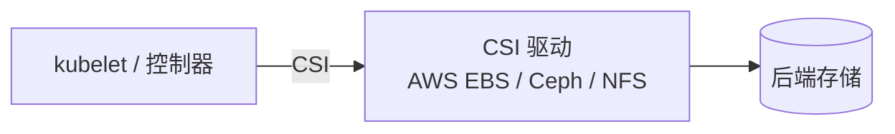

CSI（Container Storage Interface）是 K8s 调用存储的**标准接口**，三大能力：

| 能力 | 执行方 | 干什么 |
|---|---|---|
| **Provision** | 控制器侧 | 创建/删除卷 |
| **Attach / Detach** | 控制器侧 | 把卷挂到节点 |
| **Mount / Unmount** | 节点侧 | 把卷挂进容器 |

> 📌 早期的卷类型（如 `awsElasticBlockStore`、`gcePersistentDisk`）写死在 K8s 代码里（**in-tree**），维护负担重。现在都迁移到 **CSI 驱动**，K8s 核心只认 CSI，各存储厂商自己实现驱动——和 CRI/CNI 思路一致：**接口抽象解耦实现**。
>
> ⚠️ **版本敏感性**：**核心 CSI Migration 在 K8s 1.25 GA**（GCE PD / AWS EBS 同批，vSphere、Azure File 在 1.26 GA），此后 in-tree 插件逐步移除。新集群一律用 CSI；老清单里的 `awsElasticBlockStore` 等字段靠迁移层重定向到 CSI 驱动，能跑但建议改写。

## 四、PV 与 PVC —— 声明与供给分离

把「实际存储」和「用户需求」分离，让应用不用关心底层存储细节。

### 三个角色

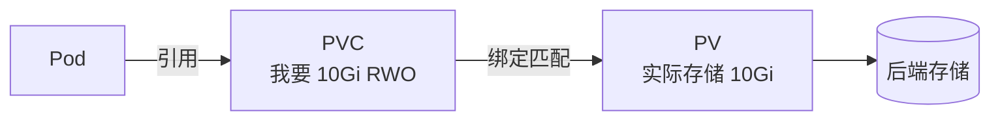

| 角色 | 层级 | 含义 |
|---|---|---|
| **PV（PersistentVolume）** | 集群级 | 一块实际的存储，由管理员或 StorageClass 创建 |
| **PVC（PersistentVolumeClaim）** | 用户级（namespace 内） | 声明「我要多大、什么访问模式」 |
| **绑定** | 控制器 | 把 PVC 和匹配的 PV 绑定，Pod 引用 PVC 就能用 |

> 📌 心智：**PVC 是「我要什么」，PV 是「实际有什么」**。应用只写 PVC，不碰 PV。

### 访问模式（accessModes）

| 模式 | 缩写 | 含义 | 备注 |
|---|---|---|---|
| ReadWriteOnce | RWO | 单节点读写 | 最常见，云盘通常只支持这个 |
| ReadOnlyMany | ROX | 多节点只读 | |
| ReadWriteMany | RWX | 多节点读写 | 需 NFS/CephFS 等支持 |
| ReadWriteOncePod | RWOP | **单 Pod** 读写 | K8s **1.22+**，比 RWO 更严格（限制 Pod 而非节点） |

> ⚠️ 访问模式描述的是**访问能力，不是性能**。RWX 必须存储后端支持，云盘通常只支持 RWO。

### PV 状态机

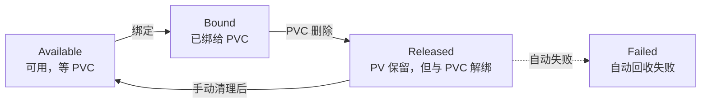

### 回收策略（reclaimPolicy）

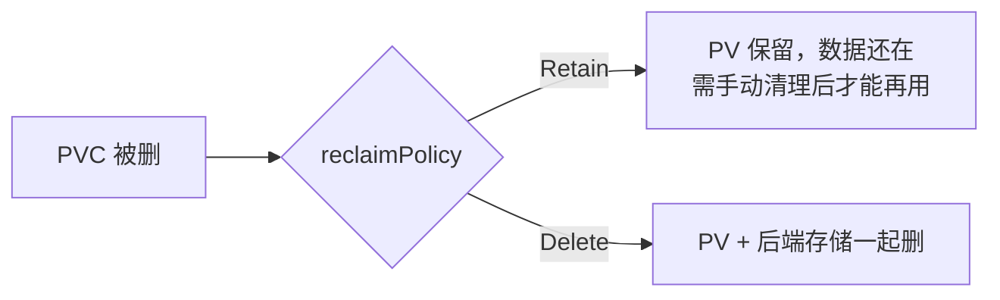

| 策略 | 行为 | 适用 |
|---|---|---|
| **Retain** | PV 保留，数据不丢，管理员手动处理 | 静态供给、重要数据 |
| **Delete** | 连后端存储一起删 | 动态供给默认 |
| Recycle | — | **已废弃** |

## 五、StorageClass 与动态供给

静态供给（管理员手动建一堆 PV 等人来用）太繁琐。**StorageClass + 动态供给**让「PVC 一申请，PV 自动建」。

### 静态 vs 动态

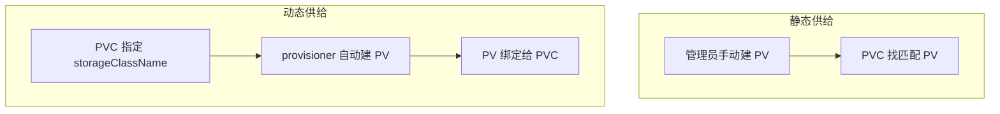

### StorageClass 字段

| 字段 | 含义 |
|---|---|
| `provisioner` | 用哪个 CSI 驱动建卷（如 `ebs.csi.aws.com`） |
| `parameters` | 规格参数（磁盘类型 `gp3`、IOPS 等） |
| `volumeBindingMode` | `Immediate`（立刻建）/ `WaitForFirstConsumer`（等 Pod 调度好再建） |
| `reclaimPolicy` | 动态建出的 PV 默认 `Delete` |

> 可以设一个**默认 StorageClass**（标注 `storageclass.kubernetes.io/is-default-class`）。PVC 不写 sc 名时自动用它。

### 为什么需要 WaitForFirstConsumer

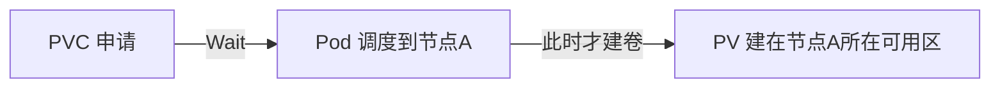

云盘通常和可用区绑定。如果 PVC 一申请就建卷，可能建在 A 区，结果 Pod 调度到 B 区——卷挂不上。`WaitForFirstConsumer` 让卷等 Pod 调度好再建，保证**拓扑一致**。

> 📌 生产建议：云盘类 StorageClass 一律用 `WaitForFirstConsumer`，避免跨可用区挂载失败。

## 六、StatefulSet 与 PVC 模板

StatefulSet 通过 `volumeClaimTemplates` 给每个 Pod 自动创建**独立的 PVC**，Pod 重启后接回原来的卷——这是「稳定存储」的实现。

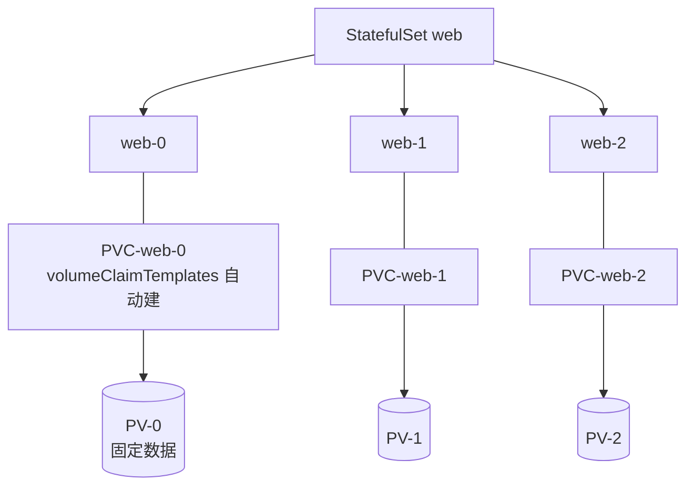

- 每个 Pod 名固定（web-0、web-1…），PVC 名也固定（`<volumeClaimTemplate>-<pod名>`）。
- Pod 重建后控制器把同名的 PVC 重新绑给它，数据连续。
- 缩容时 PVC **不自动删除**（数据保护），需手动清理。

## 七、快照与备份

存储要能「回滚到某个时间点」。K8s 有两个层面：**VolumeSnapshot**（卷级快照）和 **Velero**（集群级备份）。

### VolumeSnapshot：卷级快照

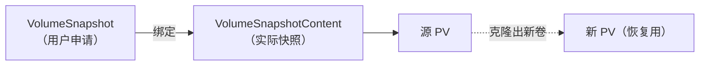

资源关系和 PV/PVC 一一对应：

| 快照侧 | 对应存储侧 |
|---|---|
| VolumeSnapshotClass | StorageClass |
| VolumeSnapshotContent | PV |
| VolumeSnapshot | PVC |

- 依赖 **CSI 快照能力**（CSI 驱动要支持 snapshot）。
- 用途：备份某个卷、从快照克隆新卷、灾难恢复。

### Velero：集群级备份

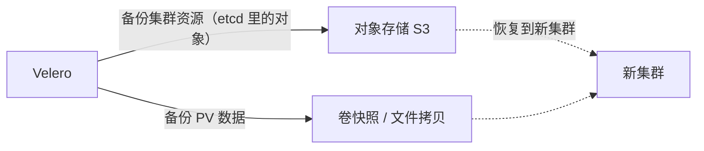

Velero 备份的是**整个集群的状态**：

- 把 etcd 里的资源对象（Deployment、Service…）导出存到对象存储。
- PV 数据通过卷快照（CSI）或文件级拷贝备份。
- 可跨集群恢复（灾备、迁移）。

### 两者区别

| | VolumeSnapshot | Velero |
|---|---|---|
| 范围 | 单个卷 | 整个集群（资源 + 卷） |
| 层级 | 存储 | 集群运维 |
| 跨集群 | 不直接支持 | 支持 |

> 📌 VolumeSnapshot 管「这块盘的某个时间点」；Velero 管「整个集群能不能在别处复活」。生产环境两者都用：Velero 做整体灾备，VolumeSnapshot 做单卷回滚。

## 八、选型决策表 🎯

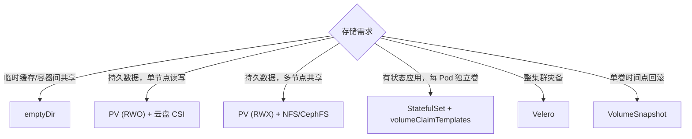

## 九、面试高频问答 🎯

**Q1：emptyDir、hostPath、PVC 区别？**
emptyDir 随 Pod 生命周期（Pod 删就没），用于临时缓存；hostPath 挂节点路径，安全风险大生产基本禁用；PVC 绑定持久卷，独立于 Pod 生命周期，Pod 重建数据还在。

**Q2：PV、PVC、StorageClass 什么关系？**
PV 是实际存储（集群级），PVC 是用户需求声明（「我要多大、什么访问模式」，namespace 内），StorageClass 是存储「产品规格」+ 自动供给逻辑（provisioner）。应用只写 PVC；静态供给时管理员手动建 PV 等匹配；动态供给时 PVC 指定 storageClassName，provisioner 自动建 PV 绑定。

**Q3：访问模式 RWO/ROX/RWX/RWOP 区别？**
RWO 单节点读写（云盘常用）、ROX 多节点只读、RWX 多节点读写（需 NFS/CephFS 支持）、RWOP 单 Pod 读写（K8s 1.22+，比 RWO 更严格，限制到 Pod 级）。⚠️ 访问模式是访问能力不是性能，RWX 必须存储后端支持。

**Q4：动态供给为什么需要 WaitForFirstConsumer？**
云盘和可用区绑定。如果 PVC 一申请就建卷，可能建在 A 区，结果 Pod 调度到 B 区——卷挂不上。WaitForFirstConsumer 让卷等 Pod 调度好再建，保证拓扑一致。生产云盘类 SC 一律用它。

**Q5：reclaimPolicy Retain 和 Delete 区别？Recycle 呢？**
Retain：PVC 删除后 PV 保留（数据不丢），需手动清理才能再用，适合重要数据/静态供给。Delete：PVC 删除时连后端存储一起删，动态供给默认。Recycle 已废弃，不要再提（面试说到「已废弃」即可）。

**Q6：CSI 是什么？解决了什么问题？**
Container Storage Interface，K8s 调用存储的标准接口，三大能力：Provision（建/删卷）、Attach/Detach（卷挂到节点）、Mount/Unmount（挂进容器）。解决早期 in-tree 插件（写死在 K8s 代码里）维护负担重的问题——**CSI Migration 1.25 GA** 后 K8s 核心只认 CSI，各厂商自己实现驱动，接口与实现解耦。

**Q7：StatefulSet 怎么实现稳定存储？缩容时 PVC 会删吗？**
通过 `volumeClaimTemplates` 给每个 Pod 自动建独立 PVC（名固定 `<template>-<pod名>`），Pod 重建后绑回同名 PVC，数据连续。⚠️ 缩容时 PVC **不自动删除**（数据保护），需手动清理——这也是 StatefulSet 缩容要小心的点。

**Q8：VolumeSnapshot 和 Velero 区别？生产怎么用？**
VolumeSnapshot 是卷级快照（单块盘的时间点），依赖 CSI 快照能力，用于单卷回滚/克隆。Velero 是集群级备份（etcd 资源对象 + PV 数据），存到对象存储，可跨集群恢复，用于整体灾备/迁移。生产两者都用：Velero 做整体灾备，VolumeSnapshot 做单卷回滚。

**Q9：Pod 被 Evicted，常见存储原因是什么？**
emptyDir、hostPath、容器可写层都算 ephemeral storage（临时存储），总量受节点磁盘限制。节点磁盘紧张时，按 QoS 等级和 eviction 阈值驱逐 Pod——这是生产 Pod 被 Evicted 的常见原因。排查看 `kubectl describe pod` 的 Events 和节点 `kubectl describe node` 的磁盘水位。

**Q10：PVC 一直 Pending 怎么排查？**
几个方向：① 没有匹配的 PV（静态供给时 accessModes/capacity 不匹配）；② StorageClass 的 provisioner 失败（看 CSI 驱动日志）；③ `WaitForFirstConsumer` 模式下还没调度到 Pod（等 Pod 调度好才会建卷）；④ 拓扑约束（可用区不够资源）。先 `kubectl describe pvc` 看 Events，再 `kubectl get sc` 确认 provisioner 和 bindingMode。

## 十、关联

- 上游 → [[01-架构与组件]]（kubelet 调 CSI 接口）、[[02-工作负载资源]]（StatefulSet 用 volumeClaimTemplates）
- 调度 → [[05-调度与资源管理]]（WaitForFirstConsumer 调度拓扑、QoS 与 ephemeral storage 驱逐）
- 灾备 → VolumeSnapshot + Velero + etcd 备份（[[08-集群运维]] 灾备节）
- 接口 → CSI 三大能力、CRI/CNI/CSI 三接口对比