---
tags:
  - k8s
  - scheduling
  - 面试
created: 2026-11-14
status: 已整理
---

# Kubernetes 调度与资源管理

> 面向面试：一篇讲清调度两阶段、亲和性/污点、拓扑分布、优先级抢占、QoS 分级、HPA/VPA、PDB，附高频问答。

## 一、调度与资源管理全景

回答三个问题：**Pod 落到哪个节点？资源怎么分？怎么伸缩？**

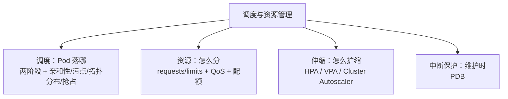

## 二、调度流程：两阶段

调度器只做一件事：给未调度 Pod 挑一个节点，写回 `nodeName`。挑节点靠两阶段算法。

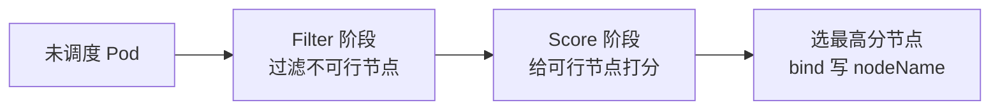

### Filter（过滤，硬性条件）

排除不满足硬性条件的节点：

- **PodFitsResources**：节点剩余资源够不够 Pod 的 requests。
- **NodeUnschedulable**：节点是否被 cordoned（`unschedulable`）。
- **NodeSelector / NodeAffinity**：标签是否匹配。
- **TaintToleration**：Pod 是否容忍节点的污点。
- **VolumeZone / VolumeTopology**：卷和节点的拓扑是否一致（→ WaitForFirstConsumer）。

### Score（打分，软性偏好）

对通过 Filter 的节点打分排序：

- **NodeResourcesBalancedAllocation**：CPU/内存越均衡分越高。
- **ImageLocality**：节点已缓存镜像加分（拉得快）。
- **PodTopologySpread**：跨域分布越均匀分越高。
- **InterPodAffinity**：符合 Pod 亲和/反亲和加分。

### Scheduling Framework

现代调度器是**插件化的框架**，把整个流程拆成扩展点：

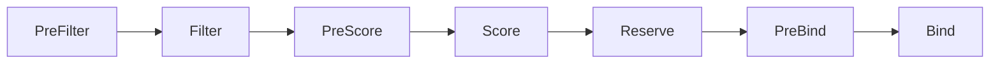

每个扩展点都能插入自定义插件，实现专属调度策略（GPU 调度、批处理调度），不用改 K8s 核心。

## 三、亲和性与污点

控制「Pod 想去哪些节点、不想去哪些节点」。两套机制：**亲和性（Affinity）**正向表达偏好，**污点/容忍（Taint/Toleration）**反向排斥。

### 亲和性三种

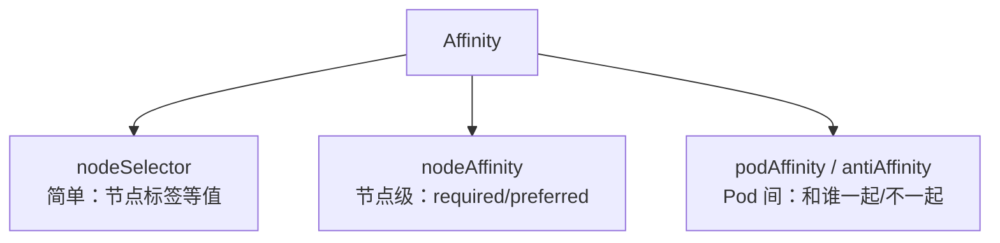

| 类型 | 作用于 | 强度 |
|---|---|---|
| **nodeSelector** | 节点标签 | 硬性（必须匹配） |
| **nodeAffinity** | 节点标签 | `required`（硬）/ `preferred`（软，带权重） |
| **podAffinity / antiAffinity** | 已有 Pod 的标签 | required / preferred |

典型用法：
- `nodeAffinity required`：把数据库 Pod 调到带 `disk=ssd` 的节点。
- `podAntiAffinity required`：同一应用副本**分散到不同节点**，避免单节点故障全挂。

### 污点与容忍（Taint / Toleration）

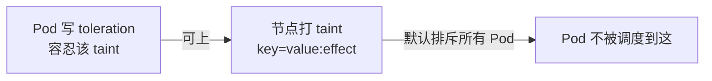

污点三种 effect：

| effect | 行为 |
|---|---|
| **NoSchedule** | 不调度新 Pod 上来（已在这的不动） |
| **PreferNoSchedule** | 尽量不调度（软） |
| **NoExecute** | 把不容忍的 Pod **直接驱逐** |

典型用法：
- master 节点打 `node-role.kubernetes.io/control-plane:NoSchedule`，业务 Pod 上不来。
- 节点出问题打 `node.kubernetes.io/not-ready:NoExecute`，Pod 被驱逐。

> 📌 **tolerationSeconds**：Pod 写 toleration 时可设 `tolerationSeconds`——被 NoExecute 污点命中后**延迟这么久才被驱逐**。常用于「节点短暂抖动时不急着跑」，给 Pod 一个缓冲期（如设 300s，节点 5 分钟内恢复就不被驱逐）。

> ⚠️ **版本敏感性**：master taint 在 K8s **1.24** 从 `node-role.kubernetes.io/master` 改为 `control-plane`（1.24 前 master 也保留作兼容，1.24 后逐步移除）。

> 📌 亲和性是「Pod 表达想去哪」；污点是「节点表达排斥谁」。常配合：污点划大类（master 不跑业务），亲和性精细定向（业务指定 zone）。

## 四、拓扑分布约束

`topologySpreadConstraints` 让 Pod **跨故障域（zone/rack/节点）均匀分布**，避免一个应用副本全堆在一个域里——单域故障就全挂。

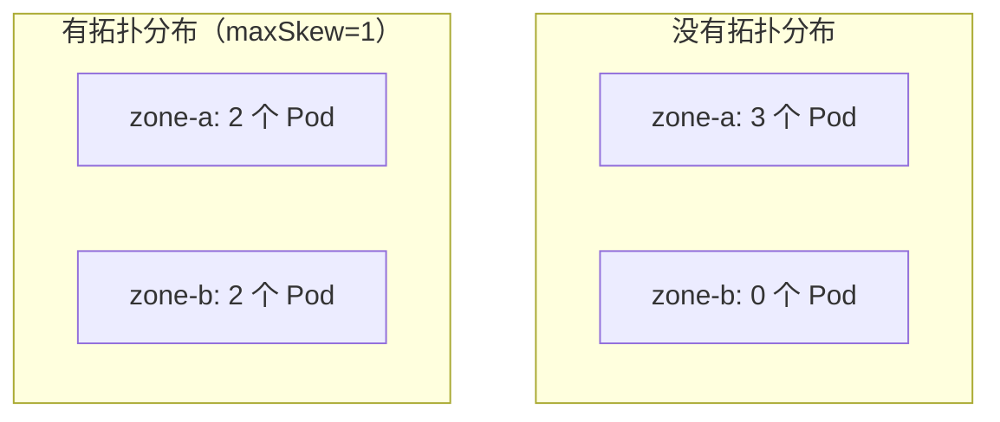

| 参数 | 含义 |
|---|---|
| **maxSkew** | 各域之间数量差的最大容忍值（如 `1` 表示最多差 1 个） |
| **topologyKey** | 按什么拓扑域分布（`topology.kubernetes.io/zone`、`kubernetes.io/hostname`） |
| **whenUnsatisfiable** | `DoNotSchedule`（硬性）/ `ScheduleAnyway`（软性） |
| **labelSelector** | 要分布的是哪些 Pod（本应用的） |

### 和 podAntiAffinity 的区别

| | podAntiAffinity | topologySpreadConstraints |
|---|---|---|
| 目标 | 别和某些 Pod 在一起 | 各域数量均衡 |
| 粒度 | 二元（在/不在） | 可控的「差值」 |

> 📌 podAntiAffinity 只能说「别去已有同 Pod 的节点」，太粗；拓扑分布能精确控制「各域最多差几个」，更灵活。生产**跨可用区高可用**首选拓扑分布。

## 五、优先级与抢占

资源不够、高优 Pod 调度不上时，调度器会**驱逐（抢占）一些低优 Pod**给高优 Pod 腾位置。

### PriorityClass：给 Pod 定优先级

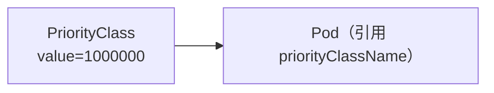

- `PriorityClass` 是集群级资源，定义一个整数优先级（越大越优先）。
- Pod 在 `priorityClassName` 里引用。
- 系统内置两个：`system-cluster-critical`、`system-node-critical`（给关键组件如 kube-proxy、CNI）。

### 抢占流程

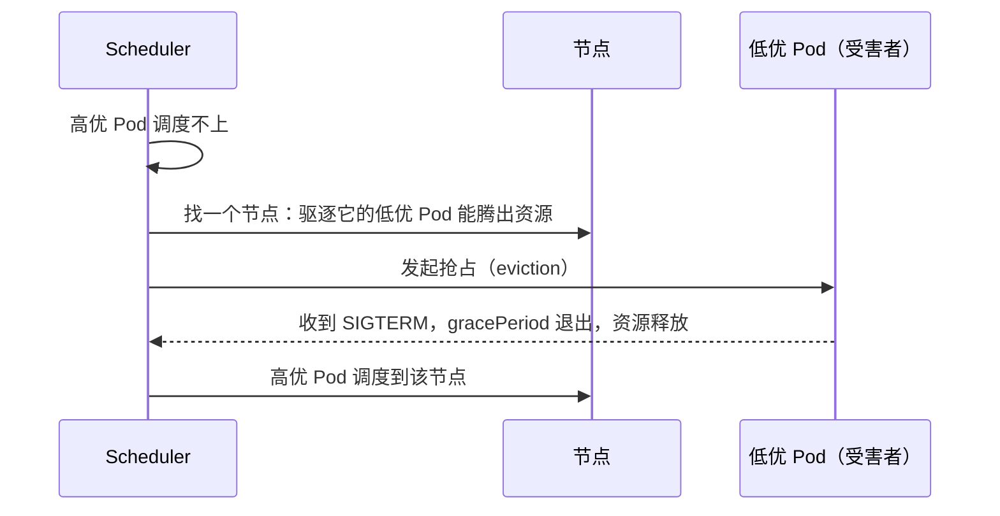

### 抢占的约束

- 只抢**优先级更低**的 Pod。
- 抢占受 [[#九、PDB]] 约束——如果驱逐受害者会违反它的 PDB，调度器尽量避开。
- 抢占有**优雅期**：受害者先收到 SIGTERM（给 `terminationGracePeriodSeconds` 退出），高优 Pod 才会被真正调度上去。

> ⚠️ 抢占用得不好会引发**抢占风暴**（被驱逐的低优 Pod 又重新调度，再抢占别人）。务必配合 PDB 和合理的优先级梯度。

## 六、资源 requests/limits 与 QoS

每个 Pod 应设 `resources.requests`（保障量）和 `limits`（上限）。这两个值决定 Pod 的 **QoS 等级**，进而决定节点压力时**谁先被驱逐**。

### requests vs limits

| 字段 | 作用 | 超了怎样 |
|---|---|---|
| **requests** | 调度依据，节点要满足这么多才让 Pod 上 | — |
| **limits** | 运行上限 | CPU 超了**限流（throttle）**；内存超了 **OOMKilled** |

> ⚠️ CPU 是可压缩资源（超了限流，不杀进程）；内存是不可压缩资源（超了直接 OOM 杀进程）。这是关键区别。

### QoS 三等级

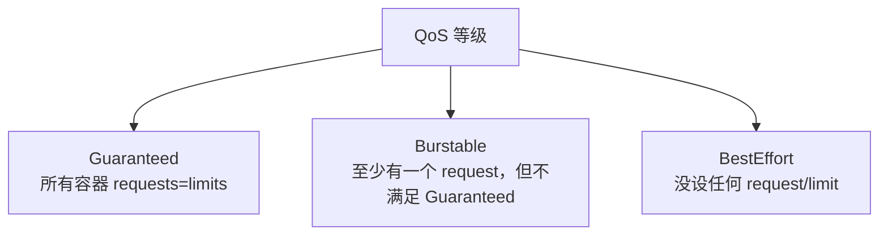

| 等级             | 判定                                | 节点压力时     |
| -------------- | --------------------------------- | --------- |
| **Guaranteed** | **所有容器** CPU+内存的 requests==limits | 最后被驱逐     |
| **Burstable**  | 有 requests 但不等于 limits            | 中间        |
| **BestEffort** | 完全没设                              | **最先被驱逐** |

> 📌 Guaranteed 的精确判定：**每个容器**都设了 CPU 和内存，且 requests=limits。只设部分容器或只设部分资源都不算 Guaranteed。想让关键 Pod 最稳，把它设成 Guaranteed（requests 和 limits 设成一样的值）。

### 节点压力驱逐

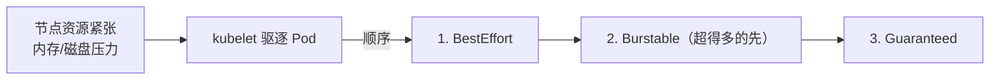

### 底层实现：CPU 限流 vs 内存 OOM

| 资源 | 内核机制 | 超了会怎样 |
|---|---|---|
| **CPU**（可压缩）| cgroup CFS quota：v1 为 `cpu.cfs_quota_us / cpu.cfs_period_us`（v2 为 `cpu.max`），`limits.cpu=1` ≈ 每 100ms 周期最多用 100ms | **被限流（throttling）**，进程变慢但不会死，表现为延迟毛刺、P99 飙升 |
| **内存**（不可压缩）| cgroup `memory.limit_in_bytes` / v2 `memory.max` | 内核 OOM killer 杀容器，状态 `OOMKilled` |

> 📌 **运维高频坑**：给 Go / Java 服务设很小的 CPU limit（如 `100m`）会造成严重 throttling——CPU 使用率看着不高，RT 却飙高。排查看 `container_cpu_cfs_throttled_periods_total / container_cpu_cfs_periods_total`；低延迟服务可考虑**只设 requests、放宽或不设 CPU limit**（需评估超卖风险，连本节 QoS）。
> ⚠️ `requests` 只影响**调度**与 CFS share 权重（竞争时的分配比例），不是硬上限；`limits` 才是硬约束。

## 七、命名空间级配额

| 资源                | 作用                                                               |
| ----------------- | ---------------------------------------------------------------- |
| **ResourceQuota** | 限制一个 namespace 能用多少 CPU/内存/存储/Pod 数                              |
| **LimitRange**    | 给 namespace 设默认 request/limit 和单 Pod 上限（没设 resources 的 Pod 用默认值） |

> 用途：多租户/多团队共享集群时，用 ResourceQuota + LimitRange 给每方划资源边界。

## 八、自动伸缩 HPA / VPA / Cluster Autoscaler

K8s 三个方向的伸缩：

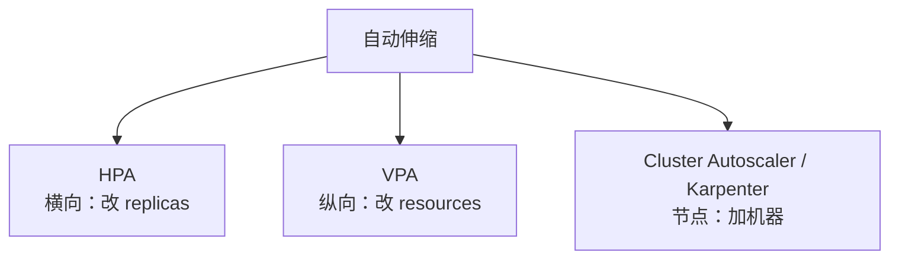

| | 调什么 | 触发依据 |
|---|---|---|
| **HPA** | Deployment/RS 的 `replicas` | CPU/内存/自定义指标 |
| **VPA** | Pod 的 `resources.requests` | 历史/实时资源用量 |
| **Cluster Autoscaler** | 节点数 | 有 Pod 因资源不足 Pending |

### HPA（最常用）

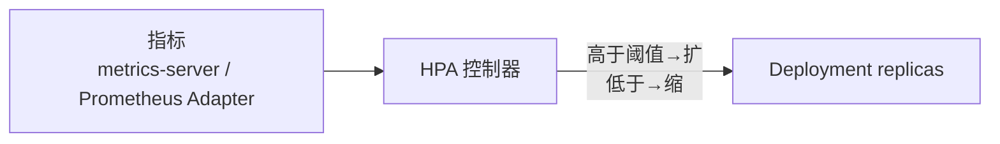

- 依赖**指标来源**：CPU/内存需 metrics-server；自定义指标需 Prometheus Adapter。
- **HPA v2**（`autoscaling/v2`）支持多指标、最小/最大副本数、稳定窗口（防抖）。

> ⚠️ **版本敏感性**：HPA `autoscaling/v2` 在 K8s **1.23 GA**；`v2beta1`/`v2beta2` 已废弃。
>
> ⚠️ HPA 用 CPU/内存时，**Pod 必须设 `resources.requests`**——HPA 算的是「实际用量占 request 的比例」，没 request 就没法算。

### VPA

- 调整 Pod 的 requests（让 Pod 拿到更合适的资源量）。
- 默认模式 `Recreate`：改资源要**重建 Pod**。
- K8s **1.27 alpha** 引入 InPlacePodVerticalScaling，支持**原地改**（不重启）；该特性长期处于实验阶段，生产以目标集群 `kubectl explain` 为准，别默认可用。

> ⚠️ HPA 和 VPA **不能同时管 CPU/内存**——会打架。一般横向用 HPA，纵向只管那些无法横向扩的有状态应用。

### Cluster Autoscaler vs Karpenter

| | Cluster Autoscaler | Karpenter |
|---|---|---|
| 模型 | 模拟 node group 扩缩 | 直接按 Pod 需求开机 |
| 速度 | 慢（走云 ASG） | 快（直接调云 API） |
| 来源 | K8s SIG | AWS 主导（已扩展多云） |

## 九、PDB —— Pod 中断预算

PDB（PodDisruptionBudget）保证**自愿中断时，应用至少有 N 个 Pod 还活着**——防止一次维护把某应用打挂。

### 自愿 vs 非自愿中断

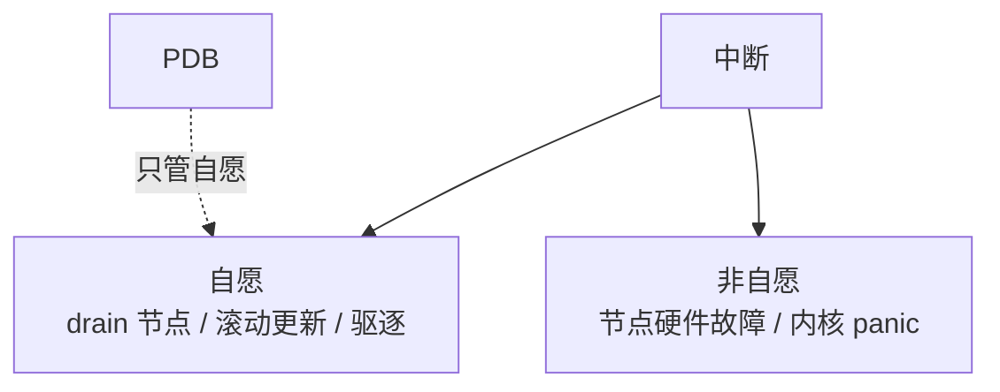

> ⚠️ **PDB 只管自愿中断**。节点突然宕机这种非自愿的，PDB 拦不住——那要靠副本数和拓扑分布约束。

### PDB 怎么起作用

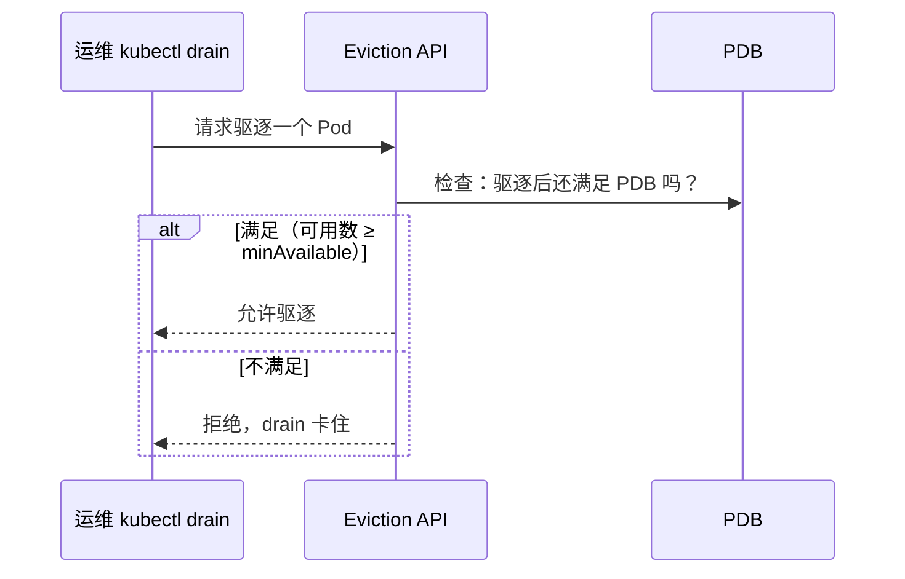

PDB 用 `minAvailable` 或 `maxUnavailable` 之一（互斥，可为整数或百分比）：

- `minAvailable: 2`：至少保持 2 个可用。
- `maxUnavailable: 1`：最多同时中断 1 个。

### 配合场景

| 场景 | PDB 作用 |
|---|---|
| Deployment 滚动更新 | 保证更新期间可用副本数 |
| drain 节点维护 | 防止一次摘太多 Pod |
| 优先级抢占 | 抢占受害者也受 PDB 保护 |

## 十、面试高频问答 🎯

**Q1：调度器怎么挑节点？两阶段是什么？**
Filter（过滤）排除不满足硬性条件的节点（资源不够、污点不容忍、nodeSelector 不匹配、卷拓扑不一致）；Score（打分）对剩余节点排序（资源越均衡分越高、镜像已缓存加分、跨域分布越均匀分越高）。最后选最高分节点 bind 写 nodeName。现代调度器是 Scheduling Framework，每个扩展点可插自定义插件。

**Q2：nodeSelector、nodeAffinity、podAntiAffinity 区别？**
nodeSelector 最简单（节点标签等值，硬性）；nodeAffinity 更强（支持 required 硬/preferred 软+权重，支持集合匹配）；podAntiAffinity 作用于已有 Pod（让副本分散到不同节点）。生产跨可用区高可用首选 topologySpreadConstraints，比 podAntiAffinity 更灵活（可控差值）。

**Q3：污点三种 effect 区别？master 节点靠什么阻止业务 Pod？**
NoSchedule（不调度新 Pod，已在这的不动）、PreferNoSchedule（尽量不调度，软）、NoExecute（把不容忍的 Pod 直接驱逐）。master 节点打 `node-role.kubernetes.io/control-plane:NoSchedule` taint，业务 Pod 不写 toleration 就上不来。⚠️ 注意 1.24 起 taint key 从 `master` 改为 `control-plane`。

**Q4：QoS 三等级怎么判定？谁先被驱逐？**
Guaranteed（所有容器 CPU+内存 requests=limits，最后被驱逐）；Burstable（有 requests 但不等于 limits，中间）；BestEffort（完全没设，最先被驱逐）。判定要点：必须**每个容器**都设了 CPU 和内存且 requests=limits 才是 Guaranteed。想让关键 Pod 最稳就设成 Guaranteed。

**Q5：CPU 和内存的 limits 超了分别怎样？**
CPU 超了**限流（throttle）**——CPU 是可压缩资源，不杀进程只是变慢；内存超了 **OOMKilled**——内存是不可压缩资源，直接杀进程。这是关键区别，面试常考。

**Q6：HPA 怎么工作？为什么我的 HPA 不生效？**
HPA 控制器根据指标（CPU/内存需 metrics-server，自定义需 Prometheus Adapter）算「实际用量占 request 的比例」，超过阈值扩 replicas、低于缩。HPA 不生效常见原因：① Pod 没设 `resources.requests`（HPA 算不了比例）；② metrics-server 没装或挂了；③ 用了废弃的 `autoscaling/v2beta1`（应改 `v2`，1.23 GA）。

**Q7：HPA 和 VPA 能同时用吗？**
不能同时管 CPU/内存——会打架（HPA 改 replicas，VPA 改 requests，互相干扰）。一般横向用 HPA，纵向只管那些无法横向扩的有状态应用。VPA 默认 Recreate 模式要重建 Pod，K8s 1.27+ 的 InPlacePodVerticalScaling 支持原地改。

**Q8：优先级抢占怎么工作？有什么风险？**
高优 Pod 调度不上时，调度器找一个节点：驱逐它的低优 Pod 能腾出资源。受害者先收 SIGTERM 给 gracePeriod 退出，高优 Pod 才真正调度上去。抢占受 PDB 约束（会违反 PDB 就尽量避开）。风险是**抢占风暴**——被驱逐的低优 Pod 又重新调度再抢占别人，需配合 PDB 和合理优先级梯度。

**Q9：PDB 保护什么？节点宕机它管吗？**
PDB 只管**自愿中断**（drain、滚动更新、驱逐），保证自愿中断时应用至少有 N 个 Pod 活着。**不管非自愿中断**（节点硬件故障、内核 panic）——那要靠副本数和拓扑分布约束。PDB 用 minAvailable 或 maxUnavailable 之一，可为整数或百分比。

**Q10：拓扑分布约束和 podAntiAffinity 区别？生产用哪个？**
podAntiAffinity 是二元（在/不在），只能说「别去已有同 Pod 的节点」，太粗；topologySpreadConstraints 可控「各域最多差几个」（maxSkew），更灵活。生产跨可用区高可用首选拓扑分布（配合 `topology.kubernetes.io/zone`）。

**Q11：节点资源紧张时驱逐顺序？**
kubelet 按 QoS 驱逐：先 BestEffort，再 Burstable（超 request 多的先），最后 Guaranteed。这是为什么关键 Pod 要设成 Guaranteed——不仅调度有保障，压力时也最后被驱逐。

## 十一、关联

- 上游 → [[01-架构与组件]]（Scheduler 组件、Scheduling Framework）、[[02-工作负载资源]]（Deployment 滚动更新与 PDB）
- 资源 → requests/limits、QoS、ResourceQuota/LimitRange
- 伸缩 → HPA v2、VPA、Cluster Autoscaler/Karpenter
- 中断 → PDB、抢占 gracePeriod、节点 drain（[[08-集群运维]] 升级维护）