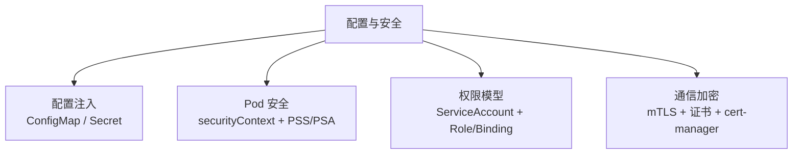
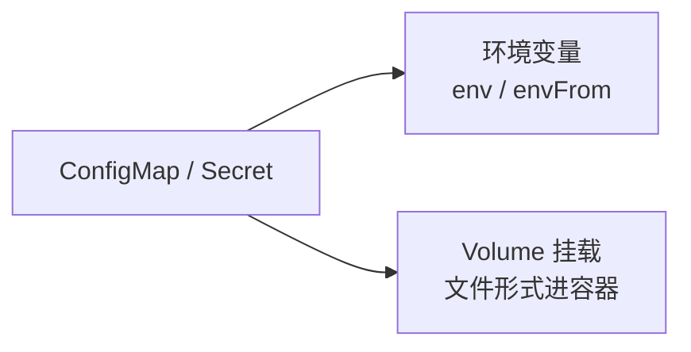
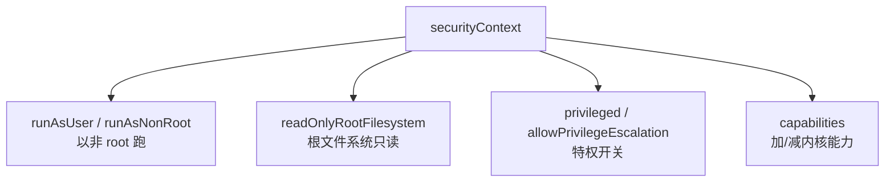
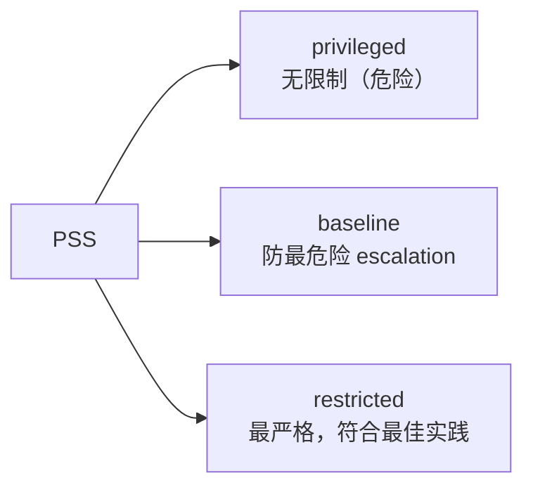
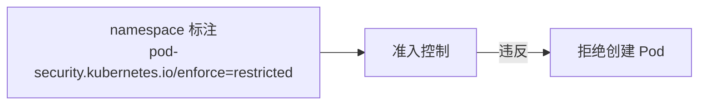
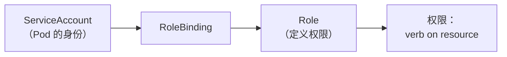
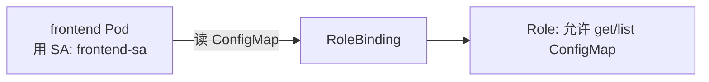
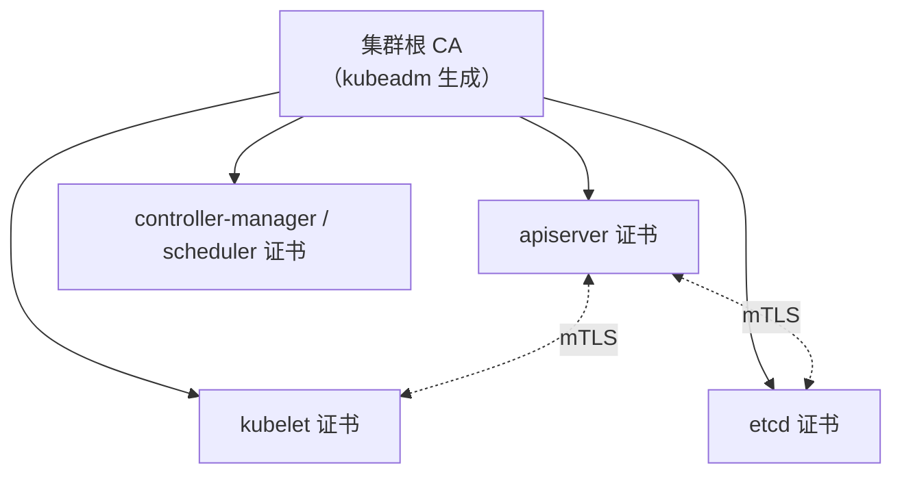
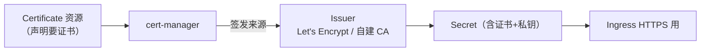

---
tags:
  - k8s
  - security
  - 面试
created: 2026-11-14
status: 已整理
---

# Kubernetes 配置与安全

> 面向面试：一篇讲清 ConfigMap/Secret、SecurityContext、PSS/PSA、RBAC/ServiceAccount、证书与 TLS，附安全加固清单与高频问答。

## 一、配置与安全全景

四个层面：

一句话心智：**配置走 ConfigMap，密钥走 Secret（注意默认不加密）；Pod 危险性靠 SecurityContext 限制；命名空间级靠 PSA；权限靠 RBAC；组件通信靠 mTLS。**

## 二、ConfigMap 与 Secret

把配置和敏感数据从镜像里抽出来，用 K8s 资源管理，应用只引用。ConfigMap 存普通配置，Secret 存敏感数据。

### 两种注入方式

| 方式 | 特点 |
|---|---|
| **环境变量** | `envFrom` 一次性灌入所有 key，或 `valueFrom` 单个引用；**Pod 启动后不变** |
| **Volume 挂载** | 每个 key 变成一个文件；**支持热更新**（应用需自己 reload） |

> ⚠️ **subPath 挂载的文件不会热更新**——这是个常见坑。要热更新就别用 subPath，或用符号链接技巧。
>
> 📌 kubelet 会周期性（默认 10s）重新同步挂载的 ConfigMap/Secret，所以 Volume 方式能热更新。需要动态配置的优先用 Volume + 应用 watch/reload（如 signal SIGHUP）。

### Secret ≠ 加密

> ⚠️ **Secret 默认只是 base64 编码，不是加密！** base64 谁都能解码，别以为放进 Secret 就安全了。

要真正加密，需开启 **etcd 静态加密**（`EncryptionConfiguration`），让 Secret 在 etcd 里以密文存储（K8s 1.13+ 支持）。

### Secret 常见类型

| 类型 | 用途 |
|---|---|
| `Opaque` | 通用键值（最常用） |
| `kubernetes.io/dockerconfigjson` | 拉私有镜像的认证 |
| `kubernetes.io/tls` | TLS 证书+私钥（给 Ingress） |
| `kubernetes.io/service-account-token` | SA token（**1.24 前自动创建，之后改为投影卷**） |

### imagePullSecrets：拉私有镜像

Pod 用 `imagePullSecrets` 引用一个 `kubernetes.io/dockerconfigjson` 类型的 Secret，kubelet 拉私有仓库镜像时用它认证。也可在 ServiceAccount 上设 `imagePullSecrets`，该 SA 下的所有 Pod 自动带上——推荐做法，避免每个 Pod 重复配。

### immutable ConfigMap/Secret

K8s **1.21+** 支持 `immutable: true`。设了之后内容不可改（要改只能重建），但 kubelet 不再 watch，**减少 apiserver 负担**。不常变的配置建议设 immutable。

## 三、Pod 安全与 SecurityContext

控制「Pod 能做多危险的事」——能不能用 root、能不能特权、能不能改内核能力。靠 **securityContext**（细粒度）和 **Pod Security Standards**（命名空间级策略）两套。

### securityContext：容器/Pod 级设置

关键实践（最小权限）：

- `runAsNonRoot: true`——禁止 root 运行。
- `readOnlyRootFilesystem: true`——根目录只读，写入只到挂载的卷。
- `drop: [ALL]` 再按需 `add`——砍掉所有内核能力，只留必需的。
- `allowPrivilegeEscalation: false`——禁止子进程提权。

### Pod Security Standards（PSS）

命名空间级的三档安全策略：

| 等级 | 限制 |
|---|---|
| **privileged** | 基本不限（只在必要时用，如 CNI） |
| **baseline** | 禁止特权、禁止 hostPath 滥用等 |
| **restricted** | 必须 non-root、只读根 FS、砍 capabilities 等 |

### Pod Security Admission（替代 PSP）

- 在 namespace 上标注 `enforce/audit/warn=<级别>`。
- `enforce` 违反直接拒绝；`audit` 记日志；`warn` 返回警告。

> ⚠️ **版本敏感性**：**PSP（PodSecurityPolicy）在 1.21 deprecated，1.25 移除**，被 **PSA（Pod Security Admission）取代**。PSA 1.23 beta、**1.25 GA**。新集群一律用 PSA，别再提 PSP。

## 四、RBAC 与 ServiceAccount

K8s 的权限模型：**ServiceAccount（身份）+ Role（权限）+ Binding（绑定）**。谁（SA）能对什么资源做什么操作。

### 三个角色

| 资源 | 范围 |
|---|---|
| **ServiceAccount** | Pod 的身份。每个 Pod 引用一个 SA，调 apiserver 时用它认证。每个 namespace 有个默认 SA（`default`） |
| **Role** | **命名空间级**（只管本 ns 的资源） |
| **ClusterRole** | **集群级**（管集群范围资源如 nodes；也可用于跨 ns） |
| **RoleBinding** | 绑 Role（本 ns）或 ClusterRole（限定到本 ns） |
| **ClusterRoleBinding** | 绑 ClusterRole（全集群生效） |

### 一个例子

> 📌 **最小权限原则**：给每个应用建专属 SA，只绑它真正需要的权限，别用 `default` SA 跑生产应用。

### ServiceAccount Token 的演进

| 版本 | Token 机制 |
|---|---|
| **1.24 前** | 创建 SA 时自动生成一个 `kubernetes.io/service-account-token` 类型的 Secret，token 永不过期 |
| **1.24+** | **改为投影卷（projected）**——TokenRequest API 生成，**有过期时间、自动轮转**，不再自动生成永久 token Secret |

> ⚠️ **版本敏感性**：1.24+ 升级后，老的 SA token Secret 仍可用但不再自动创建新 SA 的 token Secret。Pod 通过投影卷（`projected` volume，`serviceAccountToken` 源）拿 token，更安全。

## 五、证书管理与 TLS

K8s 控制平面组件之间用 **mTLS（双向 TLS）** 通信。理解证书体系是排障和给 Ingress 配 HTTPS 的基础。

### 集群证书信任关系

- 集群有一个**根 CA**，所有组件证书都由它签发。
- apiserver ↔ kubelet、apiserver ↔ etcd 都是双向 TLS。
- kubelet 默认开启**证书轮转**（`rotateCertificates`，1.19+ 默认 true），快过期时自动换新，不用人工续。

### 证书过期 = 集群挂

> ⚠️ 控制平面证书默认有效期 1 年。**过期后组件无法通信，整个集群停摆**。kubeadm 提供 `kubeadm certs check-expiration` 检查、`kubeadm certs renew` 续期。

### cert-manager：自动签发证书

- cert-manager 是第三方控制器，自动签发和续期证书。
- 给 Ingress 配 HTTPS 几乎是标配。
- 支持公网证书（Let's Encrypt，ACME）和内部证书（自建 CA）。

### SA token（相关但不是 TLS 证书）

Pod 调 apiserver 用的是 **ServiceAccount JWT token**（由 apiserver 的私钥签名，不是 X.509 证书）。现代 K8s 用**投影 token（projected）**——有过期时间、自动轮转，比老式挂载 token 更安全。

## 六、安全加固清单（生产必备）🎯

| 层面         | 措施                                                                                 |
| ---------- | ---------------------------------------------------------------------------------- |
| **Pod 安全** | `runAsNonRoot: true` + `readOnlyRootFilesystem: true` + `drop: [ALL]` capabilities |
| **命名空间**   | 标注 `pod-security.kubernetes.io/enforce=restricted`（PSA）                            |
| **权限**     | 每应用专属 SA，最小权限绑定；禁用 `default` SA 跑生产                                                |
| **Secret** | 开启 etcd 静态加密；敏感配置用 External Secrets / Sealed Secrets                               |
| **网络**     | NetworkPolicy 默认 deny，按需开白名单（依赖 Calico/Cilium）                                     |
| **镜像**     | 镜像扫描（Trivy）、签名验证、禁用 `:latest` tag                                                  |
| **证书**     | kubelet 证书轮转；cert-manager 自动续期 Ingress 证书                                          |
| **审计**     | 开启 audit log，记录 apiserver 操作                                                       |

## 七、面试高频问答 🎯

**Q1：ConfigMap 和 Secret 区别？Secret 安全吗？**
ConfigMap 存普通配置，Secret 存敏感数据。⚠️ Secret 默认只是 base64 编码，不是加密——base64 谁都能解码。要真正加密需开启 etcd 静态加密（EncryptionConfiguration）。

**Q2：ConfigMap 怎么注入 Pod？能热更新吗？**
两种：环境变量（env/envFrom，Pod 启动后不变）和 Volume 挂载（每个 key 变文件，支持热更新）。kubelet 周期性（默认 10s）同步挂载的 ConfigMap。⚠️ subPath 挂载的文件不热更新——这是个坑。需要动态配置的优先 Volume + 应用 reload。

**Q3：SecurityContext 怎么限制 Pod 危险性？生产怎么配？**
runAsNonRoot（禁止 root）、readOnlyRootFilesystem（根目录只读）、capabilities drop ALL 再按需 add、allowPrivilegeEscalation: false。生产标准：non-root + 只读根 FS + 砍 capabilities，配合 PSA restricted 级强制。

**Q4：PSS 和 PSA 是什么？PSP 去哪了？**
PSS（Pod Security Standards）是三档安全策略（privileged/baseline/restricted）；PSA（Pod Security Admission）是执行机制，在 namespace 标注 enforce/audit/warn。⚠️ PSP（PodSecurityPolicy）1.21 deprecated、**1.25 移除**，被 PSA 取代（PSA 1.25 GA）。新集群一律用 PSA。

**Q5：RBAC 模型？Role 和 ClusterRole 区别？**
ServiceAccount（身份）+ Role（权限）+ Binding（绑定）。Role 是命名空间级（只管本 ns），ClusterRole 是集群级（管 nodes 等集群资源，也可跨 ns）。RoleBinding 绑 Role 或把 ClusterRole 限定到本 ns；ClusterRoleBinding 绑 ClusterRole 全集群生效。

**Q6：为什么不要用 default SA 跑生产应用？**
default SA 权限不明且所有 Pod 共享，违反最小权限原则。应给每个应用建专属 SA，只绑它真正需要的权限。

**Q7：ServiceAccount Token 在 1.24 有什么变化？**
1.24 前创建 SA 时自动生成 `kubernetes.io/service-account-token` 类型 Secret，token 永不过期（有安全风险）。**1.24+ 改为投影卷（projected）**——TokenRequest API 生成，有过期时间、自动轮转，不再自动生成永久 token Secret，更安全。

**Q8：集群证书体系？过期了会怎样？**
集群有根 CA，所有组件证书由它签发，组件间 mTLS 通信。控制平面证书默认有效期 1 年，**过期后组件无法通信，整个集群停摆**。用 `kubeadm certs check-expiration` 检查、`kubeadm certs renew` 续期。kubelet 默认开启证书轮转（1.19+），自动换新。

**Q9：cert-manager 干什么的？**
第三方控制器，自动签发和续期证书。声明 Certificate 资源，它从 Issuer（Let's Encrypt 公网 ACME 或自建 CA）签发，存成 Secret 给 Ingress HTTPS 用。给 Ingress 配 HTTPS 几乎是标配。

**Q10：生产环境 K8s 安全加固怎么做？**
Pod 层：runAsNonRoot + readOnlyRootFilesystem + drop capabilities；命名空间层：PSA enforce=restricted；权限层：每应用专属 SA + 最小权限；Secret 层：etcd 静态加密 + External Secrets；网络层：NetworkPolicy 默认 deny；镜像层：扫描+签名+禁 latest；证书层：kubelet 轮转 + cert-manager；审计层：开 audit log。

## 八、关联

- 上游 → [[01-架构与组件]]（apiserver 认证/鉴权/准入流程）、[[03-服务与网络]]（NetworkPolicy、Ingress HTTPS）
- 配置 → ConfigMap/Secret 注入、immutable
- 安全 → SecurityContext + PSA + RBAC + NetworkPolicy
- 证书 → mTLS + cert-manager + kubeadm certs renew