---
tags:
  - k8s
  - api-watch
  - 面试
created: 2026-11-14
status: 已整理
---

# Kubernetes API 与 Watch 机制

> 面向面试：一篇讲清 K8s 最核心的内部机制——请求处理、resourceVersion、List-Watch、Informer、Reconcile、OwnerReference、Finalizer、准入控制、CRD。这是理解 K8s 内部运转和写 Operator 的基石。

## 一、API 与 Watch 机制全景

K8s 的一切组件协作都建立在一条链路上：

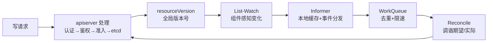

一句话心智：**apiserver 是唯一入口，resourceVersion 是一致性锚点，List-Watch 是事件驱动的基础，Informer 封装了 List-Watch + 本地缓存，Reconcile 把实际拉回期望——这条链路让 K8s 自愈、可扩展、解耦。**

## 二、API Server 请求处理流程

### 写请求的完整管道

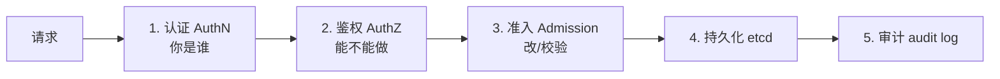

1. **认证（AuthN）**：识别身份——客户端证书、token、OIDC 等。可配多种认证插件，任一通过即认定。
2. **鉴权（AuthZ）**：判断该身份有无权限——RBAC / Node / Webhook。
3. **准入（Admission）**：对对象做修改或校验——分 Mutating 和 Validating 两阶段（→ [[#九、准入控制]]）。
4. **持久化**：写入 etcd。
5. **审计**：记录这次操作到 audit log。

### 读请求的不同

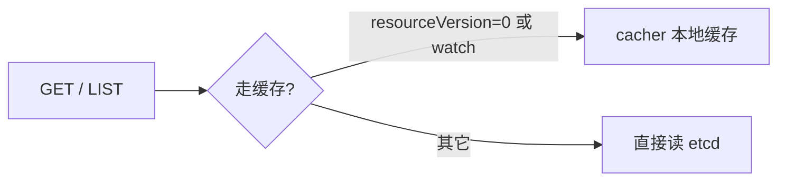

- 普通 GET/LIST 可能直接读 etcd，也可能走 cacher 缓存。
- **Watch 永远走 cacher**，不会每个事件都打 etcd。

> 📌 apiserver 内部为每类资源维护一个 **watch cache（cacher）**：它自己 watch etcd 维护这份缓存，客户端的 watch 和部分 list 从这里读——既保护 etcd，又让多个客户端共享。

### APF：apiserver 限流（大集群必备）

请求进入 apiserver 的 handler chain 后，由 **API Priority and Fairness**（1.20 beta、**1.29 GA**）先做分类与排队，再进入后续处理。

| 概念 | 作用 |
|---|---|
| `FlowSchema` | 按请求特征分类（kubelet 心跳、控制器的 list/watch、用户 kubectl 各归一类）|
| `PriorityLevelConfiguration` | 每类分配并发份额（concurrency shares），类内公平排队 |
| 超额 | 返回 **429 + Retry-After**，不是无限堆积 |

> 📌 **运维价值**：单个失控控制器疯狂 list/watch 时，不会把 kubelet 心跳、leader election 饿死——这是「watch 风暴」的第一道闸门（连 [[08-集群运维]]）。排障看 `apiserver_flowcontrol_*` 指标，或 `kubectl get --raw /debug/api_priority_and_fairness/dump_priority_levels`。
> ⚠️ 别与 `--max-requests-inflight` 混淆：后者是粗粒度总并发上限，APF 才是按流量分类的隔离。

## 三、resourceVersion 与乐观并发

每个对象有个 `resourceVersion`，它是 etcd 的**全局递增版本号**（基于 etcd ModRevision）。它支撑 K8s 的**乐观并发控制**和 List-Watch 的一致性。

### 乐观并发：防更新丢失

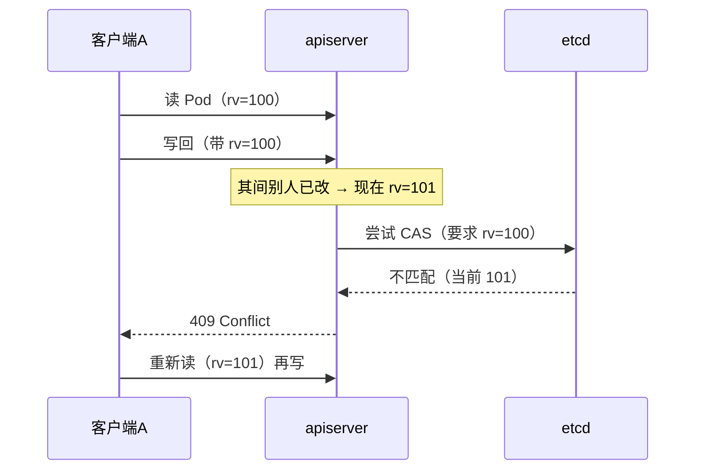

- 更新对象时**带上读到的 resourceVersion**，apiserver 据此做 CAS（compare-and-swap）。
- 中间被别人改过（版本不匹配），返回 **409 Conflict**，客户端重新读再写。
- 防止「后写覆盖先写」丢失更新——比如两个控制器同时改同一对象。

> 📌 控制器写对象常用 **`patch` 而非 `update`**：patch 只改部分字段，冲突面小；update 带整个对象，更容易撞。

### 它也是 List-Watch 的「书签」

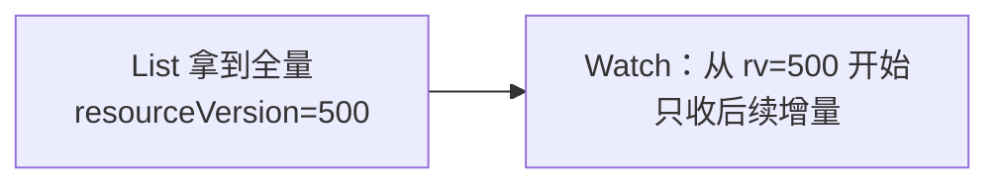

客户端 List 一次，拿到当时的 resourceVersion 作为「我看到的状态版本」，之后 Watch 从这个版本开始只收增量。

## 四、List-Watch 机制

K8s 组件不主动轮询 apiserver（太浪费），而是用 **List-Watch**：先 List 一次建基线，再 Watch 持续收增量。

### List + Watch 组合

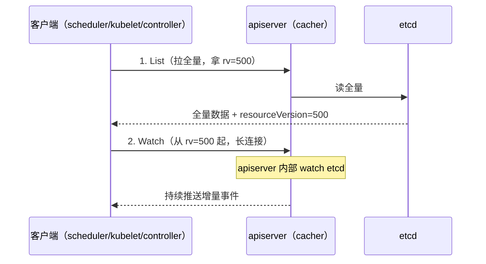

> ⚠️ **客户端 watch 的是 apiserver（cacher），不是 etcd**。只有 apiserver 自己 watch etcd，并用自己的 cacher 缓存服务客户端。

### 为什么不能只用 Watch

- Watch 只给「增量」，冷启动时本地没基线，没法工作。
- 必须先 List 建立完整本地视图，再 Watch 追增量——组合才完整。

### resync：防丢事件的兜底

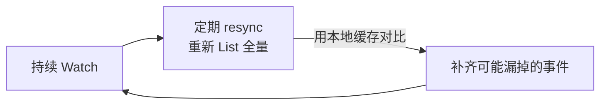

- 即使 Watch 很可靠，也怕极端情况漏事件。
- Informer 会**定期 resync**：重新 List 全量，和本地缓存对比，把缺的补上。
- resync 不重新创建对象，只是重新触发一遍 handler（让控制器有机会再 reconcile）。

### bookmark：减少 resync 开销

长空闲时客户端的 resourceVersion 会过时（etcd 历史压缩了）。apiserver 会发 **BOOKMARK 事件**（不带具体变化，只更新 resourceVersion），让客户端的版本保持新鲜，避免被迫频繁 resync。

> 📌 **版本敏感性**：bookmark（resourceVersion 书签）K8s **1.17 GA**。

## 五、Informer 与工作队列

Informer 是 client-go 提供的高层抽象，**封装了 List-Watch + 本地缓存 + 事件分发**。写控制器几乎都用 Informer，不会裸写 List-Watch。

### Informer 内部结构

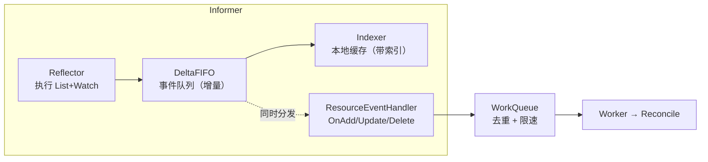

| 组件 | 职责 |
|---|---|
| **Reflector** | 底层执行 List+Watch，把事件塞进 DeltaFIFO |
| **DeltaFIFO** | 先进先出事件队列，保存对象增量（Added/Updated/Deleted）|
| **Indexer** | 本地线程安全缓存，带索引（按 namespace/label 快速查），避免每次打 apiserver |
| **Handler** | 注册的回调，收到事件被触发 |

### 为什么还要 WorkQueue

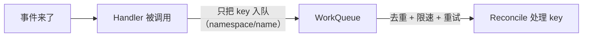

直接在 Handler 里处理业务会有问题：

- **去重**：同一对象短时间多次变化，队列只处理一次（合并）。
- **限速**：处理失败能退避重试，避免雪崩。
- **并发安全**：多个 worker 从队列取 key 并行处理，互不干扰。

> 📌 标准模式：**Handler 只入队 key，Reconcile 按 key 去读缓存+调谐**。事件处理和业务逻辑解耦，控制器更健壮。

### SharedInformer

多个控制器关心同一种资源时，用 **SharedInformer** 共享一份 List-Watch 和缓存，避免重复 watch 打 apiserver。controller-manager 内部就是这么做的。

## 六、控制器与 Reconcile 循环

控制器 = **Informer（感知变化）+ WorkQueue（调度处理）+ Reconcile（调谐逻辑）**。Reconcile 是控制器的心脏：把实际状态拉回期望状态。

### 控制器结构

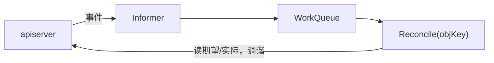

### Reconcile 干什么

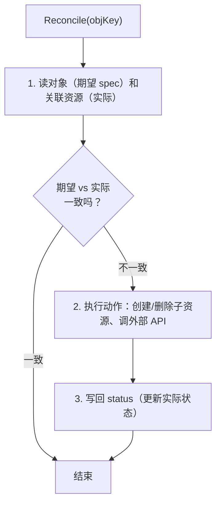

以 Deployment 控制器为例：

1. 读 Deployment（期望 3 副本）和它的 ReplicaSet（实际）。
2. 实际不足 → 创建/扩 ReplicaSet。
3. 写回 Deployment.status（更新 readyReplicas 等）。

### Reconcile 的三个关键特性

> 📌 这是控制器模式能自愈、可恢复的根基：

- **幂等**：同一个 key 处理多少次结果都一样——所以失败能放心重试。
- **level-triggered（基于当前状态）**：不依赖「发生过什么事件」，只看「现在期望 vs 实际」——错过事件下次循环也会发现。
- **不假设事件顺序**：事件可能乱序、丢失、重复，Reconcile 照样能收敛。

### 写回的工程要点

- 优先用 `patch` 而非 `update`——减少 [[#三、resourceVersion]] 冲突。
- status 走 **status 子资源**（`/status` 端点），和 spec 分开更新，冲突面更小。
- 一个 Reconcile 只处理一个 key，不阻塞别的。

## 七、OwnerReference 与垃圾回收

K8s 对象之间有**父子关系**（Deployment→ReplicaSet→Pod）。删父对象时，子对象怎么处理？由 `ownerReferences` + 垃圾回收（GC）控制器决定。

### ownerReferences：谁是谁的爹

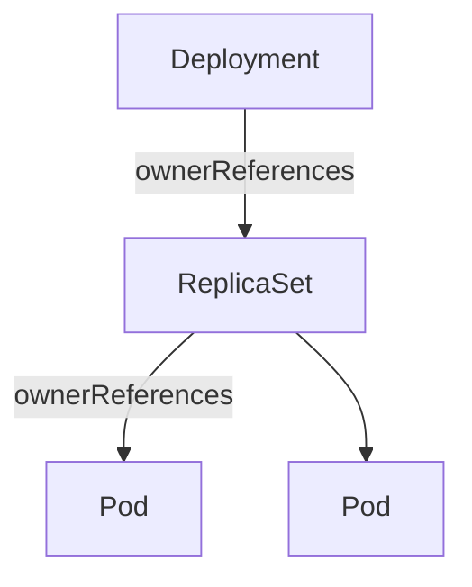

- 子对象的 `metadata.ownerReferences` 指向父对象（含父的 apiVersion/kind/name/**uid**）。
- 用 **uid 而非 name** 判断归属——name 可被复用（删了再建同名），uid 全局唯一不会混淆。

### 级联删除：删父对象时

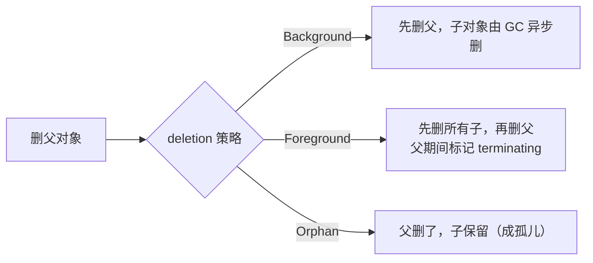

| 策略 | 行为 |
|---|---|
| **Background**（默认） | 立刻删父，子对象由 GC controller 后台清理 |
| **Foreground** | 先等所有子删完，才真正删父（子需标 `blockOwnerDeletion`）|
| **Orphan** | 不删子，子变成无主对象 |

> 📌 GC controller 持续 watch 对象，发现某对象的 owner 不存在了（孤儿），就把它删掉（除非 Orphan 策略）。这是 [[#六、控制器与 Reconcile]] 的一个典型应用。

## 八、Finalizer 机制

有些对象删除前必须做清理（比如 Operator 创建的外部资源、PV 的后端卷）。**Finalizer** 就是删除前的「清理钩子」，保证对象不会被还没清理就真删。

### 带 Finalizer 的对象怎么删

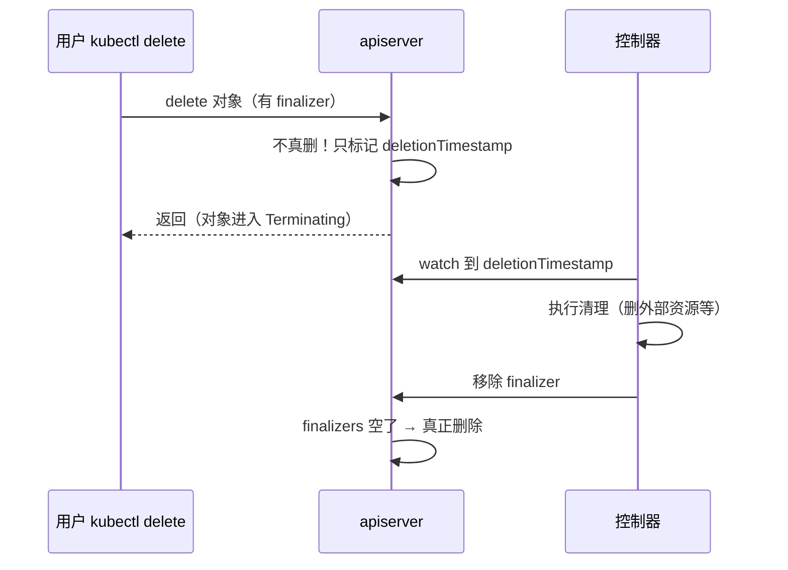

- `metadata.finalizers` 是一个字符串列表（如 `kubernetes.io/pv-protection`）。
- **只要列表非空，对象就不会被真正删除**——delete 只标记 `deletionTimestamp`。
- 控制器看到 `deletionTimestamp`，跑清理逻辑，然后**移除自己加的 finalizer**。
- 所有 finalizer 都被移除后，对象才被 GC 真正删掉。

### 为什么要这样设计

- Operator 创建了云上的 LB/数据库等外部资源，这些不在 etcd 里。
- 如果对象直接被删，控制器没机会清理外部资源——会泄漏。
- Finalizer 让删除「暂停」，给控制器清理的机会。

> ⚠️ **卡住的 Finalizer**：如果加了 finalizer 的控制器挂了或逻辑有 bug，finalizer 永远移不掉，对象就**一直卡在 Terminating**。排查看 `metadata.finalizers`，必要时手动 patch 清掉（谨慎，可能泄漏外部资源）。

## 九、准入控制 Admission

准入（Admission）是请求处理管道中**鉴权之后、持久化之前**的一环：对要写入的对象做修改或校验。它是 K8s 可扩展性的关键扩展点。

### 两阶段

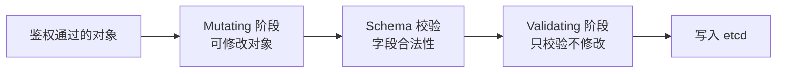

- **Mutating**：可改对象（设默认值、注入字段）。例：`DefaultStorageClass` 给没指定 sc 的 PVC 默认填一个。
- **Schema 校验**：检查字段是否符合资源定义（必填、类型）。
- **Validating**：只校验不改。例：`ResourceQuota` 检查是否超配额，超了拒绝。

> 📌 顺序很重要：**先 Mutating 再 Validating**——这样 Validating 校验的是改过之后的最终值。

### 内置准入器 vs Webhook

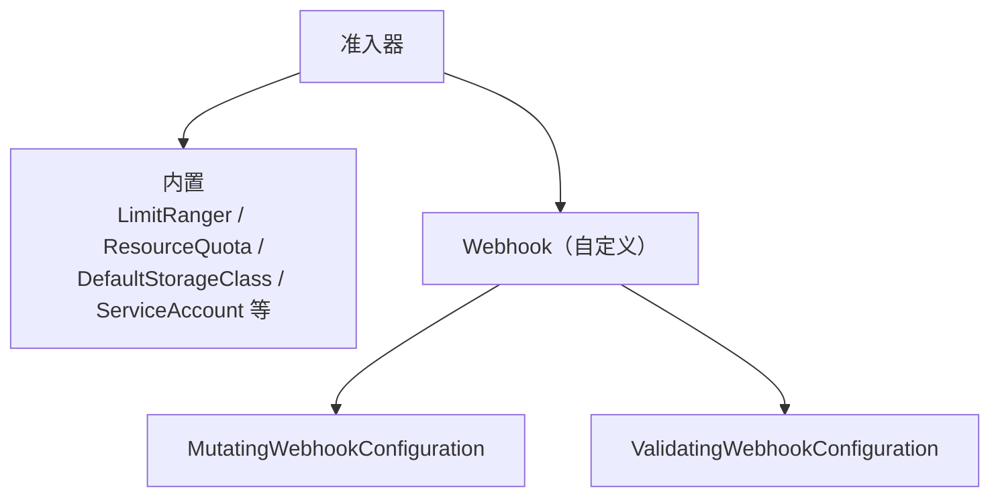

- 内置准入器：K8s 自带，编译进 apiserver。
- **Webhook**：你自己部署一个 HTTP 服务，apiserver 在准入阶段**同步调用**它——拿到对象，改或校验后返回。

### Webhook 的典型用途

- **策略引擎**：Kyverno、OPA Gatekeeper 都是基于准入 webhook 实现的——强制安全策略、标签规范等。
- **sidecar 自动注入**：Istio 的 sidecar 就是 MutatingWebhook 自动注入的。

> ⚠️ Webhook 是**同步调用**，apiserver 等它返回。所以 webhook 服务必须**高可用 + 低延迟**——挂了或慢了，整个集群写操作都受影响。

### ValidatingAdmissionPolicy（CEL，1.30 GA）

> 📌 **版本敏感性**：**ValidatingAdmissionPolicy** 的演进是 **1.26 alpha → 1.28 beta → 1.30 GA**（1.28 尚未稳定）。它用 CEL（Common Expression Language）在 apiserver **进程内**校验：无网络跳转、无 TLS 证书、无外部服务可用性依赖。策略对象与 binding 分离，可先 `validationActions: [Audit]` 灰度再切 `Deny`。适合简单字段校验，复杂逻辑仍需 webhook 或 Kyverno/Gatekeeper。

## 十、CRD 与 API 扩展

CRD（CustomResourceDefinition）让你**定义自己的资源类型**——像在 K8s 里造一个新 `kind`。配合自定义控制器，就是 **Operator**。

### CRD 定义类型，CR 是实例

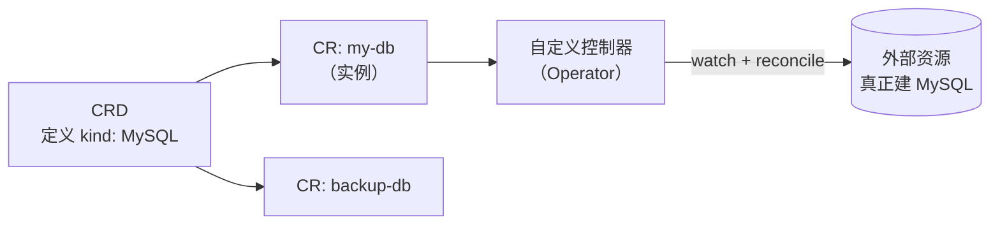

- **CRD**：声明「有一种资源叫 MySQL，它的 spec 长这样」（用 OpenAPI V3 schema 描述字段）。
- **CR（Custom Resource）**：按 CRD 定义的实例——`my-db`、`backup-db`。
- 创建 CRD 后，`kubectl get mysql` 就能用了，apiserver 会按 CRD 校验 CR 的字段。

### CRD 能配什么

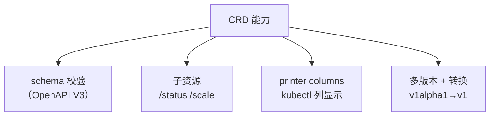

| 能力 | 说明 |
|---|---|
| **schema** | 定义 spec/status 字段和校验规则（OpenAPI V3）|
| **status 子资源** | 控制器单独更新 status（和 spec 分开，减少冲突）|
| **scale 子资源** | 支持 `kubectl scale` 操作 CR |
| **多版本转换** | v1alpha1→v1，需 **conversion webhook** 做版本间转换 |

> ⚠️ **版本敏感性**：CRD `apiextensions.k8s.io/v1` 在 K8s **1.16 GA**；`v1beta1` 在 **1.22 移除**。

### Operator = CRD + 控制器

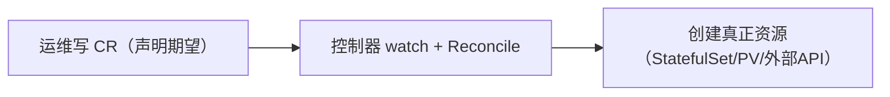

- 你写一个 CR（比如「我要一个 3 副本的 MySQL 集群」）。
- Operator 控制器 watch 到这个 CR，按 spec 去创建真正需要的 K8s 资源和外部资源，并维护它（备份、升级、故障恢复）。
- 把「人类运维的知识」编码进控制器——这就是 Operator 的本质。

### Server-side apply（字段所有权）

> 📌 **版本敏感性**：**Server-side apply** 在 **1.16 beta → 1.22 GA**。它引入**字段所有权（field manager）**：`managedFields` 记录每个字段归谁管，不同管理者各改各的字段，`apply` 时不互相覆盖；同一字段被多方声明会报**显式冲突**，只有 `--force` 才抢所有权。适合多控制器/多团队改同一对象。

### vs 聚合 API（APIService）

| | CRD | 聚合 API（APIService）|
|---|---|---|
| 存储 | apiserver 存 etcd | 自己跑 apiserver + 自定义存储 |
| 复杂度 | 轻量，声明式 | 重，需自定义存储逻辑 |
| 适用 | 95% 场景 | 需完全自定义存储/特殊协议 |

> 📌 大多数自定义资源用 **CRD** 就够了；只有需要完全自定义存储/特殊协议时才用聚合 API。

## 十一、面试高频问答 🎯

**Q1：API Server 处理一个写请求经过哪些环节？**
认证（你是谁）→ 鉴权（能不能做）→ 准入（Mutating 改 → Schema 校验 → Validating 校验）→ 持久化到 etcd → 审计 log。

**Q2：resourceVersion 是什么？有什么用？**
etcd 维护的**全局递增版本号**（基于 ModRevision）。两个用途：① 乐观并发——更新带 rv 做 CAS，冲突返回 409；② List-Watch 的书签——List 拿到 rv，Watch 从该 rv 开始收增量。

**Q3：为什么控制器写对象用 patch 而非 update？**
update 带整个对象，和别的控制器同时改容易撞 resourceVersion 冲突（409）。patch 只改部分字段，冲突面小。status 还能走 status 子资源端点，和 spec 分开更新，进一步减少冲突。

**Q4：List-Watch 为什么不能只用 Watch？**
Watch 只给增量，冷启动时本地没基线没法工作。必须先 List 建立完整本地视图+拿到 resourceVersion，再 Watch 从该版本追增量。组合才完整。而且客户端 watch 的是 apiserver（cacher），不是 etcd。

**Q5：Informer 内部结构？为什么还要 WorkQueue？**
Informer = Reflector（List+Watch）→ DeltaFIFO（事件队列）→ Indexer（本地缓存）+ Handler（回调）。Handler 不直接处理业务，而是把 key 入 WorkQueue——因为 WorkQueue 提供**去重**（同对象多次变化合并）、**限速**（失败退避重试）、**并发安全**（多 worker 并行）。标准模式：Handler 只入队 key，Reconcile 按 key 读缓存调谐。

**Q6：Reconcile 为什么能自愈？三个关键特性？**
① 幂等——同 key 处理多次结果一样，失败能放心重试；② level-triggered——基于当前状态而非事件，错过事件下次循环也会发现差异；③ 不假设事件顺序——事件乱序丢失重复照样收敛。这三点让控制器可崩溃重启、可自愈。

**Q7：resync 是什么？bookmark 解决什么？**
resync 是 Informer 定期重新 List 全量+对比本地缓存，补齐可能漏掉的事件（兜底）。bookmark 是 apiserver 在长空闲时发的不带具体变化只更新 rv 的事件，让客户端版本保持新鲜，避免被迫频繁 resync（1.17 GA）。

**Q8：OwnerReference 级联删除三种策略？**
Background（默认，先删父，子由 GC 后台清）；Foreground（先删所有子再删父，子需标 blockOwnerDeletion）；Orphan（父删子留，成孤儿）。GC controller watch 对象，发现 owner 不存在就删孤儿。注意 ownerReferences 用 **uid** 判断归属（name 可复用，uid 唯一）。

**Q9：Finalizer 怎么工作？对象卡在 Terminating 怎么办？**
对象有 finalizer 时，delete 不真删只标 deletionTimestamp。控制器 watch 到 deletionTimestamp 跑清理逻辑，移除自己的 finalizer。所有 finalizer 移除后才真删。卡在 Terminating 通常因控制器挂了或 bug——排查 `metadata.finalizers`，必要时手动 patch 清掉（谨慎，可能泄漏外部资源）。

**Q10：准入控制两阶段顺序？为什么？**
先 Mutating（可改对象）→ Schema 校验 → Validating（只校验）。顺序重要：Validating 校验的是 Mutating 改过之后的最终值，否则校验完又被改就没意义了。

**Q11：准入 webhook 有什么风险？ValidatingAdmissionPolicy 解决什么？**
webhook 是同步调用，apiserver 等它返回——挂了或慢了整个集群写操作受影响，`failurePolicy: Fail` 时甚至全集群写入不可用，必须高可用+低延迟+证书不过期。**ValidatingAdmissionPolicy（1.30 GA）**把简单校验用 CEL 放进 apiserver 进程内执行，无网络跳转、无证书、无外部可用性依赖，从根上消掉这类故障；可先 `Audit` 再 `Deny` 灰度。复杂逻辑仍需 webhook。

**Q12：CRD 和 Operator 什么关系？CRD v1 什么时候 GA？**
CRD（CustomResourceDefinition）定义自定义资源类型，CR 是实例。Operator = CRD + 自定义控制器（watch CR + Reconcile 创建真正资源）。CRD `apiextensions.k8s.io/v1` 在 K8s 1.16 GA，v1beta1 在 1.22 移除。CRD 支持 schema 校验、status/scale 子资源、多版本转换（conversion webhook）。

**Q13：Server-side apply 解决什么？**
引入字段所有权（field manager，`managedFields` 记录）——每个字段记着归谁管，不同管理者各改各的，`apply` 时不互相覆盖；冲突会显式报出，`--force` 才抢所有权。适合多控制器/多团队改同一对象（**1.22 GA**）。

**Q14：写一个 Operator 的核心要素？**
① CRD 定义自定义资源（schema + status 子资源）；② 控制器用 Informer watch CR；③ Reconcile 读期望 spec + 实际状态，创建/调谐子资源；④ 用 OwnerReference 建立父子关系（级联删除）；⑤ 对外部资源用 Finalizer 保证删除时清理。底层靠 client-go 或 controller-runtime 库。

## 十二、关联

- 上游 → [[01-架构与组件]]（apiserver 组件、cacher、控制循环设计思想）
- 实现 → resourceVersion / List-Watch / Informer / WorkQueue / Reconcile
- 资源生命周期 → OwnerReference 级联删除 + Finalizer 清理
- 扩展 → CRD + Operator + 准入 webhook + ValidatingAdmissionPolicy
- 安全交叉 → [[06-配置与安全]]（PSA 本身也是准入插件、RBAC 决定谁能建 CRD）
- 运维交叉 → [[08-集群运维]]（APF 限流与 watch 风暴、etcd 快照里的 resourceVersion）
- 应用交叉 → [[02-工作负载资源]]（Deployment→RS→Pod 级联删除、探针只改 status）
- 写 Operator → [[Go 与 K8s 开发]]（client-go / controller-runtime）