---
tags:
  - k8s
  - ops
  - 面试
created: 2026-11-14
status: 已整理
---

# Kubernetes 集群运维

> 面向面试：按运维工作的真实生命周期编排——**搭建（建）→ 日常巡检（养）→ 变更管理（升）→ 故障排查（救）→ 备份灾备（备）**。每一步都对应运维工程师每天实际做的事。

## 一、运维全景：集群生命周期

运维工程师和集群的关系是一条生命周期线：

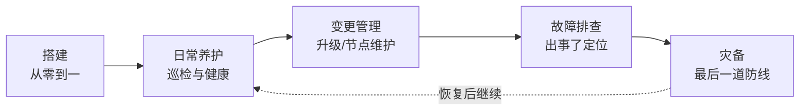

一句话心智：**建的时候想好高可用，养的时候盯住健康指标，变更前先备份、变更中靠 drain+PDB，出事分层排查，兜底靠 etcd 快照。**

## 二、搭建：从零到一

### kubeadm 搭建流程

kubeadm 是官方的集群搭建工具，把「装一套能跑的 K8s」标准化成几条命令。

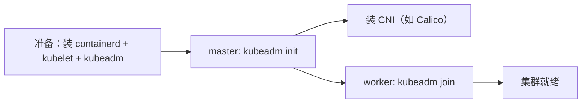

- `kubeadm init`：在第一个 master 上初始化——生成证书、起 etcd、把控制平面组件以**静态 Pod** 跑起来、生成 join 命令。
- `kubeadm join`：worker 节点用 join 命令加入集群。

### 静态 Pod：控制平面怎么跑

控制平面组件（apiserver/etcd/scheduler/CM）以**静态 Pod** 形式运行：kubelet 直接读 `/etc/kubernetes/manifests` 目录里的清单启动，**不经 apiserver**——集群还没起来时，组件也能被 kubelet 拉起。这是「先有鸡先有蛋」问题的解法。

### 生产高可用拓扑

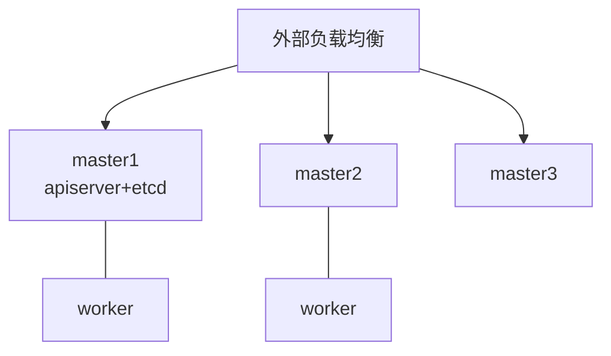

- 多 master + 外部 LB（apiserver 前面挂负载均衡）。
- etcd 两种部署方式：

| 方式 | 特点 |
|---|---|
| **堆叠**（和 master 同节点） | 部署简单，节点少；master 挂 = apiserver 和 etcd 一起挂 |
| **外置**（独立 etcd 集群） | 故障隔离更好，etcd 可独立扩容；但运维更重（多管一套集群） |

> 📌 中小规模用堆叠（3 master），大规模或对 etcd 稳定性要求高用外置。

### 搭建方式对比

| 方式 | 适用 |
|---|---|
| **托管**（GKE/EKS/AKS/ACK） | 省心，控制平面厂商管 |
| **kubeadm** | 自建，标准化 |
| **kubespray / RKE** | 自建，带更多自动化 |
| **k3s** | 边缘/轻量场景 |

## 三、日常养护：巡检与健康

集群跑起来之后，日常运维的核心是**在故障发生前发现苗头**。

### 健康巡检清单

| 巡检项 | 命令 / 指标 | 异常信号 |
|---|---|---|
| 节点状态 | `kubectl get nodes` | NotReady、内存/磁盘压力 |
| 控制平面 Pod | `kubectl get pods -n kube-system` | 非 Running、频繁重启 |
| 系统组件 | CoreDNS / CNI / kube-proxy Pod | 重启、日志报错 |
| 资源水位 | `kubectl top nodes` / `top pods` | 接近 requests/limits 饱和 |
| 异常事件 | `kubectl get events --sort-by=.lastTimestamp` | Failed、BackOff、Evicted |
| 证书有效期 | `kubeadm certs check-expiration` | 临近过期（默认 1 年）|
| Pod 健康度 | `kubectl get pods -A \| grep -v Running` | CrashLoopBackOff、Pending |

> 📌 `kubectl get componentstatuses` 已**废弃**（1.19 起不再维护），现在直接看 `kube-system` 的组件 Pod 状态。

### etcd 健康与维护

etcd 是唯一有状态组件，也是巡检重点：

- `etcdctl endpoint health`——确认各成员健康。
- `etcdctl endpoint status`——看 db size、raft term、leader。
- ⚠️ **碎片整理（defrag）**：etcd 删除数据后空间不会自动归还（只能复用），频繁更新会导致 db 膨胀、告警 `database size exceeds the recommended limit`。需要定期 `etcdctl defrag` 回收空间（生产建议逐个成员做，避免同时打挂 quorum）。
- etcd 会自动**压缩历史（compact）**，但 compact 不等于 defrag——compact 只是清理旧版本记录，defrag 才真正释放磁盘空间。

### 日志链路：`kubectl logs` 背后发生了什么

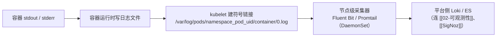

| 要点 | 说明 |
|---|---|
| `kubectl logs` | 走 apiserver → kubelet 读**节点本地**日志文件，不是从 etcd 或采集器取 |
| `--previous` | 读上一轮容器的日志，容器崩溃重启后查原因必用 |
| 轮转 | kubelet 的 `containerLogMaxSize` / `containerLogMaxFiles` 控制，打太多会轮转丢历史 → **关键日志必须外发** |
| 节点删除 | 本地日志随之消失，这就是必须部署采集器的原因 |

> ⚠️ 应用必须**往 stdout/stderr 写日志**；写进文件的日志采集器默认收不到（除非额外挂卷并配置采集路径）。

### 指标链路：`kubectl top` / HPA 的数据从哪来

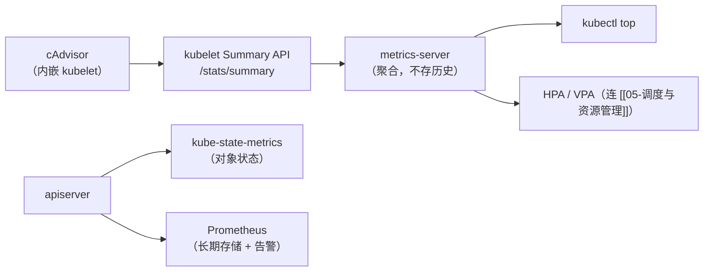

| 组件 | 提供什么 | 常见误判 |
|---|---|---|
| cAdvisor / kubelet | 容器 CPU、内存**实际用量** | `kubectl top` 没数据先查它和 metrics-server |
| **metrics-server** | 聚合 Resource Metrics API，供 `kubectl top` 与 HPA 用 | **不存历史**，别指望它画图；HPA 不生效 90% 是它没装 / 证书 / 网络不通 |
| **kube-state-metrics** | 从 apiserver 监听对象**状态**（副本数、Pod phase、PVC 状态）| 它不提供用量指标，与 metrics-server 互补，不能互相替代 |
| Prometheus | 拉取并长期存储上述指标 | 平台侧长期观测与告警 |

> 📌 一句话串起来：**cAdvisor 出用量 → metrics-server 聚合给 HPA → kube-state-metrics 出对象状态 → Prometheus 长期存**。排查「HPA 不扩」就按这条链逐段验证。

## 四、变更管理：升级与节点维护

K8s 版本迭代快（一年 3 个 minor），升级和节点维护是高频变更。

### 升级顺序与版本偏差

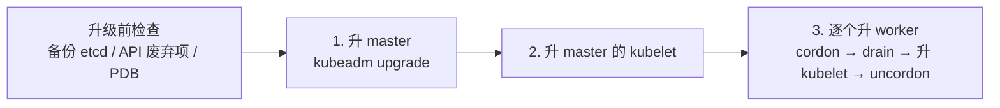

**升级前检查清单：**

1. **备份 etcd**（snapshot save）——回滚的底牌。
2. **检查 API 废弃项**——新版移除的 API（如 `v2beta1` HPA）会让旧清单创建失败，用 `kubectl-convert` 或提前改写。
3. 检查各应用的 PDB，确认 drain 时不会卡死。
4. 确认 CNI / CSI 等组件有兼容新版本的版本。

> ⚠️ **版本偏差规则（version skew policy）**：
> - kubelet **不能高于** apiserver。
> - kubelet 最多**落后 apiserver 3 个 minor 版本**（K8s **1.28 起**，之前是 2 个）。
> - 控制平面升级**不能跳版本**（1.28→1.29→1.30 逐个升，不能 1.28→1.30）。
>
> 所以必须**先升 master**，worker 逐个升。

### 节点维护：cordon + drain

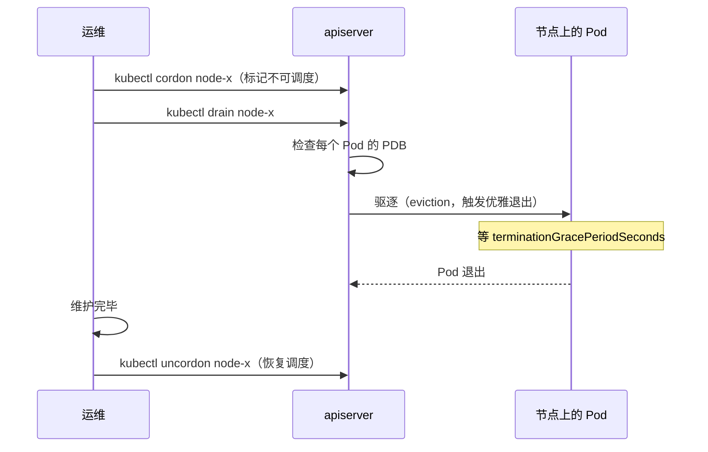

| 命令           | 作用                                         |
| ------------ | ------------------------------------------ |
| **cordon**   | 把节点标 `unschedulable`，新 Pod 不再调度过来（不影响已运行的） |
| **drain**    | 驱逐该节点上的 Pod（DaemonSet 除外），受 PDB 约束         |
| **uncordon** | 恢复可调度                                      |

> ⚠️ drain 走的是 **Eviction API**（和直接 delete Pod 不同），它会尊重 PDB 和优雅退出。**维护节点务必走 drain，别直接删 Pod**。会破坏 PDB 时 drain 会卡住等待——这是保护机制，不是故障。

## 五、故障排查：出事了怎么办

K8s 故障排查的核心方法：**按层定位**——从上（应用）到下（基础设施），每层用对应工具看现象、验证假设。不要无目的乱试命令。

### 分层排查决策树

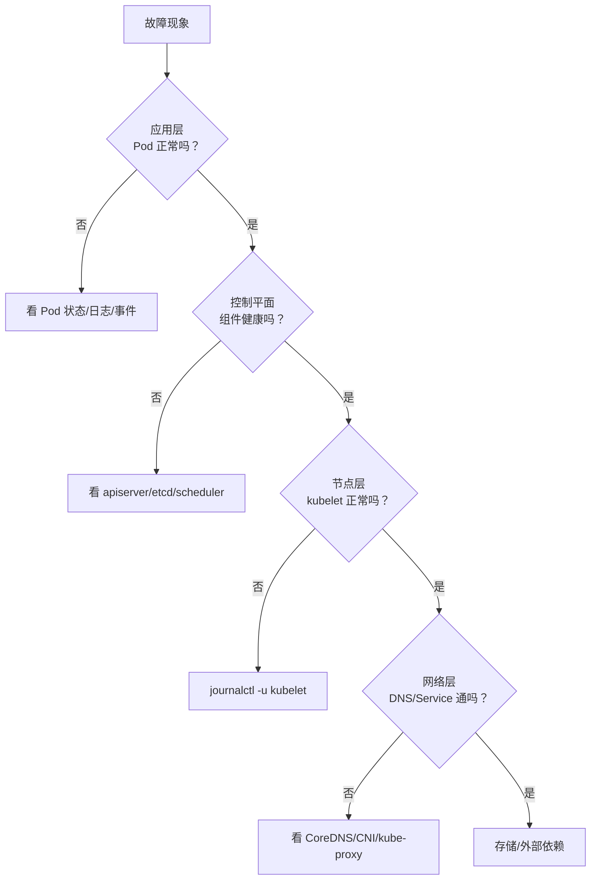

### 应用层（最常见）

常用命令：

- `kubectl get pods` —— 看 phase。
- `kubectl describe pod <name>` —— 看 Events（拉镜像失败、调度失败都在这）。
- `kubectl logs <pod>` —— 看容器日志（`-p` 看上次崩溃的日志）。
- `kubectl exec -it <pod> -- sh` —— 进容器查（DNS 通不通、端口在不在）。

典型 Pod 异常状态：

| 状态 | 含义 | 排查方向 |
|---|---|---|
| **Pending** | 没调度上或没资源 | describe 看 scheduler 事件、节点资源、PVC 是否绑定 |
| **ImagePullBackOff** | 拉不到镜像 | 镜像名/tag/仓库权限（imagePullSecrets）/网络 |
| **CrashLoopBackOff** | 启动后崩、重启、再崩 | logs 看应用报错、liveness 探针是否过严 |
| **OOMKilled** | 内存超 limit 被杀 | 调大 limits 或查内存泄漏 |
| **Evicted** | 被驱逐（节点压力/抢占） | 看节点磁盘/内存水位、是否被高优 Pod 抢占 |
| **Terminating 卡住** | finalizer 没清掉 | 看 `metadata.finalizers`，检查对应控制器 |

### 控制平面

- 直接看 `kube-system` 的组件 Pod（componentstatuses 已废弃）。
- apiserver 慢：常见根因是 **etcd 慢**（磁盘 IO、db 膨胀没 defrag）、watch 风暴。
- etcd：`etcdctl endpoint health` + `endpoint status` 看 db size 和延迟。

### 节点与网络

- 节点 `NotReady`：`journalctl -u kubelet`，看 kubelet 是否挂、容器运行时是否正常、节点是否压力驱逐。
- DNS 不通：`kubectl exec` 进 Pod `nslookup`；看 CoreDNS Pod 是否正常；检查 ndots 多次解析问题。
- Service 不通：检查 EndpointSlice 有没有后端（readiness 是否通过）；确认 kube-proxy 规则在内核里。

### 两个必会的排查技巧

| 技巧 | 命令 | 解决什么 |
|---|---|---|
| **临时容器调试** | `kubectl debug -it <pod> --image=busybox:1.36 --target=<container>` | distroless / scratch 镜像没有 shell，`kubectl exec` 进不去；ephemeral container 可共享目标容器的进程与网络命名空间（**1.23 beta / 1.25 GA**）|
| 调试节点 | `kubectl debug node/<node> -it --image=busybox` | 在节点上起特权 Pod 查 kubelet / 内核 / 网络，不用 SSH |
| 复制 Pod 复现 | `kubectl debug <pod> --copy-to=debug-pod --share-processes` | 复制同配置 Pod 做实验，不动生产实例 |
| **生成清单** | `kubectl create deploy nginx --image=nginx --dry-run=client -o yaml > deploy.yaml` | 不真的创建对象，直接产出可用 YAML 骨架 |
| 服务端校验 | `kubectl apply --dry-run=server -f x.yaml` | 让 apiserver 做准入 + 校验但不落盘，提前发现字段废弃、CRD 不匹配 |

> ⚠️ `--dry-run=client` 只做客户端语法检查，**不校验集群是否接受该 API 版本**；涉及版本兼容一律用 `=server`。调试容器用完及时清理，别留在生产命名空间。

## 六、灾备：最后一道防线

集群故障时能恢复到什么程度，取决于备份了什么。K8s 备份分两层：**etcd（集群状态）** 和 **PV 数据**。

### 备份的两层

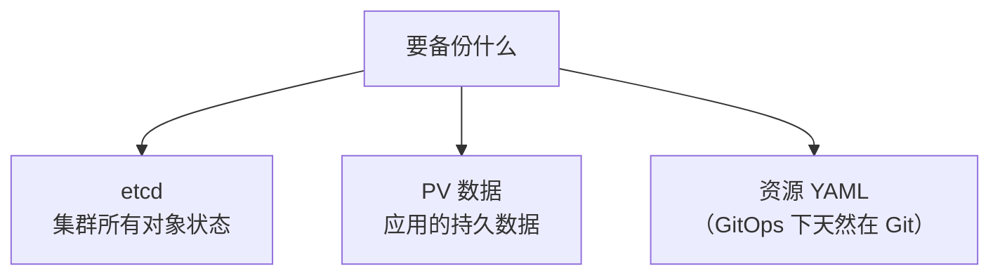

> 📌 etcd 是唯一有状态组件，**etcd 丢了，整个集群状态就丢了**——这是必须备份的核心。

### etcd 快照与恢复

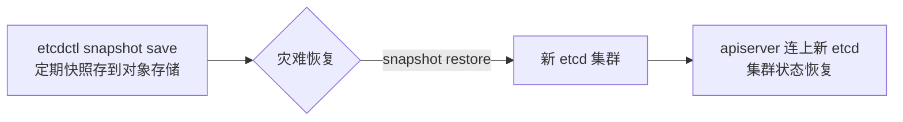

- 用 `etcdctl snapshot save` 定期快照（cron + 存对象存储）。
- 恢复时 `snapshot restore` 到新 etcd，再让 apiserver 连上去——集群状态就回来了。
- 这是 K8s 灾难恢复的「终极手段」。

### Velero：集群级备份

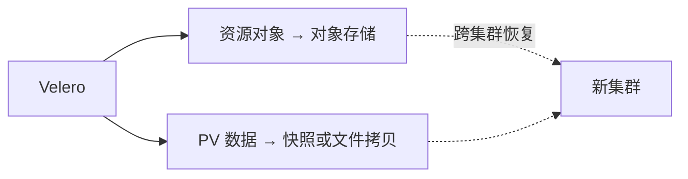

- Velero 备份**选定的命名空间/资源 + 对应 PV 数据**。
- 适合：跨集群迁移、整个集群灾备、按命名空间粒度恢复。
- 和 etcd 快照互补：etcd 是全量集群状态的最终底牌，Velero 是更细粒度、可跨集群的方案。

### 恢复演练

> ⚠️ **没演练过的备份等于没备份**。生产必须定期做恢复演练：拿快照在测试集群 restore，验证集群状态和应用数据是否完整。备份的有效性只有恢复能证明。

## 七、面试高频问答 🎯

**Q1：控制平面组件是怎么跑起来的？静态 Pod 是什么？**
kubelet 直接读 `/etc/kubernetes/manifests` 目录里的清单启动容器，**不经 apiserver**。控制平面（apiserver/etcd/scheduler/CM）都以静态 Pod 形式跑——解决「apiserver 还没起来谁拉起它」的先有鸡先有蛋问题。改静态 Pod 清单，kubelet 会自动重启对应组件。

**Q2：生产集群高可用怎么搭？etcd 堆叠还是外置？**
多 master + 外部 LB（apiserver 挂负载均衡）。etcd 堆叠（和 master 同节点）部署简单适合中小规模；外置（独立集群）故障隔离好、可独立扩容，但运维更重。3 master 起步（Raft 容忍 1 故障），5 master 容忍 2。

**Q3：K8s 升级的顺序和约束？**
先升控制平面（kubeadm upgrade），再升 master 的 kubelet，最后逐个升 worker（cordon→drain→升 kubelet→uncordon）。约束：kubelet 不能高于 apiserver，最多落后 3 个 minor（1.28 起，之前 2 个）；控制平面不能跳版本，逐个 minor 升。升级前备份 etcd、检查 API 废弃项。

**Q4：cordon、drain、uncordon 区别？drain 和直接删 Pod 有什么不同？**
cordon 标节点不可调度（新 Pod 不来，已运行的不动）；drain 驱逐节点上的 Pod（DaemonSet 除外）；uncordon 恢复调度。drain 走 **Eviction API**，尊重 PDB（会破坏 PDB 时卡住等待）和优雅退出（SIGTERM+gracePeriod）；直接 delete Pod 不检查这些，可能造成可用副本不足、请求丢失。

**Q5：Pod 一直 Pending 怎么排查？**
`kubectl describe pod` 看 Events：① 调度失败——资源不足/亲和性不满足/污点不容忍/taint；② PVC 未绑定（存储类问题）；③ 节点被 cordon。再 `kubectl get events` 看集群级事件，`kubectl top nodes` 看资源水位。

**Q6：CrashLoopBackOff 怎么排查？**
`kubectl logs <pod> -p` 看上次崩溃的日志（最关键证据）——应用报错就修应用；日志没报错但频繁重启，检查 liveness 探针是否过严（启动慢被误杀，配 startup 探针）；`kubectl describe` 看 OOMKilled（内存超 limit）。

**Q7：etcd 的 db 膨胀告警怎么处理？**
etcd 删除数据后空间只能复用不自动归还，频繁更新导致 db 膨胀、告警 `database size exceeds`。处理：逐个成员 `etcdctl defrag` 回收空间（不能同时做，避免打挂 quorum）。注意 compact（清理旧版本记录）不等于 defrag（释放磁盘空间），两者都要。

**Q8：apiserver 变慢，可能的原因？**
最常见根因是 etcd 慢：磁盘 IO 瓶颈（etcd 要求 SSD、fsync 延迟高会拖垮写入）、db 膨胀没 defrag、etcd quorum 波动。其他：watch 风暴（大量客户端 watch 同类资源）、apiserver 自身过载（可水平扩）。排查 `etcdctl endpoint status` 看 db size 和延迟，看 etcd 磁盘 IO。

**Q9：节点 NotReady 排查什么？**
`journalctl -u kubelet` 看 kubelet 日志（挂了/证书过期/和 apiserver 通信断）。常见根因：kubelet 进程挂、容器运行时挂、节点压力（内存/磁盘/PID 驱逐）、网络断连（>40s 心跳超时控制平面标 NotReady）。

**Q10：备份要备什么？怎么验证备份有效？**
三层：etcd 快照（集群状态，终极底牌）、PV 数据（Velero/VolumeSnapshot）、资源 YAML（GitOps 下天然在 Git）。**没演练过的备份等于没备份**——生产必须定期在测试集群做恢复演练，验证 restore 后集群状态和应用数据完整。

**Q11：kubeadm 和托管集群（EKS/GKE）怎么选？**
托管：控制平面厂商管（升级/证书/HA 都省心），适合大多数团队；kubeadm：自建，完全控制但所有运维自己扛（证书、升级、etcd 运维）。小团队/无专职运维选托管；对数据主权、特殊网络要求、成本敏感的自建。

## 八、关联

- 上游 → [[01-架构与组件]]（控制平面组件、etcd、静态 Pod）、[[05-调度与资源管理]]（drain + PDB、抢占）
- 搭建 → kubeadm、高可用拓扑、证书体系（[[06-配置与安全]]）
- 排查 → Pod 状态（[[02-工作负载资源]]）、EndpointSlice（[[03-服务与网络]]）、PVC Pending（[[04-存储]]）
- 灾备 → etcd 快照 + Velero + VolumeSnapshot
- 控制面 → [[07-API 与 Watch 机制]]（APF 限流、watch cache、resourceVersion 与快照一致性）