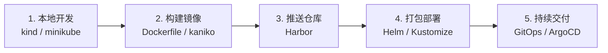
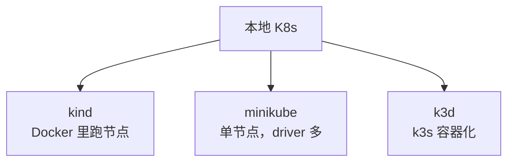
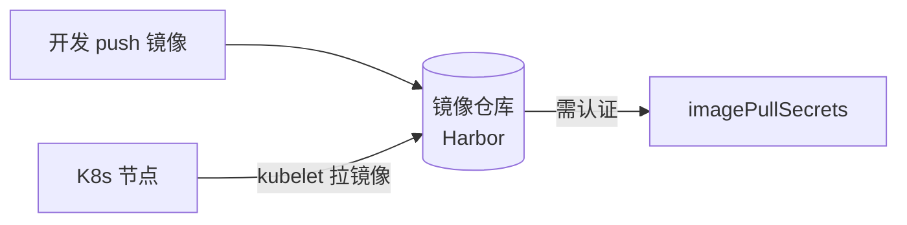
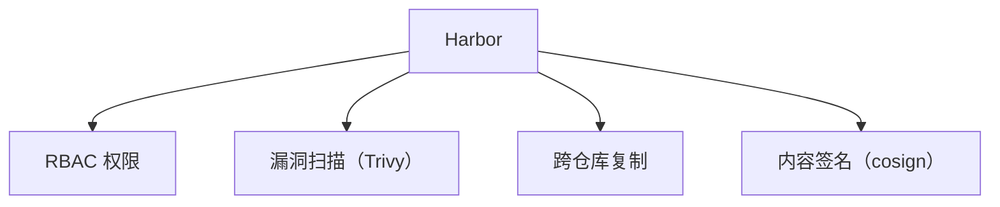
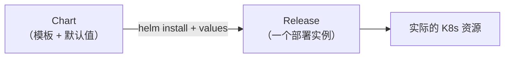
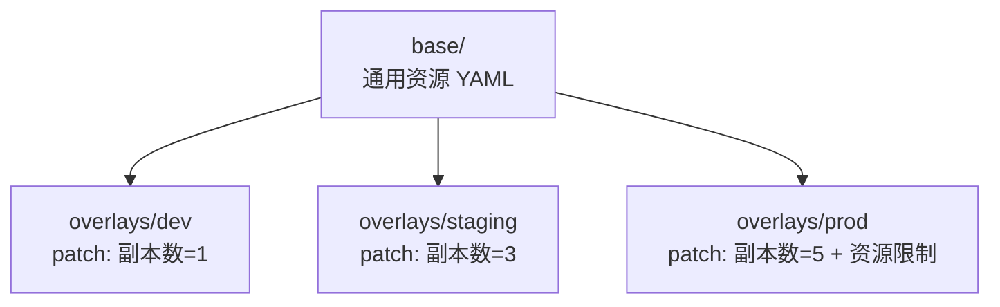
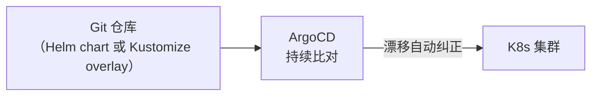

---
tags:
  - k8s
  - ecosystem
  - 面试
created: 2026-11-14
status: 已整理
---

# Kubernetes 生态与工具

> 面向面试：按**应用交付流水线**编排——本地开发（建环境）→ 构建镜像 → 推送仓库（Harbor）→ 打包部署（Helm/Kustomize）→ GitOps 持续交付。每个工具都有它在链路上的位置。

## 一、生态工具全景：一条交付流水线

K8s 的周边工具不是孤立的，它们串在一条应用交付流水线上：



一句话心智：**本地用 kind 验证，镜像推到 Harbor（带扫描和签名），用 Helm 或 Kustomize 打包部署，最终交给 GitOps 自动同步——这就是云原生的交付全链路。**

## 二、第一环：本地开发环境

本地起一个 K8s 集群做开发测试，不用动生产。

### 主流工具对比



| 工具 | 特点 | 适合 |
|---|---|---|
| **kind** | 每个「节点」是一个 Docker 容器，可多节点，启动快 | **CI / 自动化测试**、多节点验证 |
| **minikube** | 单节点，多种 driver（docker/vm/裸机），带 dashboard | **学习入门**、本地开发 |
| **k3d** | 跑 k3s（轻量发行版），资源占用极小 | 资源紧张、需要多个轻量集群 |
| Docker Desktop K8s | 一键开启 | 已用 Docker Desktop 的开发者 |

> 📌 kind 在 CI 里最流行（GitHub Actions 直接用），因为纯 Docker、快、可多节点。**无论哪个，kubectl 连上去的体验和生产集群一致——学到的知识直接迁移。**

## 三、第二环：镜像构建与仓库

### 镜像构建要点

- **多阶段构建**：builder 阶段编译，final 阶段只拷贝产物——Go 项目最终镜像可小到 10MB 级。
- Go 项目可省 Dockerfile：**ko** 直接从 Go 源码构建镜像并推仓库（CI 里无需 Docker daemon）；无法跑 Docker daemon 的环境（如 CI 容器内）用 **kaniko** 构建。

### 仓库与 K8s 的关系



- 开发把镜像 push 到仓库，kubelet 按 `image: registry/app:tag` 去拉。
- 私有仓库要认证：建 **imagePullSecret**（`kubernetes.io/dockerconfigjson` 类型），Pod 引用；更推荐**在 ServiceAccount 上配**，该 SA 下所有 Pod 自动带上。

### Harbor：企业级仓库



Harbor（CNCF 项目）比原生 registry 多了：

| 能力 | 说明 |
|---|---|
| **RBAC** | 项目级权限管理 |
| **漏洞扫描** | 集成 Trivy，push 时自动扫 |
| **复制** | 镜像同步到其他仓库（多地域）|
| **签名** | cosign 签名验真，防篡改（供应链安全）|

### 镜像安全实践

- 用**最小基础镜像**（distroless / scratch / alpine）减小攻击面。
- **CI 里卡高危漏洞**——扫描不过不让部署。
- **签名校验**（cosign + admission 策略），只允许已签名镜像部署。
- **别用 `latest` tag**——不可复现，随时可能变。用语义化版本 + git sha（如 `v1.2.3-9f3a2b1`）。

## 四、第三环：Helm —— 包管理

Helm 是 K8s 的**包管理器**（类比 apt/yum）。把一组 K8s 资源打包成 **Chart**，一键安装/升级/回滚——装复杂应用（数据库、监控栈）离不开它。

### 核心概念



| 概念 | 含义 |
|---|---|
| **Chart** | 应用包——`templates/`（Go 模板渲染 YAML）+ `values.yaml`（默认参数）+ `Chart.yaml`（元信息）|
| **Release** | 用某 Chart + 一组 values 部署出来的实例（同一 Chart 可装多份）|
| **values** | 覆盖默认参数，实现同一 Chart 不同环境不同配置 |

### Chart 结构

```
myapp/
├── Chart.yaml          # 元信息（名/版本）
├── values.yaml         # 默认参数
└── templates/          # 渲染成 K8s 资源的模板
    ├── deployment.yaml
    ├── service.yaml
    └── _helpers.tpl
```

### Helm v3 关键变化

- **无 Tiller**（v2 有服务端 Tiller，**v3 移除**）——helm 客户端直接用 kubeconfig 调 apiserver。

> ⚠️ **Tiller 被移除的安全原因**：v2 的 Tiller 固定持有集群管理员权限且不鉴权，任何能连它的人都能部署任意资源——巨大的安全漏洞。v3 让 helm 用调用者自己的 kubeconfig 权限执行，权限收敛到人。

- Release 状态以 **Secret** 形式存在对应 namespace，方便查询历史和回滚。
- 命令：`helm install / upgrade / rollback / uninstall`。

### 运维实战要点

- `helm upgrade --install`：没有就装、有就升级（幂等，CI 里常用）。
- `--atomic`：升级失败自动回滚到上一版本。
- `--wait`：等资源真正 Ready 才返回（而不是只等 YAML 提交成功）。
- **Hooks**：`pre-install`（部署前跑，如 schema 迁移）、`post-upgrade`（升级后跑）等生命周期钩子，Job 常配 hook 用。

## 五、第三环替代：Kustomize —— 无模板配置管理

Kustomize 不引入模板语法，用「**基础 + 覆盖**」组织多环境配置。已内置在 kubectl（`kubectl apply -k`）。

### base + overlays 模式



- **base**：一组通用的原始 YAML（Deployment、Service 等）。
- **overlays**：在 base 上叠加 patch，产出针对某环境的最终 YAML。
- 每个 overlay 有 `kustomization.yaml` 声明用哪些 base + 哪些 patch。

### patch 两种方式

| 方式 | 机制 |
|---|---|
| **Strategic Merge** | 写一份部分 YAML，K8s 按字段智能合并（如只改 replicas）|
| **JSON Patch** | 用路径精确改某个字段（适合复杂结构）|

> ⚠️ **版本敏感性**：kubectl 内置的 kustomize 版本**滞后**于独立版（随 K8s 发版更新），新特性可能要等。CI 里要新特性可装独立 kustomize CLI。

## 六、Helm vs Kustomize 选型

| | Helm | Kustomize |
|---|---|---|
| 机制 | Go 模板渲染 | YAML patch 叠加 |
| 学习成本 | 要学模板语法 | 几乎零（认 YAML 就行）|
| 适合 | 参数多、逻辑复杂的**应用打包分发** | 同一应用**多环境差异化**、轻量定制 |
| 生态 | Chart 仓库海量（bitnami 等）| 无分发生态，重在组织自有 YAML |

> 📌 经验：**应用打包分发用 Helm，组织同一应用多环境差异用 Kustomize**。两者也能混用（Helm chart 生成 + Kustomize 后处理）——ArgoCD 就支持这种组合。

## 七、下游：GitOps 持续交付

流水线的最后一环是 GitOps：Git 仓库成为期望状态的唯一事实来源，控制器（ArgoCD/Flux）持续比对集群实际状态并自动同步。



- 集群状态漂移（有人手改）会被自动纠正——审计、回滚（git revert）都天然具备。
- 与渐进式交付（Argo Rollouts / Flagger 金丝雀发布）配合，是生产交付的标准形态。
- 详细展开见 Go 板块交叉的「CI-CD 与 GitOps」专题。

## 八、面试高频问答 🎯

**Q1：Helm 解决什么问题？核心概念？**
K8s 资源一多，手工管理 YAML 就乱了。Helm 把一组资源打包成 Chart（模板+默认值），用 values 参数化，一键 install/upgrade/rollback。核心三概念：Chart（应用包）、Release（部署实例）、values（参数）。

**Q2：Helm v3 为什么移除 Tiller？**
v2 的 Tiller 是服务端组件，固定持有集群管理员权限且不做鉴权——任何能连它的人都能部署任意资源，是巨大安全漏洞。v3 移除 Tiller，helm 直接用调用者自己的 kubeconfig 权限调 apiserver，权限收敛到人。Release 状态改存为 namespace 里的 Secret。

**Q3：Helm 和 Kustomize 怎么选？**
Helm 用 Go 模板渲染，适合参数多、逻辑复杂的应用打包分发（生态海量 Chart）；Kustomize 无模板、base+overlay 叠加 patch，几乎零学习成本，适合同一应用多环境差异化。经验：分发用 Helm，多环境差异用 Kustomize，两者可混用（ArgoCD 支持 chart 生成 + Kustomize 后处理）。

**Q4：kubectl apply -k 是什么？**
kubectl 内置了 Kustomize，`-k` 参数表示按 kustomization.yaml 渲染并应用——不需要额外装工具。注意内置版本滞后于独立 CLI。

**Q5：Harbor 比原生 registry 多了什么？为什么要签名？**
RBAC 权限、Trivy 漏洞扫描、跨仓库复制、cosign 内容签名。签名解决**供应链安全**：镜像从构建到部署之间可能被篡改，签名+准入校验保证「部署的就是构建的那个」。

**Q6：镜像 tag 为什么不能用 latest？怎么打 tag？**
latest 不可复现——今天和昨天的 latest 可能是不同代码，回滚也没法回到明确版本。生产 tag 用语义化版本 + git sha（如 `v1.2.3-9f3a2b1`），版本、代码提交一一对应，可追溯可回滚。

**Q7：本地开发用什么集群？CI 里呢？**
本地学习 minikube 最友好（dashboard、多 driver）；CI/自动化测试用 kind 最流行（纯 Docker、快、可多节点，GitHub Actions 直接用）；资源紧张要多个轻量集群用 k3d。无论哪个，kubectl 体验和生产一致。

**Q8：CI 里没有 Docker daemon 怎么构建镜像？**
用 **kaniko**（无需 daemon 的容器内构建）或 Go 项目用 **ko**（直接从源码构建镜像推仓库）。CI 的执行环境通常是容器，里面再跑 Docker daemon 很麻烦且不安全。

**Q9：helm upgrade 怎么保证安全？**
`--atomic`：升级失败自动回滚到上一版本；`--wait`：等资源真正 Ready 才算成功（而不是提交成功就返回）。CI 里标准用法：`helm upgrade --install --atomic --wait`。

**Q10：GitOps 是什么？和 Helm 什么关系？**
Git 仓库成为期望状态的唯一事实来源，ArgoCD/Flux 持续比对 Git 里的声明和集群实际状态，漂移自动纠正。GitOps 的「内容」通常就是 Helm chart 或 Kustomize overlay——Helm/Kustomize 负责「怎么渲染 YAML」，GitOps 负责「让集群始终等于 Git」。

## 九、关联

- 上游 → [[08-集群运维]]（生产集群从哪来）、[[01-架构与组件]]（kubelet 拉镜像、imagePullSecrets）
- 安全 → [[06-配置与安全]]（imagePullSecrets、镜像供应链）
- 下游 → [[GitOps 与 FluxCD]]、[[FluxCD]]（平台组件板块，GitOps 持续交付）
- 开发 → [[Go 与 K8s 开发]]（ko 构建镜像、client-go 调 API）