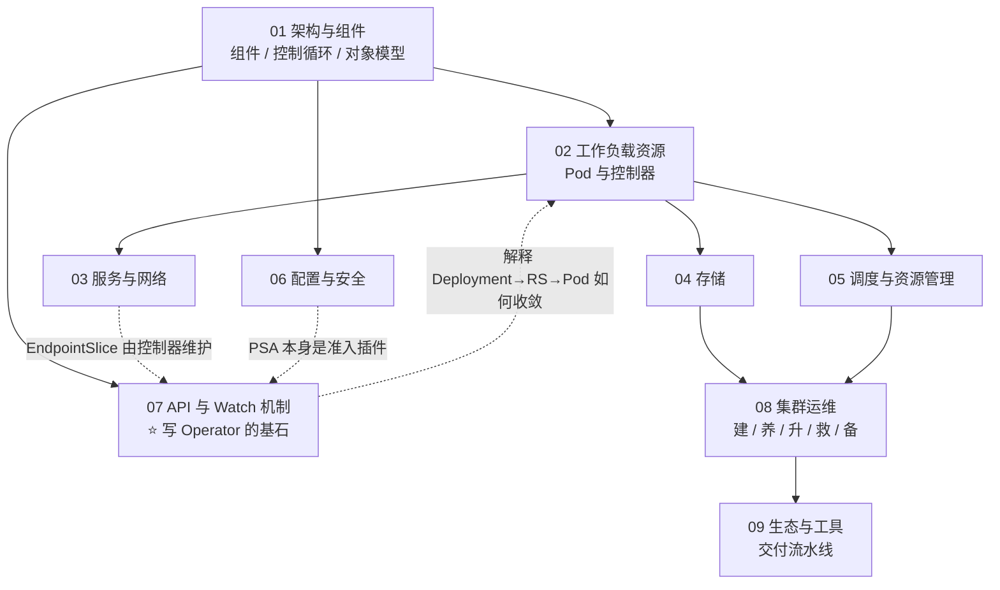

---
tags:
  - 云原生
  - k8s
  - moc
created: 2026-11-01
updated: 2026-11-15
---

# ⎈ Kubernetes

Kubernetes 学习总览：**9 篇面试向大笔记**，约 10.2 万字、124 张图、105 道高频问答。一个分区一篇，按编号推进。

## 全局知识地图

9 篇不是并列清单，**01→07 是核心机制链，08→09 是工程实践链**；带虚线的是「机制解释现象」的反向关联，理解这些跨篇依赖比逐篇背诵更重要。

**读法**：01 立心智模型 → 02~06 按「跑什么 / 怎么访 / 存哪 / 落哪 / 谁能碰」铺开资源面 → 07 下沉到「这些自动行为到底怎么实现」→ 08~09 回到生产。面试被追问「为什么」时，答案基本都在 07。

## 跨篇横切主线

> 下面 8 个概念每篇都会出现、但角色不同。**同一行横向读完**，比单篇纵向读更能建立整体感，也是排查时定位问题的索引。

| 横切概念 | 定义在哪 | 展开在哪 | 一句话关系 |
|---|---|---|---|
| **List-Watch / Reconcile** | [[01-架构与组件]]、[[07-API 与 Watch 机制]] | [[02-工作负载资源]] 控制器分层、[[03-服务与网络]] EndpointSlice、[[05-调度与资源管理]] HPA、[[06-配置与安全]] PSA | 集群里所有「自动」都来自 watch + 幂等收敛 |
| **resourceVersion** | [[07-API 与 Watch 机制]] | [[01-架构与组件]] 对象模型、[[08-集群运维]] etcd 快照 | 乐观并发与 watch 断点续传是同一条版本线 |
| **labels / selector** | [[01-架构与组件]] | [[02-工作负载资源]] RS 找 Pod、[[03-服务与网络]] Service 找后端、[[05-调度与资源管理]] 亲和性/拓扑 | 全靠 label 松耦合关联，组件之间不持有硬引用 |
| **OwnerReference / Finalizer** | [[07-API 与 Watch 机制]] | [[02-工作负载资源]] Deployment→RS→Pod、[[08-集群运维]] Terminating 卡住 | 一个管级联删除，一个管删除前必须完成的清理 |
| **requests / limits 与 QoS** | [[05-调度与资源管理]] | [[02-工作负载资源]] 探针与优雅退出、[[08-集群运维]] Evicted/OOMKilled/kubectl top | 同一组字段决定调度、驱逐、监控三条线 |
| **ServiceAccount / RBAC** | [[06-配置与安全]] | [[07-API 与 Watch 机制]] 鉴权阶段、[[02-工作负载资源]] 投影卷、[[09-生态与工具]] imagePullSecrets | 身份贯穿 API 请求、Pod 运行、镜像拉取 |
| **PDB / drain** | [[05-调度与资源管理]] | [[08-集群运维]] 升级与节点维护 | 自愿中断保护只在变更时才被触发 |
| **证书 / mTLS** | [[06-配置与安全]] | [[01-架构与组件]] 组件互信、[[08-集群运维]] `kubeadm certs renew` | 控制面组件之间唯一的信任基础 |

## 学习路线

| # | 笔记 | 核心内容 |
|---|---|---|
| 1 | [[01-架构与组件]] | 架构全景、8 组件详解、Deployment 创建全链路、三大设计思想、对象模型、RuntimeClass |
| 2 | [[02-工作负载资源]] | Pod/探针/原生 sidecar、Downward API、5 类控制器、Job 进阶、选型 |
| 3 | [[03-服务与网络]] | 网络模型/CNI、Service/EndpointSlice、externalTrafficPolicy、kube-proxy、CoreDNS/NodeLocal DNSCache、Ingress/Gateway API、NetworkPolicy |
| 4 | [[04-存储]] | Volume、CSI、PV/PVC、StorageClass 动态供给、StatefulSet 存储模板、快照与 Velero |
| 5 | [[05-调度与资源管理]] | 调度两阶段、亲和性/污点、拓扑分布、抢占、QoS 与 CFS 底层、HPA/VPA、PDB |
| 6 | [[06-配置与安全]] | ConfigMap/Secret、SecurityContext、PSS/PSA、RBAC、证书与 TLS、安全加固清单 |
| 7 | [[07-API 与 Watch 机制]] | ⭐ 请求管道与 APF、resourceVersion、List-Watch、Informer、Reconcile、OwnerRef、Finalizer、准入、CRD/SSA |
| 8 | [[08-集群运维]] | 运维生命周期：搭建→巡检（日志/指标链路）→变更→排障（kubectl debug）→灾备 |
| 9 | [[09-生态与工具]] | 交付流水线：本地环境→镜像/Harbor→Helm/Kustomize→GitOps |

## 学习提示

- **面试主线**：1 → 7 是核心（架构 → 组件 → 资源 → 机制），8 → 9 是工程实践。
- **写 Operator 必读**：第 7 篇（Informer / Reconcile / Finalizer / CRD 是基石），再看 [[Go 与 K8s 开发]] 的 client-go。
- **版本口径**：正文所有版本敏感点已逐条核对并标注——dockershim 移除 1.24、PSP 移除/PSA GA 1.25、SA Token 投影卷 1.24、CSI Migration 1.25、EndpointSlice 1.21、HPA v2 1.23、SSA 1.22、VAP 1.30、原生 sidecar 1.33 GA、APF 1.29、ephemeral containers 1.25。**私有化交付务必对照客户集群版本矩阵**，用 `kubectl explain` / `kubectl api-resources` 现场验证，不要照搬笔记里的版本。
- 每篇末尾都有「关联」段，双链互通，可按需跳转。

## 关联

- 上游：[[云原生]]
- 交叉：[[Go 与 K8s 开发]]（client-go / Operator）、[[GitOps 与 FluxCD]] 与 [[FluxCD]]（组件交付）、[[02-可观测性]]（平台侧观测）
