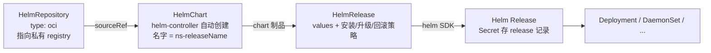
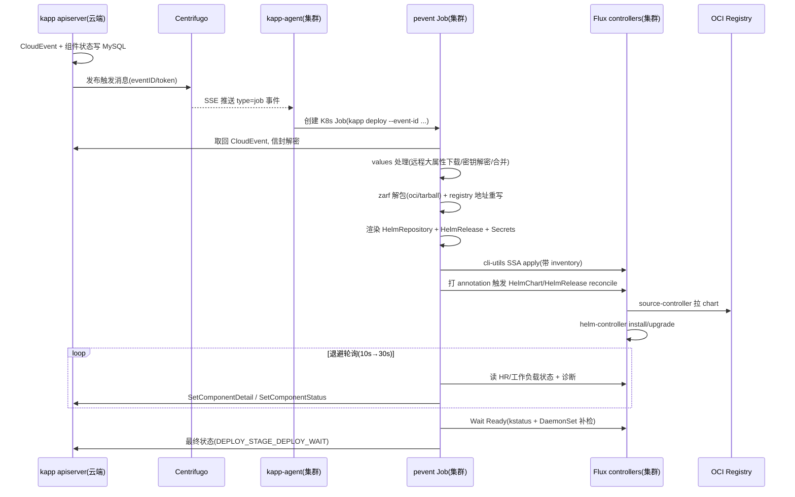
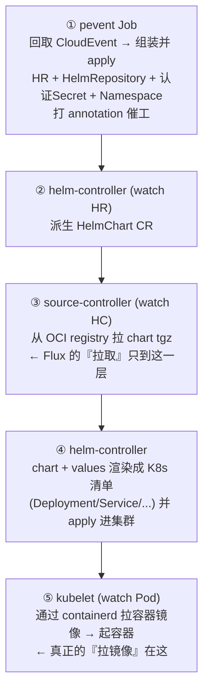
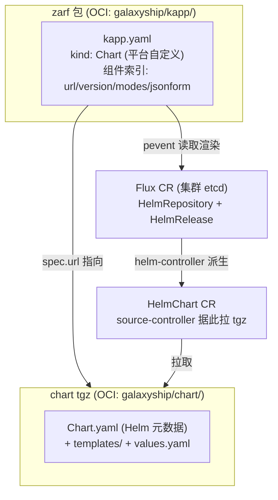
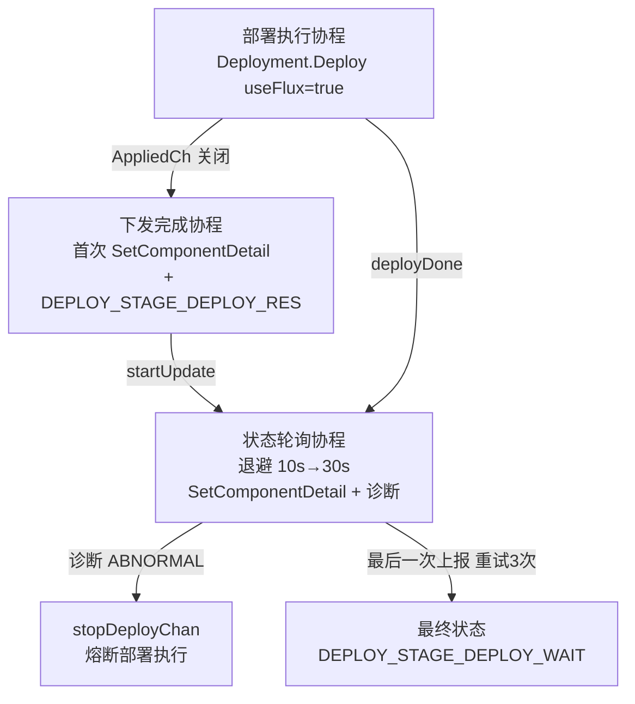

---
tags:
  - 平台组件
  - gitops
  - fluxcd
  - helm
  - 实战
created: 2026-11-22
---

# 🚀 FluxCD

> kapp 平台在客户集群内的**组件交付执行引擎**。核心结论先记：kapp 没有采用 FluxCD 经典的"Git 仓库轮询"GitOps 模式，而是**程序化生成 Flux CR + 主动触发 reconcile**——把 Flux 当成一个带失败重试、回滚、状态上报的"Helm 执行器"来用，触发权完全收归云端平台。

## 一、定位：执行引擎，而非轮询式 GitOps

| 维度 | 经典 FluxCD 用法 | kapp 的实际用法 |
|---|---|---|
| 声明来源 | GitRepository / OCIRepository 里的 YAML | pevent 进程内用 Go template 现场渲染 |
| 触发方式 | `interval` 周期轮询 + webhook | `interval: 87600h`（10 年，等于关闭轮询），靠 annotation 主动触发 |
| 漂移纠正 | Flux 自动把集群拉回 Git 声明 | 不做自动漂移纠正，每次变更由平台发起新事件 |
| 变更入口 | git push | kapp-web 表单 → CloudEvent → 集群 Job |

为什么这么选：私有化交付场景里，"声明的唯一事实源"是**云端 MySQL 里的组件配置 + 版本记录**，不是客户集群里的某个 Git 仓库。客户集群可能离线、可能被运维手改，平台要的是"我让你装你才装、装完告诉我结果"的强控制语义，而不是 Flux 的自治收敛语义。

代码证据（`kapp/internal/apps/kapp/deploy/helm_render.go`）：

```go
ociRepo := fluxcd.HelmRepoInfo{
    // Interval 不自动，由上游主动触发
    Interval: "87600h",
    ...
}
helmRelease := fluxcd.HelmReleaseInfo{
    Interval: "87600h",
    ...
}
```

## 二、FluxCD 核心概念速览（GOTK）

Flux v2 由一组 controller 组成（GitOps Toolkit）：

| Controller | 职责 | 本项目是否核心 |
|---|---|---|
| source-controller | 拉取 chart/manifest 制品，产出 Artifact | ✅ HelmRepository / HelmChart |
| helm-controller | 解析 HelmRelease，执行 helm install/upgrade/rollback/uninstall | ✅ 核心 |
| kustomize-controller | 解析 Kustomization，SSA apply + 健康检查 + prune | 辅助：apiserver OpenAPI `FluxcdService` 提供 ReconcileKustomization/健康检查，只操作已有 CR，不创建 |
| notification-controller | 事件外发 / 接收 webhook | 未用（状态走 pevent 回报） |
| image-automation/reflection-controller | 镜像自动更新 | 部署了但链路未用 |

> 组件部署链只走 source-controller + helm-controller。两个易混点：① HelmChart 不是 kapp 创建的，是 helm-controller 从 HR 的 `spec.chart.spec` 自动派生的；CloudEvent 只是指令+配置载荷的运输载体，CR 由 pevent 在集群内渲染后 SSA apply。② HelmRepository 默认指向云端 OCI 仓（华为 SWR），离线/海外场景经 registry override 重写为客户本地仓。

CR 依赖链（本项目实际用到的部分）：



关键机制：
- **HelmChart 是隐式资源**：由 helm-controller 从 HR 的 `spec.chart.spec` 自动派生，命名 `<namespace>-<releaseName>`（见 `fluxutils.GetHelmChartNameOfHelmRelease`）。排查"chart 拉不下来"要去看这个 HelmChart，而不是 HelmRelease。
- **HC 被两个 controller watch，角色不同**：source-controller 是 HC 的属主控制器（watch 到 HC → 解析 sourceRef → 下载 chart → 回写 `status.artifact` + Ready）；helm-controller 也 watch HC（把 HC 状态事件映射回创建它的 HR），chart 就绪后继续执行 install/upgrade。因此 HR 部署是**两段式异步**：第一段"建 HC + 等货"先返回，第二段"货到了再装"由 watch HC 事件驱动。
- **reconcile 触发**：给对象打 `reconcile.fluxcd.io/requestedAt: <时间戳>` annotation 即可触发一次立即协调；HelmRelease 额外支持 `reconcile.fluxcd.io/forceAt` 强制执行（详见 6.2）。
- **就绪判定**：看 `status.conditions` 里的 `Ready` condition；kapp 还叠加了 `sigs.k8s.io/cli-utils` 的 kstatus 计算。

## 三、项目内的部署形态

Flux 自身也是一个平台组件，定义在 `packages/flux/`（chart + values.yaml），四个 controller 镜像全部烘焙为私有仓地址（`galaxyship-*/image/fluxcd/*`），随平台底座一起安装。也就是说：**先有 Flux，后面所有业务组件才走 Flux 交付**。

## 四、端到端部署链路



> SSE 的"门铃"设计：apiserver **不把 CloudEvent 全文推给 agent**，SSE 消息只有 eventID + notifyToken（agent 侧 `EventTrigger`）；pevent 启动后才反向回连 apiserver 取回部署内容全文。大件走 HTTP 拉取，敏感内容还能做信封加密与远程属性下载。

涉及代码（均在 kapp 仓库）：

| 环节 | 文件 |
|---|---|
| 事件处理入口 | `internal/apps/pevent/deploy/process.go` |
| 三协程部署编排 | `internal/apps/pevent/deploy/loop.go` |
| zarf 解包 + 分流 | `internal/apps/kapp/deploy/deploy.go` |
| CR 渲染 | `internal/apps/kapp/deploy/helm_render.go`、`fluxapp.go` |
| CR 模板 | `pkg/kapp/fluxcd/helm_release_tpl.go`、`helm_repo_tpl.go`、`schema.go` |
| SSA apply | `internal/apps/kapp/deploy/apply.go` |
| 触发/等待 reconcile | `pkg/fluxutils/reconcile.go`、`object.go` |
| DaemonSet 补检/诊断状态 | `pkg/fluxutils/check.go` |

### 4.1 职责边界：Flux 拉 chart，不拉镜像

"Flux 开始干活"要拆成五步，两种"拉取"发生在不同层、拉的是不同东西：



- source-controller 拉的是 **chart tgz**（几百 KB 的 YAML 模板包），存成 Artifact；
- helm-controller 渲染 chart 得到工作负载清单并 apply——**只创建 K8s 对象，不碰镜像**；
- Pod 调度到节点后，**kubelet** 才按 `image:` 字段拉镜像（可能几个 GB）；
- 离线场景的镜像问题不在 Flux 链路上解决：zarf 解包时已把镜像导入客户本地 registry，镜像前缀由 Kyverno 准入重写，Flux 对此无感。

pevent 的职责边界到"清单 apply + 工作负载就绪判定 + 状态回报"为止，镜像和容器运行时是 K8s 本身的事。

### 4.2 zarf 包：另一份原材料，运行时现拉

组装 Flux CR 的原料有**两个来源**，缺一不可：

- **CloudEvent**（← apiserver ← MySQL，pevent 不直连数据库）：values/mode/namespace 等"这次怎么装"；
- **zarf 包**（← OCI 制品）：kapp.yaml 等"这个组件是什么"。包地址就是 CloudEvent 的 `Src` 字段（`process.go`：`Source: deployInfo.Src`）。

**拉取时机：部署协程的第一步，先于 CR 渲染**。`Deploy()` 用 `sources.Identify` 按制品形态分流（oci/tarball/本地目录），`zarfwrap.Deploy` 拉到 Job 容器本地目录解包 → `rewriteRegistryInDir` → 读 kapp.yaml 渲染 CR。顺序不可颠倒：不先解包拿到 kapp.yaml，就不知道 chart 在哪、组件叫什么。**zarf 包不常驻集群**，只是 Job 生命周期内的临时文件，Job 结束即消失。

两次拉取对照（不同主体、不同制品、不同时机）：

| | zarf 包 | chart tgz |
|---|---|---|
| 谁拉 | **pevent**（zarf SDK） | **source-controller** |
| 何时 | 渲染 CR **之前** | CR 进集群**之后** |
| OCI 路径 | `galaxyship/kapp/` | `galaxyship/chart/` |
| 内容 | kapp.yaml + 镜像(离线包) + manifests | Chart.yaml + templates + values |
| 落点 | Job 容器临时目录 | source-controller 的 Artifact 存储 |
| 失败看哪 | pevent Job 日志 | HelmChart / source-controller |

**在线安装也拉 zarf 包**：代码没有在线/离线分支，`Airgap` 标志只影响 ns 打 `zarf.dev/agent` label，`RegistryOverride` 只影响地址重写。区别在包的"内容重量"：`push.sh` 推云端 OCI 时用 `--only-manifest=true`（`cmd/cli/pack/create.go` 里默认就是 true），所以：

| | 在线安装 | 离线安装 |
|---|---|---|
| zarf 包形态 | OCI 制品，**manifest-only**（不含镜像，KB~MB 级） | 完整 tarball（`zarf-package-*.tar.zst`，镜像烘焙在内，GB 级） |
| 镜像谁拉 | kubelet 直接从云端 registry 拉 | zarf 解包时导入集群本地 registry，kubelet 从本地仓拉 |
| chart 谁拉 | source-controller 从云端 SWR 拉 | source-controller 从本地仓拉（RegistryOverride 重写后） |
| 额外动作 | 无 | ns 打 zarf agent label + Kyverno 重写镜像前缀 |

为什么在线也要套 zarf 壳：① 一套代码两种环境，`sources.Identify` 自动适配；② kapp.yaml 需要标准化包格式随版本走（顺带 cosign 签名校验，见 `zarfwrap/cosign_lookup.go`）；③ 离线是"同一包加重"，构建期 `--only-manifest` 开关决定轻量/完整版，部署期逻辑完全复用。

## 五、从 kapp.yaml 到 Flux CR

### 5.1 输入：两个 OCI 制品与三个 "Chart"

packages 仓库每个组件目录：`kapp.yaml` + `chart/`（Helm chart）+ modes 对应的 values 模板（如 `small.yaml`）。构建期产出**两个不同的 OCI 制品**（`packages/build/push.sh`）：`helm push` 推 chart tgz 到 `galaxyship/chart/`；`kapp-cli pack create` 推 zarf 包到 `galaxyship/kapp/` 并注册到 apiserver（`--kapp-server`）。

项目里有三个叫 "Chart" 的东西，分属三层，极易混淆：

| 文件 | apiVersion / kind | 在哪个制品里 | 本质 |
|---|---|---|---|
| `kapp.yaml` | `kapp.kingdee.com/v1alpha1` / **kind: Chart** | zarf 包 | 平台自定义组件索引，纯文件，**不是 K8s CR** |
| `chart/Chart.yaml` | `apiVersion: v2`（无 kind 字段） | chart tgz 最外层 | Helm 标准元数据 |
| Flux `HelmChart` CR | `source.toolkit.fluxcd.io/v1` | 集群 etcd | 真正的 K8s 资源，helm-controller 派生 |

**kapp.yaml 的 kind: Chart 是平台打包描述符**：集群里没有 `kapp.kingdee.com` 这个 CRD，它永远不会被 apply。解析代码是纯文件读取（`pkg/kapp/schema/kapp.go`：`IndexFileName = "kapp.yaml"`、`ChartKind = "Chart"`，另有 `AppStackKind`；`KappManifest.Load` = `os.ReadFile` + `yaml.Unmarshal`）。它告诉平台四件事：

- 组件身份：`metadata.name/version`；
- chart 去哪拉：`spec.url` + `spec.version`（→ HelmRepository + HR 的 chart 字段）；
- 装到哪怎么装：`spec.namespace`、`spec.modes`（mode → values 模板）；
- 前端表单长什么样：`spec.jsonform`（json/ui/values 三个 schema，驱动 kapp-web 配置界面）。

流转：构建期打进 zarf 包并注册 apiserver → 部署期 pevent 解包 → `fluxapp.go` "load meta from kapp.yaml" → 渲染 Flux CR。

**chart/Chart.yaml 是 Helm 元数据**（name/version/appVersion/type/dependencies），用于 `helm package/push` 的制品标识和依赖解析，也不是 K8s 资源。两者有强制一致性约束：`build.sh` 的 `check()` 要求 `kapp.yaml spec.version == Chart.yaml version`、`kapp.yaml metadata.version == Chart.yaml appVersion`，不一致直接构建失败。



一句话：kapp.yaml 是"组件说明书"（平台层），Chart.yaml 是"chart 身份证"（Helm 层），HelmChart CR 是"拉货订单"（Flux 层）——说明书指向身份证，订单去取货。

### 5.2 values 合并优先级

`helm_render.go` 的合并顺序（后者覆盖前者）：

1. **mode values 模板**：先用 `SystemParams`（系统参数）做 Go template 渲染，空值保留默认；
2. **ExtraValuesFile**：CloudEvent 带来的界面组件配置，优先级最高。pevent 侧已先做过两步预处理（`process.go`）：
   - 远程大属性下载（`downloaders`，敏感/超大值不进 CloudEvent，按前缀远程拉取回填）；
   - 密钥 ID 解密（`decryptAndReplaceSecrets`，从 server 取密文解密成明文回填）。

### 5.3 HelmRepository 渲染要点

- `type: oci`（url 以 `oci://` 开头时），URL 要**剥掉末尾的 chart 名**——HelmRepository 指向仓库层，chart 名在 HelmRelease 的 `spec.chart.spec.chart` 里；
- `secretRef`：私有仓 basic auth（`<release>-registry` Secret）；
- `certSecretRef`：自签 CA 证书 Secret。公网可信仓（kingdee.com / myhuaweicloud.com / ghcr.io / docker.io）不带 certSecretRef；
- `interval: 87600h`。

### 5.4 HelmRelease 模板关键策略

`pkg/kapp/fluxcd/helm_release_tpl.go`（v2beta2）：

```yaml
spec:
  persistentClient: false
  maxHistory: 4
  interval: 87600h
  install:
    createNamespace: true
    remediation: { retries: 0 }        # 安装失败不重试, 立即暴露
  upgrade:
    remediation: { retries: 3, strategy: rollback }  # 升级失败自动回滚
  rollback:
    cleanupOnFail: false
    disableHooks: true                 # 回滚不跑 hooks
  uninstall:
    deletionPropagation: foreground
    disableHooks: true
  test: { enable: false }
  values: ...                          # 内联, 经 encrypt 函数处理
```

设计解读：
- **install retries 0 / upgrade retries 3 + rollback**：首次安装失败通常是配置/环境问题，重试无意义，快速失败让诊断介入；升级失败有旧版本可回，自动回滚保可用性。
- **disableHooks**：业务 chart 的 hooks（如数据库初始化 Job）不可重复执行，回滚/卸载时必须跳过。
- **maxHistory 4**：限制 Helm release Secret 数量，etcd 减压。
- **values 内联而非 valuesFrom**：模板里保留了 ConfigMap valuesFrom 分支但实际未启用（渲染代码里被注释），配置直接进 HR spec，变更即触发。

### 5.5 敏感值的 $Encrypt 与 dabc

values 模板里写 `$Encrypt({{.zk.password}})`，渲染时经 `encrypt` 模板函数（`pkg/template/funcmaps.go` → `EncryptWithDabcByTemplate`）替换为 **dabc 密文**（`pkg/dabc/dabc.go`，金蝶 MC 管理中心的默认密码算法：MD5 拼接 + DES + base64 反转拼接，前缀 `d@f*g:`）。

注意区分两条加密链：
- **dabc**：业务语义加密，密文**原样穿透 Flux 和 chart** 进入应用配置，由星空应用自己解密——Flux 看到的只是普通字符串；
- **信封加密**：CloudEvent 传输层的部署内容加密 + 密钥 ID 机制，pevent 取回事件后解密，与 Flux 无关。

## 六、Apply 与主动触发

### 6.1 SSA apply（apply.go）

渲染出的资源集（Namespace + HelmRepository + HelmRelease + 两个 Secret）不用 kubectl，而是用 `sigs.k8s.io/cli-utils` 的 Applier：

- **Server-Side Apply + ForceConflicts**，fieldManager = `kapp.sigs.k8s.io`；
- **inventory ConfigMap**：ID 为 `kapp-<ns>-<releaseName>`，记录这组资源的清单，支持后续 **prune**（foreground 传播，5m 超时）；
- `InventoryPolicy: PolicyAdoptAll`：收养已存在的同组资源（重复部署不冲突）；
- airgap 场景给 namespace 打 `zarf.dev/agent: true` label（zarf 镜像重写准入依赖它）。

### 6.2 annotation 触发 reconcile（fluxutils/reconcile.go）

**先理解 controller 什么时候会干活**。helm-controller 的 reconcile 循环只有四种触发源：

| 触发源 | 说明 |
|---|---|
| spec 变更 | 对象 `metadata.generation` 变化 |
| 周期定时器 | `spec.interval` 到期 resync |
| 依赖变化 | 引用的 HelmChart/Secret 等变了 |
| requestedAt annotation | 人工/程序要求"立刻来一轮" |

kapp 把 interval 设成 87600h 等于关掉周期触发；若本次 values 与上次完全相同，SSA apply 后 spec 不变、generation 不涨，controller 根本不会动——重装/强制升级就失效了。annotation 就是补这个洞的。

**requestedAt：Flux 官方的"立即协调"机制**。controller 每轮结束把处理过的时间戳记进 `status.lastHandledReconcileRequest`；watch 到 annotation 值比 status 记录的更新，就立即入队再跑一轮——无视 interval、无视 spec 是否变化。`flux reconcile helmrelease xxx` 底层干的就是这件事。

**forceAt：HelmRelease 特有的第二层强制**。requestedAt 只保证"跑一轮 reconcile"，不保证"执行 helm upgrade"——helm-controller 会比对期望状态哈希与上次实际应用的哈希，chart/values 都没变就判定"已同步"直接跳过 helm 动作。`reconcile.fluxcd.io/forceAt` 绕过这个短路判断，强制再执行一次 upgrade（等价 `helm upgrade --force`）。所以 kapp 对 HR **两个都打**，保证"配置没变也重装"的语义；HelmChart 没有 force 语义，只打 requestedAt 让它重新拉 chart。

**annotation 本身不"install"**：它只是让 controller 跑循环，install 还是 upgrade 由循环内部查 Helm release 记录（Secret）决定——不存在则 install，存在且期望状态变了/被 force 则 upgrade，失败按 remediation 回滚。首次安装时 SSA 创建 HR 本身就触发了 reconcile，annotation 是双保险，真正价值在重复部署/spec 未变场景。

做法借鉴 weave-gitops 的 fluxsync：

```go
annotations[meta.ReconcileRequestAnnotation] = ts   // reconcile.fluxcd.io/requestedAt
if gvk.Kind == HelmReleaseKind {
    annotations[helmv2beta2.ForceRequestAnnotation] = ts  // reconcile.fluxcd.io/forceAt
}
// PartialObjectMetadata + MergeFrom patch, RetryOnConflict 防冲突
```

只 patch metadata 不碰 spec/status，避免与 controller 自身写入打架。触发顺序：**先 HelmChart 后 HelmRelease**（chart 制品先就位）。HelmChart NotFound 被容忍（首次部署时它还没被创建）。

### 6.3 两段式等待与 DaemonSet 补检

`Reconciler.Wait` 的判定逻辑：
1. 轮询（2s 间隔，默认超时 4h）对象状态，用 **kstatus** 计算到 `Current`；
2. `Current` 后再补检 release manifest 里的 **DaemonSet**（30s 超时，超时不报错、回退继续等 HR）——因为 Helm SDK 对 DaemonSet 就绪判断有 bug（helm PR #10831 / #11102），且 Pod 可能还在拉镜像；
3. 最后校验 `Ready` condition 为 True。

一个重要的产品化细节（代码注释原话）：**等待过程不因诊断异常而提前退出**，否则前端诊断页面看不到错误信息——失败也要把状态完整上报。

等待用时间戳对账的原因：`Wait` 会校验 `status.lastHandledReconcileRequest` 是否追上了自己打的 requestedAt——确认"我要求的那一轮真的跑完了"，而不是拿旧状态交差。

### 6.4 helm-controller 内嵌 Helm SDK，不是调 helm 命令

helm-controller 镜像里**没有 helm 二进制**，它是把 `helm.sh/helm/v3` 作为 Go 库嵌进进程，直接调 action 包：

| HR spec 字段 | 对应 Helm SDK 调用 |
|---|---|
| `install:` | `action.NewInstall`（release 不存在时） |
| `upgrade:` | `action.NewUpgrade` |
| `rollback:` | `action.NewRollback` |
| `uninstall:` | `action.NewUninstall` |
| `test:` | `action.NewReleaseTesting` |

HR 里的 timeout / remediation.retries / disableHooks / createNamespace 就是逐一映射成 SDK action 的选项。Flux 的 Helm 行为偶尔与 CLI 有细微差异，因为它走库的默认值路径而非 CLI 封装逻辑（DaemonSet 就绪 bug 即 SDK 层）。

**release 记录存集群 Secret**：每次 install/upgrade 成功后，完整快照（manifest/values/状态/版本号）写进目标 ns 的 `sh.helm.release.v1.<releaseName>.v<N>` Secret。helm-controller 判断 install 还是 upgrade 就是查它。

项目内证据：kapp 自己也内嵌同一套 SDK——`fluxutils/reconcile.go` 用 `helmutils.NewActionConfigFromEnv` + `action.NewGet` 直接读 helm-controller 装出来的 release manifest 做 DaemonSet 补检。两个进程素不相识却能互操作，靠的是"**Helm 的状态不在任何进程里，而在集群 Secret 里**"这个契约。flux CLI（packages/flux 里的 flux-cli 镜像）只是给人用的工具，controller 运行时不依赖它。

## 七、部署编排：三协程 + 诊断熔断

`pevent/deploy/loop.go` 用 errgroup 跑三个协程：



- 诊断结果（`DiagnosisStatus`）随 `SetComponentDetail` 上报云端，`HelmReleaseStatus` 把 HR conditions 映射为平台诊断状态（`fluxutils/check.go`）；
- 诊断为 ABNORMAL 时向部署协程发停止信号，**主动取消等待**（不等 4h 超时）；
- 最终上报带重试（rate limiter / timeout / connection refused 等瞬时错误，独立 context 防原 ctx 到期）。

## 八、超时层级速查

| 层 | 默认值 | 覆盖方式 |
|---|---|---|
| zarf 解包+部署总时长 | 4h | `defaultZarfInstallTimeout` |
| helm install | 90m | env `INSTALL_TIMEOUT` |
| helm upgrade | 180m | env `UPGRADE_TIMEOUT` |
| helm rollback | 20m | 模板写死 |
| Wait reconcile | 4h | 调用参数 |
| DaemonSet 补检 | 30s | 写死 |
| prune | 5m | apply option |

## 九、实战命令速查（客户集群排障）

```bash
# 看组件交付状态（HR 名字 = 组件实例编码, ns = 组件 namespace）
kubectl get helmrelease -A
kubectl -n <ns> describe helmrelease <release>     # 重点看 status.conditions

# chart 拉取失败时看隐式 HelmChart（名字 = <ns>-<release>）
kubectl -n <ns> get helmchart <ns>-<release> -o yaml

# 看 source 层（OCI 仓库认证/证书问题在这层暴露）
kubectl -n <ns> get helmrepository kapp-<name> -o yaml

# 手动触发一次协调（等价于 kapp 的 annotation 做法）
flux reconcile helmrelease <release> -n <ns> --force
# 或不装 flux CLI:
kubectl -n <ns> annotate helmrelease <release> \
  reconcile.fluxcd.io/requestedAt="$(date +%s)" --overwrite

# 看 helm-controller 执行日志
kubectl -n flux-system logs deploy/helm-controller | grep <release>

# 平台侧资源清单（prune 依据）
kubectl -n <ns> get cm -l cli-utils.sigs.k8s.io/inventory-id=kapp-<ns>-<release>

# 暂停/恢复某组件的 Flux 协调（suspend 后 kapp 触发会直接报错）
flux suspend helmrelease <release> -n <ns>
flux resume helmrelease <release> -n <ns>
```

## 十、踩坑清单

1. **interval 不是越大越省**：87600h 是刻意的"关闭轮询"，若照抄到需要漂移纠正的场景会失去 GitOps 自愈能力；反过来，给 kapp 的 HR 改小 interval 会引入平台不知情的自动重部署。
2. **requestedAt vs forceAt**：只打 requestedAt 时，spec 未变的 HelmRelease 可能被 helm-controller 跳过；kapp 对 HR 两个都打，保证"配置没变也重装"的语义。
3. **HelmChart NotFound 是正常态**：首次部署时 HelmChart 尚未由 helm-controller 创建，Request/Wait 都做了容忍，别当 bug 修。
4. **DaemonSet 就绪误判**：Helm SDK 的已知 bug，kapp 用 30s 补检 + 回退兜底；自己写等待逻辑时不要只信 helm status。
5. **HelmRepository URL 带 chart 名会 404**：渲染时专门 `replaceLast` 剥掉末尾 chart 名，手工写 CR 时注意仓库层/制品层的区别。
6. **values 里的 dabc 密文不是乱码**：`d@f*g:` 前缀的字符串是业务密码密文，应用侧解密，不要"顺手"改成明文或重新加密。
7. **suspend 会让平台部署直接失败**：`Reconciler.Request` 检查 `spec.suspend`，排障时 suspend 了组件记得恢复，否则下次部署报 "resource is suspended"。
8. **registry 覆盖只改 chart 地址**：`--registry-url`/`KAPP_REGISTRY_URL` 只重写 kapp.yaml 里的 chart URL；values/manifests 里的镜像前缀由 **Kyverno 准入**统一重写，两条路径别混。
9. **Flux 不拉镜像**：source-controller 只拉 chart tgz，容器镜像由 kubelet 拉。排障分清两种失败：chart 拉取失败看 HelmChart/source-controller（认证/证书/URL 问题）；镜像拉取失败看 Pod events/kubelet（ImagePullBackOff，本地仓导入/前缀重写问题）。
10. **kapp.yaml 的 kind: Chart 不是 K8s 资源**：集群无 `kapp.kingdee.com` CRD，它是 Go 代码解析的平台打包描述符；别与 chart/Chart.yaml（Helm 元数据）、Flux HelmChart CR 混淆（见 5.1 三层对照）。
11. **在线安装也拉 zarf 包**：manifest-only 轻量版，kapp.yaml 必须随包走；zarf 包拉取失败看 pevent Job 日志，与 chart 拉取失败（看 HelmChart）是两类故障。

## 十一、文件索引

| 主题 | 位置 |
|---|---|
| Flux 组件包 | `packages/flux/`（chart + values.yaml） |
| 组件包规范 | `packages/README.md`、各组件 `kapp.yaml` |
| kapp.yaml schema 解析 | `kapp/pkg/kapp/schema/kapp.go` |
| zarf 拉取/解包封装 | `kapp/internal/apps/zarfwrap/wrap.go`、`cosign_lookup.go` |
| 组件包构建/推送 | `packages/build/{build,push}.sh`、`kapp/cmd/cli/pack/create.go` |
| HR/Repo 模板与结构体 | `kapp/pkg/kapp/fluxcd/` |
| 渲染与合并 | `kapp/internal/apps/kapp/deploy/helm_render.go` |
| SSA apply + inventory | `kapp/internal/apps/kapp/deploy/apply.go` |
| reconcile 触发/等待 | `kapp/pkg/fluxutils/reconcile.go` |
| Helm SDK 读 release（DaemonSet 补检） | `kapp/pkg/fluxutils/reconcile.go`、`kapp/pkg/helmutils/` |
| 诊断状态映射 | `kapp/pkg/fluxutils/check.go`、`kapp/internal/utils/diagnosis/diagnoser/helmrelease.go` |
| 事件处理与编排 | `kapp/internal/apps/pevent/deploy/{process,loop}.go` |
| dabc 加密 | `kapp/pkg/dabc/dabc.go`、`kapp/pkg/template/funcmaps.go` |

## 相关

- 上游：[[平台组件]] · [[云原生]]
- 交付链上下游：[[Zarf]]（解包与离线镜像）· [[CloudEvents]]（部署事件信封）· [[Centrifugo]]（事件下行通道）· [[Helm&Kustomize]]（chart 渲染基础）
- 准入配合：Kyverno（镜像前缀重写，见踩坑 8）