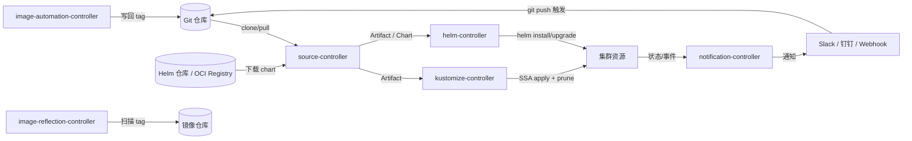
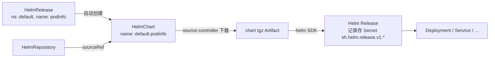
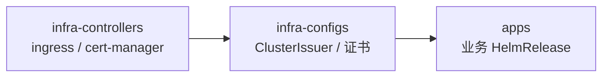
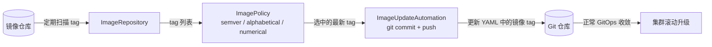
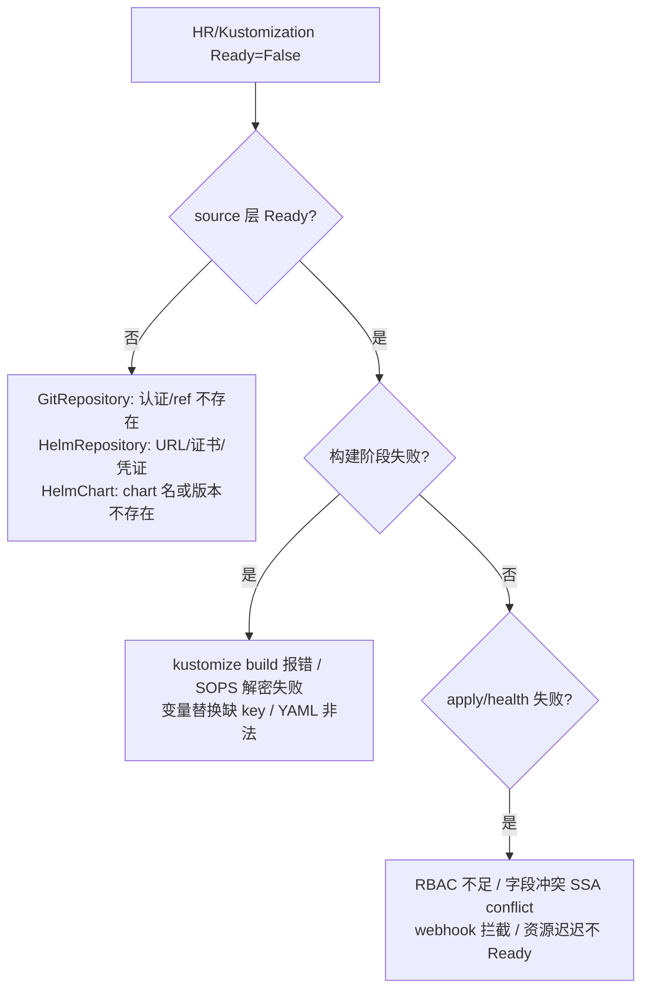

---
tags:
  - 平台组件
  - gitops
  - fluxcd
  - helm
  - 教学
created: 2026-11-22
---

# 📖 GitOps 与 FluxCD

> 通用教学笔记：讲清 GitOps 理念与 Flux v2 的完整工作机制，不涉及具体项目。项目内的特殊用法见 [[FluxCD项目实战]]。

## 一、GitOps 是什么

GitOps 是一种以 **Git 仓库为唯一事实源（Single Source of Truth）** 的持续交付方法。四条核心原则：

1. **声明式**：系统期望状态用声明式配置描述（K8s YAML / Helm chart / Kustomize）；
2. **版本化且不可变**：期望状态存 Git，任何变更都有 commit 历史，可审计、可回滚；
3. **自动拉取**：集群内的 agent 持续把 Git 里的声明"拉"进集群，而不是 CI 流水线往集群"推"；
4. **持续收敛**：agent 不断对比实际状态与期望状态，发现漂移（有人 kubectl 手改、资源被删）就自动纠正。

与 CI/CD 推送模式的关键区别：

| 维度 | 传统 CI/CD 推送 | GitOps 拉取 |
|---|---|---|
| 变更入口 | 流水线 `kubectl apply` / `helm upgrade` | git push（唯一入口） |
| 集群凭证 | CI 系统持有集群 kubeconfig（攻击面大） | 集群内 agent 主动出站拉取，无需入站凭证 |
| 漂移处理 | 无感知，手改后与流水线记录不一致 | 自动检测并纠正回 Git 声明 |
| 回滚 | 重跑旧流水线 | `git revert`，agent 自动收敛 |
| 审计 | 散落在 CI 日志 | Git 历史即完整审计日志 |

Flux 和 ArgoCD 是 GitOps 的两大主流实现，本文讲 Flux。

## 二、Flux v2 架构：GitOps Toolkit（GOTK）

Flux v2 不是一个单体程序，而是**一组各司其职的 K8s controller + 一套 CRD**，合称 GitOps Toolkit。每个 controller 只 watch 自己的 CR，通过 CR 之间的引用串成流水线：

| Controller | 管理的 CR | 职责 |
|---|---|---|
| source-controller | GitRepository / HelmRepository / OCIRepository / Bucket | 从外部源拉取制品（manifest 打包成 tar、chart、OCI artifact），产出集群内可访问的 **Artifact**，供下游消费 |
| kustomize-controller | Kustomization（CR，注意与 kustomize 工具区分） | 从 Artifact 取 manifest，做 kustomize 构建 / SOPS 解密 / 变量替换，**Server-Side Apply** 进集群，健康检查 + prune |
| helm-controller | HelmRelease | 用 Helm SDK 执行 install / upgrade / test / rollback / uninstall，release 记录存 Secret |
| notification-controller | Provider / Alert / Receiver | 事件外发（Slack、钉钉、webhook）+ 接收外部 webhook 触发 reconcile |
| image-reflection-controller | ImageRepository / ImagePolicy | 扫描镜像仓库 tag，按策略选出"最新"镜像 |
| image-automation-controller | ImageUpdateAutomation | 把选出的镜像 tag 写回 Git 仓库（自动 commit） |

数据流全景：



要点：**source-controller 是唯一与外部制品源打交道的组件**，认证、证书、代理都配置在 source 层 CR 上；下游 controller 只消费集群内 Artifact，不直接访问 Git/Registry。排障时"拉不下来"看 source 层，"装不上去"看 kustomize/helm 层。

## 三、安装与 Bootstrap

### 3.1 flux CLI 与前置检查

```bash
# 安装 CLI
curl -s https://fluxcd.io/install.sh | sudo bash

# 检查集群是否满足安装条件（K8s 版本、RBAC、已有 Flux）
flux check --pre
```

### 3.2 bootstrap：把 Flux 自身也交给 Git 管

```bash
# GitHub（自动建仓、生成 deploy key、提交 Flux 自身 manifests）
flux bootstrap github \
  --owner=<org> --repository=fleet-infra \
  --branch=main --path=clusters/prod \
  --personal

# 通用 Git（GitLab / Gitea / 裸 git，需先手动建好仓库）
flux bootstrap git \
  --url=ssh://git@example.com/org/fleet-infra \
  --branch=main --path=clusters/prod \
  --private-key-file=/path/to/deploy.key
```

bootstrap 做三件事：

1. 把 Flux 自身的组件 manifests（`gotk-components.yaml`）+ 同步 CR（`gotk-sync.yaml`）提交到仓库 `--path` 下；
2. 在集群安装 Flux controllers（默认 `flux-system` namespace）；
3. 创建一个指向仓库自身的 GitRepository + Kustomization——**从此 Flux 升级也是改 Git 里的 components 文件，由 Flux 自己收敛**（自举）。

bootstrap 后的仓库典型结构：

```
fleet-infra/
├── clusters/
│   ├── prod/
│   │   ├── flux-system/          # bootstrap 生成，勿手改
│   │   │   ├── gotk-components.yaml
│   │   │   ├── gotk-sync.yaml
│   │   │   └── kustomization.yaml
│   │   ├── infrastructure.yaml   # Kustomization CR → 指向 infrastructure/
│   │   └── apps.yaml             # Kustomization CR → 指向 apps/prod/
│   └── staging/
├── infrastructure/               # 平台组件（ingress、cert-manager、监控…）
│   ├── controllers/
│   └── configs/
└── apps/
    ├── base/                     # 应用基础定义
    ├── prod/                     # prod overlay（Kustomize patch）
    └── staging/
```

分层逻辑：`clusters/` 只放"指向哪里的 Kustomization CR"，`infrastructure/` 与 `apps/` 放真正的声明，环境差异用 Kustomize overlay 表达。**先收敛基础设施、再收敛应用**，用 `dependsOn` 保证顺序（见 §5.3）。

## 四、Source 层：制品从哪来

四种 source CR，API 均为 `source.toolkit.fluxcd.io/v1`：

### 4.1 GitRepository

```yaml
apiVersion: source.toolkit.fluxcd.io/v1
kind: GitRepository
metadata:
  name: podinfo
  namespace: flux-system
spec:
  interval: 5m                      # 轮询间隔
  url: https://github.com/stefanprodan/podinfo
  ref:
    branch: master                  # 四选一: branch / tag / semver / commit
    # semver: ">=6.0.0"             # 语义化版本范围，自动跟踪最新 tag
  secretRef:
    name: git-credentials           # HTTPS: username/password(token); SSH: identity/known_hosts
  # provider: azure                 # 云厂商托管认证（Azure/GCP/AWS）
```

- `ref` 精确到 commit 时不可变，适合锁定版本；`semver` 适合自动跟踪 release；
- 产出 Artifact 是**整个仓库（或 sparseCheckout 子目录）的 tar 包**，存在 source-controller 的本地存储，通过 HTTP 暴露给下游；
- 私有仓认证 Secret 的 key 有讲究：HTTPS 用 `username` + `password`，SSH 用 `identity` + `known_hosts`。

### 4.2 HelmRepository

```yaml
# 经典 HTTP chart 仓库（index.yaml）
apiVersion: source.toolkit.fluxcd.io/v1
kind: HelmRepository
metadata:
  name: bitnami
  namespace: flux-system
spec:
  interval: 1h
  url: https://charts.bitnami.com/bitnami
---
# OCI chart 仓库（现代推荐，chart 即 OCI artifact）
apiVersion: source.toolkit.fluxcd.io/v1
kind: HelmRepository
metadata:
  name: podinfo-oci
  namespace: flux-system
spec:
  type: oci                         # 关键区别
  interval: 5m
  url: oci://ghcr.io/stefanprodan/charts   # 注意: 仓库层地址, 不含 chart 名
  secretRef:
    name: registry-auth             # dockerconfigjson 类型
```

**易错点**：OCI 类型的 `url` 是仓库层地址（到 namespace 为止），chart 名和版本写在 HelmRelease 的 `spec.chart.spec` 里。URL 里带上 chart 名会 404。

### 4.3 OCIRepository 与 Bucket

- `OCIRepository`：把任意 OCI artifact（不只是 chart，也可以是打包的 manifests、conftest 策略等）拉到集群，`spec.layerSelector` 可选 mediaType / operation（`extract` 解包 or `copy` 原样）；
- `Bucket`：从 S3 兼容对象存储（MinIO / AWS S3）拉 manifest 包，适合不能出 Git 流量的场景。

## 五、Kustomization CR：manifest 的收敛引擎

**注意命名冲突**：这里的 Kustomization 是 `kustomize.toolkit.fluxcd.io/v1` 的 CR，是 Flux 的部署单元；它内部*可以*执行 kustomize 工具的 build，但目录下没有 `kustomization.yaml` 也能直接 apply 纯 YAML。

### 5.1 最小示例

```yaml
apiVersion: kustomize.toolkit.fluxcd.io/v1
kind: Kustomization
metadata:
  name: podinfo
  namespace: flux-system
spec:
  interval: 10m                     # 漂移检测/收敛周期
  path: ./kustomize                 # 仓库内路径
  prune: true                       # Git 里删掉的资源, 集群里也删掉（垃圾回收）
  sourceRef:
    kind: GitRepository
    name: podinfo
  targetNamespace: default          # 强制所有资源进这个 ns
  timeout: 2m                       # 单次 apply 的等待上限
  wait: true                        # apply 后等所有资源 Ready 才算成功
```

### 5.2 核心机制

- **Server-Side Apply（SSA）**：kustomize-controller 用 SSA 管理字段所有权。有人 `kubectl edit` 改了 Flux 管理的字段，下个 interval 会被改回来——这就是**漂移纠正**。想临时手改调试，先 `flux suspend kustomization <name>`；
- **prune**：控制器给 apply 过的资源打 label 记录 inventory，Git 里删除文件后，对应集群资源被删除。`prune: false` 则只增不删；
- **健康检查**：内置对 Deployment / StatefulSet / DaemonSet / Job / Pod / Service 等的就绪判定，`wait: true` 时不 Ready 就报 `Ready=False`，并阻塞 `dependsOn` 它的下游；
- **变量替换**：`spec.postBuild.substituteFrom` 引用 ConfigMap/Secret，把 manifest 里的 `${VAR}` 替换掉（轻量模板，复杂逻辑还是交给 kustomize/Helm）；
- **SOPS 解密**：`spec.decryption.provider: sops` + age 私钥 Secret，Git 里存加密文件，apply 前在内存解密（见 §9）。

### 5.3 dependsOn：编排收敛顺序

```yaml
spec:
  dependsOn:
    - name: infra-controllers       # 等它 Ready=True 才开始收敛本对象
```

典型链：`cert-manager CRD/控制器 → ClusterIssuer → 业务应用的证书 → 应用`。注意 `dependsOn` 只保证**顺序**，不做回滚联动；跨 Kustomization 引用资源时，被依赖方必须 `wait: true` 健康检查才有意义。

## 六、HelmRelease：Helm 的 GitOps 化

`helm.toolkit.fluxcd.io/v2`。HelmRelease 不是简单包一层 `helm upgrade`，而是把 Helm 的**全生命周期**（安装、升级、测试、失败修复、回滚、卸载）都变成声明式。

### 6.1 完整示例

```yaml
apiVersion: helm.toolkit.fluxcd.io/v2
kind: HelmRelease
metadata:
  name: podinfo
  namespace: default
spec:
  interval: 10m
  chart:
    spec:
      chart: podinfo                # chart 名
      version: "6.x"                # semver 范围, 自动跟踪新 patch
      sourceRef:
        kind: HelmRepository
        name: podinfo-oci
        namespace: flux-system      # source 可以跨 ns 引用
      interval: 5m                  # chart 版本检查间隔（独立于 HR interval）
  values:
    replicaCount: 2
  valuesFrom:                       # 外部 values, 按序合并, 后者覆盖前者
    - kind: ConfigMap
      name: podinfo-values          # key: values.yaml
    - kind: Secret
      name: podinfo-secret-values
  install:
    createNamespace: true
    remediation:
      retries: 3                    # 安装失败重试次数, -1 = 无限
  upgrade:
    remediation:
      retries: 3
      strategy: rollback            # 升级失败: rollback(回旧版) 或 uninstall(卸了重装)
    force: false                    # true = 资源冲突时删掉重建（危险, 慎用）
  rollback:
    cleanupOnFail: true
  uninstall:
    keepHistory: false
  driftDetection:
    mode: enabled                   # 检测并纠正 helm 管理资源的漂移（ SSA patch）
```

### 6.2 隐式 HelmChart：排障必懂

HelmRelease 的 `spec.chart.spec` 会让 helm-controller **自动创建一个 HelmChart CR**（source 层资源），命名规则 `<namespace>-<releaseName>`，由 source-controller 去下载 chart 包：



所以 chart 拉取失败（认证错、版本不存在、证书问题）时，**看 HelmChart 和 HelmRepository 的 status，而不是只盯 HelmRelease**——HR 上往往只有一句 "chart not ready"。

### 6.3 失败修复与回滚语义

- `install.remediation.retries`：安装失败后先 uninstall 再重装，重试 N 次仍失败则标记 `Ready=False` 停手；
- `upgrade.remediation.strategy: rollback`：升级失败自动回滚到上一个成功 release；回滚也失败则按策略卸载重装；
- 历史版本数由 `spec.maxHistory` 控制（默认 5），限制 etcd 里 release Secret 的数量；
- `spec.suspend: true`：暂停该 HR 的一切 reconcile（排障/冻结发布用）。

### 6.4 values 的两种来源怎么选

| 方式 | 适用 | 注意 |
|---|---|---|
| `spec.values` 内联 | 值少、随 Git 版本走 | 改 values 即改 HR spec，立即触发 |
| `valuesFrom` ConfigMap/Secret | 值多、敏感值、多 HR 共享 | 引用的 CM/Secret 变更也会触发 reconcile（controller watch 它们）；Secret 里的值不落 Git 明文 |

## 七、Reconcile 机制深入

所有 Flux CR 共享同一套协调语义，理解这层就能读懂一切 Flux 对象的行为：

### 7.1 触发方式（三种）

1. **周期轮询**：`spec.interval` 到点就 reconcile。source 层检查远端有没有新版本；kustomize/helm 层即使源没变也会重新 apply（漂移纠正）；
2. **事件触发**：对象 spec 变更（generation 变化）、依赖的 source 产出新 Artifact、valuesFrom 引用的 CM/Secret 变化；
3. **手动/webhook 触发**：打 annotation——

```bash
# 请求立即协调（spec 没变时 helm-controller 可能跳过实际执行）
kubectl annotate helmrelease podinfo -n default \
  reconcile.fluxcd.io/requestedAt="$(date +%s)" --overwrite

# HelmRelease 专属: 强制执行（即使 spec/values 都没变也重跑 helm upgrade）
kubectl annotate helmrelease podinfo -n default \
  reconcile.fluxcd.io/forceAt="$(date +%s)" --overwrite

# flux CLI 等价命令
flux reconcile source git podinfo
flux reconcile kustomization podinfo --with-source   # 连 source 一起触发
flux reconcile helmrelease podinfo --force
```

`requestedAt` vs `forceAt` 的区别是常见坑：前者只是"请你看看"，后者是"无论如何执行一遍"。

### 7.2 读懂 status

```yaml
status:
  observedGeneration: 3             # 已处理的 spec 版本; 小于 metadata.generation = 还没处理到
  conditions:
    - type: Ready                   # 最终就绪判定（看这个）
      status: "True"
      reason: ReconciliationSucceeded
    - type: Reconciling             # 正在执行中
      status: "False"
  lastAppliedRevision: main@sha1:abc123   # 当前收敛到的 Git revision / chart 版本
  lastAttemptedRevision: main@sha1:def456 # 最近一次尝试的 revision（失败时两者不一致）
```

排障三板斧：`Ready` condition 的 message → `lastAttemptedRevision` 是否停在旧版 → 对应 controller 日志。

### 7.3 suspend 的边界

`spec.suspend: true` 只暂停**该对象自身**的 reconcile：source 被 suspend 后不再拉新制品，但下游 Kustomization 仍会按自己的 interval 用旧 Artifact 反复 apply。要冻结整条链，用 `flux suspend kustomization <name> --all` 或逐层 suspend。

## 八、多环境仓库布局与依赖编排

一个中等规模团队的 fleet 仓库推荐结构（bootstrap 结构的扩展）：

```
fleet-infra/
├── clusters/
│   ├── prod/
│   │   ├── flux-system/
│   │   ├── infra.yaml        # Kustomization → ../../infrastructure/controllers
│   │   └── apps.yaml         # Kustomization → ../../apps/prod, dependsOn: infra
│   └── staging/              # 同构, 指向 apps/staging
├── infrastructure/
│   ├── controllers/          # ingress-nginx, cert-manager 的 HelmRelease
│   │   ├── kustomization.yaml
│   │   ├── ingress-nginx.yaml
│   │   └── cert-manager.yaml
│   └── configs/              # ClusterIssuer 等, dependsOn controllers
└── apps/
    ├── base/podinfo/         # HelmRelease 基础定义
    ├── prod/                 # overlay: patch replicaCount / 资源限额
    └── staging/
```

收敛顺序靠 Kustomization CR 的 `dependsOn` 串起来：



原则：

- **一个 Kustomization CR 管一个"部署单元"**（一组同生命周期、同健康语义的资源），不要一个 CR 包打天下——失败时无法定位是哪部分坏了，`dependsOn` 也没法细粒度编排；
- 环境差异全部走 Kustomize overlay / 不同 values 文件，**base 里不出现环境名**；
- 应用升级到新版本 = 改 Git 里的 `chart.spec.version` 或镜像 tag，PR review 即发布审批。

## 九、Secret 管理：SOPS + age

GitOps 要求一切进 Git，但 Secret 不能明文进。Flux 的标准答案是 **Mozilla SOPS 加密 + kustomize-controller 内置解密**：

```bash
# 1. 生成 age 密钥对
age-keygen -o age.agekey        # 公钥打印在 stderr, 私钥在文件里

# 2. 集群里创建私钥 Secret（controller 用它解密）
kubectl -n flux-system create secret generic sops-age \
  --from-file=age.agekey=age.agekey

# 3. 仓库根放 .sops.yaml, 声明加密规则
cat > .sops.yaml <<EOF
creation_rules:
  - path_regex: .*\.secret\.yaml$
    encrypted_regex: ^(data|stringData)$
    age: <公钥>
EOF

# 4. 加密后提交（文件仍是合法 YAML, 只有 data 值是密文）
sops --encrypt --in-place apps/prod/db.secret.yaml
git add .sops.yaml apps/prod/db.secret.yaml && git commit -m "add db secret"
```

Kustomization CR 开启解密：

```yaml
spec:
  decryption:
    provider: sops
    secretRef:
      name: sops-age
```

要点：加密只覆盖 Secret 的 `data/stringData`，kind/name 等元数据保持明文（否则 kustomize 无法引用）；私钥只存在集群 Secret 里，**age.agekey 私钥文件本身绝不进 Git**。除 age 外 SOPS 也支持 PGP / KMS / Vault，团队有云 KMS 时优先用 KMS（免私钥分发）。

## 十、通知与 Webhook

### 10.1 事件外发：Provider + Alert

```yaml
apiVersion: notification.toolkit.fluxcd.io/v1beta3
kind: Provider
metadata:
  name: slack
  namespace: flux-system
spec:
  type: slack                       # slack / msteams / discord / generic(webhook) / github ...
  channel: deployments
  address: https://hooks.slack.com/services/xxx
---
apiVersion: notification.toolkit.fluxcd.io/v1beta3
kind: Alert
metadata:
  name: helm-alerts
  namespace: flux-system
spec:
  providerRef:
    name: slack
  eventSeverity: info               # info: 全部事件; error: 只报失败
  eventSources:
    - kind: HelmRelease
      name: '*'                     # 该 ns 下所有 HR
    - kind: Kustomization
      name: '*'
```

### 10.2 事件入站：Receiver（git push 秒级触发）

轮询 interval 有分钟级延迟，Receiver 让 Git 服务端 push 事件直接触发 reconcile：

```yaml
apiVersion: notification.toolkit.fluxcd.io/v1
kind: Receiver
metadata:
  name: github-receiver
  namespace: flux-system
spec:
  type: github                      # github / gitlab / harbor / generic ...
  events: ["ping", "push"]
  secretRef:
    name: webhook-token             # controller 自动生成随机 token
  resources:
    - kind: GitRepository
      name: podinfo
```

```bash
# 取自动生成的 webhook 路径
kubectl -n flux-system get receiver github-receiver \
  -o jsonpath='{.status.webhookPath}'
# 拼成 https://<外部入口>/hook/<sha256(token)> 配到 GitHub webhook
```

注意：Receiver 需要 notification-controller 有**入站可达**的地址（Ingress / LoadBalancer）。纯内网无入站的环境只能靠轮询——这也是有些私有化平台干脆关掉轮询、由上游程序化打 annotation 触发的原因（[[FluxCD项目实战]] 就是这种形态）。

## 十一、镜像自动更新（Image Automation）

把"镜像出了新 tag → Git 里的 tag 自动更新 → 集群自动升级"整条链闭环，三个 CR 分工：



```yaml
apiVersion: image.toolkit.fluxcd.io/v1beta2
kind: ImagePolicy
metadata:
  name: podinfo
  namespace: flux-system
spec:
  imageRepositoryRef:
    name: podinfo
  policy:
    semver:
      range: ">=6.0.0"
---
apiVersion: image.toolkit.fluxcd.io/v1beta2
kind: ImageUpdateAutomation
metadata:
  name: fleet
  namespace: flux-system
spec:
  interval: 5m
  sourceRef:
    kind: GitRepository
    name: fleet-infra
  git:
    checkout:
      ref:
        branch: main
    commit:
      author:
        name: fluxbot
        email: fluxbot@example.com
      messageTemplate: "chore: update image {{range .Updated.Images}}{{println .}}{{end}}"
    push:
      branch: main
  update:
    path: ./apps
    strategy: Setters               # 识别 YAML 里的标记注释
```

被更新的 YAML 需要打 setter 标记：

```yaml
image: ghcr.io/stefanprodan/podinfo:6.5.0 # {"$imagepolicy": "flux-system:podinfo"}
```

注意：写回 Git 需要**可写凭证**（deploy key 带写权限 / PAT），与只读的拉取凭证分开；自动更新绕过了 PR review，生产环境建议只对 staging 开启，或配合分支保护把 fluxbot 的 push 限制到专用分支再走 PR。

## 十二、常用命令速查

```bash
# 全局状态
flux check                          # controllers 健康 + 版本
flux get all -A                     # 所有 Flux CR 一览
flux stats                          # 各类型 reconcile 统计

# 分层查看
flux get sources git -A
flux get sources chart -A           # 含隐式 HelmChart
flux get kustomizations -A
flux get helmreleases -A

# 手动触发
flux reconcile source git <name>
flux reconcile kustomization <name> --with-source
flux reconcile helmrelease <name> --force

# 冻结/恢复（排障时先 suspend 再手改集群）
flux suspend kustomization <name>
flux resume kustomization <name>

# 排障
flux logs --level=error             # 聚合所有 controller 错误日志
flux events --for HelmRelease/podinfo -n default
flux trace deployment/podinfo -n default   # 反查: 这个资源归哪个 CR 管、收敛到哪个 revision

# 调试渲染（不 apply, 只看会生成什么）
flux build kustomization <name> --path ./apps/prod

# 卸载
flux uninstall --namespace=flux-system     # 删 controllers, 保留业务资源
```

`flux trace` 特别有用：集群里任何一个资源，反查出它由哪个 Kustomization/HelmRelease 管理、来自哪个 Git revision——回答"这东西是谁装的、为什么是这个版本"。

## 十三、排障思路与常见坑

### 13.1 分层排障法

失败沿依赖链向上传导，排障要**从 source 层往下查**：



### 13.2 常见坑清单

1. **Kustomization CR ≠ kustomization.yaml**：前者是 Flux 部署单元，后者是 kustomize 工具的配置，同名不同物；
2. **OCI HelmRepository 的 URL 不带 chart 名**：仓库层与制品层分开写，URL 带 chart 名直接 404；
3. **chart 拉取失败看隐式 HelmChart**：名字 `<ns>-<releaseName>`，HR 的 status 只有一句笼统的 "chart not ready"；
4. **requestedAt 不保证执行**：spec 没变时 HelmRelease 可能跳过，需要强制执行用 `forceAt` / `--force`；
5. **suspend 只停自己**：suspend source 不停下游的反复 apply，冻结整条链要逐层操作；
6. **prune 误删**：把某个目录从 Kustomization 的 `path` 里挪走 = Git 声明里"删除"了这些资源，`prune: true` 会把集群里的它们删掉。调整 path 前先想清楚 inventory 归属；
7. **SSA 字段冲突**：资源曾被 kubectl/其他 controller 管理过，SSA 报 field conflict。确认归属后可给 Kustomization 加 `spec.force: true`（一次性抢所有权，别常开）；
8. **dependsOn 不传递健康语义**：上游没配 `wait: true` 时，"Ready" 可能只代表 apply 成功而非工作负载就绪，下游照样提前启动；
9. **interval 的取舍**：太短浪费 API/流量，太长漂移纠正慢。常见配置：source 5m~1h、Kustomization/HR 10m~30m，再配 webhook 补实时性；
10. **Flux 自升级也是 GitOps**：改 `gotk-components.yaml` 提交即可，但 bootstrap 生成的 `flux-system/` 目录不要手动重构，`flux bootstrap` 重跑会覆盖。

## 十四、Flux vs ArgoCD 速览

| 维度 | Flux v2 | ArgoCD |
|---|---|---|
| 形态 | 一组独立 controller + CRD，无自带 UI | 单体 server + 完善的 Web UI |
| 配置方式 | 纯 CR，kubectl/flux CLI 操作 | CR + UI + CLI |
| Helm 支持 | helm-controller 全生命周期（含自动回滚） | 渲染成 manifest 后 apply，rollback 靠 Git |
| 多集群 | 每集群装一套，fleet 仓库分目录管理 | 一套 server 管多集群（注册 cluster secret） |
| 扩展性 | GOTK 各组件可独立替换/复用（如只用 helm-controller） | 整体性强，App-of-Apps / ApplicationSet 编排 |
| 适用画像 | 平台工程：把交付能力嵌进自己的系统 | 应用团队：开箱即用的可视化 GitOps |

两者理念一致，选型主要看"要不要 UI/多集群集中管理"以及"是否把 Flux 组件当 SDK 复用"。

## 相关

- 上游：[[平台组件]] · [[云原生]] · [[Kubernetes]]
- 项目用法：[[FluxCD项目实战]]（程序化 CR + 主动触发的非典型形态，与本文经典模式对照阅读）
- 基础工具：[[Helm&Kustomize]]（chart 与 overlay 的构建基础）