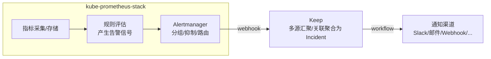
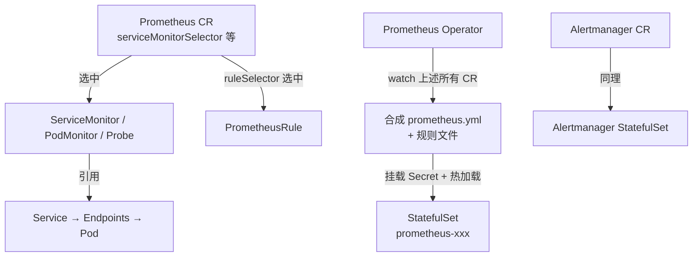
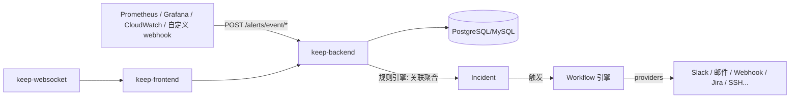
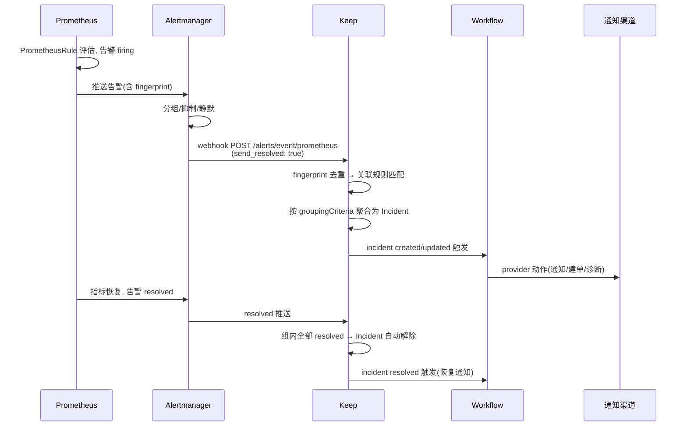

---
tags:
  - 平台组件
  - monitoring
  - prometheus
  - alertmanager
  - keep
  - 教学
aliases:
  - KPS
  - Keep
  - kube-prometheus-stack
created: 2026-11-22
---

# 📖 KPS 与 Keep

> 通用教学笔记：讲清 kube-prometheus-stack（集群指标与告警信号）和 Keep（告警聚合与工作流自动化）的完整工作机制，不涉及具体项目。项目内的定制用法见 [[KPS+Keep项目实战]]。

## 一、两者在观测体系中的位置

一条完整的告警链路分三段，KPS 和 Keep 各管一段：



| 维度 | KPS | Keep |
|---|---|---|
| 处理对象 | 时序指标（metrics） | 告警事件（alerts） |
| 核心问题 | "系统现在什么状态" | "哪些告警其实是同一件事，该通知谁、做什么" |
| 告警能力 | 单 Prometheus 内的阈值判断 + Alertmanager 分组降噪 | **跨数据源**关联（Prometheus/CloudWatch/Datadog/Grafana…）、事件生命周期、自动化工作流 |
| 类比分工 | 信号生产者 | 信号消费者与升格者 |

关键认知：**Alertmanager 的 group 不是事件**。它只是把同一批告警打包成一条通知，没有状态、没有生命周期、不能跨源关联。Keep 的 Incident 才是有状态的事件对象（firing → acknowledged → resolved），能挂工作流、能被 API 查询和处置。两者是互补而非替代——常见组合就是 KPS 出信号、Keep 做聚合升格。

---

# Part A：kube-prometheus-stack

## 二、KPS 是什么

kube-prometheus-stack 是 prometheus-community 维护的 **Helm chart 全家桶**，一次安装得到：

| 子组件 | 职责 |
|---|---|
| Prometheus Operator | 核心：watch 一组 CRD，把声明式配置翻译成 Prometheus/Alertmanager 的实际配置并管理其 StatefulSet |
| Prometheus | 指标采集、TSDB 存储、规则评估 |
| Alertmanager | 告警去重、分组、抑制、静默、路由投递 |
| Grafana（可选） | 可视化，预装一批 K8s 仪表盘 |
| node-exporter | DaemonSet，节点级指标（CPU/内存/磁盘/网络） |
| kube-state-metrics | Deployment，把 K8s 对象状态转成指标（Pod phase、Deployment 副本数等） |
| defaultRules | 社区沉淀的告警规则集（K8s 组件、节点、容器资源） |

注意区分：**KPS ≠ Prometheus Operator**。Operator 只是其中的控制器；KPS 是"Operator +  operands + exporters + 规则 + 仪表盘"的打包发行版。

## 三、Operator 的 CRD 模型（核心机制）

Prometheus Operator 的设计哲学：**把 Prometheus 的配置文件变成 K8s CR**。你不再手写 `prometheus.yml` 的 scrape_configs，而是创建 ServiceMonitor 等对象，Operator 负责合成配置、热加载。

| CRD | 作用 |
|---|---|
| `Prometheus` | 声明一个 Prometheus 实例：副本数、retention、存储、资源、**选择哪些监控对象**（各种 selector） |
| `Alertmanager` | 声明 Alertmanager 实例及其配置来源 |
| `ServiceMonitor` | 声明"抓哪些 Service 背后的 Pod 的 metrics 端口" |
| `PodMonitor` | 直接按 label 选 Pod（没有 Service 的场景，如 DaemonSet 直抓） |
| `Probe` | 黑盒探测（blackbox exporter）：HTTP/TCP/ICMP 拨测 |
| `PrometheusRule` | 告警规则 + recording rules |
| `ScrapeConfig` | 原生 scrape_config 的 CR 化（抓 K8s 之外的目标：EC2、文件服务发现等） |
| `AlertmanagerConfig` | 分 namespace 的路由/接收器片段，由 Operator 合并进主配置 |

配置合成流程：



两个直接推论：

1. **CR 的 status 不等于工作负载就绪**：Prometheus CR 本身没有"运行中"语义，排障要看它派生的 StatefulSet/Pod；
2. **selector 决定纳管范围**：ServiceMonitor 建了但没被抓取，九成是 Prometheus CR 的 selector 没匹配上（见 §4.3）。

## 四、安装与关键 values

### 4.1 安装

```bash
helm repo add prometheus-community https://prometheus-community.github.io/helm-charts
helm repo update

helm install kps prometheus-community/kube-prometheus-stack \
  -n monitoring --create-namespace \
  -f values.yaml
```

### 4.2 关键 values 速览

```yaml
prometheus:
  prometheusSpec:
    retention: 10d                    # TSDB 保留时长
    retentionSize: 18GB               # 或按大小保留, 二者先到先触发
    resources:
      requests: { memory: 2Gi }
      limits:   { memory: 4Gi }       # 内存与活跃序列数强相关, 见 §7
    storageSpec:
      volumeClaimTemplate:
        spec:
          storageClassName: fast-ssd
          resources: { requests: { storage: 50Gi } }
    # 五个 selector: 决定纳管哪些监控 CR
    serviceMonitorSelectorNilUsesHelmValues: false   # false = 不按 release label 过滤
    podMonitorSelectorNilUsesHelmValues: false
    ruleSelectorNilUsesHelmValues: false
    probeSelectorNilUsesHelmValues: false
    scrapeConfigSelectorNilUsesHelmValues: false
    remoteWrite: []                   # 需要长期存储/集中查询时配 Thanos/Mimir/VictoriaMetrics

alertmanager:
  alertmanagerSpec:
    retention: 120h                   # 静默/通知日志保留
  config: { ... }                     # 路由树, 见 §6

grafana:
  enabled: true                       # 已有独立 Grafana 时设 false

defaultRules:
  create: true                        # 社区默认告警规则
  rules:
    etcd: false                       # 可按组关闭(如控制面不可达时)

kubeControllerManager: { enabled: false }   # 控制面组件监控, 托管集群/不可达时关闭
kubeEtcd: { enabled: false }
kubeScheduler: { enabled: false }
kubeProxy: { enabled: false }
```

### 4.3 selector 语义（最常见的困惑）

`xxxSelectorNilUsesHelmValues` 的含义：

- `true`（默认）：selector 为空时，**只纳管带本 release label 的 CR**——即只有 KPS chart 自己创建的监控对象生效，你手建的 ServiceMonitor 不被理睬；
- `false`：selector 为空时解释为"匹配所有"——**任何 namespace 的 ServiceMonitor/PrometheusRule 都被纳管**。

平台化场景通常五个全设 `false`，让业务组件 chart 自带监控"即插即用"；代价是失去准入控制，测试用的 SM 也会被抓取，基数治理要靠自己（§7.2）。另一种精细做法是显式写 selector（按 label/namespace 匹配），只纳管打了约定 label 的 CR。

## 五、接入自己的服务

### 5.1 ServiceMonitor：白盒监控的标准姿势

前提：应用暴露 `/metrics`（Prometheus 文本格式），且有一个 Service 指向它。

```yaml
apiVersion: v1
kind: Service
metadata:
  name: myapp
  labels: { app: myapp }
spec:
  selector: { app: myapp }
  ports:
    - name: http-metrics              # 端口必须有名字, SM 按名字引用
      port: 8080
---
apiVersion: monitoring.coreos.com/v1
kind: ServiceMonitor
metadata:
  name: myapp
  namespace: monitoring               # 放哪个 ns 取决于 Prometheus CR 的 selector 范围
  labels: { release: kps }            # selector 按 label 过滤时需要
spec:
  selector:
    matchLabels: { app: myapp }       # 选中上面的 Service
  namespaceSelector:
    matchNames: [myapp-ns]            # Service 所在的 ns; any: true = 全部
  endpoints:
    - port: http-metrics              # 引用 Service 的端口名
      path: /metrics
      interval: 30s
      scrapeTimeout: 10s
```

没有 Service 时用 PodMonitor（`podMetricsEndpoints` + `podTargetLabels`），直接按 Pod label 选目标。

验证：Prometheus UI → Status → Targets，应出现 `serviceMonitor/monitoring/myapp/0` 这样的 target pool。

### 5.2 PrometheusRule：告警与预计算

```yaml
apiVersion: monitoring.coreos.com/v1
kind: PrometheusRule
metadata:
  name: myapp-rules
  labels: { release: kps }
spec:
  groups:
    - name: myapp.rules
      rules:
        # 告警规则: expr 持续为真超过 for 时长 → firing
        - alert: MyAppHighErrorRate
          expr: |
            sum(rate(http_requests_total{job="myapp",code=~"5.."}[5m]))
            / sum(rate(http_requests_total{job="myapp"}[5m])) > 0.05
          for: 10m                    # 防抖: 瞬时毛刺不告警
          labels:
            severity: warning         # 路由/抑制依赖的分级 label
          annotations:
            summary: "错误率超过 5%"
            description: "{{ $labels.instance }} 5xx 比例 {{ $value | humanizePercentage }}"
        # recording rule: 把昂贵查询预计算成新序列, 仪表盘/告警复用
        - record: job:http_requests:rate5m
          expr: sum(rate(http_requests_total[5m])) by (job)
```

规则工程要点：

- **`for` 是防抖窗口**，不是评估间隔；expr 每个 evaluation_interval 算一次，连续为真满 `for` 才 firing；
- 告警分级的惯例：`critical`（需要立即行动）/ `warning`（需要关注）/ `info`（原因类信号，供关联分析）；
- 区分**症状类**与**原因类**信号：用户可感知的故障（错误率、延迟）用 warning+；资源水位这类"可能有问题"的原因信号降级为 info，避免告警疲劳；
- **改规则先跑单元测试**：`promtool test rules` 用 input_series 构造指标序列、断言指定时刻的告警状态：

```yaml
# rule-test.yaml
rule_files: [rules.yaml]
evaluation_interval: 1m
tests:
  - interval: 1m
    input_series:
      - series: 'http_requests_total{code="500"}'
        values: '0+60x20'             # 每分钟 +60, 持续 20 个点
      - series: 'http_requests_total{code="200"}'
        values: '0+540x20'
    alert_rule_test:
      - eval_time: 15m
        alertname: MyAppHighErrorRate
        exp_alerts:
          - exp_labels: { severity: warning }
```

```bash
promtool test rules rule-test.yaml
```

### 5.3 黑盒探测：Probe

```yaml
apiVersion: monitoring.coreos.com/v1
kind: Probe
metadata:
  name: homepage
spec:
  jobName: blackbox
  prober:
    url: blackbox-exporter.monitoring:9115
  module: http_2xx
  targets:
    staticConfig:
      static: [https://example.com]
```

需要先部署 blackbox-exporter（KPS 有可选子 chart `prometheus-blackbox-exporter`）。

## 六、Alertmanager：路由树与降噪

Prometheus 只负责"产生告警"，**去重、分组、抑制、静默、投递全在 Alertmanager**。

### 6.1 配置结构

```yaml
route:
  receiver: default
  group_by: [alertname, namespace]    # 分组维度: 同组告警合并成一条通知
  group_wait: 30s                     # 新组等 30s 攒一攒再发(聚合同批告警)
  group_interval: 5m                  # 已发过的组, 有新告警加入时至少隔 5m 再发
  repeat_interval: 4h                 # 组内无变化时, 重复提醒的间隔
  routes:
    - matchers: [severity="critical"]
      receiver: pager
    - matchers: [alertname="Watchdog"]
      receiver: "null"                # 心跳告警路由到空接收器(降噪)

inhibit_rules:
  - source_matchers: [severity="critical"]
    target_matchers: [severity="warning"]
    equal: [alertname, namespace]     # 同 alertname+ns 的 critical 压制 warning

receivers:
  - name: default
    webhook_configs:
      - url: http://keep-backend:8080/alerts/event/prometheus
        send_resolved: true           # 恢复通知也发(下游状态对账的前提)
  - name: pager
    pagerduty_configs: [...]
  - name: "null"                      # 内置空接收器
```

### 6.2 三个时间参数的语义（易混）

| 参数 | 作用对象 | 语义 |
|---|---|---|
| `group_wait` | **新组**的第一条通知 | 延迟发送，等同组告警到齐 |
| `group_interval` | **已有组**出现新告警 | 两次通知的最小间隔 |
| `repeat_interval` | **无变化的组** | 持续 firing 时的重复提醒周期 |

### 6.3 抑制 vs 静默 vs 分组

- **抑制（inhibit）**：规则驱动，critical 存在时自动哑掉相关 warning——"节点都挂了，就别再报节点上的 Pod 告警"；
- **静默（silence）**：人工/临时，按 matcher 在时间窗内屏蔽匹配告警（维护窗口用），UI/API 创建；
- **分组（group）**：不丢告警，只是合并通知；组内每条告警的明细仍在 webhook payload 里。

### 6.4 Watchdog 心跳

defaultRules 自带一条永远 firing 的 `Watchdog` 告警，路由到 null 或外部 dead-man's-switch 服务。用途：**验证整条告警链路活着**——如果连 Watchdog 都收不到，说明 Prometheus→Alertmanager→接收器链路断了，而不是"系统很健康"。

## 七、存储、容量与基数治理

### 7.1 容量估算

Prometheus 内存主要由**活跃时间序列数（active series）**决定，经验值：每百万活跃序列约需 8~16Gi 内存（含查询开销）。磁盘 ≈ `每秒采样数 × retention 秒数 × 每样本 1~2 字节`。

```promql
# 当前活跃序列数
prometheus_tsdb_head_series
# 各 job 的序列数占比(找基数大户)
topk(10, count by (job) ({__name__=~".+"}))
# 采样速率
rate(prometheus_tsdb_head_samples_appended_total[5m])
```

### 7.2 基数（cardinality）爆炸的常见来源与对策

序列数 = 指标数 × label 值组合数。一个高基数 label（user_id、request_path、pod_template_hash）就能让序列数翻几个数量级。

- **采集端丢弃**：ServiceMonitor 的 `metricRelabelings` drop 高基数指标/label；
- **kube-state-metrics**：用 `metricLabelsAllowlist` 精确控制放行哪些 K8s label，默认不放行全部；
- **应用端自律**：不把无界值（URL 全路径、用户输入）做成 label；
- 事后补救：`promtool tsdb analyze` 离线分析块文件找大户。

### 7.3 长期存储与多集群

单机 Prometheus 的 retention 受本地盘限制。需要长期历史/全局视图时：

- `remoteWrite` → Thanos Receive / Grafana Mimir / VictoriaMetrics；
- 或 Thanos sidecar 模式：对象存储归档 + 全局查询层。

教学阶段先掌握单机形态，remoteWrite 只是把 TSDB 的写入复制一份出去，查询与告警仍在本地评估。

## 八、KPS 排障速查

```bash
# Operator 与 operands
kubectl -n monitoring get pods
kubectl -n monitoring logs deploy/kps-prometheus-operator
kubectl -n monitoring get prometheus,alertmanager

# 采集目标状态(UI): Targets 页看每个 pool 的 up/lastError
kubectl -n monitoring port-forward svc/kps-prometheus 9090:9090
curl -s 'localhost:9090/api/v1/targets' | jq '.data.activeTargets[] | select(.health!="up")'

# 规则是否加载 / 告警是否产生
curl -s localhost:9090/api/v1/rules | jq '.data.groups[].name'
curl -s 'localhost:9090/api/v1/query?query=ALERTS{alertstate="firing"}'

# Alertmanager 实际生效配置(存在 Secret 里)
kubectl -n monitoring get secret alertmanager-kps-alertmanager \
  -o jsonpath='{.data.alertmanager\.yaml}' | base64 -d
kubectl -n monitoring port-forward svc/kps-alertmanager 9093:9093
# UI: 看告警是否到达、被哪条路由/抑制/静默处理

# ServiceMonitor 没生效的三连问
kubectl get servicemonitor -A --show-labels        # 1. label 匹配 selector 吗
kubectl -n monitoring get prometheus kps-prometheus -o yaml | grep -A5 Selector  # 2. selector 范围
kubectl -n <ns> get endpoints <svc>                # 3. Service 有就绪端点吗
```

分层定位：**指标没采到** → Targets/SM/selector；**采到了没告警** → PrometheusRule 加载/expr/for；**告警了没通知** → Alertmanager 路由/抑制/静默/接收器。

---

# Part B：Keep

## 九、Keep 是什么

[Keep](https://www.keephq.dev)（keephq/keep）是开源的**告警管理与自动化平台**（AIOps alert management），解决 Alertmanager 之上的三个问题：

1. **多源汇聚**：Prometheus、Grafana、CloudWatch、Datadog、Zabbix、自定义 webhook…几十种 provider 的告警进同一个池子，统一模型（Alert）；
2. **关联升格**：按规则把相关告警聚合为 **Incident（事件）**，有状态生命周期、可认领、可处置；
3. **工作流自动化**：事件/告警触发 workflow，执行富化、诊断、通知、修复动作（provider 生态复用）。

一句话：**Alertmanager 管"一条告警怎么发出去"，Keep 管"一堆告警意味着什么、接下来做什么"**。

## 十、架构与安装

### 10.1 组件

| 组件 | 职责 |
|---|---|
| keep-backend（keep-api） | FastAPI 后端：告警摄入、规则引擎、workflow 执行、provider 管理，默认 :8080 |
| keep-frontend（keep-ui） | Next.js 前端，默认 :3000（也代理 /backend 路由） |
| keep-websocket | 前端实时推送（告警/事件状态变化） |
| database | SQLite（单机默认）/ MySQL / PostgreSQL（生产） |



### 10.2 安装

```bash
# Docker Compose(快速体验)
git clone https://github.com/keephq/keep && cd keep
docker compose up -d
# UI: http://localhost:3000

# Helm(K8s 生产)
helm repo add keephq https://keephq.github.io/helm-charts
helm install keep keephq/keep -n keep-system --create-namespace \
  --set backend.env.API_KEY=<自定义密钥>
```

生产要点：数据库外接 PostgreSQL/MySQL（chart 可带内置 PG，但状态与备份要自己管）；**API Key 是全局摄入/查询凭证**（`X-API-KEY` 头），多租户场景用 tenant 级 key。

## 十一、核心概念

| 概念 | 说明 |
|---|---|
| **Alert** | 统一告警模型：name、severity、status（firing/resolved/acknowledged）、labels、annotations、**fingerprint（去重键）**、source |
| **Incident** | 关联规则聚合出的事件，有独立生命周期；一个 alert 可关联多个 incident |
| **Rule** | 关联规则：什么告警、按什么维度分组、什么条件开组/解组 |
| **Workflow** | 触发器 + 步骤序列的自动化（通知、富化、诊断、修复） |
| **Provider** | 与外部系统的双向连接器：既是告警来源，也是 workflow 的动作执行器 |
| **Mapping** | 把第三方 payload 字段映射到 Keep 统一模型（自定义源必配） |
| **Enrichment** | 告警富化：提取字段、补上下文（如从 CMDB 补 owner） |
| **Preset / Facet** | 前端筛选视图 / 可筛选的字段维度 |

### 11.1 告警摄入与去重

```bash
# Alertmanager 原生格式(推荐, Prometheus 系零改造)
curl -X POST http://keep:8080/alerts/event/prometheus \
  -H "X-API-KEY: <key>" -H "Content-Type: application/json" \
  -d '{"status":"firing","alerts":[{
        "status":"firing",
        "labels":{"alertname":"HighCPU","instance":"node-1","severity":"warning"},
        "annotations":{"summary":"CPU 90%"},
        "startsAt":"2026-11-22T10:00:00Z",
        "fingerprint":"abc123"}]}'

# 通用格式(任意源, 配合 mapping)
curl -X POST http://keep:8080/alerts/event \
  -H "X-API-KEY: <key>" -d '{"name":"disk-full","severity":"critical","status":"firing",...}'
```

去重语义：**同 fingerprint 的重复推送是更新而非新建**；`status: resolved` 把对应告警置为已恢复。这就是为什么上游必须 `send_resolved: true`——否则 Keep 里的告警永远 firing，事件永不解除。

### 11.2 关联规则（Rule）

```json
POST /backend/rules
{
  "ruleName": "节点资源异常",
  "celQuery": "(source == \"prometheus\" && labels.alertname in [\"CPUThrottlingHigh\", \"KubeMemoryOvercommit\", \"NodeNotReady\"])",
  "sqlQuery": {"sql": "...", "params": {}},
  "groupingCriteria": ["labels.instance"],
  "timeframeInSeconds": 600,
  "createOn": "any",
  "resolveOn": "all_resolved",
  "threshold": 1,
  "incidentNameTemplate": "节点异常-{{alert.labels.instance}}"
}
```

逐字段语义：

| 字段 | 含义 |
|---|---|
| `celQuery` / `sqlQuery` | 规则命中条件，**两套查询引擎双表达**（CEL 表达式 / SQL），语义需一致 |
| `groupingCriteria` | 分组维度：命中告警按这些 label 值分组，**每组一个 Incident**（多租户场景常用租户/环境 label，实现事件隔离） |
| `timeframeInSeconds` | 时间窗：窗外旧告警不再追加进组 |
| `createOn: any` | 第一条命中告警就开组（对比 `all`：条件全满足才开） |
| `resolveOn: all_resolved` | 组内**全部**告警 resolved 才解除事件（对比 `first_resolved`/`never`） |
| `threshold` | 组内告警数达到阈值才升格为 Incident |
| `incidentNameTemplate` | 事件名模板，可插 alert 字段 |

规则设计经验：

- 按**故障域**分类建规则（控制面/计算/网络/存储/各中间件/业务），一条告警最好只落一个域——用 CEL 里的 namespace 排除避免"节点告警同时进计算事件和中间件事件"；
- 留一条**兜底规则**接住未分类告警，否则它们无声消失；
- 规则无优先级时命中即开组，注意互斥条件要自己写严。

### 11.3 Workflow

YAML 声明，`triggers` + `steps`（actions/conditions/foreach）：

```yaml
workflow:
  id: incident-notify
  description: 事件创建/更新时通知
  triggers:
    - type: incident
      events: [created, updated]
      filters:
        - key: status
          value: firing
  steps:
    - name: notify-oncall
      provider:
        type: webhook               # 任意 provider: slack/email/smtp/ssh/jira...
        with:
          url: http://notify-service/hook
          method: POST
          body:
            incident_id: "{{ incident.id }}"
            name: "{{ incident.name }}"
            severity: "{{ incident.severity }}"
            alerts: "{{ incident.alerts }}"
```

要点：

- 触发器类型：`alert`（告警级）/ `incident`（事件级）/ `manual`（UI 手动）/ `interval`（定时）；
- `{{ }}` 模板可引用 incident/alert 上下文；步骤间可用 `{{ steps.xxx.results }}` 传递结果；
- **通知去重责任在下游或 workflow 自己**：incident updated 触发很频繁（每追加一条告警就 update），持续 firing 的事件要做退避/幂等，否则通知风暴；
- workflow 执行有日志（UI 可查每步输入输出），排障先看执行记录再看 provider 配置。

## 十二、KPS + Keep 经典组合

把两部分接起来，标准流水线：



Alertmanager 侧接线（KPS values）：

```yaml
alertmanager:
  config:
    receivers:
      - name: keep
        webhook_configs:
          - url: http://keep-backend.keep-system:8080/alerts/event/prometheus
            send_resolved: true
            http_config:
              authorization:
                type: Bearer
                credentials: <API_KEY>   # 或按 Keep 版本用自定义头方案
    route:
      receiver: keep
      group_by: [alertname, namespace]
```

职责边界再强调一次：**降噪在 Alertmanager 做（抑制/静默/分组），升格在 Keep 做（关联/事件/自动化）**。把 Keep 当第二个 Alertmanager 用（只转发不建规则）是浪费；反过来指望 Alertmanager 做跨源关联是强人所难。

## 十三、Keep API 与排障速查

```bash
K=http://keep:8080; H="X-API-KEY: <key>"

# 告警与事件
curl -H "$H" "$K/alerts"                          # 告警列表
curl -H "$H" "$K/incidents"                       # 事件列表
curl -H "$H" "$K/incidents/<id>/alerts"           # 事件关联的告警明细
# CEL 查询
curl -H "$H" -X POST "$K/alerts/query" \
  -d '{"cel":"fingerprint in [\"abc123\"]","limit":10}'

# 规则 / 工作流 / providers
curl -H "$H" "$K/rules"
curl -H "$H" "$K/workflows"
curl -H "$H" -X POST "$K/workflows/<id>/run"      # 手动触发
curl -H "$H" "$K/providers"

# 处置
curl -H "$H" -X POST "$K/incidents/<id>/status" -d '{"status":"acknowledged"}'
```

常见坑：

1. **resolved 不发，事件永不解除**：上游 `send_resolved: false` 是最常见错误；`resolveOn: all_resolved` 时组里一条告警没恢复，整个事件挂着；
2. **fingerprint 语义要稳定**：上游改了 fingerprint 拼接方式（如加了新 label），旧告警变"新告警"，事件重复开组；
3. **CEL 与 SQL 双表达不一致**：规则两套查询引擎各写各的，命中行为以实际引擎为准，改规则两边同步；
4. **incident updated 触发过频**：每追加一条告警都 update，通知 workflow 不做退避会风暴；
5. **API Key 是全局凭证**：泄露等于告警池可写可查，按环境/租户分 key，进 Secret 不进 Git 明文；
6. **内置 SQLite 不能上生产**：backend 多副本/重启丢状态，生产外接 PG/MySQL；
7. **告警进了 Keep 但没事件**：先查规则 celQuery 是否命中（`/alerts/query` 验证），再查 groupingCriteria 的 label 是否存在——label 缺失会分到空值组；
8. **KPS 侧"没告警"与 Keep 侧"没事件"是两层问题**：按 §八 的分层法先确认 Prometheus 产生了 firing，再查 webhook 投递，最后才轮到 Keep 规则。

## 十四、与相邻方案的边界

| 方案 | 定位 | 与 KPS+Keep 的关系 |
|---|---|---|
| Alertmanager 单独用 | 单源路由通知 | 小集群够用；没有事件状态与跨源关联 |
| Grafana Alerting | 可视化驱动的告警 | 规则分散在 Grafana，可作为 Keep 的一个告警源 |
| PagerDuty/OpsGenie | 商业 on-call 平台 | Keep 的 incident 可经 provider 推给它们做值班分派 |
| SigNoz | 应用级观测（trace/APM/日志） | 与 KPS 互补：KPS 集群级指标，SigNoz 应用级信号（见 [[SigNoz]]） |

## 相关

- 上游：[[平台组件]] · [[云原生]] · [[Kubernetes]]
- 项目用法：[[KPS+Keep项目实战]]（alertserver 网关、环境隔离、中文聚合规则、多渠道通知退避等定制，与本文经典模式对照阅读）
- 交付机制：[[GitOps 与 FluxCD]]（KPS/Keep 的声明式部署）
- 观测分工：[[SigNoz]]（应用级 APM）· [[02-可观测性]]