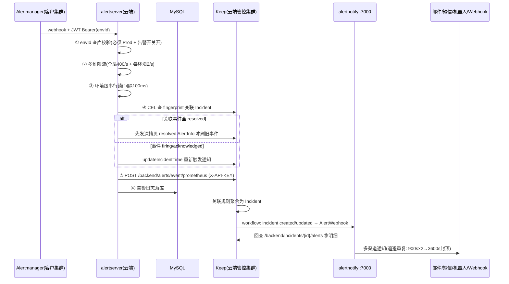
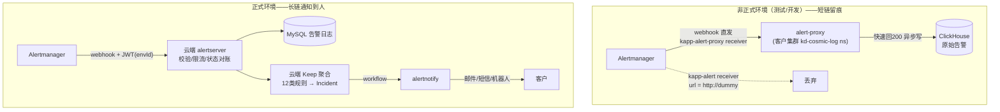
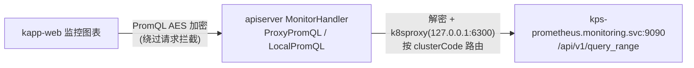

---
tags:
  - 平台组件
  - monitoring
  - prometheus
  - alertmanager
  - keep
  - 实战
created: 2026-11-22
---

# 🚨 KPS + Keep 项目实战

> 星河平台的告警体系是一条**两次升格的流水线**：Prometheus 原始告警 → Keep 聚合为事件(Incident) → alertnotify 通知到人。核心结论先记：**KPS 管集群指标与告警信号，Keep 管聚合升格，kapp（alertserver/alertnotify）管环境隔离、流量治理和通知出口**。数据面留在集群内（retention 3d、不 remoteWrite），云端只拿查询结果和告警——与 NAT 约束下"集群侧主动外连"的整体架构一致。

## 一、定位与分工

| 组件 | 部署位置 | 职责 |
|---|---|---|
| KPS（kube-prometheus-stack） | 客户集群 `monitoring` ns | Prometheus Operator 全家桶：指标采集/存储/规则评估 + Alertmanager 路由投递 |
| Keep | 客户集群 `keep-system` ns + **云端管控集群也有一套** | 多源告警汇聚、关联聚合为 Incident、workflow 自动化 |
| alertserver | 云端 `galaxyship` ns | 告警接收网关：环境校验/限流/状态对账/转发 Keep |
| alertnotify | 云端 `galaxyship` ns :7000 | 通知出口：邮件/短信/金蝶机器人/Webhook + 退避 |
| alert-proxy | 客户集群 `kd-cosmic-log` ns（**仅非正式环境**） | Alertmanager webhook 侧通道 → ClickHouse |

观测三件套分工（防混淆）：KPS 集群级指标，SigNoz 应用级 trace/APM/日志（见 [[SigNoz]]），Keep 告警层聚合。Grafana 是**独立组件**（packages/grafana，grafana-system ns），KPS 子 chart 里的 grafana 被禁用。

## 二、KPS 部署形态

### 2.1 组件包与版本

`packages/kube-prometheus-stack/`（组件名 `kps`）走标准 Flux 交付链（见 [[FluxCD项目实战]]）：chart 65.2.0-22，operator v0.77.1，Prometheus v2.54.1，Alertmanager v0.27.0，node-exporter v1.8.2，kube-state-metrics v2.13.0。镜像全部烘焙私有仓前缀。


### 2.2 default.yaml 关键配置

| 配置 | 值 | 解读 |
|---|---|---|
| 五个 selector | `podMonitor/rule/serviceMonitor/probe/scrapeConfigSelectorNilUsesHelmValues: false` | **全开放纳管**：任何 ns 的 ServiceMonitor/PrometheusRule 都被自动拾取，组件 chart 自带监控即插即用 |
| retention | 3d | 历史查询窗口只有 3 天，数据不出集群 |
| remoteWrite | `[]` | 不做远程写，云端靠代理查询 |
| storage | 20Gi PVC，storageClassName `local` | 本地盘，注意节点绑定 |
| prometheus resources | limits 3cpu/2Gi，requests 10m/500Mi | 默认值，部署规划期按集群规模覆盖（见 2.3） |
| grafana.enabled | **false** | 用独立 grafana 组件，别在 KPS 里找 |
| kubeControllerManager/Etcd/Scheduler/Proxy | 全 false | 控制面 exporter 默认关闭（kubeadm 静态 Pod 未暴露 metrics 端口的现实妥协） |
| defaultRules.create | true | 上游社区规则保留 |
| customRules | CPUThrottlingHigh severity=warning | 覆盖上游默认级别 |
| lang | cn | 控制 galaxyship 规则子 chart 的语言包（cn/en 双语模板） |
| kube-state-metrics | metricLabelsAllowlist pods/deployments 的 app 系 label | 控制基数，防止 label 爆炸 |

### 2.3 部署规划期容量适配

deployplan 有专门的 [KpsProcessor](file:///home/lisong/projects/kapp/internal/domain/deployplan/transformer/processer/kps.go)：从组件资源配置取 `PrometheusCpuLimit/PrometheusMemoryLimit`，注入 [kps-values.yaml 模板](file:///home/lisong/projects/kapp/internal/domain/deployplan/templater/templates/kps-values.yaml) 覆盖 prometheusSpec.resources——**KPS 的容量是规划出来的，不是拍脑袋默认值**。

### 2.4 平台诊断对 KPS CR 的特殊处理

[pevent/get/get.go](file:///home/lisong/projects/kapp/internal/apps/pevent/get/get.go)：诊断资源采集遇到 `monitoring.coreos.com/Prometheus` 和 `Alertmanager` CR 时，沿 owner 链展开 **StatefulSet → Pods + 关联 Services** 一并上报——Operator 类 CR 的就绪状态要看其派生工作负载，不能只看 CR 本身。

## 三、告警规则工程（galaxyship-prometheusrules）

KPS chart 内嵌子 chart `galaxyship-prometheusrules`，三组平台扩展规则，**中英双语模板**（rules-cn/rules-en，由 lang 切换），阈值全部 values 化可调。规则设计的注释非常讲究，值得学习：

### 3.1 JVM 规则（指标名对应 jmx_prometheus_javaagent 1.5.0）

| 规则 | 阈值/窗口 | 级别 | 设计理由（values 注释原话提炼） |
|---|---|---|---|
| gcTime | 10% / 5m；20% 升 critical | warning→critical | 社区默认 5% 对稳定在 8~9% 的常规服务过于敏感，故取 10%；20% 以上基本被 GC 拖垮 |
| heap | 90% / 10m 窗口均值 | **info** | 含未回收垃圾，JVM 常把堆用到接近上限再 GC，属"原因类"信号；真风险看 oldGenAfterGc |
| oldGenAfterGc | GC 后老年代 90% / 5m | warning | 这才是内存压力的"症状类"信号 |
| heapMaxNearLimit | -Xmx/容器 limit 90% / **30m** | info | 静态配置风险（经验值 70~75%），会持续到改配置为止，长 for 防告警疲劳 |
| rssNearLimit | RSS/limit 90% / 5m | warning | 进程级内存逼近容器上限 |
| deadlock | 1m | critical | 死锁直接严重 |
| exitOnOom | 退出码 3 / 10m 窗口 | warning（prod 升 critical） | 依赖 JVM `-XX:+ExitOnOutOfMemoryError` |

### 3.2 容器内存规则

- **nearLimit**：工作集/limit 90% / 2m，warning；
- **oomKilled**：容器被 OOM 杀并重启（restarts + last_terminated_reason 联合判断），10m 回看窗口；
- **oomEvent**：内核 OOM 事件（`container_oom_events_total`，含子进程被杀、容器未重启），5m 窗口，**被 ContainerOOMKilled 抑制**——两者区分"容器死了"和"容器里死了个进程"。

### 3.3 CNPG 规则

backendsWaiting（等待 300s）、pgDatabaseXidAge（事务年龄 3 亿，防回卷）、pgReplication（复制延迟 300s）、lastFailedArchiveTime（归档失败）、databaseDeadlockConflicts、replicaFailingReplication；longRunningTransaction 被注释保留（可启用）。

### 3.4 promtool 单元测试

[tests/oom-rules-test.yaml](file:///home/lisong/projects/packages/kube-prometheus-stack/tests/oom-rules-test.yaml) 是**告警规则的单元测试**，文件头给了完整运行方式：

```bash
# 在 kube-prometheus-stack 目录下
helm template t chart/charts/galaxyship-prometheusrules | yq 'select(.metadata.name=="container-memory-alerts") | {"groups": .spec.groups}' > /tmp/container-memory-alerts.yaml
helm template t chart/charts/galaxyship-prometheusrules | yq 'select(.metadata.name=="jvm-alerts") | {"groups": .spec.groups}' > /tmp/jvm-alerts.yaml
cp tests/oom-rules-test.yaml /tmp/ && cd /tmp && promtool test rules oom-rules-test.yaml
```

用 input_series 构造指标序列、alert_rule_test 断言指定时刻触发的告警及 labels/annotations——**改规则先跑测试**。

### 3.5 组件自带监控

valkey/metallb/fluentbit/clickhouse/node-problem-detector/apusic-ingress-alb/external-secrets/spegel/qdrant 等组件 chart templates 里都烘焙了 `servicemonitor.yaml`/`prometheusrule.yaml`，配合 KPS 全开放 selector，**组件装到哪监控跟到哪**。

## 四、Alertmanager：配置是部署期渲染的

KPS values 的 alertmanager 段不是静态配置，三个模板函数（[pkg/template/funcmaps.go](file:///home/lisong/projects/kapp/pkg/template/funcmaps.go)）按环境生成关键值：

| 函数 | 逻辑 |
|---|---|
| `alertUrl` | 正式环境 → `galaxyship.kingdee.com/kapp.alert.v1.RegService/RecvAlertInfoFromPrometheus`（可被 `FORMAL_ALERT_URL` env 覆盖）；非正式 → `http://dummy` |
| `alertToken` | **JWT HS256，claim 带 envId**，issuer `kapp-alert`——alertserver 解 token 即知来源环境 |
| `alertProxyUrl` | **仅非正式环境**返回 `kapp-alert-proxy.kd-cosmic-log.svc:8080/api/v1/alerts`；正式环境返回空，连 alert-proxy Deployment 都不渲染 |

路由策略三层：

- **抑制**：critical 压 warning/info（同 namespace+alertname）、warning 压 info、InfoInhibitor 机制；
- **降噪**（路由到 null）：Watchdog；`kd-cosmic-ops` ns 里 cloudevent 开头的部署 Job/Pod（**平台自身部署动作不惊动客户**）；`kd-cosmic-log` 的 CPUThrottlingHigh；
- **分组**：`group_by: [alertname]`，group_wait 15s / group_interval 1m / repeat_interval 5m，`send_resolved: true`（恢复通知也发，是云端状态对账的前提）。

alertmanager 自身：retention 48h，limits 2cpu/512Mi。

## 五、告警上行全链路（核心机制）

### 5.0 三级流水线总览：Prometheus → Alertmanager → Keep

三个组件各管一段，职责不重叠：

```mermaid
flowchart LR
    subgraph PROM["Prometheus（客户集群）——单规则评估"]
        S["scrape 指标<br/>ServiceMonitor 自动发现"] --> E["评估 PrometheusRule<br/>(三层预置规则)"]
        E --> F["表达式成立 → pending<br/>持续满足 for 时长 → firing"]
    end
    subgraph AM["Alertmanager（客户集群）——同类降噪"]
        D["去重+分组<br/>group_by: alertname<br/>group_wait 15s"] --> I["抑制+静默<br/>(oomKilled 抑制 oomEvent)"]
        I --> R["路由分发<br/>prod→云端 / 非prod→alert-proxy<br/>repeat_interval 5m"]
    end
    subgraph KEEP["云端 Keep——跨告警关联"]
        C["12类关联规则<br/>CEL/SQL 双表达<br/>按 env_id 分组"] --> INC["Incident<br/>resolveOn: all_resolved<br/>7d 窗口"]
        INC --> WF["workflow → alertnotify<br/>多渠道通知+退避"]
    end
    F -->|"push /api/v2/alerts"| D
    R -->|"webhook+JWT → alertserver<br/>六道关卡(见5.1)"| C
```



职责边界（每级只做自己的降噪，不越位）：

| 组件 | 只做 | 不做 |
|---|---|---|
| Prometheus | 单条规则的阈值评估 + for 时长确认（时间维降噪） | 不聚合、不通知、不跨规则关联 |
| Alertmanager | 同 alertname 分组/抑制/静默/路由（同类维降噪） | 不懂业务语义，不跨 alertname 关联 |
| Keep | 跨告警关联成 Incident（业务维降噪，如"计算资源类"把 CPU/内存/OOM 归一组） | 不评估阈值、不采集指标 |

关键参数（[default.yaml](file:///home/lisong/projects/packages/kube-prometheus-stack/default.yaml) 实测值）：

| 参数 | 值 | 含义 |
|---|---|---|
| `group_by` | `['alertname']` | 同名告警归一组 |
| `group_wait` | 15s | 新组首条告警等 15s 凑批再发 |
| `group_interval` | 1m | 组内有新告警时的发送间隔 |
| `repeat_interval` | 5m | 持续 firing 的重发周期（云端 alertnotify 另有退避拉长到 15→60min） |
| `resolve_timeout` | 5m | 收不到 Prometheus 的 resolved 时的兜底判恢复 |

firing/resolved 生命周期四级接力：① Prometheus 规则不再成立时主动发 resolved；② Alertmanager 5m 兜底；③ alertserver 的 resolved 冲刷状态机（见 5.1 第④步）保证新事件干净开组；④ Keep `resolveOn: all_resolved`——组内**所有**告警都 resolved 才关 Incident，避免"一个恢复就误报整体恢复"。

云端段时序细节（alertserver → Keep → alertnotify）：



### 5.1 alertserver 六道关卡

[services/alert/alert.go](file:///home/lisong/projects/kapp/internal/apps/alertserver/services/alert/alert.go) 的 `RecvAlertInfo`：

1. **环境校验**：envId 查库、必须 ProdEnvType（非正式按成功返回但丢弃——与 dummy URL 构成双保险）、客户告警开关必须开；
2. **多维限流**（生产配置 [12kapp-alert/config.yaml](file:///home/lisong/projects/kapp/deploy/components/12kapp-alert/config.yaml)）：全局 400/s、2400/min、24000/h；**每环境 2/s、12/min、120/h**；
3. **环境级串行锁**：注释原话"避免并发告警到达 keep 后产生同名聚合事件，每个告警接收相差 100ms，**暂不支持多实例**"；
4. **resolved 冲刷状态机**（firing 到达时）：CEL 查询 Keep（`POST /backend/alerts/query`，`cel: fingerprint in [...]`）——关联事件全 resolved 则先发一份深拷贝 resolved AlertInfo 把旧事件刷成自动恢复，保证新事件干净开组；事件 firing/acknowledged 则更新时间戳重触发通知；
5. **转发 Keep**：`POST /backend/alerts/event/prometheus`（Alertmanager 原生格式，X-API-KEY）；fingerprint 已拼 envId、补齐 job/namespace label（方便 Keep 聚合）；
6. **落 MySQL**。

### 5.2 非正式环境侧通道

[alert-proxy](file:///home/lisong/projects/kapp/internal/apps/alertproxy/server/webhook_handler.go)：收 Alertmanager webhook `POST /api/v1/alerts`，**快速回 200、异步写 ClickHouse**，另提供查询 API。仅非正式环境部署（测试环境告警不进云端 Keep，本地留痕可查）。注意：alert-proxy **没有任何聚合逻辑**，ClickHouse 里存的是原始告警，不是 Incident。

### 5.3 正式 vs 非正式：两条互斥链路



三个易错点：

1. **非正式链路不经过 Keep**：Alertmanager 直连 alert-proxy，中间没有聚合步骤；聚合只发生在云端 Keep，且只服务正式环境。
2. **互斥是渲染期决定的**：非正式 `alertUrl`→dummy、`alertProxyUrl`→有效 URL；正式环境正好相反（alert-proxy 连 Deployment 都不渲染）。
3. **双保险**：就算非正式告警漏到云端 alertserver，`RecvAlertInfo` 第一道关卡校验 `envType != Prod` 直接丢弃（按成功返回）。

设计意图对照：

| | 正式环境 | 非正式环境 |
|---|---|---|
| 目标 | 告警必须通知到人，要聚合降噪 | 留痕可查即可，不打扰任何人 |
| 聚合 | 云端 Keep（跨环境统一视图，env_id 隔离） | 不聚合（测试告警没有聚合价值） |
| 存储 | MySQL + Keep PG | ClickHouse（本地廉价留痕） |
| 通知 | alertnotify 多渠道 + 退避 | 无 |

另注意：正式链路里 alertserver **存 MySQL 和转发 Keep 是并列动作**，不是先后串联；通知有退避（15min→30min→60min），不是每次 repeat 都打扰客户。

## 六、Keep：部署、初始化与聚合规则

### 6.1 组件包

[packages/keep](file:///home/lisong/projects/packages/keep/kapp.yaml)：keep 0.45.4（keep-api/keep-ui 0.45.11），ns `keep-system`，backend/frontend/websocket 三件套 + database。`default-pg` 模式用 **chart 自带 PG**（`keep-database:5432`，连接串 `postgresql+psycopg2://...`）；生产可外接 **CNPG**（Readme 记录完整流程：cnpg operator → cnpg-cluster → `CREATE DATABASE keep` → 装 keep）。chart 还带 db-cleanup-cronjob（默认关，schedule 每日 1 点、保留 2 天）和 HPA/多种 ingress 变体。

**云端管控集群也部署了一套 Keep**——alertserver 配置指向 `keep-frontend.keep-system.svc.cluster.local:3000`（同集群 DNS），汇聚所有客户环境的告警。前端告警页（kapp-web AlertApi → apiserver services/alert）查的也是这套云端 Keep。

**客户集群的 Keep 是可选组件，默认不在告警主链路里**：deploy.json 默认组件清单无 keep；正式环境告警去云端 Keep，非正式去 ClickHouse。它的用途是**本地自治告警工作台**：KPS README 记录了把 Alertmanager receiver 直指本地 Keep（`keep-frontend.keep-system.svc:3000/backend/alerts/event/prometheus`）的示例配置——数据主权敏感客户装上 keep + 改路由，即可不依赖云端本地管理 Incident/规则/workflow。

### 6.2 keep-init.sh：一次性初始化

[tools/keep-init.sh](file:///home/lisong/projects/packages/keep/tools/keep-init.sh) 用 Keep API 批量创建**关联规则 + facets**：

```bash
./keep-init.sh <ip:port> <X-API-KEY>
# 注意: 只能执行一次, 出错修复后从错误处续跑,
# 或在前端删除已创建的规则/事件/facet 后重跑
```

规则结构（每条 POST /backend/rules）：

```json
{
  "sqlQuery": {"sql": "...", "params": {...}},
  "celQuery": "(source == \"prometheus\" && labels.job in [...])",
  "ruleName": "集群控制平面异常",
  "groupingCriteria": ["labels.env_id"],
  "resolveOn": "all_resolved", "createOn": "any", "threshold": 1,
  "timeframeInSeconds": 604800,
  "incidentNameTemplate": "集群控制平面异常-{{alert.labels.env_id}}"
}
```

要点：**sqlQuery/celQuery 双表达**（Keep 内部两套查询引擎）、**按 env_id 分组**（环境隔离）、全部告警恢复才解除事件、7 天追加窗口（脚本值 604800s；alert-group-v2.md 文档写 24h，**以脚本为准**）、事件名中文模板带环境号。

### 6.3 12 类聚合规则

[alert-correlation/alert-group-v2.md](file:///home/lisong/projects/packages/keep/alert-correlation/alert-group-v2.md)：控制平面 / 计算资源 / 网络 / 存储 / 监控组件 / Redis / RabbitMQ / Zookeeper / PG / 星空产品(kd-cosmic-*) / 部署服务(kd-cosmic-ops) / 未分组兜底。设计细节：

- 统一 `source=prometheus` 过滤；事件名全中文；
- **计算资源类排除中间件 ns**（monitoring/redis-system/rabbitmq-system/zk-system/pg-system/versitygw-system 等）——它们有专属分类，避免一条节点告警同时落两个事件；
- 规则无优先级，命中即产生事件。

## 七、Keep → 通知闭环

### 7.1 workflow 触发

[workflow/incident_create.yaml / incident_update.yaml](file:///home/lisong/projects/packages/keep/workflow)：incident created/updated 且状态 firing/resolved/acknowledged 时，HTTP POST 到 `kapp-alertnotify.galaxyship.svc:7000/kapp.alert.v1.AlertService/AlertWebhook`，body 带 incident id/name/status/severity。**Keep 是通知的触发源，不是终点**。

### 7.2 alertnotify 多渠道 + 退避

[internal/apps/alertnotify](file:///home/lisong/projects/kapp/internal/apps/alertnotify)：收 webhook → 回查 Keep `GET /backend/incidents/{id}/alerts?limit=10`（X-API-KEY）拿告警明细 → 通知渠道注册表分发：**邮件 / 短信（独立限流）/ 金蝶机器人(kdRobot) / 自定义 Webhook**，附 portalLink 跳回 galaxyship 控制台。

**重复通知退避**（notifyBackoff.go + alertnotify.example.toml）：未恢复告警首次重复间隔 900s，退避倍数 2.0，封顶 3600s，状态存 Redis——告警持续 firing 时通知频率 15min→30min→60min 递减，防骚扰。

## 八、查询链路：云端图表怎么看集群指标



- [services/monitor.go](file:///home/lisong/projects/kapp/internal/apps/apiserver/services/monitor.go)：前端 PromQL 是 AES 加密传输的（注释原话"解密query，绕过请求拦截"），10s 超时，gzip 响应透传；
- `LocalPromQL` 查云端自己的 Prometheus（configs `PROMETHEUS_` 段）；
- [queryk8s.GetPrometheusData](file:///home/lisong/projects/kapp/internal/apps/apiserver/services/queryk8s/queryk8s.go) 另一条查询入口；
- 服务自监控也被 KPS 抓取：kapp 的 Temporal SDK tally→Prometheus 桥接（pkg/temporal/metrics.go，:9090）、xwei-server 的 Centrifugo 指标（promauto + promhttp）。

## 九、数据治理与清理

[pkg/alert](file:///home/lisong/projects/kapp/pkg/alert/alert.go) 封装 Keep 运维接口：

- `FetchAllIncidents`：分页拉全量事件；
- `CleanupEnvIncidents`：按 cutoff 筛过期事件（start_time 为空视为已过期）→ 分页查关联告警去重 fingerprint → **先 batch_enrich 处置告警，成功后再 bulk delete 事件**（顺序保证不留孤儿告警）；
- [pgcleanup.go](file:///home/lisong/projects/kapp/pkg/alert/pgcleanup.go)：**直连 Keep 的 PostgreSQL 清表**（incident/alert 关联/fingerprint），处理了 PG 63 字节标识符上限——环境退租清场的兜底手段。

## 十、实战命令速查

```bash
# KPS 状态
kubectl -n monitoring get prometheus,alertmanager,servicemonitor,prometheusrule
kubectl -n monitoring describe prometheus kps-prometheus
kubectl -n monitoring logs sts/prometheus-kps-prometheus -c prometheus

# 看某组件的采集与规则
kubectl get servicemonitor -A | grep <组件>
kubectl -n <ns> get prometheusrule <name> -o yaml

# 告警规则单元测试(见 3.4 完整命令)
promtool test rules oom-rules-test.yaml

# 手动查 Prometheus(集群内)
kubectl -n monitoring port-forward svc/kps-prometheus 9090:9090
curl 'localhost:9090/api/v1/query?query=up==0'

# Alertmanager 配置与静默
kubectl -n monitoring get secret alertmanager-kps-alertmanager -o jsonpath='{.data.alertmanager\.yaml}' | base64 -d
kubectl -n monitoring port-forward svc/kps-alertmanager 9093:9093

# Keep API(X-API-KEY 从配置取)
curl -H "X-API-KEY: <key>" http://<keep>/backend/rules          # 聚合规则
curl -H "X-API-KEY: <key>" http://<keep>/backend/incidents      # 事件
curl -H "X-API-KEY: <key>" -X POST http://<keep>/backend/alerts/query \
  -d '{"offset":0,"limit":10,"cel":"(fingerprint in [\"xxx\"])"}'

# 云端告警链路排障
kubectl -n galaxyship logs deploy/kapp-alertserver | grep <envId>
kubectl -n galaxyship logs deploy/kapp-alertnotify | grep <incidentId>
```

## 十一、踩坑清单

1. **KPS 里找不到 Grafana 是正常的**：grafana.enabled=false，用独立 grafana 组件（grafana-system ns）。
2. **selector 全开放是双刃剑**：任何 ns 的 ServiceMonitor 都会被纳管，手工创建的测试 SM 也会被抓取；排查"指标多了/基数爆了"先查 SM 全集。
3. **非正式环境告警被双重丢弃**：Alertmanager 侧 dummy URL + alertserver 侧 ProdEnvType 校验。测试环境告警去 alert-proxy 的 ClickHouse 查，别在云端 Keep 找。
4. **alertserver 暂不支持多实例**：环境级串行锁是进程内锁，扩副本会破坏"防同名聚合事件"的串行语义。
5. **resolved 冲刷有顺序**：先刷旧事件再发新 firing，深拷贝 AlertInfo 改 status——直接转发会让 Keep 把新告警追加进已 resolved 的旧事件。
6. **keep-init.sh 只能跑一次**：重复执行产生重复规则；出错从断点续跑或前端清理后重来。
7. **聚合窗口文档与脚本不一致**：v2 文档写 24h，脚本实际 604800s(7d)，以脚本为准。
8. **oomKilled ≠ oomEvent**：前者容器被杀并重启，后者内核 OOM 杀了子进程容器还活着；后者被前者抑制，排查 OOM 两个都要看。
9. **retention 3d + local PV**：历史查询超 3 天无数据；Prometheus 绑定本地盘节点，节点故障数据不可漂移。
10. **改 JVM/容器规则先跑 promtool 测试**：阈值有大量经验性调优（gcTime 10% 而非社区 5%、heap 降 info），拍脑袋改回社区默认会告警风暴。
11. **alertToken 是 JWT 不是随机串**：HS256 + envId claim，SecretKey 在 funcmaps 常量里；换密钥要同步 alertserver 验签侧。
12. **控制面监控默认关闭**：kubeControllerManager/Etcd/Scheduler/Proxy exporter 全 false，控制面告警规则（聚合规则第 1 类）依赖的指标需要另行暴露才有数据。

## 十二、文件索引

| 主题 | 位置 |
|---|---|
| KPS 组件包 | `packages/kube-prometheus-stack/`（default.yaml、chart/charts/galaxyship-prometheusrules、tests） |
| 装机自带监控 | `kurl-fork/addons/prometheus/` |
| Keep 组件包 | `packages/keep/`（chart、default-pg.yaml、tools/keep-init.sh、workflow、alert-correlation） |
| 告警 URL/Token 渲染 | `kapp/pkg/template/funcmaps.go`（alertUrl/alertToken/alertProxyUrl） |
| 告警接收网关 | `kapp/internal/apps/alertserver/`（handlers/alert.go、services/alert/{alert,rate_limit}.go） |
| 通知出口 | `kapp/internal/apps/alertnotify/`（notify/、services/notifyBackoff.go） |
| 非正式侧通道 | `kapp/internal/apps/alertproxy/server/`（webhook_handler.go、clickhouse_writer.go） |
| Keep 运维客户端 | `kapp/pkg/alert/`（alert.go、pgcleanup.go） |
| PromQL 代理 | `kapp/internal/apps/apiserver/services/monitor.go`、`services/queryk8s/` |
| KPS 容量规划 | `kapp/internal/domain/deployplan/transformer/processer/kps.go`、`templater/templates/kps-values.yaml` |
| KPS CR 诊断 | `kapp/internal/apps/pevent/get/get.go` |
| 生产部署配置 | `kapp/deploy/components/12kapp-alert/`、`kapp/deploy/k8s/kapp-alertserver/` |

## 相关

- 上游：[[平台组件]] · [[云原生]]
- 交付机制：[[FluxCD项目实战]]（KPS/Keep 都走 Flux 交付）· [[Zarf]]（离线镜像）
- 观测分工：[[SigNoz]]（应用级 APM，与 KPS 互补）
- 通信机制：[[Centrifugo]]（前端实时通道）· [[ConnectRPC]]（AlertWebhook/RecvAlertInfoFromPrometheus 都是 Connect 端点）
- 存储依赖：CNPG（Keep 生产 PG）· ClickHouse（alert-proxy 侧通道）