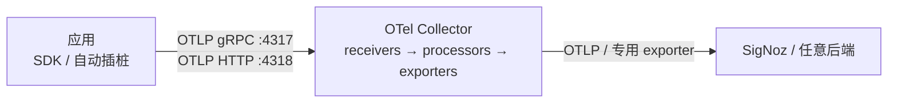
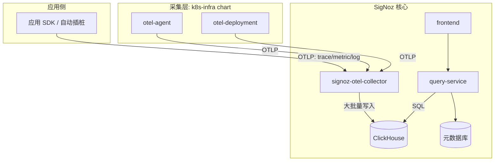
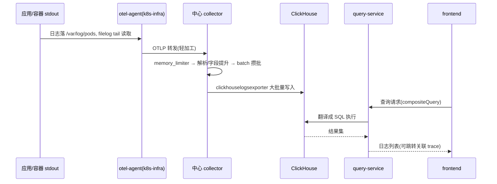
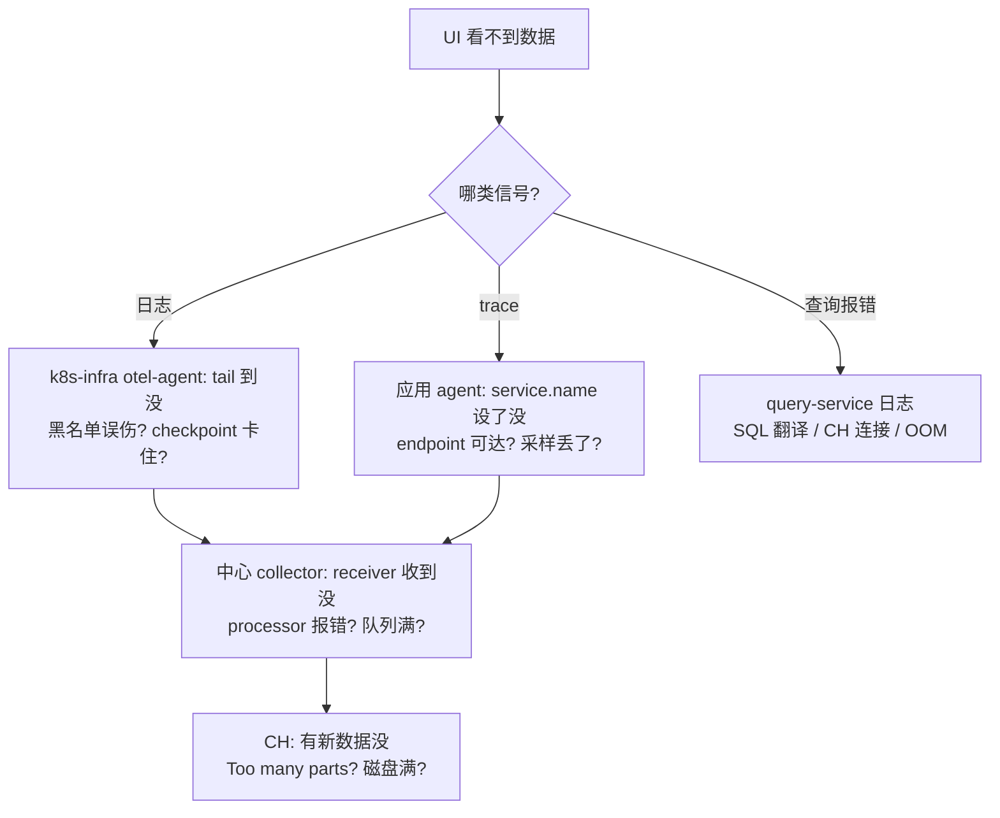

---
tags:
  - 平台组件
  - signoz
  - opentelemetry
  - clickhouse
  - 可观测性
  - 教学
created: 2026-11-23
---

# 📖 SigNoz

> 问题驱动：**痛点 → OTel 管什么/不管什么 → SigNoz 的位置 → 完整数据流 → 自动采集边界 → 最小实战 → 进阶调优/查询/排障**。项目封装形态见 [[signoz项目实战]]。

## 一、现状痛点

微服务 + K8s 之后，四个痛点同时出现：

1. **跨服务定位难**：一次请求穿过网关→订单→库存→支付，"慢在哪一跳"翻日志拼不出来；
2. **三信号三套工具**：Prometheus（指标）+ Jaeger（链路）+ ES/Loki（日志），再加 Grafana 统一展示——四套部署、三套查询方式（PromQL / LogQL 或 ES DSL / trace 检索）；
3. **关联靠人肉**：traceId 在各系统对不上，告警→trace→日志只能拿时间戳碰运气；
4. **插桩绑死厂商**：私有 SDK 埋的点，换后端全部重埋。

归纳三个需求：**跨服务串起请求；三信号统一存储互跳；插桩标准化、后端可换**。前两个靠平台，第三个靠标准——先说标准。

## 二、OTel：管产生与传输，不管存储与消费

OpenTelemetry 是 CNCF 的遥测**标准 + 工具集**，统一三件事：

| 统一什么 | 内容 |
|---|---|
| 怎么产生 | 各语言 SDK + 自动插桩（Java agent / Python、Node 启动包装器 / .NET profiler，零代码改动） |
| 怎么传输 | **OTLP**（gRPC :4317 / HTTP :4318），三信号共用 |
| 怎么描述 | 语义约定：`service.name`、`k8s.pod.name` 等字段名全球统一 |



**Collector**：独立进程，`receivers`（收）→ `processors`（加工）→ `exporters`（发）；同一二进制可当节点 agent 或中心 gateway，**不属于任何后端**。

**OTel 不管**：不存储（队列只是缓冲）、不查询/展示/告警（没有 UI）、不做业务语义（字段名统一 ≠ 字段有价值）。它解决痛点 4，并为痛点 3 提供基础（traceId 随 W3C `traceparent` 头传播、字段名统一）；**真正的关联跳转与统一展示要后端实现**。

### 必须理解的语义约定

| 概念 | 说明 |
|---|---|
| `service.name` | 最重要的 resource attribute；不设则 unknown_service，拓扑/RED 全废 |
| Resource attributes | 实体描述：`host.name`、`k8s.pod.name`、`k8s.namespace.name`、`deployment.environment` |
| Span / SpanContext | 操作单元；`trace_id` 全局唯一、`span_id` 同一 trace 内唯一 |
| Span attributes | 操作级标签：`http.request.method`、`db.system`、业务字段 |
| Severity | `severity_text`（ERROR）+ `severity_number`（17），过滤按 number 区间 |

## 三、SigNoz：OTel 的存储与消费后端

一句话定位：**OTel 管产生传输，SigNoz 管存储、查询、展示、告警**。应用侧遥测统一走 OTLP 摄入，不自研插桩协议。

与采集层**完全解耦**：应用可直推自带的 signoz-otel-collector（Collector contrib 定制发行版），也可用自建原生 Collector 指向 SigNoz 的 OTLP 入口——只要产出 OTLP，照单全收。K8s 形态下采集层由独立的 **k8s-infra** chart 部署（otel-agent + otel-deployment 两个工作负载，§四），指向核心栈 collector。

| 传统拼盘 | SigNoz |
|---|---|
| trace/指标/日志/展示四件套（§一） | 一个平台，三信号同源存 ClickHouse |
| 关联靠人肉拼 traceId | 靠 OTel 语义约定原生互跳 |

设计决策：**遥测全进 ClickHouse**（列存、高压缩、聚合快），**采集加工全交给 Collector**。本体只做三件事：查询翻译 + 告警评估（query-service）、UI、元数据管理（用户/仪表盘/告警规则）。

边界：集群级指标（节点/Pod/控制面）仍归 Prometheus 体系（[[KPS 与 Keep]]），SigNoz 主攻**应用级**，避免双采。

## 四、完整数据流：从应用到 UI

图只画拓扑与数据方向；组件职责与部署形态见下表。



一条日志的完整旅程：



| 组件 | 职责 |
|---|---|
| signoz-otel-collector | 核心 chart 的中心加工级 Deployment：解析/富化/批处理/写 CH/span→metrics；配置即标准 Collector YAML |
| otel-agent（k8s-infra） | DaemonSet 每节点一个：filelog tail 容器日志、hostmetrics/kubeletstats；不重加工、不直连 CH |
| otel-deployment（k8s-infra） | 集群级 Deployment：clusterMetrics、k8sEvents（Events 转日志信号）、prometheus 抓取 |
| ClickHouse | 唯一遥测存储，三库分信号：signoz_traces / signoz_logs / signoz_metrics；单节点起步，生产 shard×replica（Keeper 协调） |
| query-service | 查询翻译成 CH SQL；告警评估；API Key；与 frontend 同 Pod（新版合并） |
| 元数据库 | SQLite/PostgreSQL，**只存元数据（用户/仪表盘/告警规则），遥测绝不进这里** |

**为什么两级**：k8s-infra 的采集必须贴节点（filelog 读 `/var/log/pods`），加工写入要集中批处理（CH 喜欢大批量）。重逻辑放中心 signoz-otel-collector——改加工只重启中心 Deployment，不动全节点 DaemonSet。

关键机制：

- **MergeTree 铁律**：大批量低频写入；小批量高频 → 小 part 泛滥 → 合并打满 → 拒写（Too many parts）；
- **span→metrics**：`signozspanmetrics` connector 从 span 流预聚合 RED 指标——RED 图表查预聚合指标、不扫 span 明细，且不随 trace 保留期缩短消失；
- **保留期 = 表级 TTL**：retention 设置即 `ALTER TABLE ... MODIFY TTL`，物理删除随合并异步发生；
- **冷存储**：可选 S3 分层，老数据转对象存储、查询时拉回，热盘只留近期。

## 五、哪些自动采集，哪些必须应用配合

| 信号 | 自动程度 | 应用配合 |
|---|---|---|
| 容器日志 | **全自动**（k8s-infra otel-agent tail 容器日志文件，含 stdout/stderr） | 按业务字段过滤需输出 JSON + 采集侧解析提升（§6.4） |
| 节点/kubelet 指标、K8s Events | **全自动**（k8s-infra；Events 不是指标，走日志管道展示） | 无；指标 preset 与 Prometheus 二选一 |
| Traces | Java/Python/Node/.NET 自动插桩零代码；**Go 需手动 SDK** 或 eBPF（有框架限制） | 设 `service.name`；自动插桩语言跨服务传播默认自动，Go 手动 SDK 需自配 propagator |
| 运行时指标（JVM 等） | 自动插桩自动产出 | Go/自定义运行时手动埋 |
| 业务指标 | **不自动** | SDK meter 埋点 |
| 日志↔trace 关联 | **不自动** | 日志带 trace_id：Java agent 注入 MDC，logback pattern 输出 `%X{trace_id}` |
| 业务属性（userId 等） | **不自动** | span attribute / 日志字段自己埋 |

两条推论：**trace 是关联骨架，接入先打通 trace**；自动采集解决"有没有"，应用配合解决"好不好用"。

## 六、最小实战

### 6.1 Docker Compose（十分钟体验）

```bash
git clone -b main https://github.com/SigNoz/signoz.git
cd signoz/deploy
docker compose up -d
# UI: http://localhost:3301
# OTLP 入口: localhost:4317(gRPC) / 4318(HTTP)
```

自带 hotrod demo。体验路径：Services → RED 图 → trace 瀑布 → 关联日志。

### 6.2 应用接入

Java（零代码）：

```bash
java -javaagent:/opt/opentelemetry-javaagent.jar \
  -Dotel.service.name=order-service \
  -Dotel.exporter.otlp.endpoint=http://signoz-otel-collector.platform:4317 \
  -Dotel.exporter.otlp.protocol=grpc \
  -Dotel.traces.exporter=otlp \
  -Dotel.metrics.exporter=otlp \
  -Dotel.logs.exporter=none \
  -Dotel.resource.attributes=deployment.environment=prod \
  -jar app.jar
# logs.exporter=none: 日志走 filelog 采集, 不经 SDK 导出
# 日志关联: agent 自动注入 MDC, logback pattern 加 %X{trace_id}
```

Python：

```bash
pip install opentelemetry-distro opentelemetry-exporter-otlp
opentelemetry-bootstrap -a install
OTEL_SERVICE_NAME=order-service \
OTEL_EXPORTER_OTLP_ENDPOINT=http://signoz-otel-collector.platform:4317 \
OTEL_EXPORTER_OTLP_PROTOCOL=grpc \
opentelemetry-instrument python app.py
# Python 默认协议 http/protobuf, 不显式设 grpc 会打错 4317 端口
```

Go 手动引 SDK（`go.opentelemetry.io/otel` + otlptracegrpc）。K8s 里装好 opentelemetry-operator 后，可按 annotation 自动注入 agent：

```yaml
metadata:
  annotations:
    instrumentation.opentelemetry.io/inject-java: "true"
```

### 6.3 Helm（K8s 生产）

```bash
helm repo add signoz https://charts.signoz.io
helm install signoz signoz/signoz -n platform --create-namespace -f values.yaml
# 采集层独立 chart, 指向核心栈 collector
helm install k8s-infra signoz/k8s-infra -n platform \
  --set otelCollectorEndpoint=signoz-otel-collector.platform:4317
```

```yaml
clickhouse:
  install: true                # 已有外部 CH 则 false
  # 单节点起步; 集群形态配 shard/replica + keeper(键名随 chart 版本, 查 values)
otelCollector:
  config:                      # 整段可重写, 标准 Collector YAML
    processors:
      memory_limiter: { ... }  # 必须管道首位, 见 §七
      batch: { ... }
# 元数据默认 SQLite+PVC; query-service 多副本必须换 PostgreSQL
# 保留期: UI Settings(表级 TTL); 冷存储: 可选 S3 分层
```

k8s-infra presets 开关（enabled 值为官方默认；各 preset 跑在哪个工作负载见 §四）：

```yaml
otelCollectorEndpoint: signoz-otel-collector.platform:4317
presets:
  logsCollection: { enabled: true }   # 默认黑名单已排除 kube-system 与 SigNoz 自身日志
  hostMetrics:    { enabled: true }   # ↓ 已有 Prometheus 时这三个关掉, 避免双采
  kubeletMetrics: { enabled: true }
  clusterMetrics: { enabled: true }
  k8sEvents:      { enabled: true }
  prometheus:     { enabled: false }  # annotation 抓取默认关
```

决策点：指标 preset 与 Prometheus 二选一（项目全关归 KPS）；`host.name` 口径不一时用 resourcedetection `override: true`；DaemonSet 容忍全部污点；日志黑名单别关（自采集放大循环）。

### 6.4 日志解析与字段提升

agent 侧 filelog tail `/var/log/pods`，operators 链把 body 解析成结构化字段（重解析也可放中心级 transform）：

```yaml
receivers:
  filelog:
    include: [/var/log/pods/*/*/*.log]
    exclude: [/var/log/pods/kube-system_*/*/*.log]
    start_at: end
    storage: file_storage            # checkpoint 持久化, 重启不重读/丢读
    operators:
      - type: container              # 剥 CRI 前缀, 提取 pod/ns/container
      - type: json_parser
        parse_from: body
        timestamp:
          parse_from: attributes.time
          layout: '%Y-%m-%dT%H:%M:%S.%fZ'
        severity:
          parse_from: attributes.level
```

**字段提升是可过滤的前提**：留在 body 只能全文搜；move 到 attributes 后才能按 `traceId = xxx` 精确过滤、做聚合。链路：剥前缀 → JSON 解析 → move 关键字段 → 删临时字段。

## 七、进阶：Collector 管道调优

```yaml
processors:
  memory_limiter:                    # ① 必须管道首位
    check_interval: 1s
    limit_percentage: 75
    spike_limit_percentage: 15
  transform:                         # ② 业务加工(OTTL)
    log_statements:
      - context: log
        statements:
          - set(attributes["env"], "prod")
          - set(severity_text, "ERROR") where IsMatch(body, "ERROR")
  batch:                             # ③ 攒批, CH 写入生命线
    send_batch_size: 2000
    send_batch_max_size: 8000
    timeout: 2s

exporters:
  clickhouselogsexporter:
    dsn: tcp://clickhouse:9000/signoz_logs
    sending_queue:
      enabled: true
      sizer: items
      queue_size: 100000             # 按条数估容
      num_consumers: 4
      block_on_overflow: true        # 队列满阻塞上游(背压), 不丢弃
    retry_on_failure:
      enabled: true
      initial_interval: 5s
      max_interval: 30s
      max_elapsed_time: 300s
    timeout: 30s

service:
  pipelines:
    logs:
      receivers: [otlp]                  # filelog 在 agent 侧, 中心级只收 OTLP
      processors: [memory_limiter, transform, batch]   # 顺序即语义
      exporters: [clickhouselogsexporter]
```

逐条原理：

1. **memory_limiter 首位**：超限向 receiver 返回可重试错误，背压传到最上游；放中间则 collector 自己 OOMKill；
2. **batch 宁大勿小**：调小 → 小 part 泛滥 → 合并拖垮写入；2000~10000 条/批 + 2~5s timeout 兜底低流量；
3. **队列按条数估容**：单条均大小 × queue_size 对容器 memory limit（1.7KB×10 万≈170MB）；
4. **队列纯内存**：重启即丢，要不丢需 file_storage + PVC（filelog checkpoint 同理）；
5. **OTTL conditions 是 OR**：AND 语义写进单条表达式；
6. **采样**：SDK 默认全量；生产用 parentbased_traceidratio 在 SDK 调比例，或中心级 tail_sampling；采样 processor 放在 spanmetrics 之前会使 RED 少计。

## 八、进阶：查询与告警

查询入口统一 `query_range`（v3/v4），`compositeQuery` 三种 dataSource：**builder**（UI 构造）、**clickhouse_sql**、**promql**。日志列表按 `ORDER BY timestamp DESC, id DESC` 走分时段窗口扫描（1h→2h→4h…凑够 pageSize 即停）；自定义排序退化全范围扫描。P95/P99 分位依赖 CH 的 `histogramQuantile` UDF（chart 自带），缺它分位查询报错。

```bash
# API Key: UI → Settings → API Keys; 请求头 SIGNOZ-API-KEY
# 技巧: DevTools 抓 UI 的 query_range payload 改参数重放
curl -X POST http://signoz-query-service:8080/api/v4/query_range \
  -H 'Content-Type: application/json' -H 'SIGNOZ-API-KEY: <key>' \
  -d '{
    "start": 1763800000000000000,
    "end":   1763803600000000000,
    "compositeQuery": {
      "queryType": "clickhouse_sql",
      "panelType": "table",
      "clickhouse_sql": [{
        "name": "A",
        "query": "SELECT severity_text, count() AS c FROM signoz_logs.logs WHERE timestamp > now() - INTERVAL 1 HOUR GROUP BY severity_text"
      }]
    }
  }'
```

日志过滤用结构化条件（`service.name = 'x' AND severity_text = 'ERROR'`）；`body contains` 全文搜无索引、大窗口慢——能按 attribute 过滤就别全文搜（§6.4 的价值）。

告警引擎在 query-service：任意查询设阈值周期评估，渠道 Slack/邮件/Webhook/PagerDuty。分工：**基础设施告警归 KPS，应用级告警归 SigNoz**，也可 webhook 汇入 Keep 聚合（[[KPS 与 Keep]]）。Exceptions 页按类型/堆栈分组 span 异常事件。

## 九、进阶：运维与排障

```bash
kubectl -n platform get pods,svc
kubectl -n platform logs deploy/signoz-otel-collector --tail=100
kubectl -n platform logs sts/signoz -c signoz            # query-service
kubectl -n platform logs ds/otel-agent --tail=50
kubectl -n platform exec -it chi-signoz-cluster-0-0-0 -- clickhouse-client  # Pod 名随 CH 安装名
```

```sql
-- 写入是否在涨
SELECT count() FROM signoz_logs.logs WHERE timestamp > now() - 300;
-- 各服务日志量(找大户)
SELECT resources_string['service.name'] AS svc, count() AS c
FROM signoz_logs.logs WHERE timestamp > now() - 3600 GROUP BY svc ORDER BY c DESC;
-- part 数量(小 part 泛滥 = batch 太小)
SELECT database, table, count() FROM system.parts
WHERE active AND database LIKE 'signoz%' GROUP BY database, table;
```

版本升级伴随 schema 迁移 Job（telemetrystore-migrator），失败会卡住新版本，升级后先看它。

分层排障：



常见坑：

1. **unknown_service 满屏**：没设 `service.name`，拓扑/RED 全废；
2. **memory_limiter 不在首位**：背压传不到 receiver，collector OOMKill；
3. **batch 调小拖垮 CH**：小 part 泛滥 → 写入恶化 → 队列满；
4. **重启丢数据**：队列/checkpoint 默认内存/emptyDir，需 file_storage + PVC；
5. **业务字段过滤不了**：没提升为 attributes，解析链在中心 collector 做；
6. **日志-trace 跳不过去**：日志没带 trace_id（MDC/pattern 没配）；
7. **自采集循环**：关掉默认黑名单或自定义配置没排除 SigNoz 自身日志，指数放大；
8. **双套指标打架**：k8s-infra preset 与 Prometheus 同时开；
9. **retention 没生效**：TTL 异步合并才物理删除，磁盘不会立刻释放；
10. **大窗口查询慢**：自定义排序破坏分时段扫描优化；
11. **SQLite 多副本**：query-service 扩副本必须换 PostgreSQL；
12. **conditions 是 OR**：AND 写进单条表达式。

## 十、与项目形态的对照指引

| 本文机制 | 项目具体化 |
|---|---|
| 两级 Collector（§四） | k8s-infra otel-agent DaemonSet + obs-otel-collector 中心级，指标 preset 全关归 KPS |
| 字段提升（§6.4） | parse_kd_cosmic 提升 18 个苍穹业务字段 |
| 管道调优（§七） | batch 2000/8000/2s、队列 10 万条、block_on_overflow 实测参数 |
| 查询路径（§八） | UI 不暴露，apiserver→plog 四级代理收口鉴权 |
| 元数据 SQLite（§四） | SQLite + PVC，plog 幂等初始化注册/API Key |

## 一句话总结

**OTel 统一"怎么产生和传输遥测"，SigNoz 负责"存下来、查出来、关联起来、告出去"——应用按标准埋一次，三信号在 ClickHouse 里天然互跳，后端随时可换。**

## 相关

- 上游：[[平台组件]] · [[云原生]] · [[Kubernetes]]
- 项目用法：[[signoz项目实战]]（kapp-log 封装、plog 代理、苍穹字段加工）
- 观测分工：[[KPS 与 Keep]] · [[02-可观测性]]
- 交付机制：[[GitOps 与 FluxCD]]