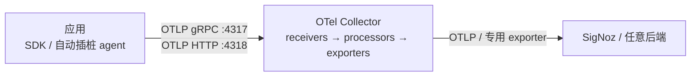
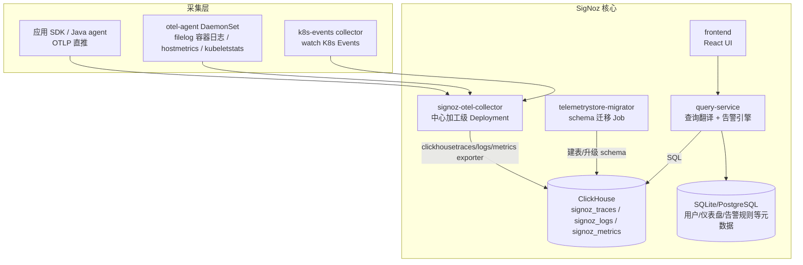
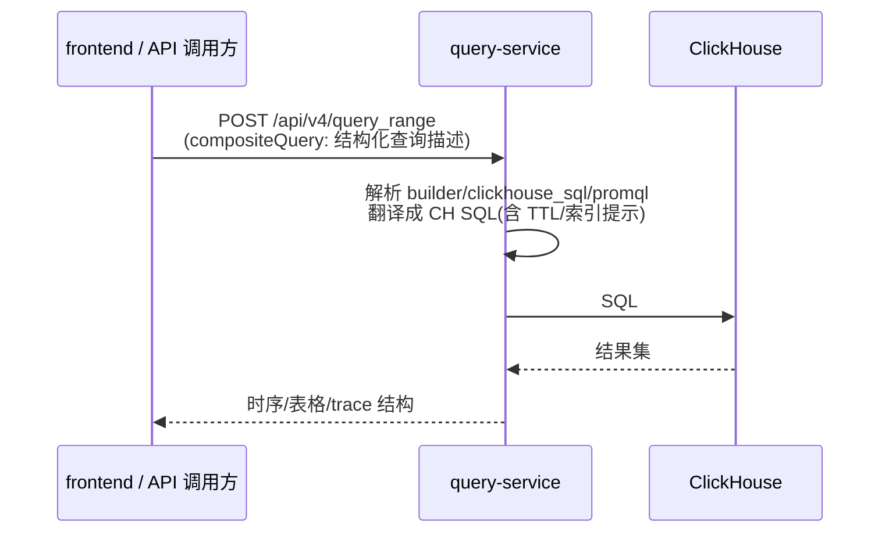
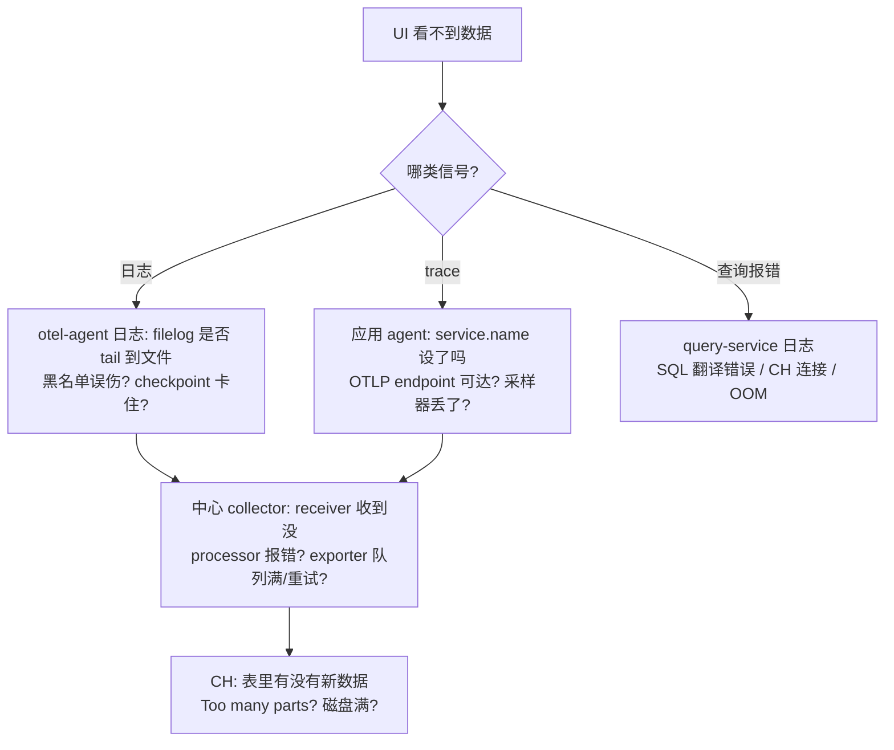

---
tags:
  - 平台组件
  - signoz
  - opentelemetry
  - clickhouse
  - 可观测性
  - 教学
created: 2026-11-23
---

# 📖 SigNoz

> 通用学习 notebook：聚焦 SigNoz 的**架构原理**与**部署/接入/调优实战**，不涉及具体项目。项目内的封装形态（kapp-log、plog 代理、苍穹字段加工）见 [[signoz项目实战]]。

## 一、定位：OTel 原生的一体化观测平台

SigNoz 是开源的 **OpenTelemetry-native** 可观测性平台，用一套系统统一处理三大信号：

| 信号 | SigNoz 能力 |
|---|---|
| Traces | 分布式链路瀑布图、服务依赖图、RED 指标（自动从 span 生成）、异常监控 |
| Metrics | OTLP 指标摄入、PromQL/ClickHouse 双查询引擎、仪表盘 |
| Logs | 日志检索（结构化过滤）、日志与 trace 关联跳转、日志派生指标 |

对照传统拼盘方案，理解它省掉了什么：

| 传统组合 | SigNoz 对应 |
|---|---|
| Jaeger/Tempo（trace）+ Prometheus（指标）+ Loki/ES（日志）+ Grafana（统一展示） | 一个平台，三信号同源存储、原生互跳 |
| 各信号独立存储、独立查询语言、关联靠人肉拼 traceId | 统一存 ClickHouse，trace↔log↔metric 靠 OTel 语义约定天然关联 |

核心设计决策：**遥测数据全部进 ClickHouse**（列存、高压缩、聚合快），不自研存储；**采集与加工全部交给 OTel Collector**（自家发行版 signoz-otel-collector），不自研 agent。SigNoz 本体只做三件事：查询翻译（query-service）、UI、告警/仪表盘等元数据管理。

与相邻方案的边界：集群级指标监控（节点/Pod/控制面）通常仍交给 Prometheus 体系（见 [[KPS 与 Keep]]），SigNoz 主攻**应用级**信号；两者可共存，但要避免对同一目标重复采集。

## 二、前置知识：OpenTelemetry 速览

SigNoz 的一切输入都是 OTLP，先补齐 OTel 的最小知识集：

### 2.1 三个角色



- **SDK / 自动插桩**：在应用内产生遥测。Java/Python/Node/.NET 有零代码改动的 auto-instrumentation agent；Go 需手动引 SDK；
- **OTLP**：OTel 的标准传输协议（gRPC 4317 / HTTP 4318），三信号共用；
- **Collector**：独立进程，管道式处理——`receivers`（收）→ `processors`（加工）→ `exporters`（发），同一二进制可当 agent（节点侧采集）或 gateway（中心加工）。

### 2.2 必须理解的语义约定

| 概念 | 说明 |
|---|---|
| `service.name` | 服务标识，**最重要的 resource attribute**；不设则显示 unknown_service，服务拓扑/RED 指标全废 |
| Resource attributes | 描述产生遥测的实体：`host.name`、`k8s.pod.name`、`k8s.namespace.name`、`deployment.environment` |
| Span / SpanContext | 一次操作单元；`trace_id` 全局唯一、`span_id` 单元唯一，跨进程靠 W3C `traceparent` 头传播 |
| Span attributes | 操作级标签：`http.request.method`、`db.system`、自定义业务字段 |
| Severity | 日志级别标准化：`severity_text`（ERROR）+ `severity_number`（17），过滤按 number 区间 |

**日志-trace 关联的前提**：日志记录里带上 `trace_id`/`span_id`（Java 用 MDC 插桩，agent 自动注入），SigNoz 才能在日志详情里一键跳 trace。

## 三、架构深入

### 3.1 组件全景



| 组件 | 实现 | 职责要点 |
|---|---|---|
| signoz-otel-collector | OTel Collector contrib 的 SigNoz 定制发行版 | 内置 clickhouse 系列 exporter、signozspanmetrics connector、schema migrate 命令；**配置即标准 Collector YAML** |
| ClickHouse | 列存 OLAP | 唯一遥测存储；单节点起步，生产可 shard×replica 集群（ClickHouse Keeper 做协调，替代 ZooKeeper） |
| query-service | Go | 把 UI/API 的结构化查询翻译成 CH SQL；告警规则评估；管理 API Key |
| frontend | React | 与 query-service 同镜像/同 Pod 部署（新版合并） |
| 元数据库 | SQLite（默认）/ PostgreSQL | **只存元数据，遥测绝不进这里**；SQLite 需 PVC 持久化 |
| k8s-infra（独立 chart） | otel-agent DaemonSet + 可选集群级 Deployment | K8s 侧采集：容器日志、节点指标、kubelet 指标、K8s Events |

### 3.2 两级 Collector 分工（K8s 形态的关键）

| 级别 | 部署形态 | 干什么 | 不干什么 |
|---|---|---|---|
| 节点级 otel-agent | DaemonSet，每节点一个 | filelog tail 本节点容器日志、hostmetrics、kubeletstats；轻量转发 | 不做重加工、不直连 CH |
| 中心级 signoz-otel-collector | Deployment，可水平扩 | 解析/富化/批处理、写 CH、span→metrics | 不直接面向应用暴露（应用也可直推它） |

为什么分级：日志采集必须贴着节点（filelog 读 `/var/log/pods`），而加工与写入需要集中批处理（CH 喜欢大批量）。agent 端配置越薄越好，重逻辑放中心级——**改加工逻辑只重启中心 Deployment，不动全节点 DaemonSet**。

### 3.3 ClickHouse 存储模型

三个库，各自信号：

| 库 | 核心表 | 说明 |
|---|---|---|
| signoz_traces | signoz_spans（+ 排序键变体/物化视图） | span 明细；服务拓扑/RED 由 signozspanmetrics connector 生成的指标表支撑 |
| signoz_logs | logs + 属性索引表（tag_attributes / attribute_keys） | 日志 body + 提升后的 attributes；过滤走属性索引 |
| signoz_metrics | samples_v4 + time_series_v4 | 样本与序列元数据分离，支持 PromQL 与 SQL 双引擎 |

要点：

- **MergeTree 家族**：数据按 part 落盘、后台合并。写入端**大批量低频**是铁律——小批量高频产生海量小 part，合并线程被打满，写入恶化甚至拒绝（Too many parts）；
- **保留期 = 表级 TTL**：SigNoz 的 retention 设置（UI/API）本质是对各表执行 `ALTER TABLE ... MODIFY TTL`，按信号分别设（日志 7d、trace 15d 之类）；
- **冷存储**：可选 S3 分层（cold storage），老数据转对象存储、查询时拉回，热盘只留近期；
- **分位数靠 UDF**：P95/P99 直方图查询依赖 `histogramQuantile` 自定义函数（UDF 文件挂进 CH），纯日志场景可省。

### 3.4 查询路径



- 查询入口统一是 `query_range`（v3/v4），body 里的 `compositeQuery` 支持三种 dataSource 查询语言：**builder**（UI 可视化构造）、**clickhouse_sql**（原生 SQL）、**promql**；
- **span→metrics**：traces 管道挂 `signozspanmetrics` connector，从 span 流实时聚合出请求数/错误数/延迟直方图——服务详情页的 RED 图表不扫 span 明细，查的是这些预聚合指标，这是"trace 数据当指标用"的关键机制；
- **日志分页优化**：日志列表查询按 `ORDER BY timestamp DESC, id DESC` 且方向一致时，query-service 走分时段窗口扫描（最近 1h→2h→4h…凑够 pageSize 即停）；自定义排序则全时间范围扫描——大时间窗下性能差异巨大。

## 四、部署实战

### 4.1 Docker Compose（十分钟体验）

```bash
git clone -b main https://github.com/SigNoz/signoz.git
cd signoz/deploy
docker compose up -d
# UI: http://localhost:3301
# OTLP 入口: localhost:4317(gRPC) / 4318(HTTP)
```

自带 demo 应用（hotrod）产生示例 trace。体验路径：Services → 选服务 → 看 RED 图 → 点 trace 瀑布 → 关联日志。

### 4.2 Helm（K8s 生产形态）

```bash
helm repo add signoz https://charts.signoz.io

# 核心栈
helm install signoz signoz/signoz -n platform --create-namespace -f values.yaml

# K8s 采集层(独立 chart, 指向核心栈的 collector)
helm install k8s-infra signoz/k8s-infra -n platform \
  --set otelCollectorEndpoint=signoz-otel-collector.platform:4317
```

核心 values 决策点：

```yaml
# ClickHouse: 单节点起步; 集群形态配 shard/replica + keeper
clickhouse:
  install: true
  shards: 1
  replicaCount: 1
  # 已有外部 CH 时 install: false, 配外部连接

# 中心 collector: 管道配置整段可重写(标准 Collector YAML)
otelCollector:
  config:
    processors:
      memory_limiter: { ... }        # 必须管道首位, 见 §6
      batch: { ... }
    exporters:
      clickhouselogsexporter: { ... }

# 元数据库: 默认 SQLite+PVC; 多副本 query-service 必须换 PostgreSQL
# 保留期/冷存储: UI Settings 或 API 设置(表级 TTL)
```

k8s-infra 侧决策点：

- **日志采集黑名单**：排除 kube-system 与 SigNoz 自身日志（自采集会形成日志放大循环）；
- **指标 preset 按需关**：hostMetrics/kubeletMetrics/clusterMetrics 与已有 Prometheus 体系二选一，避免双采；
- **resource 检测覆盖**：应用直推 OTLP 自带的 `host.name`（常是 Pod 名）与 agent 采集的节点名不一致时，用 resourcedetection processor `override: true` 统一口径，否则 UI 的 Hostname 筛选被污染；
- DaemonSet 容忍全部污点，保证每个节点都有采集。

### 4.3 应用接入（三信号 OTLP 直推）

Java（零代码，auto-instrumentation）：

```bash
java -javaagent:/opt/opentelemetry-javaagent.jar \
  -Dotel.service.name=order-service \
  -Dotel.exporter.otlp.endpoint=http://signoz-otel-collector.platform:4317 \
  -Dotel.exporter.otlp.protocol=grpc \
  -Dotel.traces.exporter=otlp \
  -Dotel.metrics.exporter=otlp \
  -Dotel.logs.exporter=none \
  -Dotel.resource.attributes=deployment.environment=prod \
  -jar app.jar
# 日志关联: agent 自动向 MDC 注入 trace_id/span_id, logback pattern 加 %X{trace_id}
```

Python：

```bash
pip install opentelemetry-distro opentelemetry-exporter-otlp
opentelemetry-bootstrap -a install     # 自动装已安装框架的插桩包
OTEL_SERVICE_NAME=order-service \
OTEL_EXPORTER_OTLP_ENDPOINT=http://signoz-otel-collector.platform:4317 \
opentelemetry-instrument python app.py
```

Go 无自动插桩，手动引 SDK（`go.opentelemetry.io/otel` + otlptracegrpc exporter），或用 eBPF 方案（Odigos 等）做零侵入。

K8s 里更优雅的方式：给 Pod 打 annotation，由 SigNoz 的 k8s-infra 自动注入 agent（initContainer 拷贝 + JAVA_TOOL_OPTIONS）：

```yaml
metadata:
  annotations:
    instrumentation.opentelemetry.io/inject-java: "true"
```

### 4.4 日志采集与解析

容器日志由 otel-agent 的 **filelog receiver** tail `/var/log/pods`，核心是 operators 链把非结构化 body 解析成结构化字段：

```yaml
receivers:
  filelog:
    include: [/var/log/pods/*/*/*.log]
    exclude: [/var/log/pods/kube-system_*/*/*.log]
    start_at: end
    storage: file_storage            # checkpoint 持久化, 重启不重读/丢读
    operators:
      - type: container              # 剥掉 CRI 时间戳/流名前缀, 提取 pod/ns/container
      - type: json_parser            # body 是 JSON 时解析
        parse_from: body
        timestamp:
          parse_from: attributes.time
          layout: '%Y-%m-%dT%H:%M:%S.%fZ'
        severity:
          parse_from: attributes.level
```

**字段提升是可过滤的前提**：解析出的字段留在 body 里只能全文搜；提升为 attributes（`move`/`set` operator 或中心级 transform processor）后才能按 `traceId = xxx`、`userId = yyy` 精确过滤、做聚合看板。业务日志解析的典型链路：剥前缀 → JSON 解析 → 关键字段 move 到 attributes → 删临时字段。

## 五、Collector 管道调优实战

中心级 collector 的 logs 管道标准形态与每个位置的理由：

```yaml
processors:
  memory_limiter:                    # ① 必须管道首位
    check_interval: 1s
    limit_percentage: 75
    spike_limit_percentage: 15
  transform:                         # ② 业务加工(OTTL 语句)
    log_statements:
      - context: log
        statements:
          - set(attributes["env"], "prod")
          - set(severity_text, "ERROR") where IsMatch(body, "ERROR")
  batch:                             # ③ 攒批, CH 写入生命线
    send_batch_size: 2000
    send_batch_max_size: 8000
    timeout: 2s

exporters:
  clickhouselogsexporter:
    dsn: tcp://clickhouse:9000/signoz_logs
    sending_queue:
      enabled: true
      sizer: items
      queue_size: 100000             # 按条数而非批数, 容量可估算
      num_consumers: 4
      block_on_overflow: true        # 队列满阻塞上游(背压), 不丢弃
    retry_on_failure:
      enabled: true
      initial_interval: 5s
      max_interval: 30s
      max_elapsed_time: 300s
    timeout: 30s                     # 大批量写入耗时更长

service:
  pipelines:
    logs:
      receivers: [otlp, filelog]
      processors: [memory_limiter, transform, batch]   # 顺序即语义
      exporters: [clickhouselogsexporter]
```

逐条原理：

1. **memory_limiter 首位**：超软限时向 receiver 返回可重试错误，把背压传导到最上游（agent/应用），而不是 collector 自己被 OOMKill。放中间则背压传不到 receiver；
2. **batch 宁大勿小**：CH 的 MergeTree 适合大批量低频；`send_batch_size` 调小 → 小 part 泛滥 → 合并拖垮写入 → 队列积满。2000~10000 条/批是常见区间，配合 2~5s timeout 兜底低流量时段；
3. **sending_queue 按条数估容**：`sizer: items` + 单条平均大小估算内存（如 1.7KB×10 万条≈170MiB），对着容器 memory limit 定 queue_size；`block_on_overflow: true` 选择"慢但不丢"；
4. **队列是纯内存**：Pod 重启丢队列。要不丢需 `file_storage` 扩展 + PVC 持久化队列（filelog 的 checkpoint 同理）；
5. **transform 用 OTTL**（OpenTelemetry Transformation Language）：`set/move/delete/replace_pattern` + `where` 条件；多条件注意语义——conditions 列表项之间是 **OR**，要 AND 必须写进一条表达式。

## 六、查询与告警实战

### 6.1 API 查询

```bash
# API Key: UI → Settings → API Keys 创建; 请求头 SIGNOZ-API-KEY
# 实用技巧: 浏览器 DevTools 抓 UI 发出的 query_range payload, 改参数后用 curl 重放
curl -X POST http://signoz-query-service:8080/api/v4/query_range \
  -H 'Content-Type: application/json' -H 'SIGNOZ-API-KEY: <key>' \
  -d '{
    "start": 1763800000000000000,
    "end":   1763803600000000000,
    "compositeQuery": {
      "queryType": "clickhouse_sql",
      "panelType": "table",
      "clickhouse_sql": [{
        "name": "A",
        "query": "SELECT severity_text, count() AS c FROM signoz_logs.logs WHERE timestamp > now() - INTERVAL 1 HOUR GROUP BY severity_text"
      }]
    }
  }'
```

builder 查询（UI 可视化构造的 JSON）结构冗长，手写不现实——**以 DevTools 抓包为模板改**是标准工作流。

### 6.2 日志检索语法

Logs Explorer 的过滤是结构化条件组合：`service.name = 'order-service' AND severity_text = 'ERROR' AND attributes.traceId = 'xxx'`，支持 contains/in/比较运算；全文搜 body 用 `body contains 'keyword'`（无索引，大窗口慢）。能按 attribute 过滤就别全文搜——这正是 §4.4 字段提升的价值。

### 6.3 告警

SigNoz 自带告警引擎（query-service 内）：对 metrics/logs/traces 的任意查询设阈值规则，周期评估，通知渠道支持 Slack/邮件/Webhook/PagerDuty 等。与 Prometheus Alertmanager 的分工惯例：**集群基础设施告警归 KPS 体系，应用级告警（错误率、延迟、日志异常模式）归 SigNoz**；也有团队把 SigNoz 告警 webhook 统一汇入 Keep 做聚合（见 [[KPS 与 Keep]]）。

### 6.4 异常监控与 RED

- Services 页的 RED 指标来自 signozspanmetrics 预聚合，**不随 trace 保留期缩短而消失**（指标独立 retention）；
- Exceptions 页把 span 里的 exception event 按类型/堆栈分组，直接看"哪个异常在涨"，不用翻日志。

## 七、运维与排障

### 7.1 常用命令

```bash
# 核心栈状态
kubectl -n platform get pods,svc
kubectl -n platform logs deploy/signoz-otel-collector --tail=100
kubectl -n platform logs sts/signoz -c signoz            # query-service

# 采集端
kubectl -n platform logs -l app.kubernetes.io/name=otel-agent --tail=50
kubectl -n platform get cm signoz-otel-collector -o yaml # 生效的管道配置

# ClickHouse 直查(排障终极手段)
kubectl -n platform exec -it chi-signoz-cluster-0-0-0 -- clickhouse-client
```

```sql
-- 写入是否在涨
SELECT count() FROM signoz_logs.logs WHERE timestamp > now() - 300;
-- 各服务日志量(找大户)
SELECT resources_string['service.name'] AS svc, count() AS c
FROM signoz_logs.logs WHERE timestamp > now() - 3600 GROUP BY svc ORDER BY c DESC;
-- part 数量(小 part 泛滥 = batch 太小)
SELECT database, table, count() FROM system.parts
WHERE active AND database LIKE 'signoz%' GROUP BY database, table;
-- 表 TTL(保留期是否生效)
SELECT name, engine FROM system.tables WHERE database = 'signoz_logs';
```

### 7.2 分层排障法



### 7.3 常见坑清单

1. **unknown_service 满屏**：应用没设 `service.name`（OTEL_SERVICE_NAME / -Dotel.service.name），拓扑与 RED 全废；
2. **memory_limiter 不在首位**：背压传不到 receiver，collector 直接 OOMKill；
3. **batch 调小拖垮 CH**：小 part 海量合并 → 写入恶化 → 队列满，日志场景 batch 只能调大不能调小；
4. **重启丢数据**：sending_queue 与 filelog checkpoint 默认纯内存/emptyDir，需 file_storage + PVC；
5. **日志过滤不了业务字段**：字段没提升为 attributes，只能全文搜；解析链要在中心 collector 做，别指望 UI；
6. **日志-trace 跳不过去**：日志 body 里没有 trace_id（MDC 没插桩或 pattern 没输出），OTel 不会自动帮你关联；
7. **自采集循环**：没排除 SigNoz 自身日志，错误日志触发更多日志，指数放大；
8. **双套指标打架**：k8s-infra 指标 preset 与已有 Prometheus 同时开，重复采集且口径不一；
9. **retention 改了没生效**：TTL 是表级 ALTER，异步合并才物理删除，磁盘不会立刻释放；
10. **大窗口日志查询慢**：自定义排序破坏 `[timestamp desc, id desc]` 分时段扫描优化，退化为全范围扫描；
11. **SQLite 元数据库多副本**：query-service 扩副本必须换 PostgreSQL，SQLite 只适合单实例；
12. **transform conditions 是 OR**：多条件列表各项之间是或关系，AND 语义要写进单条表达式。

## 八、与项目形态的对照指引

通用架构 → 项目定制的映射（读 [[signoz项目实战]] 时对照）：

| 本文通用机制 | 项目内的具体化 |
|---|---|
| 两级 Collector（§3.2） | otel-agent DaemonSet + obs-otel-collector，指标 preset 全关归 KPS |
| 字段提升（§4.4） | parse_kd_cosmic 提升 18 个苍穹业务字段 |
| 管道调优（§五） | batch 2000/8000/2s、队列 10 万条、block_on_overflow 实测参数 |
| 查询路径（§3.4） | UI 不暴露，apiserver→plog 四级代理收口鉴权 |
| 元数据 SQLite（§3.1） | SQLite + PVC，plog 幂等初始化注册/API Key |

## 相关

- 上游：[[平台组件]] · [[云原生]] · [[Kubernetes]]
- 项目用法：[[signoz项目实战]]（kapp-log 封装、plog 代理、苍穹字段加工）
- 观测分工：[[KPS 与 Keep]]（集群级指标与告警聚合，与 SigNoz 应用级信号互补）· [[02-可观测性]]
- 交付机制：[[GitOps 与 FluxCD]]