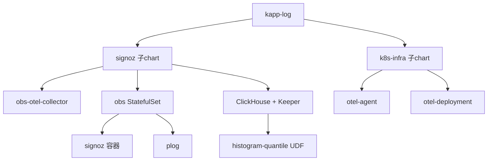
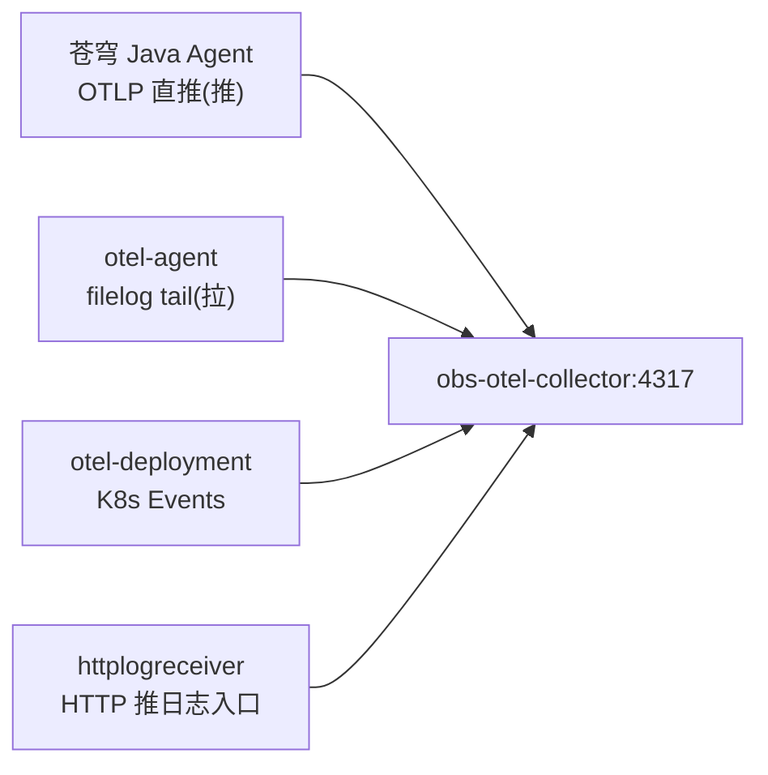
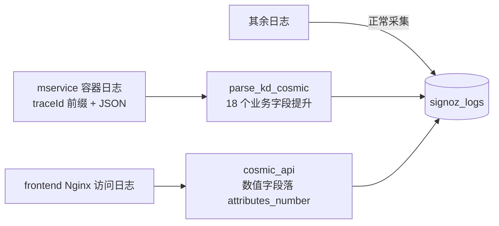
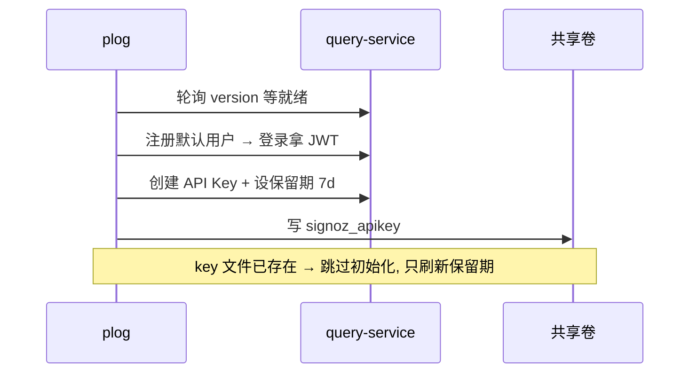
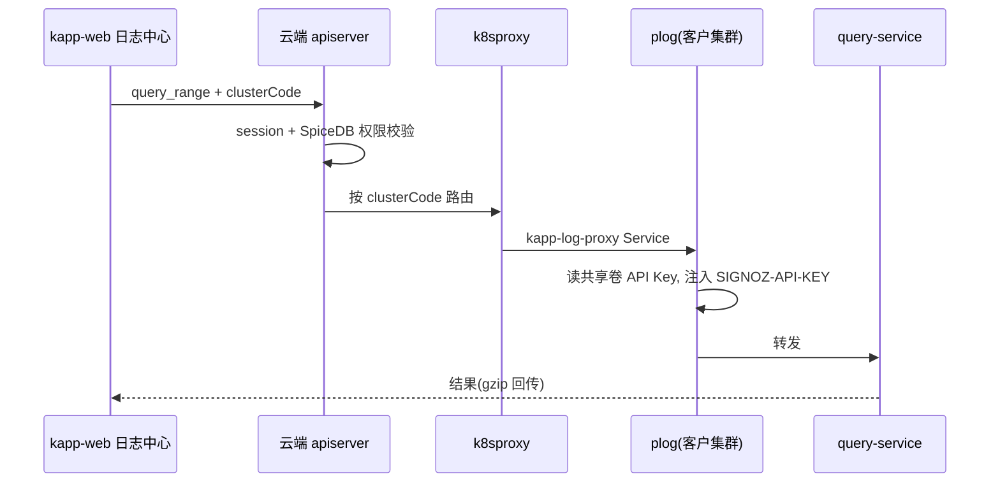

---
tags:
  - 平台组件
  - signoz
  - opentelemetry
  - clickhouse
  - 日志
  - 实战
created: 2026-11-23
---

# 📜 SigNoz 项目实战

> 通用机制（两级 Collector、CH 存储、管道调优原理）见 [[SigNoz]]，本篇只讲**项目为什么这样定制**。分工：指标归 KPS、告警归 Keep，SigNoz 只管日志/链路（[[KPS+Keep项目实战]]）；交付见 [[FluxCD项目实战]]。

## 一、项目要解决什么问题

四个约束，各逼出一个设计决策：

| 项目约束 | 设计决策 |
|---|---|
| 客户集群要用日志中心，但**原生 UI 不能暴露**（权限要收口到平台） | 自研 plog 代理 + 四级查询链路 |
| **离线交付**，运行期不能访问外网 | UDF 构建期下载打进镜像、私有镜像仓库 |
| 指标/告警已有 KPS/Keep，**不能双采打架** | k8s-infra 指标 preset 全关 |
| **Monitor 前端不可改**，业务字段过滤只能后端做 | collector 侧字段提升 processor |

形态要点：

| 项 | 值 |
|---|---|
| 封装 | 平台组件 **kapp-log**（signoz + k8s-infra 两个子 chart），命名空间 `kd-cosmic-log` |
| 环境 | 仅正式环境默认安装 |
| 版本 | **0.82.2 在线上跑；0.147.0 是升级候选**（TUNING.md 明示"尚未部署、无负载数据"） |
| 调度 | 核心组件钉专用节点（nodeSelector + toleration），与业务负载隔离 |
| 命名 | `nameOverride: obs` → obs StatefulSet、obs-otel-collector |

## 二、组件构成：上游壳 + 两块自研



叶子节点与下表成员一一对应；箭头 = 包含（UDF 由 ClickHouse Pod 的 initContainer 装入）。otel-deployment 原生跑 clusterMetrics/k8sEvents/prometheus 三个 preset，项目关掉指标后只剩 Events。

| 成员 | 来源 | 项目用途 |
|---|---|---|
| signoz 容器（query-service + frontend） | 上游合并镜像 | 查询翻译；原生 UI 仅内部排障用 |
| obs-otel-collector | 上游镜像 + **配置整段重写** | 苍穹字段加工 + 入库 |
| ClickHouse + Keeper | 上游 | 单节点遥测存储 |
| otel-agent / otel-deployment | 上游 chart + 私有镜像 | 采集端 |
| **plog** | **自研 Go** | 幂等初始化 + 查询鉴权代理|
| **histogram-quantile UDF** | **自建镜像** | 离线 P95/P99 |

易混点：signoz-otel-collector 是 signoz chart 的**自家模板**，不是子 chart；postgresql/redpanda/gateway 等可选子 chart 全关（单节点最小形态）。plog 以普通容器嵌 obs StatefulSet，兼容 K8s <1.28 无原生 sidecar。

## 三、采集：双源入站 + 三个项目约束



1. **hostname 统一**：苍穹 Agent 自带 host.name=Pod 名，污染日志中心 Hostname 筛选 → `resourceDetection.override: true` 覆盖为节点名；
2. **指标 preset 全关**：hostMetrics/kubeletMetrics/clusterMetrics 均 false，指标是 KPS 的活；
3. **黑名单**：kube-system、SigNoz 自身、hotrod/locust 测试 Pod；otel-agent 容忍全部污点。

已知局限：Events 单副本 Recreate 更新**有采集空窗，不保证停机补采**（README 明示）。

## 四、加工：前端不能改，就在采集侧提升



- **parse_kd_cosmic**：剥 `{traceId:...}` 前缀 → ParseJSON → 提升 traceId/appName/userId/tenantId/formId 等 18 字段为 attributes → 删临时字段。这是日志能按 traceId/用户/表单精确过滤的前提（DEVELOP-291："Monitor 前端不可改，只能在 otel+后端两端做"）；
- **cosmic_api**：仅 Nginx JSON 访问日志，status/request_time/bytes 落数值 attributes——**API 性能看板的数据源**；其余日志 on_error: send 不受影响。

写入链路实测参数（原理见 [[SigNoz]] §七，此处只列项目取值）：

| 配置 | 项目值 |
|---|---|
| batch | 2000 / 上限 8000 / 2s |
| memory_limiter | 75% + spike 15%，管道首位 |
| sending_queue | sizer: items、10 万条、4 消费者、block_on_overflow: true（实测单条 1.7KB，对 1Gi limit 定容） |
| retry / timeout | 5s→30s→300s / 30s |

诚实局限：**队列纯内存，重启丢数据**，当前未配 file_storage+PVC。traces 管道另走 `signozspanmetrics/delta`（自定义 latency buckets）；上游遥测上报全关。

## 五、存储：单节点离线生产形态

| 项 | 项目决策 |
|---|---|
| 拓扑 | 1 shard × 1 replica；扩容走 ADD-SHARD.md 手工指引 |
| 协调 | Keeper 替代 ZooKeeper |
| 保留 | 日志 **7 天**，plog 初始化调 API 设置；系统日志表 TTL 分级 1~30 天 |
| UDF | 构建期下载 + SHA256 校验打进镜像，**运行期不联网**；initContainer 复制到共享卷 |
| 冷存储 | S3 开关默认关 |
| 懒物化 | CH 25.12.5 上限 10000，profile 另设 "0" |
| 迁移 | telemetrystore-migrator Job + 私有仓库 imagePullSecrets |
| 元数据 | SQLite + PVC，遥测绝不进 |

## 六、初始化与凭据：幂等 + 密码不外泄



凭据工程四要点：随机密码满足 0.147+ 复杂度；**helm upgrade lookup 复用旧密码**（不重置登录态）；密码变更进 pod annotation checksum 触发重启；kafka 广播 CloudEvent 前对密码/邮箱**脱敏**——密码不落前端、不进事件流。

## 七、查询：四级代理，权限收口

**原生 UI 不暴露给客户**，前端是平台自研日志中心：



- 入口两个：`ProxySignoz`（v4 query_range，图表/列表/导出）+ `ProxySignozAttributeKeys`（v3 自动补全）；`GetLogStatus` 决定前端日志功能可用性；
- **错误文案工程**：plog 保留 "signoz not ready" 前缀供上游映射友好文案；apiserver 对 500 落 Error 日志（CH 报错/OOM 只在这里可见），connection refused 映射"日志服务未安装"；
- 自定义查询利用分时段扫描特性（orderBy 约束见 [[SigNoz]] §八）。

## 八、命令速查

```bash
kubectl -n kd-cosmic-log get pods,svc | grep obs
kubectl -n kd-cosmic-log logs obs-0 -c plog          # 初始化/代理
kubectl -n kd-cosmic-log logs obs-0 -c signoz        # query-service
kubectl -n kd-cosmic-log get cm obs-otel-collector -o yaml
kubectl -n kd-cosmic-log exec -it chi-obs-obs-0-0-0 -- clickhouse-client
```

## 九、项目特有坑

通用机制坑（batch/背压/队列丢数据/orderBy 等）见 [[SigNoz]] §九，此处只列项目踩过的：

1. **hostname 污染**：苍穹直推自带 Pod 名，必须 override 为节点名；
2. **conditions 是 OR**：0.82.2 踩坑，多条件必须一条 and 表达式（0.147.0 已修）；
3. **Events 采集空窗**：单副本 Recreate 不补采；
4. **密码升级失效**：upgrade 不 lookup 复用旧密码会重置登录态；
5. **改命名空间连带改端点**：otelCollectorEndpoint 写死 obs-otel-collector.kd-cosmic-log.svc；
6. **UDF 关闭代价**：关 UDF 后直方图分位数查询不可用；
7. **0.147.0 未验证**：TUNING.md 运行效果结论标"未验证"，线上问题先对照 0.82.2。


## 相关

- [[平台组件]]（MOC）
- [[SigNoz]]——通用机制单源，本篇定制形态与之对照
- [[KPS+Keep项目实战]]——指标/告警分工
- [[FluxCD项目实战]]——kapp-log 交付机制