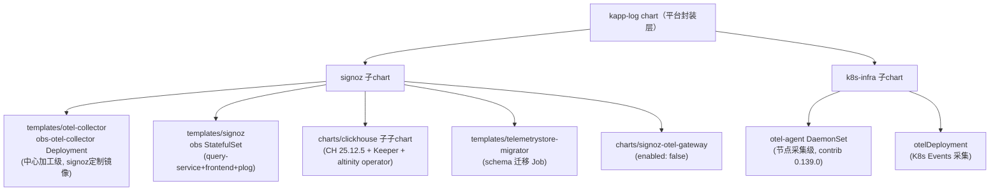
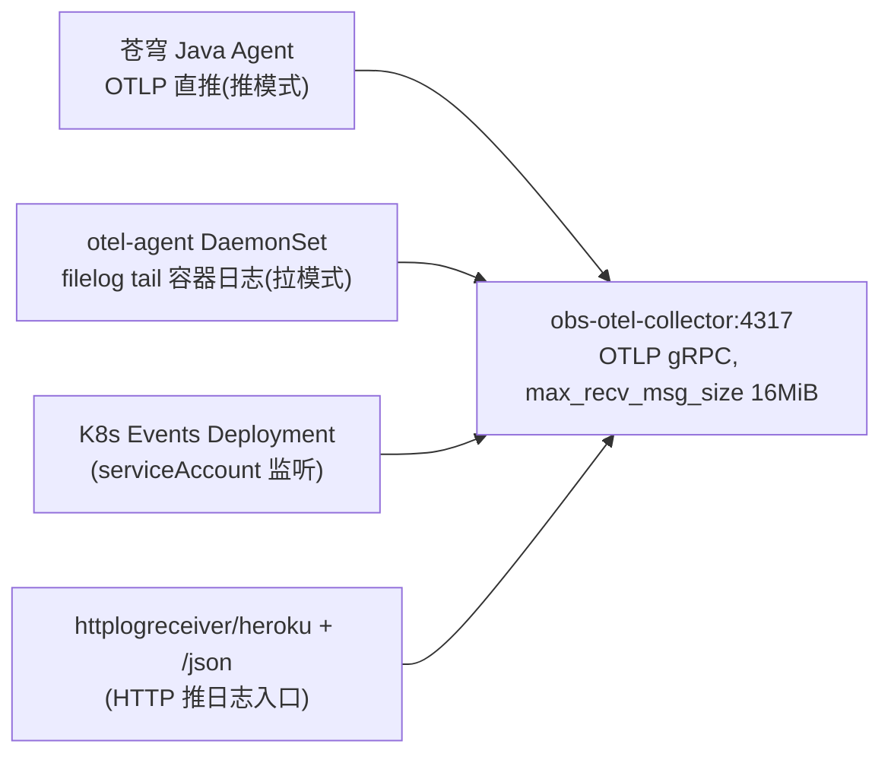
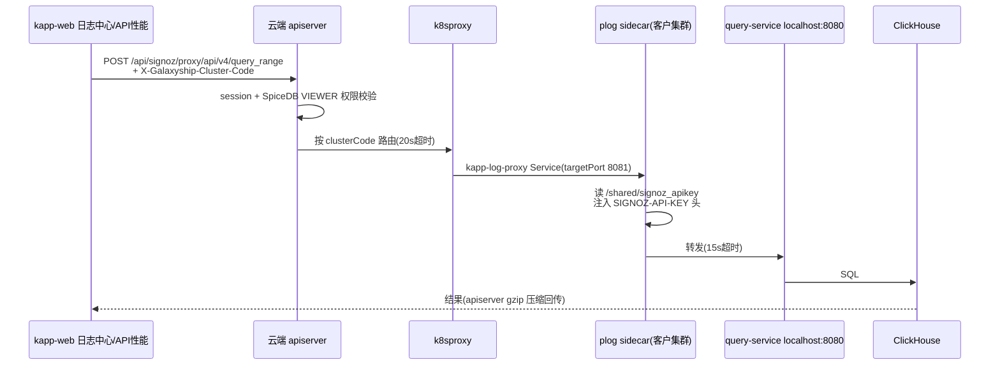

---
tags:
  - 平台组件
  - signoz
  - opentelemetry
  - clickhouse
  - 日志
  - 实战
created: 2026-11-23
---

# 📜 SigNoz 项目实战

> 聚焦 SigNoz 本体在本项目中的日志链路：**采集 → 加工 → 存储 → 查询**。
> 组件交付机制见 [[FluxCD项目实战]]；指标与告警分工见 [[KPS+Keep项目实战]]（指标归 KPS，告警归 Keep，SigNoz 只管日志/链路）。

## 一、定位与形态

SigNoz 不是独立部署的开源软件，而是被封装为平台组件 **kapp-log**（[packages/kapp-log](file:///home/lisong/projects/packages/kapp-log/0.147.0/README.md)）：

| 项 | 值 |
|---|---|
| 命名空间 | `kd-cosmic-log` |
| 环境 | 仅正式环境默认安装（deploy.json `SelectInEnvtype: prod`） |
| 版本现状 | **0.82.2 在线上跑；0.147.0 是升级候选**（TUNING.md 明示"尚未部署、无负载数据"） |
| 上游基线 | signoz chart 0.147.0（SigNoz v0.147.0 / Collector v0.144.14 / ClickHouse 25.12.5）+ k8s-infra 0.17.1（contrib 0.139.0 私有镜像） |
| 调度 | 全部核心组件 `nodeSelector: galaxyship/signoz=1` + 对应 toleration——**日志栈钉专用节点**，与业务负载隔离 |
| 资源命名 | `nameOverride/fullnameOverride: obs` → obs StatefulSet、obs-otel-collector 等 |

早期还有独立 [packages/signoz](file:///home/lisong/projects/packages/signoz/kapp.yaml)（v0.85.3）组件形态，现已整合进 kapp-log。

## 二、组件构成：上游 vs 自研



易混点：**signoz-otel-collector 是 signoz chart 的自家模板（templates/otel-collector/），不是子 chart**；真正的子 chart 只有 clickhouse / postgresql / redpanda / signoz-otel-gateway 四个，后三者本项目全关（单节点最小形态）。

| 成员 | 来源 | 职责 |
|---|---|---|
| signoz（query-service+frontend 合并镜像） | 上游 | 查询翻译 + 原生 UI；元数据存内置 SQLite（PVC） |
| signoz-otel-collector | 上游镜像 + **配置整段重写** | 加工 + 入库 |
| ClickHouse + altinity operator/metrics-exporter 0.21.2 | 上游 | 唯一遥测存储 |
| k8s-infra otel-agent / events | 上游 chart + 私有镜像 | 采集端 |
| **plog（镜像名 kapp-log-proxy）** | **自研 Go** | 初始化 + 查询鉴权代理（sidecar，端口 8081） |
| **histogram-quantile UDF** | **自建镜像** | P95/P99 分位数查询 |
| redpanda / gateway / PG | 上游可选 | 全关 |

plog 以**普通容器**嵌在 obs StatefulSet（[statefulset.yaml](file:///home/lisong/projects/packages/kapp-log/0.147.0/chart/charts/signoz/templates/signoz/statefulset.yaml)），兼容 K8s <1.28 无原生 sidecar。

## 三、采集：双源入站



[default.yaml](file:///home/lisong/projects/packages/kapp-log/0.147.0/default.yaml) k8s-infra 段关键配置：

1. **采集黑名单**：kube-system、signoz 自身日志（signozLogs: true）、hotrod/locust 测试 Pod；
2. **hostname 统一**（注释原话）：苍穹 Java Agent 自带 host.name=Pod 名，会污染日志中心 Hostname 筛选 → `resourceDetection.override: true` 强制覆盖为 `$(K8S_NODE_NAME)` 节点名；
3. **指标 preset 全关**：hostMetrics/kubeletMetrics/clusterMetrics 均 false——**指标是 KPS 的活**，避免两套 Prometheus 打架；otlpExporter 开、otlphttpExporter/loggingExporter 关；
4. **Events 采集**：开关/命名空间走表单 `container.k8sInfra.advanced.*`；单副本 Recreate 更新**有采集空窗，不保证停机补采**（README 明示）；
5. otel-agent DaemonSet **容忍全部污点**，保证每节点都采。

## 四、加工：两个苍穹 processor + 实测调优的写入链路

logs 管道：`receivers: [otlp, httplogreceiver/heroku, httplogreceiver/json] → processors: [memory_limiter, transform/parse_kd_cosmic, logstransform/cosmic_api, batch] → exporters: [clickhouselogsexporter, metadataexporter, signozmeter]`

### 4.1 transform/parse_kd_cosmic：业务字段提升

只处理 `kd-cosmic-xk/mservice` 容器日志（conditions 必须写成**一条 and 表达式**——列表内各项是 OR 关系，0.82.2 曾踩坑）：

1. `replace_pattern` 剥掉 `{traceId:...}` 前缀；
2. ParseJSON 到 temp_json；
3. **18 个业务字段提升为可查询 attributes**：traceId/appName/clusterName/className/accountId/userId/formId/opKey/instanceId/methodName/ip/appId/opMethod/formName/userName/tenantId + level→severity_text；
4. 删 temp_json。

注释挂 DEVELOP-291："**Monitor 前端不可改，只能在 otel+后端两端做**"——这是日志能按 traceId/表单/用户精确过滤的前提（otel 不提升为属性就无法过滤）。

### 4.2 logstransform/cosmic_api：API 性能数据源

仅对 `kd-cosmic-xk/frontend`（Nginx）的 JSON 访问日志做 json_parser（if 条件限定容器 + `body matches "^\s*\{"`，其余日志正常采集，on_error: send）；数值字段（status/request_time/bytes 在 Nginx 中不带引号）落 attributes_number——**前端 API 性能看板按 app/form/action/request_time/status 查询的数据源**。

### 4.3 写入链路调优（每条带实测注释）

| 配置 | 值 | 理由（注释原话提炼） |
|---|---|---|
| batch | 2000 / 上限 8000 / 2s | CH 适合大批量低频；小批量产生海量小 part 拖慢写入、队列写满 |
| memory_limiter | 75% + spike 15%，**管道首位** | 超软限向上游返回可重试错误（背压），而不是 collector 被 OOMKill |
| sending_queue | **按条数** sizer: items，10 万条 / 4 消费者 / **block_on_overflow: true** | 实测单条 1.7KB，10 万条≈230MiB，对着 1Gi limit 定；队列满阻塞上游不丢弃 |
| retry_on_failure | 5s→30s→300s | 失败重试 |
| exporter timeout | 30s | 批次加大后单次写入耗时增加 |

诚实标注的局限：**队列纯内存，Pod 重启丢数据**；要不丢需加 file_storage 扩展 + PVC（注释原话 ponytail）。

traces 管道另走 `signozspanmetrics/delta`（自定义 latency buckets 1ms~10s）从链路生成指标；上游遥测关闭：`signoz_analytics_enabled: false`、`signoz_statsreporter_enabled: false`。

## 五、存储：ClickHouse 单节点生产形态

| 项 | 配置 |
|---|---|
| 拓扑 | **1 shard × 1 replica**（扩容走 ADD-SHARD.md 手工指引） |
| 协调 | **ClickHouse Keeper 替代 ZooKeeper**（副本数表单化；ZK 镜像仅显式选择时保留，已有 ZK 数据需单独迁移） |
| 库 | signoz_logs / signoz_traces / signoz_metrics / signoz_metadata（三个 exporter DSN 分别指向） |
| 日志保留 | **7 天**（plog 初始化调 API 设置，`default_log_period` 可覆盖） |
| 系统日志表 | TTL 分级 1~30 天（queryLog 7d、blobStorageLog 30d、crashLog 3d…） |
| UDF | 自建 histogram-quantile 镜像，initContainer 复制到共享卷（**构建期下载+SHA256 校验，运行期不访问 GitHub**）；支撑固定桶直方图 P95/P99，纯日志场景可关 |
| 冷存储 | coldStorage S3 开关，**默认关** |
| 懒物化 | CH 25.12.5 默认上限 10000，子 chart 另把 default/admin profile 设 "0" |
| schema 迁移 | telemetrystore-migrator 用 Collector 内置 `migrate` 命令 + 私有仓库 imagePullSecrets |
| 元数据 | query-service 的 SQLite 走 PVC（用户/组织/仪表盘），**遥测数据绝不进 SQLite** |

## 六、初始化与凭据治理

### 6.1 plog SignozInit（幂等）

[init.go](file:///home/lisong/projects/kapp/internal/apps/plog/services/init.go)：轮询 `/api/v1/version` 等就绪 → 注册默认用户（env 注入凭据）→ 登录拿 JWT → 创建 API Key `galaxyship-api-key` → 设保留期（默认 7d）→ key 写 `/shared/signoz_apikey` 共享卷。**key 文件已存在则跳过初始化、只刷新保留期**。

### 6.2 chart 凭据工程

[secret.yaml](file:///home/lisong/projects/packages/kapp-log/0.147.0/chart/templates/secret.yaml)：随机密码 `randAlphaNum 16 + "Aa1!"`（满足 SigNoz 0.147+ 的 12 位复杂度）；**helm upgrade 时 lookup 复用已有密码避免登录态失效**；密码变更进 pod annotation checksum 触发重启；凭据 envFrom 挂进 plog。kafka 应用广播 CloudEvent 前对 `default_signoz_password/email` 脱敏（[sensitive.go](file:///home/lisong/projects/kapp/internal/apps/kafka/sensitive.go)）——**密码不落前端、不进事件流**。

## 七、查询：四级代理 + 权限收口

**SigNoz 原生 UI 不暴露给客户**，前端是平台自研日志中心，一切查询经 apiserver 鉴权：



- 入口两个：`ProxySignoz`（v4 query_range，图表/列表/分页导出全走它）+ `ProxySignozAttributeKeys`（v3 自动补全，GET 参数原样转发）——[env.go](file:///home/lisong/projects/kapp/internal/apps/apiserver/handlers/env.go)；
- `GetLogStatus` 查 kapp-log 组件安装状态，决定前端日志功能可用性；
- **错误文案工程**：plog 保留 `"signoz not ready"` 前缀供上游映射友好文案并透传真实原因；apiserver 对 500 响应体落 Error 日志（query-service/CH 报错、OOM 只在这里可见），connection refused 映射"日志服务未安装"；
- **SigNoz 查询性能特性**：orderBy 恰为 `[timestamp desc, id desc]` 且方向相同时才触发分时段窗口扫描（最近 1h→2h→4h 凑够 pageSize 即停），否则全时间范围一次性扫描——自定义查询要利用此特性。

## 八、实战命令速查

```bash
# 组件状态
kubectl -n kd-cosmic-log get pods,svc | grep obs
kubectl -n kd-cosmic-log logs obs-0 -c plog          # 初始化/代理日志
kubectl -n kd-cosmic-log logs obs-0 -c signoz        # query-service

# 采集端
kubectl -n kd-cosmic-log logs -l app.kubernetes.io/name=otel-agent --tail=50
kubectl -n kd-cosmic-log get cm obs-otel-collector -o yaml   # 生效的 collector 配置

# ClickHouse
kubectl -n kd-cosmic-log exec -it chi-obs-obs-0-0-0 -- clickhouse-client
# SHOW DATABASES; SELECT count() FROM signoz_logs.logs WHERE timestamp > now()-3600;

# 查询入口(集群内直连 plog)
curl -X POST http://kapp-log-proxy.kd-cosmic-log.svc.cluster.local:8080/api/signoz/proxy/api/v4/query_range \
  -H 'Content-Type: application/json' -d @query.json
```

## 九、踩坑清单

1. **hostname 污染**：苍穹 OTLP 直推自带 Pod 名 host.name，必须 resourceDetection.override=true 统一为节点名；
2. **conditions 是 OR**：transform 多条件必须写一条 and 表达式（0.82.2 踩坑，0.147.0 已修）；
3. **队列重启丢数据**：sending_queue 纯内存，Pod 重启丢队列；不丢需 file_storage+PVC；
4. **Events 采集空窗**：单副本 Recreate 更新不保证停机补采；
5. **小批量拖垮 CH**：batch 不能调小，小 part 海量合并拖慢写入致队列满；
6. **memory_limiter 必须管道首位**：否则背压传不到 receiver，collector 直接 OOMKill；
7. **密码升级失效**：helm upgrade 不 lookup 复用旧密码会重置登录态；
8. **orderBy 决定扫描方式**：不满足 [timestamp,id] 同向 desc 就全范围扫描，大时间窗查询慢；
9. **UDF 运行期不联网**：histogram-quantile 只在镜像构建期下载，离线环境可用；关闭 UDF 后直方图分位数查询不可用；
10. **改命名空间要连带改采集端点**：k8s-infra.otelCollectorEndpoint 写死 obs-otel-collector.kd-cosmic-log.svc；
11. **指标别走 SigNoz**：k8s-infra 指标 preset 全关是有意设计，指标归 KPS（见 [[KPS+Keep项目实战]]）；
12. **0.147.0 未验证**：TUNING.md 所有运行效果结论标"未验证"，线上问题先对照 0.82.2 文档。

## 十、文件索引

| 内容 | 位置 |
|---|---|
| 组件包/版本 | [packages/kapp-log/0.147.0/kapp.yaml](file:///home/lisong/projects/packages/kapp-log/0.147.0/kapp.yaml) |
| 全部 values（collector/CH/k8s-infra/plog） | [default.yaml](file:///home/lisong/projects/packages/kapp-log/0.147.0/default.yaml) |
| 凭据/代理 Service | [chart/templates/](file:///home/lisong/projects/packages/kapp-log/0.147.0/chart/templates/secret.yaml) |
| plog 容器定义 | [signoz/templates/signoz/statefulset.yaml](file:///home/lisong/projects/packages/kapp-log/0.147.0/chart/charts/signoz/templates/signoz/statefulset.yaml) |
| 初始化/查询代理 | [plog/services/](file:///home/lisong/projects/kapp/internal/apps/plog/services/init.go) |
| 云端查询代理 | [apiserver/handlers/env.go](file:///home/lisong/projects/kapp/internal/apps/apiserver/handlers/env.go) L752+ |
| 调优/版本差异 | [TUNING.md](file:///home/lisong/projects/packages/kapp-log/0.147.0/TUNING.md)、README.md、k8s-events-research.md、keeper-research.md |
| 前端日志中心 | [kapp-web/src/hooks/useLogState.ts](file:///home/lisong/projects/kapp-web/src/hooks/useLogState.ts) |

## 相关

- [[平台组件]]（MOC）
- [[SigNoz]]——通用架构与实战教学（两级 Collector、CH 存储模型、管道调优原理），与本篇定制形态对照阅读
- [[KPS+Keep项目实战]]——指标/告警分工，SigNoz 不碰指标
- [[FluxCD项目实战]]——kapp-log 组件的交付机制