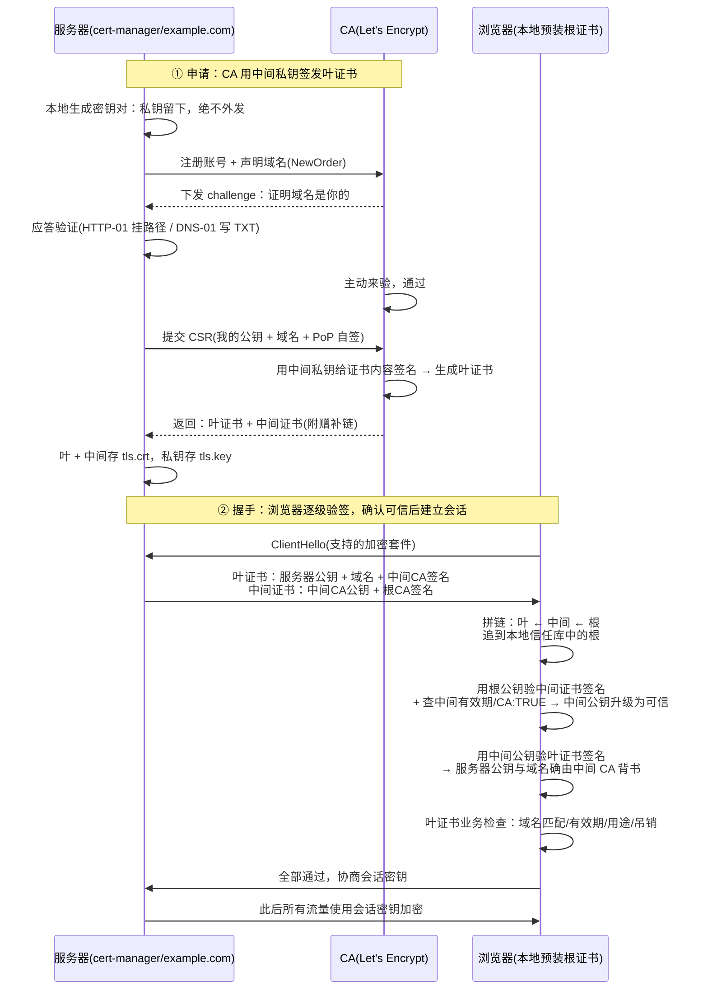
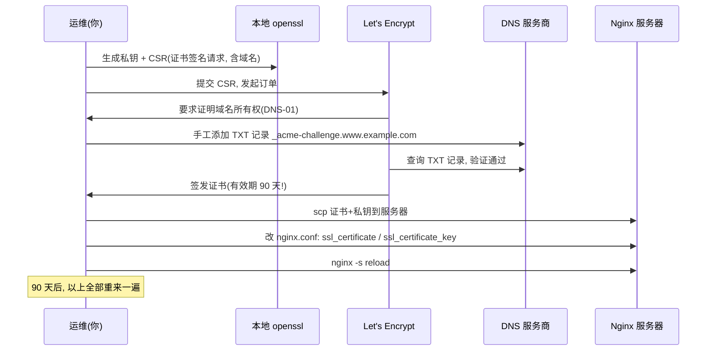
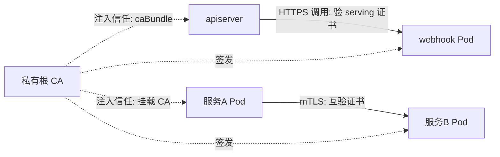
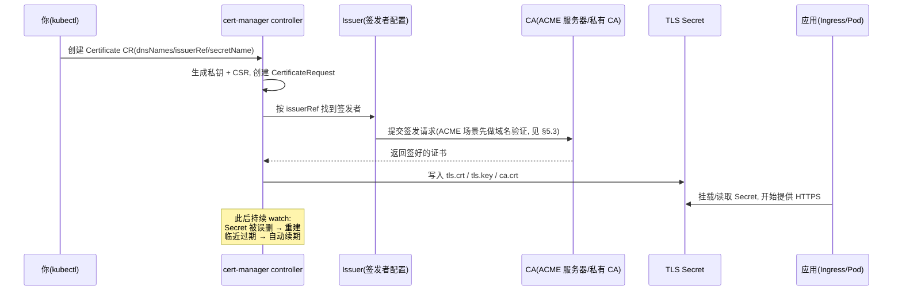
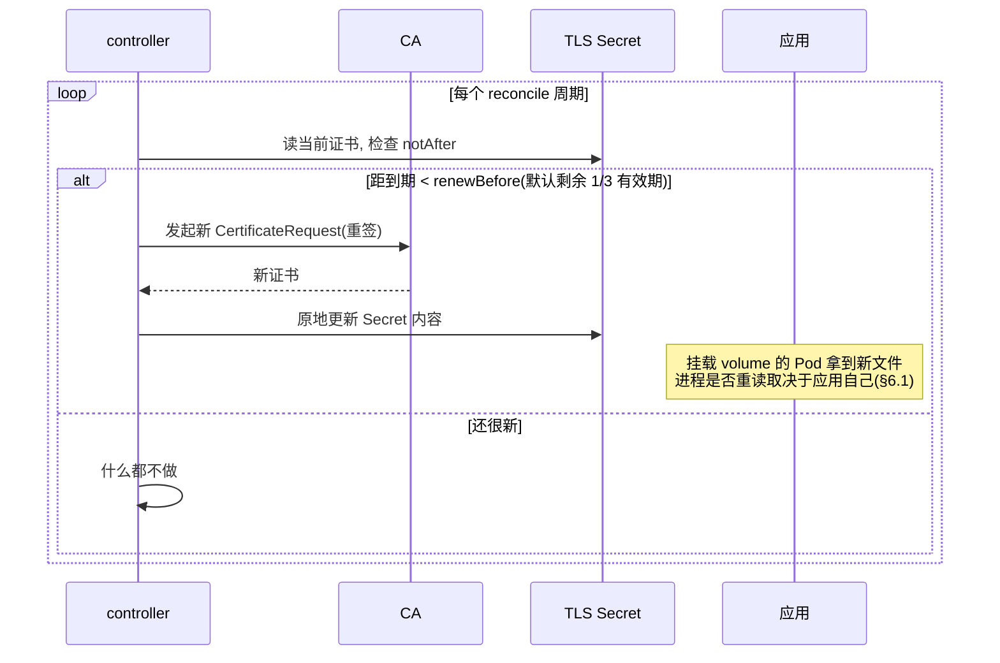
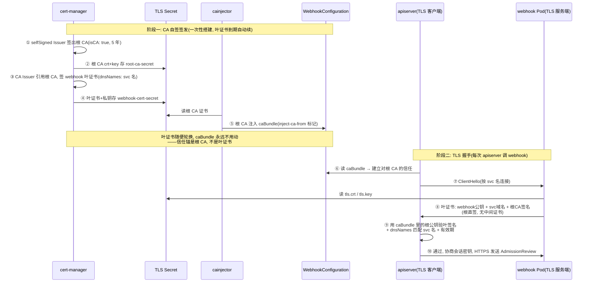
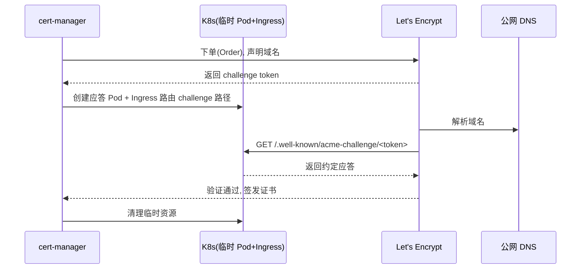
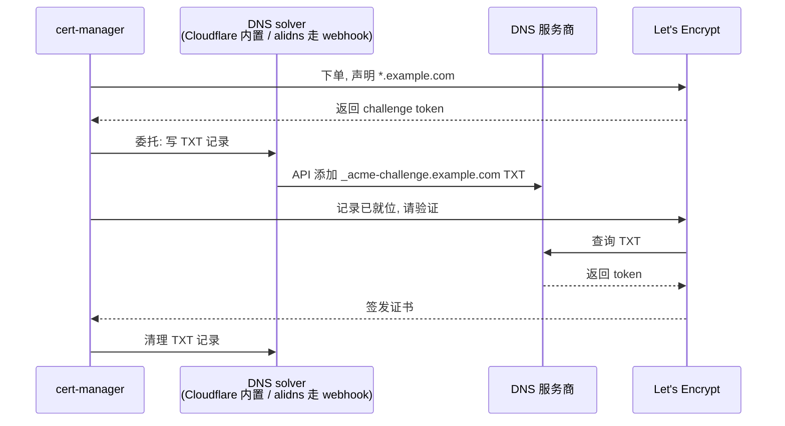
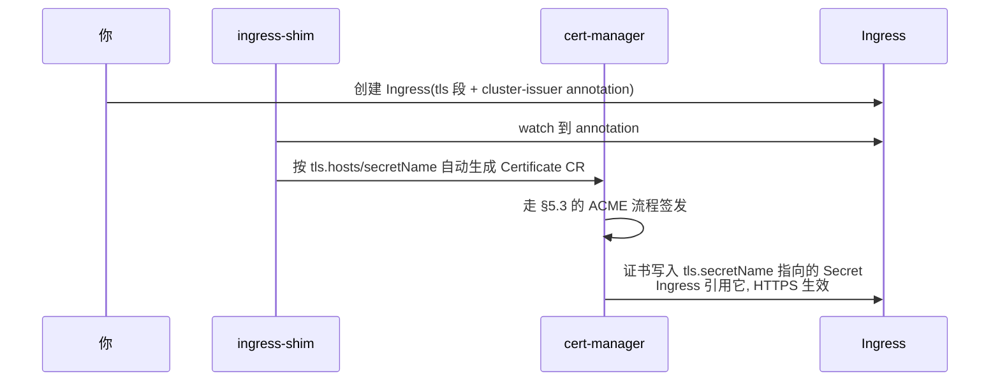
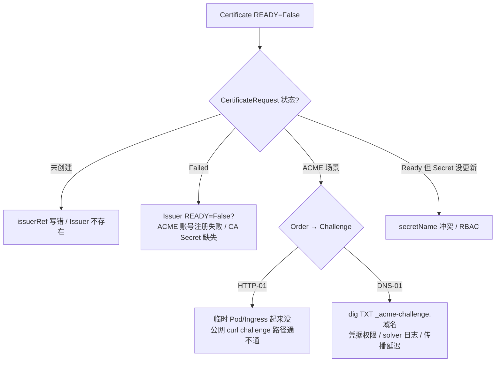

---
tags:
  - 平台组件
  - cert-manager
  - 证书
  - TLS
  - PKI
  - 教学
created: 2026-11-23
---

# 📖 cert-manager

> 一条线索展开：**证书是什么、手工怎么申请使用 → 手工方式为什么撑不住 → cert-manager 怎么解决 → CR 实例步步深入 → 续期与排障深水区**。项目内的两条证书供给线见 [[cert-manager项目实战]]。

## 一、先搞懂证书

### 1.1 从申请到握手：一张图看懂

访问 `https://example.com` 的完整信任链分两段：**先向 CA 申请叶证书，再在 TLS 握手中让浏览器沿证书链验签**。申请阶段由 CA 私钥把“服务器公钥 + 域名”签进证书；握手阶段则由浏览器从本地可信根出发，逐级得到可用来验签的公钥。



三个要点：

- **验签名**：签名 = CA 对证书内容摘要用自己私钥做的签注；验证 = 用签发者公钥确认"签名与内容摘要匹配"，即未篡改且确由该 CA 签发（RSA 可直观理解为"公钥解签得摘要 A，重算摘要 B，A==B"；ECDSA 等算法无"解密"动作，但验证逻辑相同）；
- **顺序不能反**：中间证书是现场发来的，必须先经根公钥验真，才敢使用其公钥验证叶证书——否则“假中间+假叶”自签自验即可骗过。信任逐级传递，锚在本地预装的根；
- **签名真 ≠ 可以用**：域名/有效期/吊销（OCSP/CRL）等业务检查另算。

**申请的是叶证书；中间证书是 CA 给自己办的（几年一次、全体用户共用），签发时附赠**——你碰不到中间私钥。提交的是 CSR（公钥材料），收回的是两张公开证书，叶私钥从未离开本地。ACME 提交物细节见 §5.3。

### 1.2 三张证书：机构、密钥、证书

先给 CA 的本质：**CA = 一把私钥（用来签）+ 一张含公钥的证书（用来让别人验）+ 一套信任分发机制（让验证方拿到并信任这把公钥）**。对根 CA，这张证书是自签的，信任分发 = 预装进客户端信任库；中间 CA 同构，只是证书由根签、信任分发靠握手补链（§1.1）而非预装。后面所有概念都是这三件事的展开；私有 CA（§5.2）就是你自己干这三件事：生成密钥对、自签根证书、cainjector 注入信任。

**根 CA 和中间 CA 不是两家机构，是同一家机构内部的两层密钥**：Let's Encrypt 就一家公司，根密钥锁离线 HSM 几乎不用，中间密钥在线天天签发。分层目的：中间被偷吊销换一套即可，根不用动（动根 = 全球设备更新信任库）。

| 词 | 指什么 |
|---|---|
| CA（机构） | Let's Encrypt 这样的组织，一个实体 |
| 根 / 中间 | 机构内部两套密钥，分两个安全级别 |
| 根证书 / 中间证书 / 叶证书 | 三张证书，证明"根可信""中间被根认可""服务器被中间认可" |

三张证书结构相同（**公钥 + 身份 + 颁发者签名**），区别只在：

| | 根 CA 证书 | 中间 CA 证书 | 叶证书（服务证书） |
|---|---|---|---|
| 装谁的公钥 | 根 CA 自己的 | 中间 CA 自己的 | **你的服务器的** |
| 被谁签名 | 自签名 | 根 CA | 中间 CA |
| 能签别人吗 | 能（CA:TRUE） | 能（CA:TRUE） | **不能**（CA:FALSE），故名"叶" |
| 身份字段 | CA 机构名 | CA 机构名 | **你的域名**（SAN） |
| 存放在哪 | 客户端信任库（预装） | 服务端随握手下发 | 服务端（TLS Secret） |

两个高频误解：**根证书里不是客户端的公钥**（普通 HTTPS 客户端没有证书，mTLS 才需要）；**中间证书里没有任何你的服务器信息**，它只是"验叶签名所需公钥"的载体。

### 1.3 信任锚怎么到达客户端

客户端信任的是 **CA 证书**（不是裸公钥），两个世界路径不同：

| 世界 | 信任怎么建立 | 典型场景 |
|---|---|---|
| 公共 CA（Let's Encrypt…） | 根证书**预装**在信任库（OS 证书存储 / Linux ca-certificates / Firefox NSS / Java cacerts） | 公网 HTTPS |
| 私有 CA（自己当 CA） | 客户端**被显式注入**根证书 | 集群内 TLS、K8s webhook |

**根证书绝不能靠服务器下发建立信任**——中间人可连根带叶一起伪造；服务器只能补中间环节。私有 CA 的注入落点：

| 客户端 | CA 到达方式 |
|---|---|
| apiserver 调 webhook | cainjector 填 `caBundle`（WebhookConfiguration / CRD conversion / APIService，见 §5.2） |
| 普通 Pod 调内部 HTTPS | 挂载 CA Secret / `SSL_CERT_FILE` / initContainer 追加进系统信任库 |
| 浏览器访问公网 | 不适用私有 CA |

选型由此推出：**客户端是浏览器 → 必须公共 CA；客户端是自己控制的程序 → 私有 CA 就够，且内部域名（`*.svc.cluster.local`）公共 CA 根本不签**。

## 二、没有 cert-manager 的日子：手工申请与使用

### 2.1 公网证书的手工流程



### 2.2 证书怎么用

落到配置就是两个文件路径。Nginx：

```nginx
server {
    listen 443 ssl;
    server_name www.example.com;
    ssl_certificate     /etc/nginx/certs/tls.crt;   # 证书(含链)
    ssl_certificate_key /etc/nginx/certs/tls.key;   # 私钥, 绝不外传
}
```

K8s 里换成 TLS Secret + Ingress：

```bash
kubectl create secret tls web-tls --cert=tls.crt --key=tls.key
```

```yaml
spec:
  tls:
    - hosts: [www.example.com]
      secretName: web-tls
```

### 2.3 集群内部证书：另一套手工活

最典型是 admission webhook：apiserver 调 webhook 走 HTTPS，webhook 要有 serving 证书，apiserver 要信任它的 CA：

```bash
# 自签 CA, 再签 webhook 证书(dnsNames 必须是 svc 名)
openssl req -x509 -newkey rsa:2048 -keyout ca.key -out ca.crt -days 1825 ...
openssl req -newkey rsa:2048 -keyout tls.key -out server.csr ...
openssl x509 -req -in server.csr -CA ca.crt -CAkey ca.key -out tls.crt ...
# CA 手工 base64 注入 webhook 配置——证书换了这里要跟着换
kubectl patch validatingwebhookconfiguration my-webhook \
  -p '{"webhooks":[{"name":"...","clientConfig":{"caBundle":"'"$(base64 -w0 ca.crt)"'"}}]}'
```

## 三、问题来了：手工方式为什么撑不住

1. **90 天 × 上百域名**：每张每年至少续 4 次，忘一次 = 一次全站 HTTPS 故障；
2. **K8s 动态环境**：Pod 重建、服务改名，dnsNames 随时失配；scp 到"服务器"在容器里没有落点；
3. **验证无法自动化**：DNS-01 调 API 写 TXT、HTTP-01 临时起服务应答，每个域名手工点一遍；
4. **caBundle 隐雷**：webhook 证书轮换忘更新 caBundle，x509 报错出现在别人的组件里，排查极易跑偏；
5. **私钥散落**：权限、备份、轮换全靠自觉。

归纳成四句需求：**声明要什么证书而非执行步骤；验证自动做；到期自动续；CA 自动注入**。这正是 cert-manager 做的事。

### K8s 证书用在哪：聚焦应用/workload 层

集群里的证书按"谁消费"分三层，cert-manager 的主战场是第三层：

| 层 | 证书例子 | 谁管 |
|---|---|---|
| 控制面 | apiserver/etcd/kubelet 通信证书 | kubeadm 内置 PKI，cert-manager 不碰（§6.3） |
| 边缘入口 | Ingress/Gateway 公网 TLS | cert-manager 也能管（§5.4），或云厂商/手工 |
| **应用/workload** | **webhook serving、服务间 mTLS、内部 HTTPS** | **cert-manager 主管，本篇重点** |

workload 证书长什么样？就是**发给 Pod 的证书**，两类典型消费关系：



读图：实线是 TLS 连接（客户端验服务端证书），虚线是证书与信任的来源——服务端证书由私有 CA 签，客户端的信任由 CA 注入。三个特征各对应一个设计选择：

1. **内部域名**（`*.svc.cluster.local`）公共 CA 不签 → 只能用私有 CA；
2. **客户端是集群内程序** → 不需要全球信任库，注入 CA 即建立信任（caBundle/挂载）；
3. **数量多、轮换频繁** → 每个组件的 webhook 都要一张证书，每次轮换都要"证书 + 信任注入"两侧联动。

第三点正是痛点：§2.3 的手工活（自签 CA → 签证书 → 注 caBundle）每个组件要重复一遍，每次轮换要人肉联动。**cert-manager 自动化的就是这一整套：声明 Certificate CR，签发 + 续期 + 写入 Secret + 信任分发全自动**——签发者可以是自签 CA（§5.2）也可以是 Let's Encrypt 等外部 CA（§5.3），机制相同，只是 Issuer 类型不同。

## 四、cert-manager 的解法：声明式 + 控制循环

### 4.1 它是什么

一组 K8s controller，**不是 CA 机构**——只把"申请/签发/续期/分发"自动化：

| 组件 | 干什么 |
|---|---|
| controller | 盯 Certificate CR，驱动签发与续期 |
| webhook | 校验 CR 合法性（自身证书自签自举） |
| cainjector | 自动注入 caBundle——解决痛点 4 |

### 4.2 核心机制：你声明，它跑腿



对照 §2.1：**openssl、手工 DNS、scp、改配置这些"你的戏份"全部消失**，只剩第一步声明。

### 4.3 续期也是同一个循环

续期不是"延期"，是**到期前自动重签、原地更新同一个 Secret**：



## 五、CR 实例步步深入

两个核心对象：`Issuer`（**用谁签**）和 `Certificate`（**要什么**：域名/时长/存哪）。Issuer 是 namespace 级，ClusterIssuer 集群级，用法相同。

### 5.1 第一张证书：selfSigned（最小闭环）

```yaml
apiVersion: cert-manager.io/v1
kind: Issuer
metadata: { name: selfsigned, namespace: demo }
spec:
  selfSigned: {}
---
apiVersion: cert-manager.io/v1
kind: Certificate
metadata: { name: demo-cert, namespace: demo }
spec:
  secretName: demo-tls          # 证书产出到这个 Secret
  dnsNames: [demo.example.com]
  issuerRef:
    name: selfsigned            # 用上面的 Issuer 签
    kind: Issuer
```

几秒后 Secret 就有内容。selfSigned 无需域名验证；**浏览器不信任它的原因是链追不到任何预装根**（与是否做域名验证无关）——它的真正用途是下一例的"第一推动力"。

### 5.2 内部 PKI：三段链（解决 webhook 证书）

直接 selfSigned 签 serving 证书也能跑，但每换证书都要重注 caBundle。标准做法：**长期根 CA + 叶证书由它签，caBundle 注入一次根 CA 一劳永逸**：



读图：阶段一对应下面 YAML 的四个对象，阶段二是消费侧。对照 §1.1 的公网握手，三处不同：信任锚来自 caBundle 注入而非预装；根直签叶所以**只发一张叶证书**（无中间层可补）；域名校验的对象是 svc 名。

```yaml
# ① 自签 Issuer(同 5.1)
# ② 根 CA: isCA: true 有权签别人, 5 年长效
apiVersion: cert-manager.io/v1
kind: Certificate
metadata: { name: root-ca, namespace: my-operator }
spec:
  isCA: true
  commonName: my-operator-ca
  duration: 43800h
  secretName: root-ca-secret
  issuerRef: { name: selfsigned, kind: Issuer }
---
# ③ CA Issuer: 引用根 CA Secret
apiVersion: cert-manager.io/v1
kind: Issuer
metadata: { name: ca-issuer, namespace: my-operator }
spec:
  ca: { secretName: root-ca-secret }
---
# ④ 叶证书: dnsNames 必须覆盖 apiserver 实际连接用的名字
apiVersion: cert-manager.io/v1
kind: Certificate
metadata: { name: webhook-cert, namespace: my-operator }
spec:
  secretName: webhook-cert-secret
  duration: 8760h
  dnsNames:
    - my-operator-webhook.my-operator.svc
    - my-operator-webhook.my-operator.svc.cluster.local
  issuerRef: { name: ca-issuer, kind: Issuer }
```

cainjector 靠 annotation 自动填 caBundle：

```yaml
metadata:
  annotations:
    cert-manager.io/inject-ca-from: my-operator/root-ca   # namespace/根CA名
```

注意：此最小形态**无独立中间层**（根直签叶，§1.2）——根私钥本就在线存 Secret，离线保护意义不大；规模大了再加被根签的中间层，轮换/泄露时不动根。两个易错点：**dnsNames 漏 svc 短名**、**inject-ca-from 指向根 CA 而非叶证书**。

这两个易错点正对应上图的⑧⑨步：dnsNames 漏 svc 短名 → 域名检查失败；caBundle 注错对象 → 验签失败——两者都表现为 x509 报错，且报在 apiserver 日志里。

### 5.3 公网证书：ACME（域名验证自动化）

前提：**私钥不出集群**，发给 CA 的只有公开材料：

| 阶段 | 提交的内容 | 作用 |
|---|---|---|
| ① 账号注册 | 账号公钥（JWK）+ 邮箱 | 之后请求用账号私钥 JWS 签名，CA 验来源 |
| ② NewOrder | 域名标识列表 | 声明要为哪些域名申请 |
| ③ Challenge | 域名所有权证明 | 让 CA 主动来验你控制该域名 |
| ④ Finalize | CSR（PKCS#10） | 真正的申请材料 |

CSR 三要素：**申请者公钥 + 身份（CN/SAN，须与 Order 一致）+ PoP 自签名**（证明持有配对私钥，防冒领）。CA 返回叶证书 + 中间链（`preferredChain` 可选链）。对照：`ca` 型 Issuer 无外部提交，拿集群内 CA 私钥本地直签；Vault/Venafi 发 CSR + 凭据。

**HTTP-01**：cert-manager 临时起 Pod + Ingress 应答 challenge，前提 **80 端口公网可达**，不支持泛域名：



**DNS-01**：调 DNS API 写 TXT，CA 查 DNS 验证——服务不必公网暴露，泛域名唯一选择：



Issuer 配置（Cloudflare 为例，它是内置 solver；不在内置列表的厂商如阿里云走 webhook solver，即图中的 W）：

```yaml
apiVersion: cert-manager.io/v1
kind: ClusterIssuer
metadata: { name: letsencrypt-prod }
spec:
  acme:
    server: https://acme-v02.api.letsencrypt.org/directory
    email: admin@example.com
    privateKeySecretRef: { name: letsencrypt-account-key }
    solvers:
      - dns01:
          cloudflare:
            apiTokenSecretRef: { name: cloudflare-token, key: api-token }
```

```yaml
spec:
  secretName: wildcard-tls
  issuerRef: { name: letsencrypt-prod, kind: ClusterIssuer }
  dnsNames: [example.com, '*.example.com']   # 泛域名只能 DNS-01
```

**运营三纪律**：调试用 staging（production 同域名集合每周 5 张重复签发限额）；Let's Encrypt 固定 90 天，`duration` 无效；TXT 有传播延迟，失败会重试，别急着改配置。

### 5.4 最后的偷懒：Ingress annotation 驱动

ingress-shim 控制器 watch 带 annotation 的 Ingress，自动生成 Certificate：



```yaml
metadata:
  annotations:
    cert-manager.io/cluster-issuer: letsencrypt-prod
spec:
  tls:
    - hosts: [www.example.com]
      secretName: web-tls        # 自动创建、自动续期
```

选型只看一个问题——**客户端是谁**：

| 场景 | Issuer 类型 | 验证方式 |
|---|---|---|
| 集群内 webhook/服务 mTLS | selfSigned → ca 三段链 | 无需验证，信任靠注入 |
| 公网域名（80 可达） | acme | HTTP-01 |
| 公网泛域名/内网服务 | acme | DNS-01 |
| 已有企业 CA/Vault | ca / vault | 信任锚由企业分发 |

## 六、深水区：续期细节与职责边界

### 6.1 续期之后，应用真的用上新证书了吗

```yaml
spec:
  duration: 2160h          # 有效期(ACME 公共 CA 固定 90d)
  renewBefore: 360h        # 到期前多久重签(默认剩余 1/3)
  privateKey:
    rotationPolicy: Always # 每次续期换新私钥(默认); Never 复用
```

**Secret 更新 ≠ 应用生效**：volume 挂载会拿到新文件（kubelet 同步分钟级延迟），进程是否重读看应用——nginx 要 reload，Go 要动态 `tls.Config`，**env 注入必须重启**。需要自动重启配合 reloader 类工具。

### 6.2 根 CA 到期是最易忽视的"自动化盲区"

**根 CA 的 Certificate 到期后整条链全废**；即使配了自动续期，新根也需重新分发信任（重注 caBundle）才生效。纪律：根 CA 设 5~10 年长效 + 单独监控告警，到期前双 CA 过渡轮换。

### 6.3 集群 PKI 不归它管

kubeadm 生成的 apiserver/etcd/kubelet 证书（`/etc/kubernetes/pki/`，默认 1 年）是另一套体系（即 §三的控制面层），续期走 `kubeadm certs renew`——cert-manager 自己作为 Pod 也靠这套 PKI 才能运行：

```bash
kubeadm certs check-expiration     # 集群 PKI
kubectl get certificate -A         # cert-manager PKI
```

## 七、排障：沿签发链下钻

**失败沿链向上传导，排查从现象往下钻**：



```bash
# ACME 排错四件套
kubectl get certificate,certificaterequest,order,challenge -A
kubectl describe certificate <name> -n <ns>        # Events 有失败原因

# 证书内容检查
kubectl get secret <tls-secret> -n <ns> -o jsonpath='{.data.tls\.crt}' \
  | base64 -d | openssl x509 -noout -subject -dates -ext subjectAltName

# caBundle 注入验证(webhook x509 报错先查这里)
kubectl get validatingwebhookconfiguration <name> \
  -o jsonpath='{.webhooks[0].clientConfig.caBundle}' | base64 -d | openssl x509 -noout -subject

# DNS-01 验证记录
dig TXT _acme-challenge.example.com +short

# cmctl 插件
kubectl cert-manager status certificate <name> -n <ns>   # 一站式诊断
kubectl cert-manager renew <name> -n <ns>                # 手动强制续期
```

高频坑浓缩：

1. 内部域名走 ACME 必失败；自签证书给浏览器用必弹不安全——**信任范围决定 CA 选型**；
2. dnsNames 漏 svc 短名 / inject-ca-from 指错对象 → webhook x509；
3. 调试不用 staging 撞 production 周限额；
4. 续期后进程不重读证书，env 注入必须重启；
5. 根 CA 到期无人管（§6.2）；
6. 升级顺序：先 CRD 后 controller；
7. `issuerRef.kind` 显式写对，跨 ns 引用只能用 ClusterIssuer；
8. 集群证书过期是 kubeadm 的事（§6.3）。

## 八、与项目形态的对照指引

| 本文机制 | 项目内的具体化 |
|---|---|
| 内部 PKI 三段链（§5.2） | KPS operator / ingress-alb / external-secrets webhook 证书，组件 chart 自带 CR |
| DNS-01 webhook solver（§5.3） | webhook-alidns / webhook-duckdns，apiserver dnsIssuer 策略层产品化封装 |
| Ingress annotation 驱动（§5.4） | 平台不用此模式，Certificate 由 apiserver 程序化创建 |
| 续期自动化（§4.3/§6.1） | 两条线均自动续期，原地更新 Secret——消费侧按名引用无需重新接线 |
| 集群 PKI 边界（§6.3） | kubeadm/kurl 体系独立检查 |

## 相关

- 上游：[[平台组件]] · [[云原生]] · [[Kubernetes]]
- 项目用法：[[cert-manager项目实战]]（两条证书供给线、dnsIssuer 策略层、命名契约与接线边界）
- 消费方背景：[[KPS 与 Keep]]（prometheus-operator webhook 是内部 PKI 典型消费方）
- 交付机制：[[GitOps 与 FluxCD]]（CRD 与 controller 的版本解耦管理）