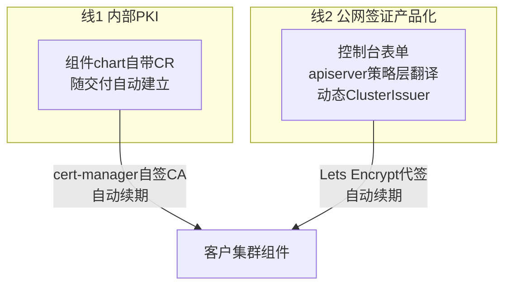
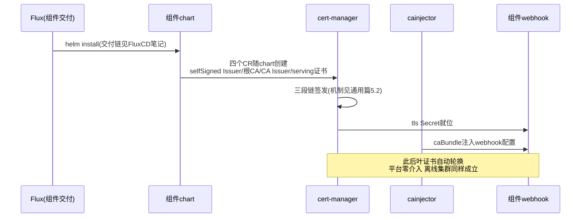
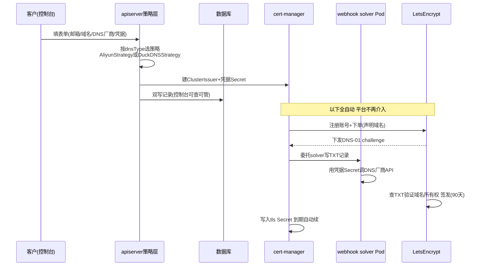

---
tags:
  - 平台组件
  - cert-manager
  - 证书
  - 产品化
  - 实战
created: 2026-11-23
---

# 🔐 cert-manager 项目实战

> 通用篇 [[cert-manager]] 回答了"证书怎么自动化"；本篇回答下一个问题：**平台面对成百上千个客户集群，cert-manager 怎么被产品化使用**。
> 一条线索：两种证书需求 → cert-manager 的两条供给线 → 每条线的架构决策 → 边界与排障。通用机制（信任链/ACME/续期/三段链）一律单源引用通用篇，本篇只讲项目特有的设计。

## 一、项目的问题：两种需求，两种身份

平台交付的客户集群里，cert-manager 要服务两个完全不同的方向：

| 需求方 | 要什么 | 难点 |
|---|---|---|
| **平台组件自己** | webhook/内部服务证书 | 集群可能离线；不能靠运维逐集群手工配 |
| **客户业务** | 自己域名的公网 HTTPS | 客户不会 kubectl；DNS 厂商各异 |

两者的"签发权在谁手里"不同，cert-manager 的身份就不同：

- 线 1：**自己当 CA**（selfSigned/CA Issuer），信任靠注入；
- 线 2：**向外部 CA 代办**（acme Issuer），信任靠浏览器预装。

**对 cert-manager 来说两条线是同一套机制**（watch Certificate → 找 Issuer → 签发 → 写 Secret → 续期），差异全在 Issuer 声明里。项目的产品化工作都在 cert-manager 之外。

## 二、两条供给线全景

| 线 | 签发权 | 生命周期管理者 | 轮换 | 外联要求 |
|---|---|---|---|---|
| 1 内部证书 | cert-manager（自签 CA） | **组件 chart**（CR 随交付安装） | 全自动 | 零（离线可用） |
| 2 公网证书 | Let's Encrypt | **apiserver 策略层**（建/删/查） | 全自动（90 天续） | 必须连 LE + DNS API |

## 三、线 1：证书是组件交付物的一部分

**问题**：KPS、ALB、external-secrets 每个都带 admission webhook，都要证书。客户集群可能离线，平台不可能逐集群运维证书。

**决策**：把 Certificate/Issuer CR **烘焙进组件 chart**——Flux 装组件的同时，证书供给线自动建立。证书不是平台运维对象，是**交付物的一部分**：

消费方（全部同款模式，CR 都在各自 chart 里）：

| 组件 | 证书用途 |
|---|---|
| KPS prometheus-operator | admission webhook |
| apusic-ingress-alb | admission webhook |
| external-secrets | webhook（dnsNames 全是内部 svc 名） |
| cert-manager 自身 | CRD conversion webhook |
| ClickHouse（可选开关） | 服务 TLS（`tls.autoGenerated.engine: cert-manager`） |

为什么自签就够——选型逻辑通用篇 §5.4 已讲透，项目只补一条硬约束：**airgap 集群连不上任何外部 CA，线 1 是唯一选择**。这也解释了组件形态：cert-manager 全环境默认装（deploy.json OrderLevel 800），因为内部 PKI 人人需要。

## 四、线 2：把控制台表单翻译成 ClusterIssuer

**问题**：通用篇 §5.3 的 ACME 流程要写 YAML、管凭据 Secret——客户做不到。且 DNS 厂商各异（阿里云/DuckDNS），凭据敏感，Issuer 生命周期要可管理。

**产品入口**：环境详情 → 证书管理 → "颁发机构"tab → **创建证书颁发者**（CertIssuer.jsx）。注意按钮创建的是**签发能力**（Issuer），不是证书——证书是 cert-manager 之后走 ACME 自动签出来的。

**决策**：apiserver 加一层 **dnsIssuer 策略层**，把"填表单"翻译成"建 CR"——**平台管生命周期，cert-manager 管签发**：

### 4.1 三个架构要点

1. **策略模式隔离厂商差异**：每个 DNS 厂商一个策略实现（`CreateClusterIssuer` + `CreateSecrets` 两个方法），加厂商 = 加策略，不动主流程；
2. **DB 与集群双写**：控制台视图来自 DB，真实状态在集群——删除必须**三清**（DB + ClusterIssuer + 凭据 Secret），否则留下"控制台看不见但集群还在续期"的幽灵 Issuer；
3. **翻译完就放手**：Issuer 建好后签发/续期全归 cert-manager，平台不参与 ACME 过程——产品化封装的是**入口**，不是机制。

配套两个 DNS-01 webhook solver 组件（webhook-alidns / webhook-duckdns）随平台交付，装在 cert-manager 命名空间——cert-manager 本体不认识 DNS 厂商 API，写 TXT 外包给 solver（官方扩展机制）。

### 4.2 证书产出后：命名契约 + 接线边界

证书 Secret 名由域名**确定性推导**（`DomainToSecretName`：域名点换横杠 + sha256 前 8 位 + `-tls` 后缀）——产出方和消费方不用通信就能对上暗号，续期原地更新 Secret 也不需要重新接线。

消费侧是 **Ingress**（`tls.secretName` 引用同名 Secret，边缘终止 TLS）。但注意核实到的边界：**平台自动建 Ingress 的代码（`createIngress`）存在但调用被注释**——当前"分发自动、接线手动"：Ingress 的 tls 引用要靠组件配置声明或 kubectl 手工指过去。

另两条客户侧前提（平台管不到）：

- **DNS A 记录**指向集群公网入口（流量可达）——与 ACME 验证用的 **TXT 记录**是两条不同的记录，后者 solver 代写、验完即删；
- 域名必须公网真实域名（内部 svc 名 LE 不签）；纯内网服务也能申请（DNS-01 只验 DNS 控制权，不要求服务公网暴露）。

成本注脚：LE 证书**免费**（DV 级，无组织身份验证），花费只在域名本身；速率限制见通用篇 §5.3 运营纪律。

## 五、边界

1. **集群 PKI 不归它管**：apiserver/etcd/kubelet 证书是 kubeadm/kurl 建集群时生成的另一套体系（通用篇 §6.3）。先有鸡后有蛋——cert-manager 自己是 Pod，靠控制面 PKI 才能运行；
2. **离线集群只有线 1**：线 2 要外联 Let's Encrypt 和 DNS API，airgap 下不可用；
3. **客户上传证书不经 cert-manager**：已购商业证书的上传分发是平台证书管理功能（secret-mgr + agent 直写 Secret），cert-manager 零参与——没有签发权就不假装能自动化。

## 六、排障与踩坑（只列项目特有）

通用 ACME 排障四件套、webhook x509 下钻见通用篇 §七。项目特有的按线定位：

| 现象 | 先查哪条线 | 查什么 |
|---|---|---|
| 组件 webhook x509 | 线 1 | chart 的 CR 是否随组件装上了（Flux 交付失败连带证书缺失） |
| 控制台 Issuer 删了还在续期 | 线 2 | 三清是否完整（DB/CR/Secret 逐一核对） |
| ACME 签发卡在 Challenge | 线 2 | solver Pod 状态、DNS 凭据权限、TXT 是否写入（通用篇 §七） |
| 证书签好了但 HTTPS 不生效 | 线 2 | Ingress 是否引用了该 Secret（接线手动）、DNS A 记录是否指向入口 |
| 离线集群公网证书失败 | 线 2 | airgap 下线 2 不可用，外联 LE/DNS API 是硬前提 |

踩坑浓缩：

1. **删 Issuer 必须三清**：凭据 Secret 漏删 = 敏感凭据残留集群；
2. **线 1 的根 CA 5 年 ≠ 叶证书 5 年**：serving 证书短得多且自动轮换，别看到 43800h 就以为不用管；
3. **cert-manager 全环境默认装**：精简组件时别把它裁了——线 1 是所有 webhook 组件的地基，裁掉它，一批组件要么装不上（CRD 缺失 helm 直接失败），要么 admission 瘫痪；
4. **线 2 签好证书 ≠ HTTPS 生效**：Ingress 接线当前手动，DNS A 记录是客户侧动作，两段都就位才可达；
5. **chart 的 cert-manager 依赖有后路**：KPS 等 chart 提供 patch Job 模式（自签 + 直接 patch caBundle，无续期），本项目统一走 cert-manager 模式 + OrderLevel 800 顺序前置。

## 相关

- [[平台组件]]（MOC）
- [[cert-manager]]——通用机制单源：信任链/ACME/三段链/续期/排障，本篇不重复
- [[FluxCD项目实战]]——线 1 的交付链：CR 随 chart 安装
- [[KPS+Keep项目实战]]——内部 PKI 最大消费方