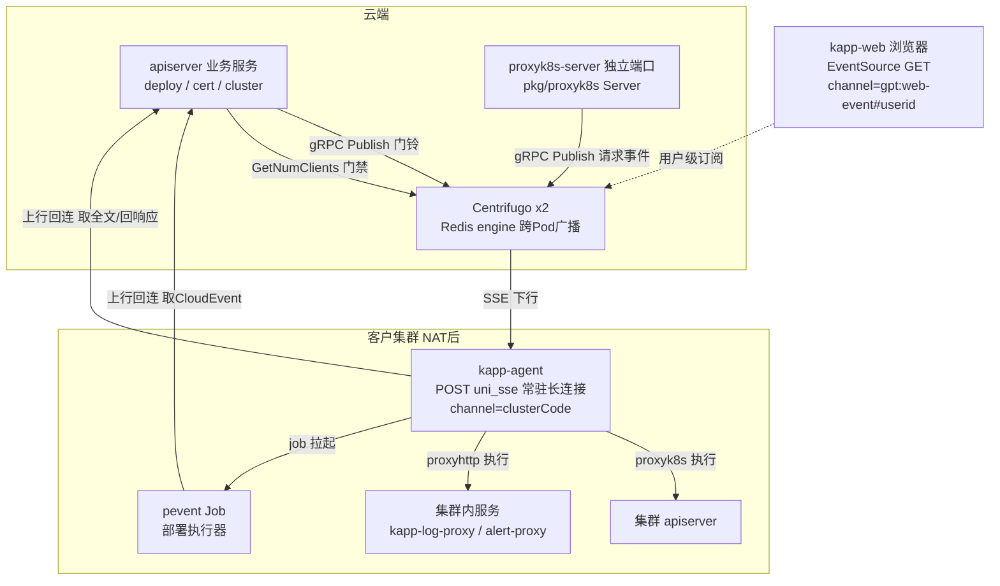
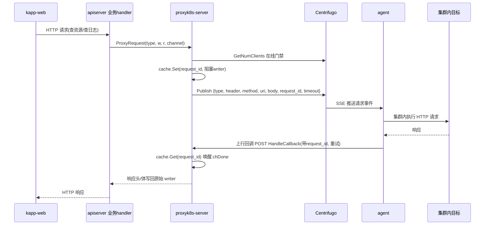
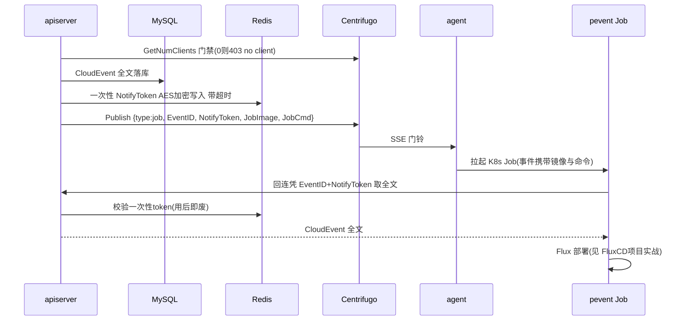

---
tags:
  - 平台组件
  - centrifugo
  - SSE
  - 实时消息
  - NAT穿透
  - 实战
created: 2026-11-23
---

# 📡 Centrifugo 项目实战

> 站在平台架构角度讲清 Centrifugo 的角色：它不只是"消息推送"，而是**云端触达客户集群的唯一通道**——异步事件下行与同步请求隧道都建立在它之上。
> 门铃的消费侧（pevent 部署链）见 [[FluxCD项目实战]]；隧道承载的日志查询见 [[signoz项目实战]]；证书业务语义见 [[cert-manager项目实战]]。本篇只写通道本身。

## 一、架构定位：一条长连接撑起三类交互

### 1.1 根本约束

客户集群在 NAT/防火墙后，**云端无法主动发起任何连接**。平台所有"云端 → 集群"的交互，都必须借道一条由集群侧主动拨号、常驻保持的长连接。Centrifugo 就是这条长连接的服务端总线：连接管理、channel 路由、消息广播、在线状态（presence）全部外包给它，apiserver 不自己维护海量连接。

选 SSE（uni_sse）而非 WebSocket/gRPC 流：基于普通 HTTP（text/event-stream），公网代理/防火墙穿透性最好。

### 1.2 三类交互模式（本项目对 Centrifugo 的全部用法）

| 模式 | 方向 | 载荷 | 项目实例 |
|---|---|---|---|
| **门铃**（异步通知） | 云 → agent | 轻量触发器，全文走回连 | 部署事件（job）、证书下发（cert） |
| **隧道**（同步 RPC） | 云 ⇄ agent | 完整 HTTP 请求/响应 | proxyk8s：控制台查集群资源、日志查询、告警视图 |
| **presence**（在线门禁） | 云查 Centrifugo | 无载荷 | agent 在线状态、发布前门禁 |



**关键认知**：上行永远是客户端主动发起（Connect RPC 短连接 / HTTP 回调），下行永远经 Centrifugo。隧道模式把"发布/订阅"总线改造成了"请求/响应"RPC——这是本项目最有特色的用法（第三节）。

## 二、通道工程：部署、channel 体系与鉴权

### 2.1 部署形态

[packages/centrifugo](file:///home/lisong/projects/packages/centrifugo/kapp.yaml)：v5.4.0（chart 11.6.1），云端组件，[huawei.yaml](file:///home/lisong/projects/packages/centrifugo/huawei.yaml) 生产配置要点：

- **2 副本 + Redis engine**（redis-headless.redis-system:6379）：内存 engine 只能单 Pod，多副本必须 Redis 做跨 Pod 广播——agent 连在 Pod A、发布打到 Pod B 也能送达；
- **三协议开关**：uni_sse（客户端连接）、grpc_api（服务端发布/查询）、presence（在线状态）；
- **namespaces**：kapp-agent / kapp-server，history_size 10、history_ttl 300s——断线 5 分钟内重连可补发，超窗靠业务对账；
- **保活**：ping 120s / pong 超时 10s；公网入口 ingress `galaxyship.kingdee.com/connection/uni_sse`；
- **双密钥**：tokenHmacSecretKey（签连接 JWT）与 apiKey/grpcApiKey（服务端 API 鉴权）分离。

### 2.2 channel 体系：三种粒度

| channel | 粒度 | 谁订阅 | 谁发布 |
|---|---|---|---|
| `<clusterCode>` | 集群级 | kapp-agent（安装时 JWT 的 subs 写死） | apiserver deploy/cert/proxyk8s |
| `gpt:web-event#<userid>` | 用户级（`#` 是 Centrifugo user-limited 语法，仅该用户可订） | kapp-web 浏览器 | 云端业务事件 |
| `xwei.session/ops/agent:<id>` | 会话级 | xwei 双端 | xwei Publisher（见第五节） |

### 2.3 鉴权：JWT 预授权，channel 不可自选

[pkg/sse/token.go](file:///home/lisong/projects/kapp/pkg/sse/token.go) `TokenGenerator.Generate`：HS256 签 `{sub: 身份, subs: {channel: {}}}`——**能订哪个 channel 在签发时就写死**，客户端没有自选入口：

- agent token：安装时签发，subs 绑定 clusterCode，换集群必须重签；
- 前端 subToken：登录时签发（[auth2.go L266](file:///home/lisong/projects/kapp/internal/apps/apiserver/handlers/auth2.go)），随 userInfo 下发，前端 [Head/index.jsx](file:///home/lisong/projects/kapp-web/src/components/Module/Head/index.jsx) 用它连 `gpt:web-event#<userid>`；
- 发布权垄断：Publish 只走 apiKey 保护的 gRPC Server API（[grpclient.go](file:///home/lisong/projects/kapp/pkg/sse/grpclient.go)，仅 `Publish` / `GetNumClients` 两个方法），客户端无发布权。

HMAC 密钥三处必须同值：centrifugo tokenHmacSecretKey、apiserver `sse_server_key`、ssemirror 同名配置。

## 三、隧道模式：proxyk8s——把 SSE 总线改造成同步 RPC（核心机制）

### 3.1 解决什么问题

控制台要看客户集群的 Pod 列表、查 SigNoz 日志、看告警视图——这些都是**同步请求/响应**语义，但云端连不进集群。[pkg/proxyk8s](file:///home/lisong/projects/kapp/pkg/proxyk8s/server.go) 的方案：把整个 HTTP 请求打包成事件经 SSE 推给 agent，agent 在集群内执行，再把 HTTP 响应**上行回调**云端，云端按 request_id 唤醒阻塞中的原始请求。

### 3.2 数据流



### 3.3 工程细节（[server.go](file:///home/lisong/projects/kapp/pkg/proxyk8s/server.go) ProxyRequest）

- **先 cache.Set 再 Publish**：源码注释明确防竞态——若先发布后设缓存，agent 可能已处理完但响应无处投递；发布失败则回滚删除缓存；
- **三层超时**：事件携带业务 Timeout（agent 执行 HTTP 用）；proxy 层兜底 `timeoutOfK8sAPI = 2min`（缓存 TTL 同值）；上游 ctx 取消（如 SigNoz 查询链的 20s）单独处理，区分 DeadlineExceeded 与手动取消；
- **两种执行器**（agent 侧 [process/](file:///home/lisong/projects/kapp-agent/internal/apps/agent/process/process.go)）：`proxyk8s` → kube_requester 打集群 apiserver；`proxyhttp` → http_requester 打集群内任意服务；
- **回调带重试**（agent [pkg/proxyk8s/agent.go](file:///home/lisong/projects/kapp-agent/pkg/proxyk8s/agent.go)）：10s 超时 + retry，响应含 header/body/request_id。

### 3.4 项目中的真实消费方

| 消费方 | 目标 | 说明 |
|---|---|---|
| 控制台集群资源页 | 集群 apiserver | agent [get_resource.go](file:///home/lisong/projects/kapp-agent/pkg/proxyk8s/get_resource.go) 把 Deployment/StatefulSet/DaemonSet/Pod 格式化成表格 |
| ProxySignoz 日志查询 | kapp-log-proxy:8080 | 四级代理链的"云端→集群"一跳就是本隧道，见 [[signoz项目实战]] |
| [alert_view.go](file:///home/lisong/projects/kapp/internal/apps/apiserver/handlers/alert_view.go) | kapp-alert-proxy | ListNamespaces/ListAlerts/GetAlertSeverity/GetAlertDetail 全走隧道 |

**架构意义**：有了这条隧道，云端任何业务 handler 都能像调本地服务一样调集群内服务——新增集群侧能力不需要新开通道，复用同一个 SSE 连接。

## 四、门铃模式：job 与 cert——两种载荷哲学

agent 的 SSE 事件分发器（[process.go](file:///home/lisong/projects/kapp-agent/internal/apps/agent/process/process.go)）按 type 路由四类处理器：`job` / `cert` / `proxyk8s` / `proxyhttp`。后两类是隧道（第三节），前两类是门铃，但**载荷策略截然不同**：

### 4.1 job：铃铛不载货（部署事件）

[deploy.go](file:///home/lisong/projects/kapp/internal/apps/apiserver/services/deploy.go)：



设计要点：SSE 只传轻量触发器，**大载荷走回连**（不压长连接）；token 一次性防重放；agent 只是"拉起 Job 的扳机"，真正执行在独立 Job Pod（[job.go](file:///home/lisong/projects/kapp-agent/internal/apps/agent/process/job.go) JobProcessor，镜像/命令/拉取密钥都由事件携带）。

### 4.2 cert：铃铛直接载货（信封加密）

[EventTrigger](file:///home/lisong/projects/kapp-agent/internal/apps/agent/process/types.go) 证书专用字段：`EncryptedData`（信封加密的 tls.key）+ `Salt`（企业确定性盐，PBKDF2 派生私钥）+ `CertValue`（公钥明文）+ 目标 Namespace/SecretName/Domain。agent [cert.go](file:///home/lisong/projects/kapp-agent/internal/apps/agent/process/cert.go) 解密后直写 K8s TLS Secret，**不回连取货**。

为什么与 job 相反：私钥已信封加密，载荷本身安全且体积小，省去一次回连往返；而 CloudEvent 全文大且含部署细节，适合落库+一次性 token 模式。

下发前同样有门禁（[cert.go handler](file:///home/lisong/projects/kapp/internal/apps/apiserver/handlers/cert.go)）：GetNumClients 查在线（离线拒发）+ agent 版本 >= 0.3.0 + 单精确域名排他。业务语义见 [[cert-manager项目实战]]。

## 五、presence：在线状态即门禁

`GetNumClients(channel)` 查 channel 上的连接数，项目中三处消费：

| 消费方 | 行为 |
|---|---|
| [cluster.go](file:///home/lisong/projects/kapp/internal/apps/apiserver/services/cluster.go) GetAgentStatus | 控制台"agent 在线/离线"徽标的实时依据（num=0 即 NOT_CONNECTED） |
| deploy.go 发布前 | num=0 直接 403 "no client"，不做无效发布 |
| ProxyRequest / 证书下发 | 同上，离线快速失败并给出可操作报错 |

**排障第一定律**：任何"云端操作集群失败"，先查 presence——agent 没连上，一切免谈。

## 六、xwei：另一套深度集成（Proxy 动态鉴权）

kapp 是"JWT 预授权 + 服务端垄断发布"的轻量用法；xwei（智能运维聊天）把 Centrifugo 用成了完整实时子系统（[xwei-server/internal/centrifugo](file:///home/lisong/projects/xwei/xwei-server/internal/centrifugo/doc.go)，ADR-P1/P3/P4）：

- **Proxy 模式**：Centrifugo 在 connect/subscribe/publish/refresh 四个时机**实时反调 xwei-server** 做鉴权与路由决策——权限不再是签发时写死，而是每次动态校验；
- **三类 channel**：`xwei.session:<id>`（会话消息）/ `xwei.ops:<id>`（运维）/ `xwei.agent:<id>`（agent 投递），命名空间解析兼容 `:` 与 `#` 两种边界；
- **Publisher**：HTTP Server API 封装 PublishToSession/PublishToOps/PublishToAgent，chat 流式回复经 PublishToAgent 投给集群侧 agent；
- 配套：lane_policy（通道策略）、agent_delivery_coordinator（投递协调）、web_presence_adapter、session_cleanup。

| | kapp | xwei |
|---|---|---|
| 鉴权 | JWT 预授权（subs 写死） | Proxy 动态鉴权（每次实时问后端） |
| 粒度 | 集群级 / 用户级 | 会话级三通道 |
| 发布 | 服务端垄断 | Publisher + Publish Proxy 路由用户消息 |
| 适用 | 低频运维事件 + 隧道 | 高频聊天流（细粒度权限 + 续期） |

## 七、周边：ssemirror 连接地理画像

[internal/apps/ssemirror](file:///home/lisong/projects/kapp/internal/apps/ssemirror/handlers/mirror.go)（云端组件 16ssemirror）：`ResolveClusterAndIpInfo` 把 clusterCode → SSE 连接来源 IP → 地理位置写 Redis（TTL 1 年）。中国 IP 用 ip2region xdb，国际 IP 用 GeoLite2-City mmdb，坐标查 city.json——为客户分布地图供数，是 SSE 连接体系的观测周边。

## 八、实战命令速查

```bash
# 1. 排障第一步:查 agent 在线(presence)
curl -s http://<centrifugo>:8000/api/presence \
  -H "X-API-Key: <apiKey>" -d '{"channel":"<clusterCode>"}'

# 2. 模拟服务端发布门铃(验证通道本身)
curl -s http://<centrifugo>:8000/api/publish \
  -H "X-API-Key: <apiKey>" \
  -d '{"channel":"<clusterCode>","data":{"type":"job","event_id":"test"}}'

# 3. 模拟 agent SSE 连接(POST uni_sse)
curl -N -X POST https://galaxyship.kingdee.com/connection/uni_sse \
  -H 'Content-Type: application/json' \
  -d '{"token":"<JWT>","subs":{"<clusterCode>":{}}}'

# 4. 多副本广播依赖:Redis engine 连通性
kubectl -n redis-system exec redis-0 -- redis-cli -a <pwd> keys 'centrifugo*'

# 5. agent 侧连接与事件处理日志
kubectl -n kd-cosmic-ops logs deploy/kapp-agent | grep -i "sse\|subscribe\|process"

# 6. 隧道超时排查:云端 proxyk8s-server 日志找 request_id
#    "blocked writer not found" = 响应回来时原始请求已超时清理
```

排错顺序：presence 在线？→ JWT（HMAC 一致/过期/subs 含目标 channel）？→ ingress uni_sse 路径？→ 多副本丢消息查 Redis engine？→ 断线补发看 history 300s 窗口？→ 隧道超时按 request_id 串云端与 agent 两侧日志。

## 九、踩坑清单

1. **内存 engine 只能单 Pod**：扩副本必须 Redis engine，否则跨 Pod 消息互不可见；
2. **channel 不可自选**：由 token subs 决定，换集群/换用户都要重签 token；
3. **门铃不载全文（job）**：抓包只见 EventID+NotifyToken 是正常的，业务数据在回连里；cert 例外（信封加密直接载货）；
4. **一次性 token**：NotifyToken 用后即废（Redis 超时删除），重放取不到事件；
5. **history 窗口仅 300s**：断线超 5 分钟补发不了，靠业务对账兜底；
6. **隧道竞态**：必须先 cache.Set 再 Publish（源码注释明示），自己扩展隧道逻辑时别颠倒；
7. **隧道三层超时**：业务 Timeout / proxy 兜底 2min / 上游 ctx，"blocked writer not found" 是响应晚于超时清理，不是丢消息；
8. **presence 是一切门禁前提**：GetNumClients=0 时部署/证书/隧道全部快速失败，先查 agent 连接；
9. **HMAC 密钥三处一致**：centrifugo / apiserver / ssemirror，不一致则连接鉴权失败；
10. **GET 形态 URL 长度**：前端 cf_connect 塞 query string，token 过大超 URL 限制；agent 用 POST（body 上限 65535）；
11. **代理空闲超时**：中间代理空闲超时小于 ping 120s 会断连；
12. **kapp 与 xwei 模式别混**：预授权 vs Proxy 动态鉴权，排查订阅失败先分清走的哪套。

## 十、文件索引

| 内容 | 位置 |
|---|---|
| 组件包/生产配置 | [packages/centrifugo](file:///home/lisong/projects/packages/centrifugo/kapp.yaml)、huawei.yaml |
| 服务端客户端(gRPC) | [kapp/pkg/sse/grpclient.go](file:///home/lisong/projects/kapp/pkg/sse/grpclient.go)、token.go |
| 隧道核心 | [kapp/pkg/proxyk8s/server.go](file:///home/lisong/projects/kapp/pkg/proxyk8s/server.go)（ProxyRequest/HandleResponse）、event.go |
| 隧道消费方 | apiserver services/proxyk8s.go、handlers/alert_view.go、services/env.go(ProxySignoz) |
| 门铃发布 | [apiserver/services/deploy.go](file:///home/lisong/projects/kapp/internal/apps/apiserver/services/deploy.go)、handlers/cert.go |
| agent 事件分发 | [kapp-agent process/process.go](file:///home/lisong/projects/kapp-agent/internal/apps/agent/process/process.go)、job.go、cert.go、types.go |
| agent 隧道执行 | [kapp-agent/pkg/proxyk8s/](file:///home/lisong/projects/kapp-agent/pkg/proxyk8s/agent.go)（agent.go/kube_requester.go/http_requester.go） |
| agent SSE 订阅 | [kapp-agent/pkg/sse/sub_new.go](file:///home/lisong/projects/kapp-agent/pkg/sse/sub_new.go) |
| 前端订阅 | [kapp-web/src/store/sse/](file:///home/lisong/projects/kapp-web/src/store/sse/SSEService.ts)（SSEService.ts/desc.md）、Head/index.jsx |
| xwei Proxy 子系统 | [xwei-server/internal/centrifugo/](file:///home/lisong/projects/xwei/xwei-server/internal/centrifugo/doc.go) |
| 地理画像 | [ssemirror/handlers/mirror.go](file:///home/lisong/projects/kapp/internal/apps/ssemirror/handlers/mirror.go)、deploy/components/16ssemirror |

## 相关

- [[平台组件]]（MOC）
- [[FluxCD项目实战]]——job 门铃的消费侧：pevent 取 CloudEvent 后的部署链
- [[signoz项目实战]]——隧道承载的日志查询四级代理链
- [[cert-manager项目实战]]——cert 门铃的业务语义与下发门禁