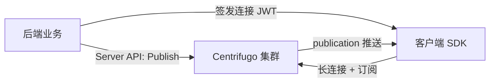
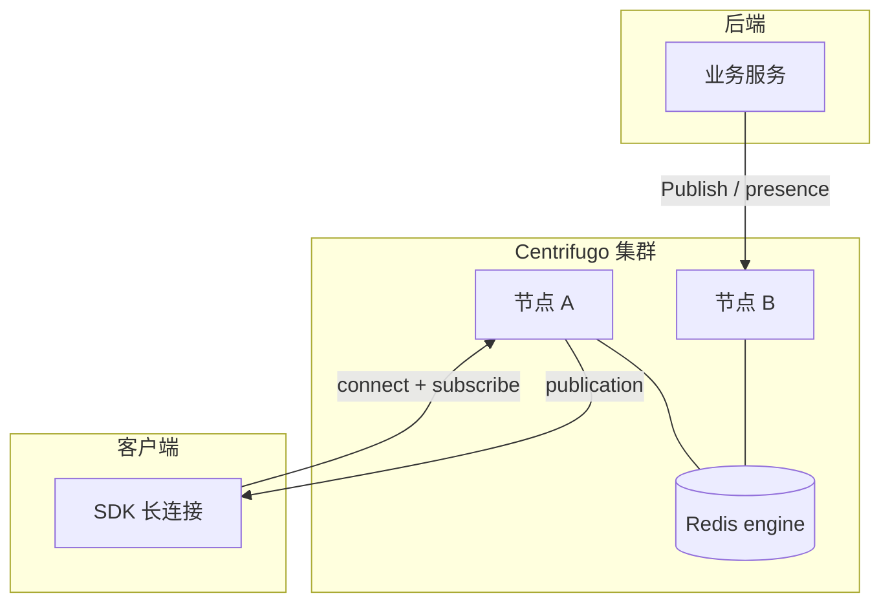
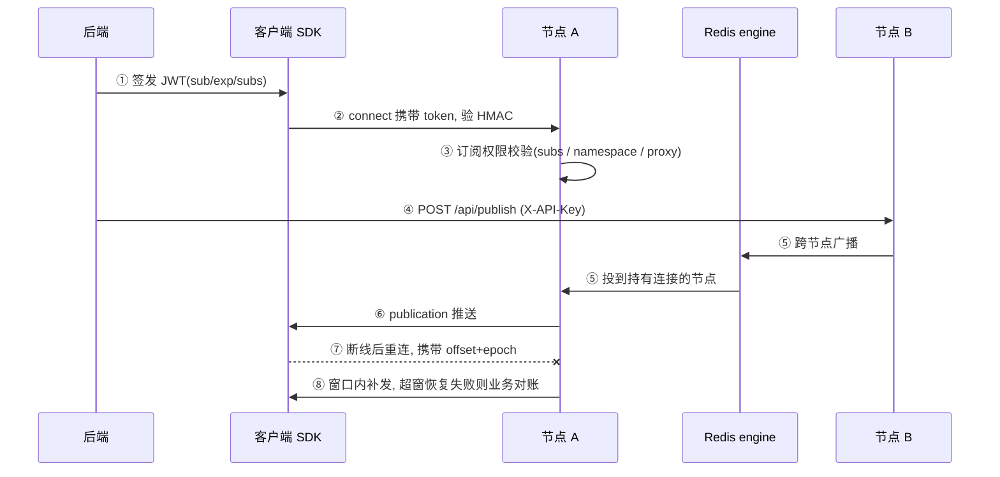
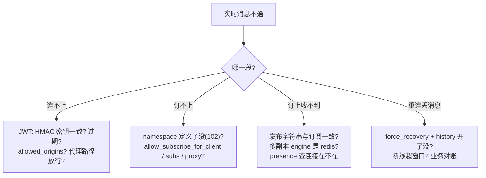

---
tags:
  - 平台组件
  - centrifugo
  - 实时消息
  - SSE
  - 教学
created: 2026-11-26
---

# 📡 Centrifugo

> 问题驱动：**痛点 → Centrifugo 管什么/不管什么 → 架构思想 → 完整数据流 → 能力边界 → 最小实战 → 集群与排障**。项目用法（NAT 穿透门铃/隧道/presence 门禁）见 [[Centrifugo项目实战]]。
> 基于 Centrifugo v5 官方文档整理，与项目部署版本 v5.4.0 对齐；实战按文档编写、未实际验证，示例密钥仅限本地。

## 一、现状痛点

业务要"服务端事件实时到浏览器/agent"，自研 WebSocket 服务会撞上四件事：

1. **扩容即丢消息**：连接散在多个 Pod，发布打到 Pod B，Pod A 上的客户端收不到——跨节点广播得自研；
2. **断线即丢消息**：重连后断开期间的消息无处补——每频道历史 + 偏移量补发得自研；
3. **鉴权与频道权限**：谁能连、谁能订哪个频道——token 校验与频道 ACL 得自研；
4. **保活与在线状态**：心跳、超时、谁在线——ping/pong 与 presence 得自研。

归纳：**连接基础设施与业务无关，却件件要写对**。Centrifugo 就是把这四件整体外包的现成服务端。

## 二、Centrifugo：管"连接 → 频道 → 送达"，不管业务语义

| 管 | 不管 |
|---|---|
| 长连接生命周期：WebSocket / SSE / HTTP-stream 接入、心跳保活 | 业务权限决策：谁可订哪个频道，由后端签 JWT 或 Proxy 回调决定 |
| 频道 pub/sub 扇出、跨节点广播（engine） | 持久存储与消费语义：history 只是补发窗口，不是消息队列 |
| 短窗口历史 + 重连恢复（offset/epoch） | 业务事件语义：房间、自定义 ack、请求/响应是应用层的事 |
| 连接鉴权（JWT / connect proxy）、presence 在线查询 | 数据生产：消息内容由后端调 Publish 注入 |



**后端只"喊一嗓子"，不持有任何连接**；消息落库、权限模型、失败对账仍在后端。痛点 1/2 由 engine + history 回应，3/4 由鉴权 + presence 回应。

### 卖点：为什么是它

| 卖点 | 具体 | 对照 |
|---|---|---|
| 语言无关 | 独立 Go 服务，后端任意语言走 HTTP/gRPC 发布；客户端 SDK 覆盖 JS/Go/Python/Java/Dart 等 | 不锁 Node（Socket.IO） |
| 连接设施内置 | presence/history/recovery/心跳开箱即用 | 省去 §一 四件自研 |
| 水平扩展 | redis engine 跨节点广播，连接数随节点扩 | 自研跨 Pod 广播难写对 |
| 多协议穿透 | WebSocket/SSE/HTTP-stream + 单向族，适配受限网络 | NAT/防火墙后仍可达（§3.6） |
| 自托管开源 | MIT 许可，数据不出网 | 私有化友好（vs Pusher SaaS） |

一句话：**把"连接基础设施"做成语言无关、可水平扩展的独立服务**——这是它相对自研与同类库的根本卖点。

## 三、架构思想

### 3.1 连接层与业务层分离

后端 ↔ Centrifugo 是**无状态 Server API**（HTTP `/api/<method>` + `X-API-Key`，或 gRPC）；Centrifugo ↔ 客户端才是有状态长连接。后端扩容不牵扯连接迁移，连接层扩容不牵扯业务代码。

### 3.2 频道是路由单位，namespace 是策略单位

频道只是一个字符串，首个订阅者出现时自动创建、末个离开时清理，**无需预建**。history/presence/订阅权限按 namespace 配置，不全局一刀切。

| 符号 | 含义 | 例 |
|---|---|---|
| `:` | namespace 边界，策略取自该 namespace | `chat:index` → namespace `chat` |
| `#` | 用户边界（user-limited），仅列出的用户可订 | `news#42` 仅用户 42 |
| `$` | 私有频道前缀，需订阅 token | `$secret` |

**发布必须用与订阅完全相同的字符串**：订 `chat:index` 却发 `index`，消息到不了——namespace 不会被剥掉。

### 3.3 engine：单机与集群的分界

| engine | 跨节点广播 | history 持久性 | 适用 |
|---|---|---|---|
| memory（默认） | ❌ 单节点 | 节点重启即失 | 开发/单 Pod |
| redis | ✅ | 取决于 Redis 配置 | **多副本必选** |

v5 另有 tarantool engine，较少用；多副本换分布式 engine 即可，常用 redis。

### 3.4 鉴权两种姿态

| | JWT 预授权 | Proxy 动态鉴权 |
|---|---|---|
| 决策时机 | 签发时写死 | connect/subscribe/publish/refresh 每次反调后端 |
| 后端要做什么 | HS256 签 `{sub, exp, subs}` | 实现回调端点 |
| 权限变更 | 重签 token | 即时生效 |
| 代价 | 变更不即时 | 多一跳回调 |

`sub` 是用户 ID；`subs` 是**服务端订阅**——连接建立即自动订上写死的频道（`subs` ≠ 权限列表）。客户端能否再自选频道，另由 namespace `allow_subscribe_for_client` / subscribe proxy 决定；项目把订阅写死在 token、关死自选，才做到"频道不可自选"。

Proxy 时机还含 `rpc`：Centrifugo 可把客户端 RPC 请求转发后端（只是传输壳，业务逻辑仍在后端）；项目未用原生 RPC，自研隧道（见 [[Centrifugo项目实战]]）。

### 3.5 送达语义：默认尽力而为，恢复是可选增强

默认 pub/sub **at-most-once**：客户端不在就错过，无 ack。两个增强开关（都必须配 `history_size`/`history_ttl`）：

- `force_positioning`：用 history 校验客户端 offset，发现潜在丢失即以 Insufficient state 断开；
- `force_recovery`：重连时按 offset+epoch 从 history 补发；应用要容忍重复消息。

客户端 SDK 内置**自动重连**与 **token 刷新**（`getToken` 回调），断线恢复不用业务手写。

### 3.6 传输协议族：双向 vs 单向

| 族 | 协议 | 端点 | 默认 |
|---|---|---|---|
| 双向 | WebSocket | `/connection/websocket` | **开** |
| 双向 | HTTP-streaming | `/connection/http_stream` | 关 |
| 双向 | SSE/EventSource 模拟 | `/connection/sse` | 关 |
| 双向 | SockJS（旧浏览器 polyfill） | `/connection/sockjs` | 关 |
| 单向 | uni_sse | `/connection/uni_sse` | 关 |
| 单向 | uni_http_stream | `/connection/uni_http_stream` | 关 |
| 单向 | uni_websocket | `/connection/uni_websocket` | 关 |

- **双向**：一条连接收发都走它；
- **单向（v5 新增）**：下行用该协议推，**上行另走 HTTP POST**（emulation 端点）——把"一条连接双向"拆成"下行推送 + 上行独立请求"。

取舍在**穿透性**：WebSocket 可能被中间代理拦截或缓冲；SSE 是普通 HTTP（`text/event-stream`），穿透 NAT/防火墙/代理最好。项目选 `uni_sse` 正是为此（客户集群在 NAT 后）。默认只开 WebSocket，其余按需 enable；SDK 按 URL 端点自动选传输，业务代码不变。

## 四、完整数据流：发布 → 集群 → 订阅

图只画拓扑与方向；组件职责见下表。



一条消息的完整旅程（含鉴权与重连恢复）：



| 组件 | 职责 |
|---|---|
| Server API | 后端入口，HTTP/gRPC + key 鉴权（方法见下表） |
| engine | 跨节点广播 + history 存储；memory 单机 / redis 集群 |
| 频道/订阅管理 | 字符串 → 订阅者映射，扇出推送 |
| presence | 频道在线连接信息，供后端做门禁/徽标 |

Server API 常用方法（后端经 `X-API-Key` 调用，HTTP `/api/<method>` 或 gRPC）：

| 方法 | 用途 |
|---|---|
| publish | 向单个频道发消息 |
| broadcast | 同一数据高效发往多个频道 |
| subscribe / unsubscribe | 服务端把某连接订上/退订某频道 |
| disconnect | 服务端主动断开某连接/用户 |
| presence / history | 查频道在线明细 / 查补发窗口历史 |
| presence_stats | 轻量计数 `num_clients`/`num_users`，发布前门禁常用 |
| refresh | 刷新连接凭据（配合 exp 续期） |

逐段风险：

| 段 | 失败模式 | 兜底 |
|---|---|---|
| ② | 密钥不一致/过期 → 拒连 | 后端重签；SDK getToken 刷新 |
| ③ | 未定义 namespace → `102 unknown channel` | 配置先定义 |
| ④ | publish fire-and-forget，**无客户端 ack** | 关键回执走业务上行 |
| ⑤ | memory engine 多副本 → 跨 Pod 丢 | 换 redis engine |
| ⑧ | 断线超 history 窗口 → 补发不了 | 业务全量对账 |

## 五、能力边界：开箱 vs 必须配合

| 能力 | 开箱 | 需改动 | 具体改动点 |
|---|---|---|---|
| 海量长连接接入 | ✅ | — | 选端点 `/connection/websocket` 或 `uni_sse` |
| 跨节点广播 | ❌ | 配置 | `engine: redis` + Redis 地址 |
| 频道权限 | ❌ | 后端 | 签 JWT 写 `subs`，或实现 subscribe proxy |
| 断线补发 | ❌ | 配置 | namespace 开 `force_recovery` + history |
| 在线状态 | ❌ | 配置 | `presence: true`，后端调 presence API |
| 持久/回放/消费组 | ❌ | **不是它的活** | 落库 / [[Kafka]] |

对比同类（每个都写"选它的代价"）：

| 维度 | Centrifugo | Socket.IO | Kafka | Pusher |
|---|---|---|---|---|
| 形态 | 自托管连接总线 | Node 应用内库 | 持久日志 broker | SaaS 托管 |
| 连接谁持有 | 独立服务 | 你的应用进程 | 消费者，非浏览器海量连接 | 厂商 |
| 扩容/补发 | engine + history 内置 | 广播靠 adapter，补发自研 | 消费组+offset 天然回放 | 厂商内置 |
| 业务语义 | 薄：频道 pub/sub | 厚：房间/ack/事件 | 厚：分区/消费组/事务 | 中：频道/事件 |
| 选它的代价 | 鉴权要自己接、无持久消费 | 锁 Node、连接设施自研 | 不为前端长连接设计、运维重 | 数据出网、按量计费、无法私有化 |

**不该用**：要回放/消费组 → Kafka；要深度事件/ack 语义且栈是 Node → Socket.IO；零运维接受出网 → Pusher；分钟级低频通知 → 轮询就够。

## 六、最小实战（v5.4.0）

### 6.1 起服务

```bash
docker run -d --name centrifugo -p 8000:8000 \
  -e CENTRIFUGO_TOKEN_HMAC_SECRET_KEY=local-demo-secret \
  -e CENTRIFUGO_API_KEY=local-demo-api-key \
  -e CENTRIFUGO_ALLOWED_ORIGINS='*' \
  -e CENTRIFUGO_NAMESPACES='[{"name":"demo","allow_subscribe_for_client":true,"presence":true,"history_size":10,"history_ttl":"300s","force_recovery":true}]' \
  centrifugo/centrifugo:v5.4.0
```

`allow_subscribe_for_client` 使 demo namespace 对已认证客户端开放订阅（**等于公开，生产用 subs 或 proxy**）。

### 6.2 后端签连接 JWT

```bash
pip install pyjwt
python3 -c "import jwt,time; print(jwt.encode({'sub':'demo-user','exp':int(time.time())+3600}, 'local-demo-secret', algorithm='HS256'))"
```

### 6.3 前端订阅（centrifuge-js 5.4.0）

```html
<script src="https://unpkg.com/centrifuge@5.4.0/dist/centrifuge.js"></script>
<script>
  const centrifuge = new Centrifuge('ws://localhost:8000/connection/websocket', { token: '<6.2 输出>' });
  const sub = centrifuge.newSubscription('demo:lobby');
  sub.on('publication', ctx => console.log('收到', ctx.data));
  sub.on('subscribed', ctx => console.log('recovered:', ctx.recovered));
  sub.subscribe();
  centrifuge.connect();
</script>
```

### 6.4 后端发一条频道消息

```bash
curl -s http://localhost:8000/api/publish \
  -H 'X-API-Key: local-demo-api-key' -H 'Content-Type: application/json' \
  -d '{"channel":"demo:lobby","data":{"text":"hello"}}'
# 预期: {"result":{}}   浏览器控制台: 收到 {text: 'hello'}
```

### 6.5 presence 与重连恢复

```bash
curl -s http://localhost:8000/api/presence \
  -H 'X-API-Key: local-demo-api-key' -d '{"channel":"demo:lobby"}'
# 预期: result.presence 含 user=demo-user 的条目
```

恢复验证：devtools 断网 → 再 publish 一条 → 恢复网络 → 先收到补发，`subscribed` 事件 `recovered: true`；断网超 300s 重连则恢复失败，需业务对账。

## 七、进阶：集群与排障

集群三要点：**多副本必须 redis engine**；公网入口常只放行 SSE 路径（`/connection/uni_sse`，普通 HTTP 穿透代理/防火墙最好，上行另走 HTTP）；**ping 间隔必须小于中间代理空闲超时**，否则静默断连。

可观测：`admin: true` 开内置 Web 管理面板（端口 8000，看节点/连接/频道），`prometheus: true` 暴露指标供 [[KPS 与 Keep]] 抓取。

分层排障：



常见坑：

1. **memory engine 扩副本**：跨 Pod 消息互不可见，多副本必换 redis；
2. **102 unknown channel**：用了未定义的 namespace；
3. **发布字符串不一致**：订 `chat:index` 发 `index`，namespace 不剥掉；
4. **HMAC 密钥多处不一致**：签发端与 `token_hmac_secret_key` 必须同值；
5. **客户端订不上**：`allow_subscribe_for_client` 默认 false，未开且无 subs/proxy；
6. **超窗丢消息**：history 窗口外恢复失败，业务对账兜底；
7. **代理空闲断连**：ping 间隔 > 代理空闲超时；
8. **把 history 当队列**：它只是补发窗口，持久消费归 [[Kafka]]。

## 八、与项目形态的对照指引

| 本文机制 | 项目具体化 |
|---|---|
| JWT 预授权（§3.4） | agent token subs 写死 clusterCode；前端 `gpt:web-event#userid` 用户级频道 |
| 单向 SSE（§3.6） | uni_sse 穿透 NAT，上行回连/隧道另走 HTTP（门铃/隧道模式） |
| redis engine（§3.3） | 2 副本 + Redis engine 跨 Pod 广播 |
| history 窗口（§3.5） | history_size 10 / history_ttl 300s，超窗业务对账 |
| presence（§四） | GetNumClients 做发布前门禁与在线徽标 |

详见 [[Centrifugo项目实战]]。

## 一句话总结

**Centrifugo 是自托管的实时连接总线，接管"连接持有 → 频道路由 → 扇出送达 → 短窗补发"，不接管业务权限决策、持久消费与事件语义；适合想甩掉长连接基础设施的私有化实时推送，不适合要回放/消费组（Kafka）或零运维 SaaS（Pusher）。**

## 相关

- 上游：[[平台组件]] · [[云原生]]
- 项目用法：[[Centrifugo项目实战]]（NAT 穿透门铃/隧道/presence 门禁）
- 持久消费分工：[[Kafka]]
- 官方文档（v5）：[配置](https://centrifugal.dev/docs/5/server/configuration) · [Server API](https://centrifugal.dev/docs/server/server_api) · [频道](https://centrifugal.dev/docs/5/server/channels) · [JWT](https://centrifugal.dev/docs/5/server/authentication)