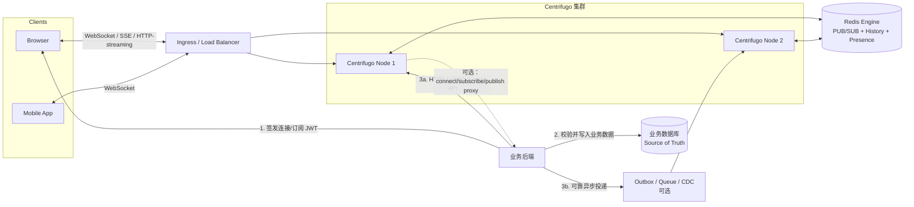

# Centrifugo 学习笔记：实时消息层的架构与实践

> 基于 Centrifugo v6 官方文档整理，重点是架构边界、消息可靠性、横向扩展和生产落地。示例中的密钥只用于本地实验，生产环境应通过 Secret 或环境变量注入，并固定到经过验证的精确版本。

## 1. 先建立正确的定位

Centrifugo 是一个独立的实时消息服务器：它替业务系统维护大量长连接，按 channel 管理订阅，并把事件高效广播给在线客户端。WebSocket 是主要传输方式，也支持 HTTP-streaming、SSE 等传输。

它最适合放在 **业务后端与终端之间，作为实时传输层**，而不是替代业务后端、数据库或可靠消息队列。

| 关注点 | 应由谁负责 |
| --- | --- |
| 用户登录、资源授权、参数校验 | 业务后端；JWT 或 proxy 是集成手段 |
| 业务事务、长期保存、完整历史 | 业务数据库 |
| 持久连接、订阅管理、在线广播 | Centrifugo |
| 跨 Centrifugo 节点传播、短期历史和在线状态 | Engine / Broker / Presence Manager |
| 必须可靠执行的业务事件投递 | Outbox、CDC、队列等机制与 Centrifugo 配合 |

最重要的架构原则：

> **数据库是事实源，Centrifugo 历史是短期恢复缓存，客户端必须能够重新拉取完整状态。**

这样即使实时链路暂时不可用，普通业务 API 仍然可用，只是页面不再实时刷新。

## 2. 核心概念与关系

- **User**：业务用户身份，通常来自连接 JWT 的 `sub`。
- **Client / Connection**：一条实际连接。一个用户打开多个浏览器标签页，会产生多个 client。
- **Channel**：消息通道，本质上是一个字符串，例如 `orders:42`。
- **Namespace**：一组 channel 的共同配置。`orders:42` 使用名为 `orders` 的 namespace；发布和订阅必须使用完整且完全相同的 channel 名。
- **Publication**：发布到 channel 的一条消息。
- **Engine**：节点间消息传播、历史和在线状态的核心实现，内部可拆成 Broker 与 Presence Manager。

Channel 是临时对象：有订阅或历史需求时自然存在，不需要先执行“创建 channel”。Namespace 则必须提前配置，否则带该前缀的 channel 会报 `102: unknown channel`。

## 3. 推荐的整体架构



### 3.1 两条主要链路

**连接链路**

1. 客户端先向业务后端请求实时连接凭证。
2. 后端识别用户并签发带 `sub`、`exp` 的 JWT。
3. 客户端通过 SDK 连接 Centrifugo，并订阅 channel。
4. Centrifugo 验签、鉴权，SDK 负责后续重连、重订阅和令牌刷新。

**消息链路**

1. 客户端的业务写操作仍走普通业务 API。
2. 后端完成鉴权、参数校验和数据库事务。
3. 后端调用 Centrifugo Server API，或通过 Outbox / 队列异步投递。
4. 收到 API 的节点通过 Broker 传播事件。
5. 持有对应订阅的节点把事件写入各自客户端连接。

不要让浏览器直接持有 API Key 调用 Server API，也不要因为已经使用 WebSocket，就把所有业务请求都迁移到实时连接上。

### 3.2 为什么默认采用“后端发布”

- 业务数据先落库，再发送实时通知，职责清晰。
- 客户端不能绕过业务校验向 channel 写任意内容。
- 权限、限流、审计仍集中在业务后端。
- 发起操作的客户可以直接使用 HTTP 响应更新 UI，不必等待自己的实时消息回环；通过 `event_id` 去重即可。

客户端直接 publish 仍有价值，例如“正在输入”等不需要持久化的临时信号；涉及业务事实时应使用 publish proxy 或回到业务 API。

## 4. Engine：单节点与多节点的关键差别

Engine 可理解为两个能力的组合：

- **Broker**：节点发现、跨节点 PUB/SUB、channel 发布与历史流。
- **Presence Manager**：在线状态的增删查。

| 方案 | 多节点广播 | 历史与恢复 | 适用场景与限制 |
| --- | --- | --- | --- |
| `memory` | 不支持常规跨节点广播 | 支持，但重启即丢失 | 本地开发、单实例；最简单且没有额外网络开销 |
| `redis` | 支持 | 支持，数据在 Redis；持久性取决于 Redis 自身配置 | 通用生产方案；需要运维 Redis，并考虑其高可用 |
| 独立 `nats` Broker | 支持 | 不支持 Centrifugo history / recovery | 只需要 at-most-once PUB/SUB，或已有 NATS 体系 |

Redis Engine 下，客户端可连接任意节点，后端也可向任意节点发布；Redis PUB/SUB 会把消息送到真正持有订阅者的节点。**因此不需要把同一用户的连接黏固定到某个 Centrifugo 节点。**

进一步拆分 Broker 与 Presence Manager，可以分别扩缩容或隔离负载。例如 NATS 负责广播、Redis 负责 presence。但只有 Redis 等支持历史的 Broker 才能提供完整的恢复能力。

Redis 成为瓶颈时，可考虑：

- 多个独立 Redis 实例间的一致性分片；
- Redis Cluster；
- 将 Broker 与 Presence Manager 拆到不同 Redis；
- 先通过指标确认瓶颈，不要一开始就把拓扑复杂化。

## 5. 消息语义：可靠性不是“开一个历史开关”就结束

### 5.1 投递与顺序

| 维度 | 语义 |
| --- | --- |
| 默认投递 | at-most-once，在线推送阶段可能丢失 |
| 开启 history + positioning / recovery | 在历史窗口内可达到 at-least-once 的恢复效果 |
| 超出窗口、流已丢失 | 不做部分恢复，客户端必须回源加载状态 |
| 同一 channel 顺序 | 串行发布或同一请求内发布可保证顺序；并发发布不保证先后 |
| 跨 channel 顺序 | 不应依赖 |
| 离线长期投递 | 不属于 Centrifugo 历史流的目标 |

即使开启 recovery，业务事件和客户端处理仍应幂等，因为重试、Outbox、网络超时都可能制造重复。

### 5.2 `offset`、`epoch` 与恢复流程

开启历史后，每个 channel 有一个有界、有序的近期消息流：

- `history_size`：最多保留多少条；
- `history_ttl`：最多保留多久；
- **二者都必须大于 0，历史才真正启用**；
- `offset`：消息在流中的递增位置；
- `epoch`：当前流的身份。流被清空或重建后，即使 `offset` 数字相同，也已经不是同一条流。

双向 SDK 会自动完成以下过程：

1. 订阅成功时记录 `epoch + offset`。
2. 每收到一条 publication，就推进本地位置。
3. 断线重连后，携带上次位置重新订阅。
4. 如果缺失消息仍完整存在，Centrifugo 按序补发，`recovered: true`。
5. 如果 `epoch` 改变、消息过期或被挤出，则 `recovered: false`，客户端回源加载完整状态。

`force_recovery: true` 会同时启用 positioning。Positioning 还能发现“连接看似正常、实际位置已经出现缺口”的情况，并促使客户端重连恢复。

```javascript
sub.on('subscribed', async (ctx) => {
  if (ctx.wasRecovering && !ctx.recovered) {
    // 不能确认连续性：从业务后端重新加载，而不是假装没有丢消息。
    await loadOrderFromBackend();
  }
});
```

注意：`wasRecovering` 只表示客户端尝试恢复；真正需要回源的重要信号是 `wasRecovering && !recovered`。

### 5.3 Stream 与 Cache 两种恢复模式

- `stream`：默认模式，补发所有缺失事件，适合聊天、操作日志、订单状态变更。
- `cache`：只补最新状态，适合行情、仪表盘、完整快照；常配合 `history_size: 1`。

历史流不是 Kafka 那样的长期事件日志，也不是离线邮箱。窗口大小应围绕“短时断网和集中重连”设计，而不是围绕“用户离线一周后补齐全部消息”设计。

### 5.4 Presence 与 Join/Leave 的边界

- Presence 是最终一致的；Redis 模式下节点异常退出后，残留状态可能要等 TTL 到期才消失。
- 大 channel 不要频繁拉取完整 presence 快照；只需要人数时使用 `presence_stats`。
- Join/Leave 会向订阅者广播。若一个有 N 个订阅者的 channel 同时发生 N 次上下线，可能形成约 N² 的消息放大，大规模房间应谨慎开启。

## 6. 认证与授权：连接成功不代表能订阅任意频道

需要分别考虑四类客户端操作：**subscribe、publish、history、presence**。它们有各自的权限检查，不能只保护 subscribe 就默认其他操作也安全。

### 6.1 两种常见集成方式

| 方式 | 优点 | 代价与适用场景 |
| --- | --- | --- |
| 连接 JWT + 订阅 JWT | Centrifugo 本地验签；集中重连时对后端压力小 | 后端需签发和刷新令牌；适合大多数生产系统 |
| Connect / Subscribe Proxy | 每次事件都由后端动态决策，可复用 Session / Cookie | 热路径增加 HTTP/gRPC 调用、延迟和故障点；适合动态权限或已有会话体系 |

Proxy 支持 HTTP 和 gRPC，并可设置超时。若每次 subscribe / publish 都访问后端，该端点必须具备与实时流量相匹配的容量。JWT 更适合降低大规模重连时的认证后端压力。

### 6.2 Channel 设计建议

- 按业务语义划分 namespace，例如 `orders`、`notifications`、`presence`，不要给所有 channel 一套过宽配置。
- 个人通知可用 user-limited channel：`personal:user#42`，并开启 `allow_user_limited_channels`。
- `$` 私有前缀只限制订阅；history、presence、publish 仍需分别授权。
- `allow_subscribe_for_client` 表示该 namespace 对所有已登录连接开放，不等于“仅允许资源所有者”。
- 默认不要开放客户端 publish；有需求时优先使用 publish proxy 做校验。
- 使用 `channel_regex` 限制客户端可订阅的命名空间内名称，减少意外暴露。
- 对 JSON 业务消息可设置 `publication_data_format: "json_object"`，把格式错误挡在发布阶段。

### 6.3 令牌实践

- 后端签发 JWT，`sub` 是字符串形式的用户 ID。
- 设置合理且较短的 `exp`，通过 SDK 的 `getToken` 刷新。
- 配置 `issuer` 和 `audience`，避免给其他服务签发的令牌被误用。
- 浏览器不能保存 HMAC 密钥；JWT 是签名而非加密，不要在 payload 放敏感明文。
- 使用 Cookie + connect proxy 时，严格设置 `client.allowed_origins`，防止跨站 WebSocket 滥用。
- Server API、Admin、Metrics 等端口应按网络边界暴露，不能随客户端连接端口一起公网开放。

## 7. 本地实践：Redis Engine + 可恢复的订单频道

下面用 `orders:42` 演示完整链路。该示例为了简化订阅，允许任意已认证用户订阅 `orders` namespace；**生产环境应改为订阅 JWT、subscribe proxy 或严格匹配的 user-limited channel。**

### 7.1 `config.json`

```json
{
  "client": {
    "token": {
      "hmac_secret_key": "local-only-change-me"
    },
    "allowed_origins": ["http://localhost:3000"]
  },
  "http_api": {
    "key": "local-only-api-key"
  },
  "engine": {
    "type": "redis",
    "redis": {
      "address": "redis://redis:6379"
    }
  },
  "channel": {
    "namespaces": [
      {
        "name": "orders",
        "allow_subscribe_for_client": true,
        "publication_data_format": "json_object",
        "history_size": 100,
        "history_ttl": "300s",
        "force_recovery": true
      }
    ]
  },
  "prometheus": {
    "enabled": true
  }
}
```

### 7.2 `compose.yaml`

```yaml
services:
  centrifugo:
    image: centrifugo/centrifugo:v6
    command: centrifugo -c config.json
    volumes:
      - ./config.json:/centrifugo/config.json:ro
    ports:
      - "8000:8000"
    depends_on:
      - redis
    ulimits:
      nofile:
        soft: 65535
        hard: 65535

  redis:
    image: redis:7-alpine
    # 不映射到宿主机，只允许 Compose 内部网络访问。
```

启动并验证配置：

```bash
docker compose up -d
docker compose exec centrifugo centrifugo checkconfig -c config.json
```

生成一个仅用于实验、1 小时有效的连接令牌：

```bash
docker compose exec centrifugo centrifugo gentoken -c config.json -u 42 -t 3600
```

### 7.3 浏览器连接与恢复处理

安装 `centrifuge` 后，在来源为 `http://localhost:3000` 的前端中使用：

```javascript
import { Centrifuge } from 'centrifuge';

const client = new Centrifuge('ws://localhost:8000/connection/websocket', {
  token: '<上一步生成的 JWT>',
  // 生产环境改为从业务后端获取，并处理 401/403：
  // getToken: async () => (await fetch('/api/realtime/token')).json().then(x => x.token),
});

const seenEvents = new Set();
const sub = client.newSubscription('orders:42');

sub.on('publication', (ctx) => {
  const event = ctx.data;
  if (seenEvents.has(event.event_id)) return;
  seenEvents.add(event.event_id);
  applyOrderEvent(event);
});

sub.on('subscribed', async (ctx) => {
  if (ctx.wasRecovering && !ctx.recovered) {
    await loadOrderFromBackend();
  }
});

sub.on('error', (ctx) => console.error('subscription error', ctx));
client.on('error', (ctx) => console.error('client error', ctx));

sub.subscribe();
client.connect();
```

真实项目中还要限制 `seenEvents` 的容量，例如使用带 LRU 淘汰的缓存；事件处理器不要执行长时间阻塞操作。

### 7.4 后端发布

```bash
curl --header "Content-Type: application/json" \
  --header "X-API-Key: local-only-api-key" \
  --request POST \
  --data '{
    "channel": "orders:42",
    "idempotency_key": "order-42-version-8",
    "data": {
      "event_id": "order-42-version-8",
      "order_id": "42",
      "version": 8,
      "type": "order.shipped",
      "payload": {"status": "shipped"}
    }
  }' \
  http://localhost:8000/api/publish
```

建议统一事件信封：

```json
{
  "event_id": "全局稳定且可用于去重的 ID",
  "type": "order.shipped",
  "aggregate_id": "42",
  "version": 8,
  "occurred_at": "2026-11-23T08:00:00Z",
  "payload": {}
}
```

实践要点：

1. 使用稳定 `event_id`，客户端或消费端幂等处理。
2. 发布重试沿用相同 `idempotency_key`，不要在重试时生成新值。
3. HTTP 200 不代表业务调用一定成功；默认模式下还要检查响应体是否包含 `error`。
4. 为 API 调用设置超时、有限重试和抖动退避。
5. `idempotency_key` 的重复抑制有期限和 Broker 适用范围，不等于永久的 exactly-once 保证；NATS Broker 会忽略它。
6. 同 channel 需要严格顺序时，按聚合根串行发布，或使用能保证分区顺序的异步链路。

可以打开多个浏览器标签页验证广播；停网或重启 Centrifugo 后再恢复，观察 `subscribed` 上下文和补发消息。Memory 与 Redis 的历史持久性不同，Redis 本身重启后的数据是否仍在，也取决于 Redis 持久化配置。

## 8. 业务写入与实时发布的可靠性设计

### 8.1 直接发布：简单但有双写窗口

常见顺序是：

```text
校验请求 → DB transaction commit → 调用 Centrifugo publish → 返回业务响应
```

数据库提交后、实时发布前仍可能宕机，因此“数据库成功”不必然意味着“通知成功”。此外，不要在数据库提交前发布，否则订阅者可能收到一个最终回滚或尚不可见的变更。

直接发布适合：

- 实时通知只是体验增强，丢失后重新加载即可；
- 客户端有明确的回源机制；
- 希望链路简单、延迟低。

### 8.2 Outbox / CDC：让业务事实与待发布事件一起持久化

对“业务变更最终必须产生实时事件”的场景：

1. 在同一数据库事务中写业务表与 Outbox 表。
2. 后台 worker 或 Centrifugo 内置 async consumer 读取事件。
3. 调用同一套 publish / broadcast 逻辑。
4. 使用幂等键和客户端去重吸收至少一次投递带来的重复。

Centrifugo v6 内置消费者可接 PostgreSQL Outbox、Kafka、NATS JetStream、Redis Stream 以及多种云队列。引入异步链路后，需要额外关注：

- 消费滞后和重试；
- 分区与 channel 的顺序关系；
- 事件在业务操作之后较晚到达时，客户端是否应忽略旧版本；
- Outbox 清理与监控。

**选择依据不是“越可靠越好”，而是事件丢失的代价。** 普通在线提示可直接发布，交易状态或关键通知更适合 Outbox。

## 9. 生产部署要点

### 9.1 负载均衡与反向代理

多节点 + Redis Engine 下通常无需 sticky session。L7 代理必须正确处理：

- WebSocket `Upgrade` / `Connection` 头，并使用 HTTP/1.1 上游；
- SSE、HTTP-streaming 关闭响应缓冲；
- 放行 `/emulation`，它承载 SSE / HTTP-streaming 的客户端到服务端命令；
- read / idle timeout 大于 Centrifugo ping 间隔（默认 25 秒），并留出余量；
- 对外使用 TLS，对应客户端地址为 `wss://` 或 `https://`。

Nginx 的关键片段：

```nginx
upstream centrifugo {
    server centrifugo-1:8000;
    server centrifugo-2:8000;
}

map $http_upgrade $connection_upgrade {
    default upgrade;
    ''      close;
}

server {
    listen 443 ssl;
    server_name realtime.example.com;

    location /connection/ {
        proxy_pass http://centrifugo;
        proxy_http_version 1.1;
        proxy_set_header Upgrade $http_upgrade;
        proxy_set_header Connection $connection_upgrade;
        proxy_buffering off;
        proxy_read_timeout 60s;
        proxy_send_timeout 60s;
    }

    location / {
        proxy_pass http://centrifugo;
    }
}
```

该片段只突出实时代理配置，实际还需补充证书、安全响应头、访问日志和内部 API 访问控制。

### 9.2 Kubernetes

- 至少两个 Centrifugo 副本，并跨可用区或节点分散。
- 使用 Redis Engine，配置 PDB，避免自愿运维同时驱逐全部副本。
- 滚动升级前验证代理排空、重连和恢复，而不只是检查 Pod Ready。
- HPA 不应只看 CPU：长连接服务的连接数、内存、网络 egress、订阅数同样关键。
- 扩容后连接不会天然均匀迁移；新连接会进入新 Pod，长期均衡需要结合重连策略观察。
- 配置、令牌密钥和 API Key 使用 Secret 管理，生产镜像固定精确版本并走升级验证。
- Redis 需要独立的高可用与故障切换方案；多 Centrifugo 副本并不能消除 Redis 单点。

### 9.3 操作系统与容量

每条连接都会消耗文件描述符；经过代理时，通常还同时消耗下游与上游连接。需要一起检查：

- Centrifugo 与 Nginx / HAProxy / Envoy 的 `nofile`；
- 代理最大连接数；
- LB 与节点间的临时端口范围和 TIME_WAIT；
- 内核 conntrack 容量；
- 单节点连接数、每连接订阅数、消息大小和广播扇出。

一个简单估算思路：

```text
节点内存 ≈ 连接数 × 单连接成本 + 订阅数 × 单订阅成本 + 历史/缓冲开销
出口带宽 ≈ 发布速率 × 平均消息线上大小 × 平均订阅者扇出
```

实际数值必须压测得到。特别要模拟“大 channel 广播”和“集中重连”，因为平均 QPS 很低并不代表系统没有瞬时风险。

## 10. 可观测性与故障排查

开启 Prometheus：

```json
{
  "prometheus": {
    "enabled": true
  }
}
```

重点关注以下信号，而不是只看进程是否存活：

| 领域 | 代表指标 / 现象 |
| --- | --- |
| 连接与订阅 | `centrifugo_node_num_clients`、`centrifugo_node_num_subscriptions`、连接接受数、异常断开数 |
| 实时投递 | `centrifugo_node_pub_sub_lag_seconds`、broadcast 延迟、transport 发送速率与字节数 |
| 恢复效果 | `centrifugo_client_recover{recovered="false"}` 增长、恢复 publication 数量 |
| Redis | PUB/SUB errors、dropped messages、buffered messages，以及 Redis 自身 CPU / 内存 / 延迟 |
| Server API | API 延迟、错误率、临时错误与重试 |
| Proxy | `centrifugo_proxy_errors`、inflight requests、proxy 延迟 |
| 系统 | RSS、CPU、文件描述符、网络、代理连接数、临时端口与 TIME_WAIT |

常见故障可按链路定位：

| 症状 | 优先检查 |
| --- | --- |
| 能连接但订阅报 `102` | namespace 未定义，或发布/订阅的完整 channel 名不一致 |
| 订阅报 `103` | subscribe 权限未开放、订阅 JWT 不匹配、proxy 拒绝 |
| 重连后 `recovered: false` | 历史窗口过小、TTL 到期、epoch 改变、Broker 数据丢失；应回源而非继续假设完整 |
| 多节点只有部分客户端收到 | Engine 配置不一致、Redis 连通性、节点是否使用同一套 Broker 与 prefix |
| 连接建立但 SSE 消息不及时 | 代理响应缓冲未关闭 |
| 每隔固定时间断线 | 代理 / LB idle timeout 小于或过于接近 ping 间隔 |
| 高并发下无法新建连接 | 文件描述符、代理 max connections、临时端口、conntrack |
| 发布 HTTP 200 但无效果 | 检查响应体 `error`、channel 全名、订阅状态和 Broker 指标 |

日志中不要记录完整 JWT、API Key 或敏感消息内容。

## 11. 上线前验证清单

### 功能与安全

- [ ] 初次加载、实时增量、恢复失败回源三条路径都验证过。
- [ ] 同一用户的多个连接、多个节点之间的广播正常。
- [ ] 未登录、越权订阅、过期令牌、令牌刷新和撤销流程符合预期。
- [ ] subscribe、publish、history、presence 分别做过权限测试。
- [ ] Server API / Admin / Metrics 不暴露给不可信网络。
- [ ] `allowed_origins`、TLS、密钥管理和密钥轮换经过验证。

### 可靠性与性能

- [ ] 消息有稳定 ID，消费者能处理重复和旧版本事件。
- [ ] 明确每个 namespace 是否需要 history、recovery、presence，没有无差别全开。
- [ ] DB 提交后发布失败的处理方式明确：可回源、重试或 Outbox。
- [ ] 压测覆盖大 channel 广播、热点 channel、消息大小分布和大量订阅。
- [ ] 演练单节点重启、滚动升级、Redis 故障切换、网络分区和集中重连。
- [ ] 代理 buffering、WebSocket upgrade、`/emulation`、idle timeout 均经过端到端测试。
- [ ] 监控、告警、Grafana 面板和客户端回源指标可用。

## 12. 一句话总结

Centrifugo 的价值不只是“提供一个 WebSocket 服务”，而是把 **长连接生命周期、channel 订阅、跨节点广播、短期恢复和在线状态** 从业务系统中拆出来。落地时真正决定系统可靠性的，是以下组合：

> **后端主导业务写入 + 数据库作为事实源 + Redis 支撑多节点 + 有界历史处理短断线 + `recovered: false` 回源 + 全链路幂等与可观测性。**

## 参考资料

- [Design overview](https://centrifugal.dev/docs/getting-started/design)
- [Channels and namespaces](https://centrifugal.dev/docs/server/channels)
- [Channel permission model](https://centrifugal.dev/docs/server/channel_permissions)
- [Client JWT authentication](https://centrifugal.dev/docs/server/authentication)
- [Engines and scalability](https://centrifugal.dev/docs/server/engines)
- [Stream history and recovery](https://centrifugal.dev/docs/server/history_and_recovery)
- [Server API walkthrough](https://centrifugal.dev/docs/server/server_api)
- [Client SDK specification](https://centrifugal.dev/docs/transports/client_api)
- [Built-in API command async consumers](https://centrifugal.dev/docs/server/consumers)
- [Load balancing and proxying](https://centrifugal.dev/docs/server/load_balancing)
- [Infrastructure tuning](https://centrifugal.dev/docs/server/infra_tuning)
- [Server observability](https://centrifugal.dev/docs/server/observability)
