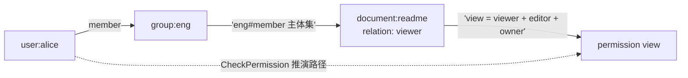
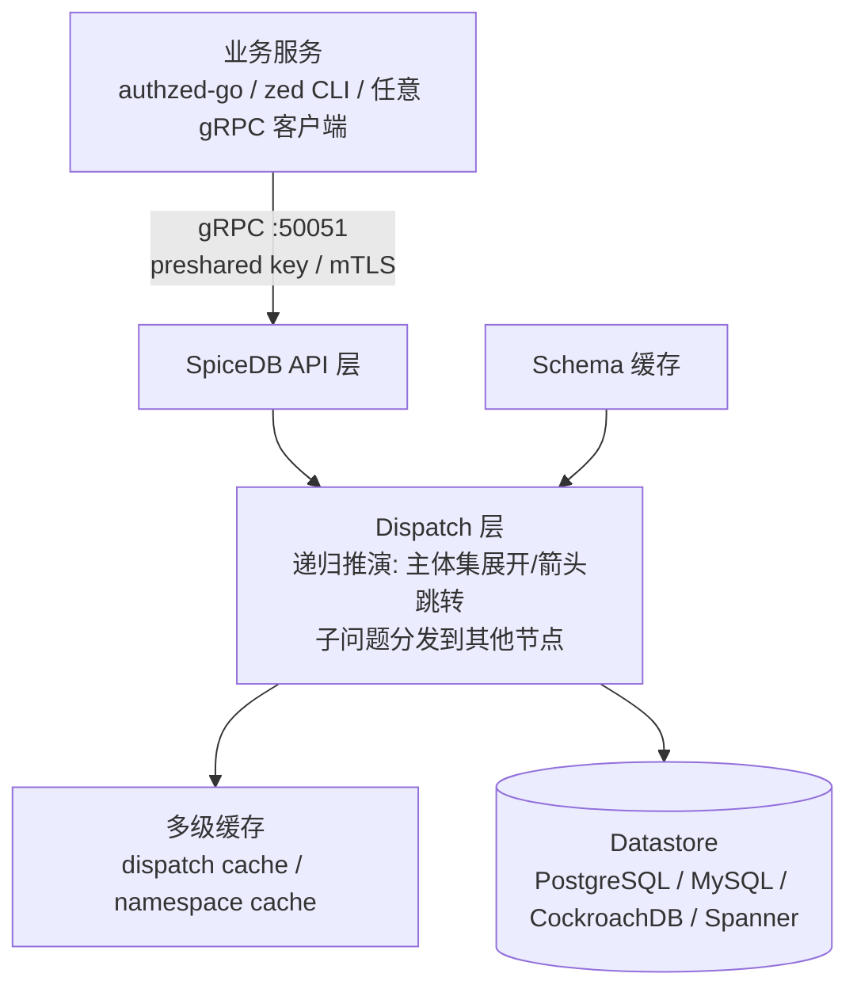
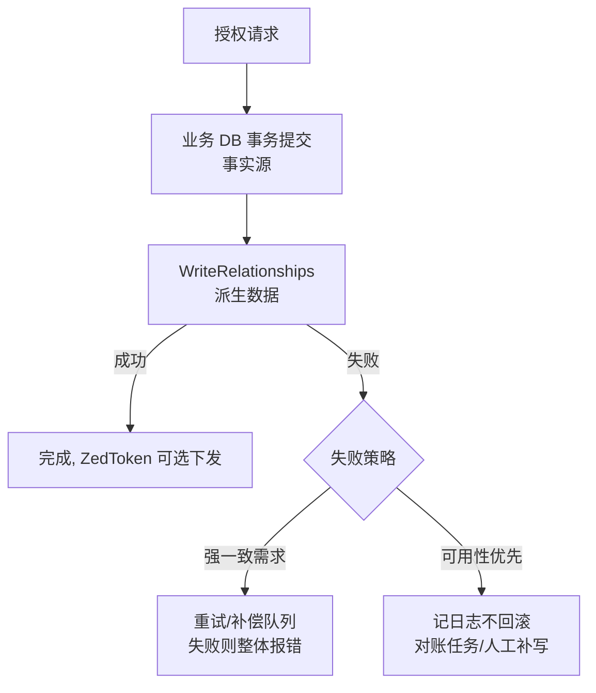
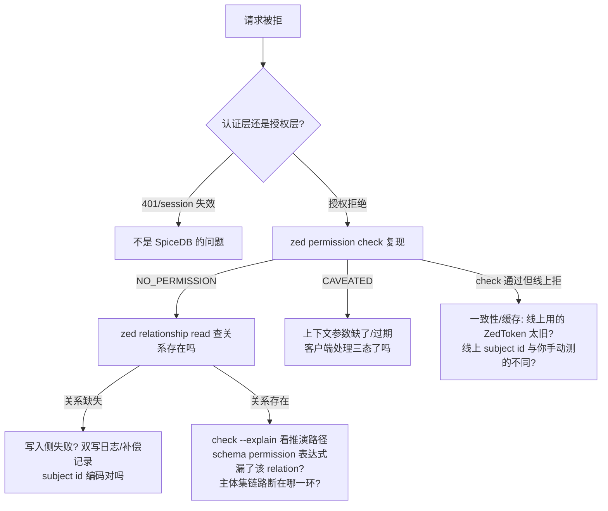

---
tags:
  - 平台组件
  - spicedb
  - 鉴权
  - Zanzibar
  - ReBAC
  - 教学
created: 2026-11-23
---

# 📖 SpiceDB

> 通用学习笔记：聚焦 SpiceDB 的**架构原理**与**建模/部署/鉴权实战**，不涉及具体项目。项目内的权限模型（permission.zed、粗粒度 `_0` 资源、三重 subject 兼容、双源兜底）见 [[SpiceDB项目实战]]。

## 一、定位：授权决策引擎

先分清两件事：

- **认证（Authentication）**：你是谁——session/JWT/OAuth 的领域；
- **授权（Authorization）**：你能对什么资源做什么——SpiceDB 的领域。

SpiceDB 是 Google **Zanzibar 论文**的开源实现（AuthZed 维护），把授权统一为一个模型：**权限 = 关系图上的可达性推演**。业务代码只问一句：

```
CheckPermission(resource: document:readme, permission: view, subject: user:alice) → true/false
```

推演过程（alice 是不是某个组的成员？那个组是不是文档所属项目的成员？项目成员是否天然能 view？）全部在 SpiceDB 内完成，业务代码不写 if-else 权限逻辑。

### 1.1 三种授权模型对比

| 模型 | 思路 | 短板 |
|---|---|---|
| RBAC | 用户→角色→权限，静态映射表 | 表达不了"alice 是**这个文档**的编辑者"这种实例级关系；角色爆炸 |
| ABAC | 属性表达式求值（部门==X && 级别>Y） | 规则散落难审计；"谁能访问这个资源"的反向查询困难 |
| **ReBAC**（SpiceDB） | 权限是实体间**关系**，检查 = 图遍历 | 需要维护关系数据；建模有学习成本 |

ReBAC 的关键优势：**关系可组合、可推演、可反查**。授给一个组 = 授给组内所有人（主体集）；editor 关系自动蕴含 view（permission 代数）；`LookupResources` 能反查"alice 能看哪些文档"（列表页过滤）。RBAC 可以看作 ReBAC 的特例——角色就是一种主体集。

## 二、核心概念：关系元组与 Schema

### 2.1 关系元组（Relationship）

一切权限数据都是这个三元组的实例：

```
resource:relation@subject
document:readme#viewer@user:alice          alice 是 readme 的 viewer
document:readme#viewer@group:eng#member    eng 组全体成员是 readme 的 viewer（主体集）
```

- **resource**：`类型:id`，被保护的对象；
- **relation**：资源上的关系名（viewer/editor/parent/member…）；
- **subject**：`类型:id` 或 `类型:id#relation`（主体集，引用"某资源的某关系的全体成员"）。

### 2.2 Schema：权限模型的单一事实源

Schema 用 Zed 语言声明**类型系统**——有哪些资源类型、每种类型有哪些关系、permission 如何由关系推演：

```
definition user {}                    // 纯主体, 不作资源

definition group {
    relation member: user
}

definition document {
    relation owner: user
    relation viewer: user | group#member     // 两种主体: 个人 或 组成员
    relation editor: user | group#member
    permission view = viewer + editor + owner    // 并集: editor/owner 自动能 view
    permission edit = editor + owner
    permission delete = owner
}
```

三个语法要点：

1. **relation 声明合法主体类型**：`user | group#member` 表示这条关系只接受这两种 subject，写入其他类型直接报错——schema 即约束；
2. **permission 是关系的代数表达式**：`+` 并集、`&` 交集、`-` 差集；permission 不落库，**每次检查时实时推演**；
3. **箭头操作符 `->` 沿关系跳转**：层级资源的核心语法，见 §4.2。

### 2.3 一张图看懂推演



alice 没有直接授权，但沿 `alice → eng#member → viewer → view` 可达，检查返回 true。**给 eng 组加一个成员，所有授给 eng 的资源权限即时生效**——这是主体集相对逐用户授权的运维优势。

## 三、架构深入

### 3.1 组件与数据流



| 层 | 职责 |
|---|---|
| API 层 | gRPC 服务：CheckPermission / WriteRelationships / ReadRelationships / LookupResources / LookupSubjects / WriteSchema / DeleteRelationships |
| Dispatch 层 | 推演引擎：把 CheckPermission 拆成子问题（"alice 是 eng 成员吗"），**子问题可分发到集群其他节点**并行求解（Zanzibar 的 dispatch 语义） |
| 缓存 | dispatch 缓存（子问题结果）+ namespace 缓存（schema）；一致性模式决定缓存可用程度（§3.3） |
| Datastore | 关系元组 + schema 的持久化；**SpiceDB 无状态，水平扩容只加 API 节点**，状态全在 datastore |

部署形态推论：SpiceDB 本体是轻量无状态服务，**容量瓶颈在 datastore 与推演深度**（关系图越深、主体集越大，一次 check 的子问题越多）。

### 3.2 API 面

| API | 用途 | 典型场景 |
|---|---|---|
| `CheckPermission` | 单点判定 | 接口鉴权中间件 |
| `LookupResources` | 反查"subject 对哪些资源有 permission" | 列表页权限过滤 |
| `LookupSubjects` | 反查"哪些 subject 对资源有 permission" | 权限管理页反显 |
| `WriteRelationships` | 原子批量写（CREATE/TOUCH/DELETE） | 授权/回收 |
| `DeleteRelationships` | 按过滤条件批量删 | 资源删除清理 |
| `ReadRelationships` | 读关系原文 | 审计/导出（**不求值 caveat**，见 §4.3） |
| `WriteSchema` | 写入/演进 schema | 建模迭代 |

### 3.3 一致性模型（Zanzibar 的核心工程问题）

分布式授权的经典难题 **New Enemy Problem**：权限刚被回收，但检查请求命中了旧缓存/旧副本，被回收者仍通过检查。SpiceDB 用 **ZedToken**（数据版本快照，旧称 zookie）+ 三档一致性解决：

| 模式 | 语义 | 代价 | 适用 |
|---|---|---|---|
| `minimize_latency` | 允许读缓存/旧快照，延迟最低 | 可能短暂读到旧权限 | 高频、容忍秒级延迟的读 |
| `at_least_as_fresh` | 携带上次拿到的 ZedToken，保证不早于该版本 | 需要客户端传递 token | **content-change check**：先读内容再鉴权的场景，防"内容已删但权限检查放行旧快照" |
| `fully_consistent` | 每次读 datastore 最新 | 无缓存收益，延迟最高 | 权限变更必须立即生效（授权管理操作本身） |

工程惯例：**普通读接口 minimize_latency + 写关系后拿 ZedToken 下发给相关读路径**；管理面操作用 fully_consistent。全量 fully_consistent 简单但放弃了 SpiceDB 最重要的性能设计。

## 四、建模实战

### 4.1 多租户层级模型（最常用骨架）

```
definition user {}

definition organization {
    relation admin: user
    relation member: user
    permission manage = admin
    permission access = member + admin
}

definition folder {
    relation org: organization
    relation viewer: user
    permission view = viewer + org->member     // 箭头: 沿 org 关系跳到 organization, 取其 member
}

definition document {
    relation folder: folder
    relation owner: user
    relation viewer: user
    permission view = viewer + owner + folder->view    // 继承 folder 的 view
    permission edit = owner + folder->org->admin       // 两级跳转: 组织管理员能编辑所有文档
}
```

`folder->view` 的语义：**沿本资源的 folder 关系找到目标资源，检查目标资源的 view permission**。层级继承不需要把授权逐层复制——组织层加一个 member，全组织文档的 view 推演自动可达。

### 4.2 RBAC 与实例授权共存

同一套 schema 表达两种粒度：

```
// 角色 = 主体集资源
definition role { relation member: user }

// 资源关系接受 个人 | 角色成员集
definition env {
    relation deployer: user | role#member
    permission deploy = deployer
}
```

- **集合级管理权**：建一个代表"全类资源"的哨兵实例（如 `env:all`），把角色绑上去——"运维角色能部署所有环境"；
- **实例级授权**：具体 `env:42` 上授给个人——"alice 能部署 42 号环境"。

两种粒度共用一套推演引擎，不需要两套权限系统。哨兵实例的 id 约定要在业务侧路由映射里明确区分。

### 4.3 Caveat：带条件的关系（限时/上下文授权）

Caveat 是附在关系上的**条件表达式**（CEL 语法），检查时传入上下文参数求值：

```
caveat not_expired(current_time timestamp, expiration timestamp) {
    current_time < expiration
}

definition env {
    relation deployer: user with not_expired
    permission deploy = deployer
}
```

```bash
# 写入: 关系附带 caveat 上下文(到期日)
zed relationship touch env:42 deployer user:alice \
  --caveat 'not_expired:{"expiration":"2026-12-23T00:00:00Z"}'

# 检查: 传入 current_time, 推演中自动求值
zed permission check env:42 deploy user:alice \
  --context '{"current_time":"2026-11-23T00:00:00Z"}'
```

关键语义：

- **过期关系仍在库里，但推演结果为无权限**——不需要定时清理任务；
- **只有 CheckPermission/LookupResources 求值 caveat**；`ReadRelationships` 返回关系原文（含 caveat 上下文），列表场景要**客户端自己判断过期**，否则把已过期授权显示出来；
- 上下文缺参时结果为 `caveated`（条件未知），客户端要处理这个第三态，不能当 false 或 true。

### 4.4 Schema 演进纪律

- `WriteSchema` 是**全量覆盖**但做兼容性校验：删 relation/改主体类型等破坏性变更会被拒绝（存量关系会失去合法性）；
- 安全演进路径：**只加不改**——加新 relation/permission，迁移关系数据，确认无引用后再删旧定义；
- schema 变更必须显式 WriteSchema 重放，SpiceDB 不会自动加载文件；schema 应进 Git 版本管理，配 `zed validate` 做 CI 校验。

## 五、部署实战

### 5.1 快速体验

```bash
# Docker(memdb 内存存储, 仅开发)
docker run -p 50051:50051 authzed/spicedb serve \
  --grpc-preshared-key "devkey" --datastore-engine memory

# zed CLI
brew install authzed/tap/zed   # 或 GitHub releases 下载
zed context set dev localhost:50051 devkey --insecure
```

### 5.2 生产形态

```bash
helm repo add authzed https://authzed.github.io/helm-charts
helm install spicedb authzed/spicedb -n spicedb-system --create-namespace \
  --set datastore.engine=postgres \
  --set datastore.uri="postgres://..." \
  --set ingress.enabled=false
```

或 **spicedb-operator** 模式：装 operator 后提交 `SpiceDBCluster` CR（authzed.com/v1alpha1），声明镜像版本/datastoreEngine/连接 Secret/preshared key/副本数，operator 管理滚动升级与迁移。

决策点：

| 项 | 建议 |
|---|---|
| datastore | PostgreSQL/MySQL 起步；超大规模选 CockroachDB/Spanner（Zanzibar 原生底座，多区域强一致） |
| API 鉴权 | preshared key（集群内简单）或 mTLS（跨网络）；key 进 Secret，客户端/CLI/服务端三处一致 |
| 副本 | 无状态可水平扩；datastore 连接池上限按副本数×单副本配置规划 |
| 迁移 | SpiceDB 自带 datastore migration（`spicedb migrate head`），operator 模式自动处理 |

### 5.3 Go 客户端接入

```go
import (
    "github.com/authzed/authzed-go/v1"
    "github.com/authzed/grpcutil"
)

client, _ := authzed.NewClient(
    "spicedb.spicedb-system.svc:50051",
    grpcutil.WithInsecureBearerToken(os.Getenv("SPICEDB_TOKEN")),
)

resp, err := client.CheckPermission(ctx, &v1.CheckPermissionRequest{
    Resource:   &v1.ObjectReference{ObjectType: "env", ObjectId: "42"},
    Permission: "deploy",
    Subject:    &v1.SubjectReference{Object: &v1.ObjectReference{ObjectType: "user", ObjectId: "alice"}},
    Consistency: &v1.Consistency{Requirement: &v1.Consistency_MinimizeLatency{MinimizeLatency: true}},
    Context:    caveatCtx,   // map[string]any, caveat 参数(current_time 等)
})
// resp.Permissionship: HAS_PERMISSION / NO_PERMISSION / HAS_PERMISSION_CAVEATED(三态!)
```

写入侧（授权）：

```go
client.WriteRelationships(ctx, &v1.WriteRelationshipsRequest{
    Updates: []*v1.RelationshipUpdate{{
        Operation: v1.RelationshipUpdate_OPERATION_TOUCH,   // 幂等 upsert
        Relationship: &v1.Relationship{
            Resource: envRef, Relation: "deployer", Subject: aliceRef,
            OptionalCaveat: &v1.ContextualizedCaveat{
                CaveatName: "not_expired",
                Context:    expirationStruct,
            },
        },
    }},
})
// resp.WrittenAt 是 ZedToken, 下发给后续读路径做 at_least_as_fresh
```

## 六、工程纪律：关系数据与业务数据的一致性

SpiceDB 落地最大的工程问题不是性能，是**双写一致性**：业务 DB 存"用户/组织/资源"，SpiceDB 存"关系"，两边没有分布式事务。



原则：

1. **业务 DB 是事实源，SpiceDB 是派生视图**——关系可以从业务数据重建（对账/重放），反过来不行；
2. **先 DB 后 SpiceDB**：DB 失败整体失败；SpiceDB 失败按业务语义选"重试补偿"或"记日志最终一致"，**明确选择并写进设计文档**，不要含糊；
3. **TOUCH 幂等**：重放/补写用 TOUCH（upsert）而非 CREATE，重复执行无副作用；
4. **资源删除必须清关系**（DeleteRelationships 按 resource 过滤）：否则 id 复用后新资源继承幽灵授权；
5. **subject id 编码一旦确定不要改**：历史关系里的 subject id 是字符串，改编码规则等于全部存量授权失效；必须改时做兼容期多 id 逐个检查或批量迁移。

## 七、排障实战

### 7.1 命令速查

```bash
zed validate schema.zed                        # schema 语法/兼容性校验
zed schema write schema.zed                    # 写入 schema
zed schema read                                # 读当前生效 schema

zed relationship touch doc:readme viewer user:alice
zed relationship read doc:readme               # 资源的全部关系
zed relationship read doc --subject-filter user:alice   # 用户的全部授权

zed permission check doc:readme view user:alice         # 单点判定
zed permission check doc:readme view user:alice --explain  # 推演路径解释(排障神器)
zed permission lookup-resources doc view user:alice     # 反查可访问资源
zed permission lookup-subjects doc view user            # 反查有权主体
```

### 7.2 403 分层排障



### 7.3 常见坑清单

1. **ReadRelationships 不求值 caveat**：列表/反显场景必须客户端判断条件，只有 check 类推演 API 才自动求值；
2. **caveated 第三态**：缺上下文参数返回"条件未知"，当 true 放行是越权，当 false 拒绝是误杀，必须显式处理；
3. **schema 改了没重放**：WriteSchema 是显式动作，文件改了不写入等于没改；
4. **破坏性 schema 变更被拒**：删 relation/改主体类型要先迁数据，只加不改是安全路径；
5. **资源删除不清关系**：id 复用产生幽灵授权；删除流程必须带 DeleteRelationships；
6. **subject id 编码漂移**：写入用 A 编码、检查用 B 编码，关系在库里但永远查不中——编码规则要有单一出处；
7. **全量 fully_consistent**：放弃缓存收益，高频接口延迟全压在 datastore；按 §3.3 分场景选档；
8. **New Enemy 场景用错一致性**：先删内容后鉴权的路径必须 at_least_as_fresh + ZedToken，minimize_latency 可能放行已删内容的旧权限快照；
9. **双写失败策略含糊**：DB 成功 SpiceDB 失败时既没重试也没日志，权限静默缺失且无自愈路径——失败策略必须是明确的设计决策；
10. **推演深度失控**：层级箭头套太多层 + 大主体集，一次 check 展开成海量子问题；建模时控制继承深度，大组考虑拆分；
11. **preshared key 三处一致**：服务端配置、业务客户端、zed CLI 的 token 必须相同，排障时先确认 CLI 连的和线上是同一个实例同一把 key；
12. **把 SpiceDB 当业务库**：关系数据只存授权语义，业务属性（用户名/环境详情）留在业务 DB，SpiceDB 里只有 id。

## 八、与项目形态的对照指引

通用机制 → 项目定制的映射（读 [[SpiceDB项目实战]] 时对照）：

| 本文通用机制 | 项目内的具体化 |
|---|---|
| RBAC+实例授权共存（§4.2） | 粗粒度 `_0` 哨兵资源 + 六个预置角色，RoutePermissionMatch 路由映射 |
| caveat 限时授权（§4.3） | not_exceed_expired，envs 全关系带 expiration；列表页客户端判过期 |
| 一致性选档（§3.3） | 管理面 FullyConsistent（变更即时生效，放弃缓存） |
| 双写纪律（§六） | enterprise 线"DB 先提交、SpiceDB 失败仅记日志"的明示最终一致决策 |
| subject id 编码（坑 6） | 三重 subject id 兼容（user_code + 两套 legacy 编码逐个尝试） |
| 隐式权限兜底 | OrgAdmin 快捷放行 + DB org 归属兜底（SpiceDB 关系是显式增量授权） |

## 相关

- 上游：[[平台组件]] · [[云原生]] · [[Kubernetes]]
- 项目用法：[[SpiceDB项目实战]]（permission.zed 解剖、鉴权中间件链、三条写入线）
- 方法论：[[权限与多租户]]（集群/用户隔离与授权集成）
- 相邻组件：[[Centrifugo]]（机器身份走 HMAC/JWT 通道鉴权，SpiceDB 管人的权限，两套互补）