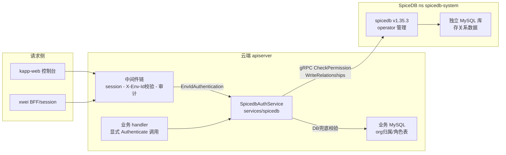
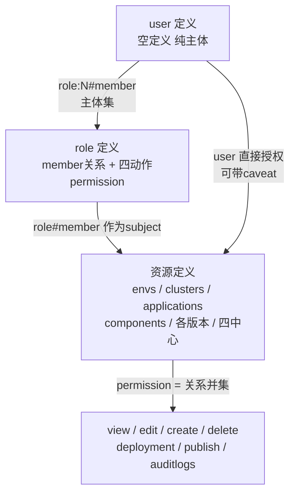
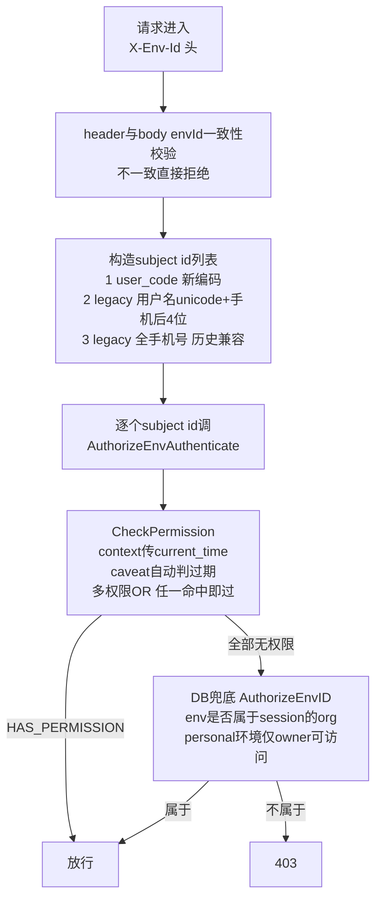
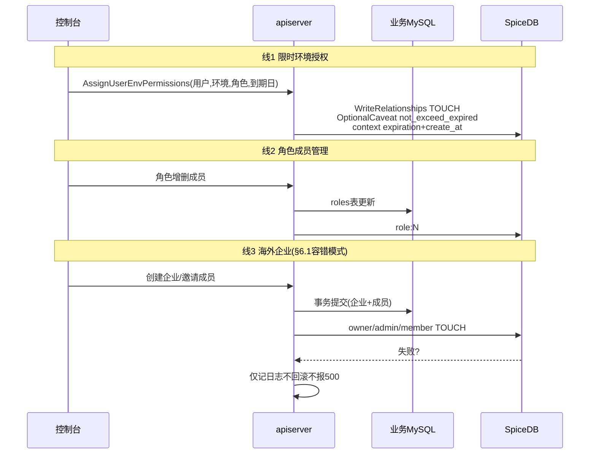

---
tags:
  - 平台组件
  - spicedb
  - 鉴权
  - Zanzibar
  - ReBAC
  - 实战
created: 2026-11-23
---

# 🔑 SpiceDB 项目实战

> 站在平台架构角度讲清 SpiceDB 的角色：它是星河平台**云端控制台的权限决策引擎**——"谁能对哪个资源做什么"不再硬编码在业务逻辑里，而是作为**关系数据**存储和推演。
> 会话与登录机制见 apiserver oauth 体系；本篇只写鉴权决策本身。

## 一、架构定位：为什么是关系型鉴权（ReBAC）

### 1.1 平台鉴权的三个难点

星河是多租户交付平台：企业（org）→ 环境（envs）→ 集群/应用/组件多层资源，权限需求远超静态 RBAC：

1. **角色要能组合**：预置"运维人员/交付人员/运营人员"等角色，授权时按角色批量授予，而不是逐用户写权限；
2. **授权要能限时**：交付人员临时获得某环境 30 天部署权，到期自动失效，不靠定时任务清理；
3. **权限要能推演**：editor 天然能 view、管理员天然拥有全部动作——规则写一次，处处生效。

SpiceDB（Google Zanzibar 论文的开源实现）把这三点统一成一句话：**权限 = 关系图上的可达性推演**。业务代码只问一句 `CheckPermission(user, resource, permission)`，推演过程全在 SpiceDB 内完成。

### 1.2 在平台中的位置



**关键认知**：SpiceDB 是**云端组件**（客户集群 deploy.json 无此项），只保护控制台 API；它不替代 session 认证（你是谁），只做授权决策（你能干什么）。业务 MySQL 与 SpiceDB 各存一份"权限相关数据"，两者的一致性靠写入侧纪律维护（第六节的容错设计）。

## 二、部署形态

[packages/spicedb](file:///home/lisong/projects/packages/spicedb/README.md)：不走 Flux 组件交付，而是 **spicedb-operator** 模式：

- 先装 operator（`kubectl apply --server-side -f .../bundle.yaml`），再提交 [cluster.yaml](file:///home/lisong/projects/packages/spicedb/cluster.yaml) 的 `SpiceDBCluster` CR（authzed.com/v1alpha1）；
- 关键配置：镜像 **v1.35.3**、`datastoreEngine: mysql`（关系数据落独立 MySQL 库，连接串在 spicedb-config Secret）、`preshared_key`（gRPC API 鉴权密钥）、replicas 1、datastoreConnMaxOpen 20；
- apiserver 侧连接（[configmap.tpl.yaml](file:///home/lisong/projects/kapp/deploy/k8s/kapp-server/configmap.tpl.yaml)）：`endpoint = spicedb.spicedb-system.svc.cluster.local:50051`，token 由 Secret 注入 `SPICEDB_TOKEN`；
- 客户端封装极薄（[pkg/db/spicedb.go](file:///home/lisong/projects/kapp/pkg/db/spicedb.go)，24 行）：authzed-go 官方 client + insecure bearer token（集群内明文 gRPC）。

## 三、Schema 解剖：permission.zed 的设计

[deploy/schema/permission.zed](file:///home/lisong/projects/kapp/deploy/schema/permission.zed)（170 行，16 个 definition）是整个权限体系的**单一事实源**。

### 3.1 三层主体模型



- `definition user {}`：空定义，user 只作主体不作资源；
- **每个关系都接受两种主体**：`user | role#member`——直接授给某人，或授给某角色的全体成员（主体集，Zanzibar 核心能力）；
- **permission 是关系的代数并集**：如 `permission view = viewer + editor + creator + deleter + deployer + envs_administrator`——授了 editor 自动能 view，管理员关系自动覆盖全部动作，无需重复授权。

### 3.2 资源定义清单

| 类别 | definition | 特有关系/权限 |
|---|---|---|
| 组织与角色 | org / role | org_admin；role 的 member |
| 交付资源 | envs / clusters | envs 多 deployer（deployment 权限）、auditlogser（auditlogs 权限） |
| 制品资源 | applications / components 及各自 versions | versions 多 publisher（publish 权限） |
| 平台四中心 | opc / deploycenter / omc / publishcenter | view / manage 两档 |
| 预留 | platform | sup_admin / sys_admin |
| 海外企业 | enterprise | owner / admin / member 三角色，transfer_owner 仅 owner |

### 3.3 caveat：限时授权的引擎

```
caveat not_exceed_expired(current_time timestamp, expiration timestamp, create_at timestamp) {
        current_time < expiration && current_time > create_at
}
```

envs 的 viewer/editor/creator/deleter/deployer/auditlogser 全部声明为 `user with not_exceed_expired`——**授权关系上附带条件**，检查时传入 current_time，SpiceDB 在推演中自动求值：过期关系还在库里，但推演结果为无权限。不需要任何清理任务。

### 3.4 enterprise 的特殊性

海外企业定义**没有 administrator 兜底关系**，且业务侧明确绕过 OrgAdmin 兜底（[spicedb.go Authenticate](file:///home/lisong/projects/kapp/internal/apps/apiserver/services/spicedb/spicedb.go) 注释）：否则企业转让后，原 owner 若仍是组织管理员会继续持有 transfer_owner 权限。权限语义严格锁定在 owner/admin/member 关系本身。

## 四、初始化：预置角色与粗粒度资源

### 4.1 引导程序

[deploy/init_permissions.go](file:///home/lisong/projects/kapp/deploy/init_permissions.go)：交付期一次性执行 `WriteSchema(permission.zed)` + `WriteRelationships(13 条预置关系)`。运行期也有等价 RPC（[spicedb_auth.go](file:///home/lisong/projects/kapp/internal/apps/apiserver/handlers/spicedb_auth.go) WriteZedFileToSpicedb / InitializeRoleResourcePermissions）可重放。

### 4.2 六个预置角色 × "_0" 粗粒度资源

预置角色（业务 MySQL roles 表）：1 系统管理员 / 2 运维人员 / 3 产品研发人员 / 4 交付人员 / 5 运营人员 / 6 企业管理人员。

预置关系形如 `envs:env_0#envs_administrator#role:6#member`——注意资源 id 是 **`env_0` 而不是某个具体环境**：

- **粗粒度管理资源**：每类资源有一个固定 `_0` 实例（env_0 / clusters_0 / applications_0 / opc_0...），代表"这一类资源的管理权"。预置关系把角色绑到 `_0` 上，得到的是**集合级**权限（能管理所有环境）；
- **细粒度实例资源**：具体环境 id（如 envs:42）上的授权才是实例级；
- [route_match.go](file:///home/lisong/projects/kapp/internal/apps/apiserver/services/spicedb/route_match.go) 的 `RoutePermissionMatch` 把每条 RPC 路由映射到 `{resource, id, permission}`：id 带 `_0` 后缀走粗粒度；否则从请求 body 用 gjson 提取真实 id（读后回填 r.Body 保证 handler 还能再读）。

这套设计让"角色管全局、授权管实例"共用同一套 schema，无需两种权限模型。

## 五、鉴权数据流：一次控制台请求的权限之旅（核心机制）

### 5.1 中间件链

[server.go](file:///home/lisong/projects/kapp/internal/apps/apiserver/server/server.go) 挂载顺序：I18n → Timeout(30s) → **Authentication**（session + 环境鉴权）→ PermissionAuthentication → AuditLog（kafka）。

### 5.2 环境级鉴权全流程



三个工程要点（[auth.go](file:///home/lisong/projects/kapp/internal/apps/apiserver/server/middlewares/auth.go) EnvIdAuthentication）：

1. **三重 subject id 兼容**（[subject_ids.go](file:///home/lisong/projects/kapp/internal/apps/apiserver/handlers/subject_ids.go)）：历史授权用"用户名 unicode+手机号"编码做 subject id，新版改用 user_code——鉴权时按新→旧顺序逐个尝试，存量授权不用迁移；
2. **caveat 上下文**：`contextData = {"current_time": now.UTC()}` 经 structpb 传入 CheckPermission，限时授权在此生效；
3. **双源兜底**：SpiceDB 查不到授权时，回退业务 MySQL 查"环境是否属于用户所在 org"——**org 成员身份是隐式权限**，SpiceDB 关系是显式增量授权。

### 5.3 资源级鉴权：Authenticate 与 OrgAdmin 兜底

业务 handler 显式调用（monitor/sysOps/enterprise_migration 等）走 [SpicedbAuthService.Authenticate](file:///home/lisong/projects/kapp/internal/apps/apiserver/services/spicedb/spicedb.go)：

- 先查 `IsOrgAdmin`（org:org_0 的 org_admin 权限）——**组织管理员对非 enterprise 资源直接放行**，这是比 DB 兜底更靠前的快捷路径；
- 再 CheckPermission，`FullyConsistent` 一致性（每次读最新，不用 zookie 缓存——权限变更立即生效，代价是每次检查都走 datastore）；
- 例外一：enterprise 资源跳过 OrgAdmin 兜底（3.4 节）；例外二：`CheckRolePermission` 直查 role 关系不兜底——源码注释明示防止"运营类权限被放大给全体 org 管理员"（国际站企业认证审核场景，实现文档 D3）。

### 5.4 xwei 的复用

xwei 不另建权限体系，直接复用同一套：[bff/handler.go](file:///home/lisong/projects/kapp/internal/xwei/bff/handler.go) authorizeEnv 调 EnvIdAuthentication 查 VIEWER；[session/handler.go](file:///home/lisong/projects/kapp/internal/xwei/session/handler.go) resolveUserRole 按 DEPLOYER/EDITOR 命中与否把用户在聊天会话中标记为 admin/普通——**权限决策结果直接驱动 AI 运维的操作边界**。

## 六、授权写入数据流：三条写入线与一致性纪律



- **线 1**（[AssignUserResourcePermissions](file:///home/lisong/projects/kapp/internal/apps/apiserver/services/spicedb/spicedb.go)）：每个 permission 写一条 TOUCH 关系，`OptionalCaveat` 携带 expiration（用户选的到期日）与 create_at（当前时间）——授权即限时，到期自动失效；
- **线 2**（[roleservice.go](file:///home/lisong/projects/kapp/internal/apps/apiserver/services/roleservice.go)）：角色成员变更同步写 `role:N#member`，由于资源授权主体是 `role#member` 主体集，**改一处成员关系，全部关联资源权限即时生效**——这是 ReBAC 相对逐条授权的运维优势；
- **线 3**（[enterprise.go](file:///home/lisong/projects/kapp/internal/apps/apiserver/handlers/enterprise.go) §6.1 注释）：DB 事务先提交，SpiceDB 写失败**仅记日志**——返回 500 会诱导用户重试产生重复/无主企业；且 enterprise 无 OrgAdmin 兜底，缺失关系无自愈路径，只能靠日志人工补写。这是**明确选择最终一致**的工程决策，不是疏忽；
- **删除清理**：资源删除时 DeleteEnvRelationships / DeleteRelationshipsByResource 同步清关系，防止 id 复用导致幽灵授权。

## 七、读取面：权限数据如何驱动 UI

| 消费方 | API | 机制 |
|---|---|---|
| 菜单显隐 | GetCanViewMenuPanelsList | 对 opc/deploycenter/publishcenter/omc 逐个 Authenticate view，决定控制台四大中心入口 |
| 授权环境列表 | GetAuthorizedEnvsByUserId | **ReadRelationships** 按 subject 过滤 envs 关系，读出 caveat 里的 expiration |
| 环境权限管理页 | GetEnvRelationships | 读某环境的全部授权关系反显 |
| xwei 会话角色 | resolveUserRole | 见 5.4 |

**注意 GetAuthorizedEnvsByUserId 的过期判断是客户端做的**（字符串比较 current_time 与 expiration）：ReadRelationships 只返回关系原文，**不求值 caveat**——caveat 只在 CheckPermission 推演时生效。列表场景必须自己过滤，否则会把已过期授权显示出来。

## 八、实战命令速查

```bash
# 1. 验证 schema 语法(改 permission.zed 后先本地校验)
zed validate deploy/schema/permission.zed

# 2. 写入 schema(等价于 init_permissions.go / WriteZedFileToSpicedb RPC)
zed schema write deploy/schema/permission.zed \
  --endpoint spicedb.spicedb-system.svc:50051 --token <preshared_key> --insecure

# 3. 手动检查某用户对某环境的权限(排障核心命令)
zed permission check envs:42 view user:<user_code> \
  --endpoint localhost:50051 --token <key> --insecure

# 4. 带 caveat 上下文检查限时授权(模拟中间件行为)
zed permission check envs:42 deployment user:<user_code> \
  --context '{"current_time":"2026-11-23T00:00:00Z"}' ...

# 5. 查某用户的全部环境授权(等价 GetAuthorizedEnvsByUserId)
zed relationship read envs --subject-filter user:<user_code> ...

# 6. 查某环境的全部授权关系(权限管理页反显数据)
zed relationship read envs:42 ...

# 7. 看 SpiceDB 本体状态(operator 管理)
kubectl -n spicedb-system get spicedbcluster,pods
kubectl -n spicedb-system logs deploy/spicedb-prod

# 8. 人工补写 enterprise 缺失关系(§6.1 容错的补救路径)
zed relationship touch enterprise:<eid> owner user:<uid> ...
```

排错顺序：403 先分清哪层拒的——session 失效（401）/ X-Env-Id 与 body 不一致 / SpiceDB 无关系且 DB org 兜底也不过 / caveat 过期（check 带 context 验证）/ subject id 编码不匹配（新旧三套逐个试）。

## 九、踩坑清单

1. **ReadRelationships 不求值 caveat**：列表场景必须客户端过滤 expiration，只有 CheckPermission 才自动判过期；
2. **三重 subject id**：user_code / legacy 手机后 4 位 / legacy 全手机号，手动 zed 排查时三个都要试，授权写入用哪套编码决定检查能否命中；
3. **OrgAdmin 兜底是双刃剑**：org 管理员对非 enterprise 资源全放行——需要严格角色语义的场景必须走 CheckRolePermission 直查（D3 教训）；
4. **enterprise 无兜底无自愈**：SpiceDB 写失败只记日志，缺失关系必须人工补写，盯紧 enterprise handler 的错误日志；
5. **DB 与 SpiceDB 双写非原子**：§6.1 是明示的最终一致决策，别试图用"事务包两边"修复，会引入重试重复企业问题；
6. **FullyConsistent 每次查库**：权限变更即时生效的代价是无缓存，高频接口注意 SpiceDB 延迟；
7. **粗粒度 `_0` 与实例 id 别混**：RoutePermissionMatch 里 id 带 `_0` 是集合级管理权，从 body 提取的才是实例级；
8. **X-Env-Id 头必须与 body 一致**：中间件显式校验，前端漏传或传错直接拒，不是 SpiceDB 的问题；
9. **schema 变更要重放**：改 permission.zed 后必须 WriteSchema（init 程序或 RPC），SpiceDB 不会自动加载文件；
10. **资源删除必须清关系**：否则 id 复用后新用户继承幽灵授权；
11. **preshared_key 三处一致**：SpiceDBCluster Secret、apiserver SPICEDB_TOKEN、zed CLI --token；
12. **permission_auth 中间件的动作鉴权当前被注释**：路由级检查实际靠 handler 显式 Authenticate 与 EnvIdAuthentication，读代码时别以为中间件在兜底。

## 十、文件索引

| 内容 | 位置 |
|---|---|
| Schema 单一事实源 | [deploy/schema/permission.zed](file:///home/lisong/projects/kapp/deploy/schema/permission.zed) |
| 引导初始化 | [deploy/init_permissions.go](file:///home/lisong/projects/kapp/deploy/init_permissions.go) |
| 部署(operator) | [packages/spicedb/cluster.yaml](file:///home/lisong/projects/packages/spicedb/cluster.yaml)、README.md |
| 客户端封装 | [pkg/db/spicedb.go](file:///home/lisong/projects/kapp/pkg/db/spicedb.go) |
| 核心服务 | [services/spicedb/spicedb.go](file:///home/lisong/projects/kapp/internal/apps/apiserver/services/spicedb/spicedb.go)（Authenticate/AssignUserResourcePermissions/GetAuthorizedEnvsByUserId） |
| 路由权限映射 | [services/spicedb/route_match.go](file:///home/lisong/projects/kapp/internal/apps/apiserver/services/spicedb/route_match.go) |
| 鉴权中间件 | [middlewares/auth.go](file:///home/lisong/projects/kapp/internal/apps/apiserver/server/middlewares/auth.go)（EnvIdAuthentication/AuthorizeEnvAuthenticate）、permission_auth.go |
| subject id 兼容 | [handlers/subject_ids.go](file:///home/lisong/projects/kapp/internal/apps/apiserver/handlers/subject_ids.go) |
| 写入方 | services/roleservice.go、handlers/enterprise.go、handlers/spicedb_auth.go |
| xwei 复用 | [internal/xwei/bff/handler.go](file:///home/lisong/projects/kapp/internal/xwei/bff/handler.go)、session/handler.go |
| 连接配置 | deploy/k8s/kapp-server/configmap.tpl.yaml [spicedb] 段 |

## 相关

- [[平台组件]]（MOC）
- [[SpiceDB]]——通用架构与实战教学（ReBAC 推演、一致性模型、caveat 语义、双写纪律），与本篇定制模型对照阅读
- [[Centrifugo项目实战]]——同为云端组件；agent 通道用 HMAC/JWT 鉴权（机器身份），SpiceDB 管控制台用户权限（人的身份），两套体系互补