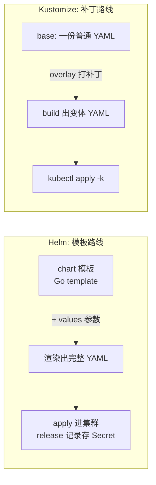
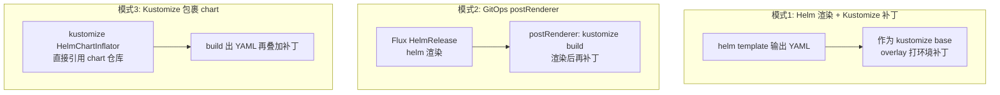

---
tags:
  - 平台组件
  - helm
  - kustomize
  - 交付
  - 教学
created: 2026-11-23
---

# 📖 Helm & Kustomize

> 通用实战笔记：这两个工具解决同一个问题——**K8s YAML 的复用与变体管理**，但思路相反：Helm 用"模板 + 参数"，Kustomize 用"基础 + 补丁"。本篇以动手使用为主线，讲清日常操作、chart 编写、多环境组织与两者组合。GitOps 场景下的声明式用法见 [[GitOps 与 FluxCD]]。

## 一、心智模型：两条路线



| | Helm | Kustomize |
|---|---|---|
| 核心抽象 | chart（带参数模板的包）+ release（一次安装实例） | base（原始 YAML）+ overlay（差异补丁） |
| 变体表达 | values 传参，模板里 if/range 分支 | 对 base 做 patch/transform，不写模板语法 |
| 生命周期管理 | 有：upgrade/rollback/history/hooks | 无：纯渲染，apply 交给 kubectl/GitOps |
| 分发 | chart 仓库/OCI registry，版本化 | 就是 Git 目录，无包概念 |
| 学习曲线 | 模板语法 + 一堆约定 | 几乎为零（YAML 还是 YAML） |

一句话决策：**做给别人装的软件用 Helm，自己团队的多环境差异用 Kustomize，复杂场景两者组合**（§十一）。

---

# Part A：Helm 实战

## 二、日常操作：用别人的 chart

### 2.1 找 chart 与读 values

```bash
helm repo add bitnami https://charts.bitnami.com/bitnami
helm repo update
helm search repo redis                          # 搜仓库
helm search hub wordpress                       # 搜 Artifact Hub(artifacthub.io)

helm show values bitnami/redis > redis-values.yaml   # 导出默认 values, 改这个文件
helm show chart bitnami/redis                        # chart 元数据/依赖
helm show readme bitnami/redis
```

**读 values 的正确姿势**：大 chart（如 kube-prometheus-stack）values 上千行，先抓四类高频段——`image`（仓库/tag/pullPolicy）、`resources`、`replicaCount`/`architecture`、`service`/`ingress`；其余按需查注释。

### 2.2 安装与参数覆盖

```bash
helm install my-redis bitnami/redis \
  -n cache --create-namespace \
  -f redis-values.yaml \
  --set auth.password='S3cret!' \
  --set replica.replicaCount=3
```

values 优先级（后者覆盖前者）：

```
chart 内置 values.yaml  <  -f 文件(多个 -f 按顺序, 后覆盖前)  <  --set/--set-string
```

`--set` 的坑：值里含逗号/点号要转义（`--set 'ingress.hosts[0].host=a\.example\.com'`），复杂结构一律写 `-f` 文件；密码类用 `--set-string` 防止被解析成数字/布尔。

### 2.3 升级、回滚与状态

```bash
helm upgrade my-redis bitnami/redis -n cache -f redis-values.yaml \
  --atomic --timeout 10m        # 失败自动回滚, 生产推荐
helm upgrade my-redis bitnami/redis --reuse-values -n cache   # 沿用上次 values(注意: 会丢失新 chart 版本的默认值变化)

helm history my-redis -n cache          # release 修订史
helm rollback my-redis 2 -n cache       # 回到修订 2
helm status my-redis -n cache
helm get values my-redis -n cache       # 当前生效的用户 values
helm get manifest my-redis -n cache     # 当前生效的完整 YAML

helm uninstall my-redis -n cache --keep-history   # 卸载但保留历史(可 rollback 恢复)
```

关键认知：**release 状态存在目标 ns 的 Secret 里**（`sh.helm.release.v1.<name>.v<N>`），不在 Tiller（v3 早已移除）、不在本地。`helm list -A` 能列出一切；`--atomic` 的本质是 upgrade 失败后自动执行 rollback。

### 2.4 卡死救援

```bash
# 报错 "another operation (install/upgrade/rollback) is in progress"
helm history my-redis -n cache        # 找到 pending-upgrade 的修订
helm rollback my-redis <上一个成功修订> -n cache
# rollback 也卡: 删除 pending 状态的 release Secret(最后手段)
kubectl -n cache delete secret -l owner=helm,name=my-redis,status=pending-upgrade
```

## 三、写自己的 chart

### 3.1 脚手架与结构

```bash
helm create myapp
```

```
myapp/
├── Chart.yaml          # 包元数据: name/version(chart 版本)/appVersion(应用版本)/dependencies
├── values.yaml         # 默认参数
├── templates/          # Go template 渲染的 K8s YAML
│   ├── deployment.yaml
│   ├── service.yaml
│   ├── ingress.yaml
│   ├── _helpers.tpl    # 命名模板(下划线开头不渲染成资源)
│   ├── NOTES.txt       # install 后打印给用户的提示
│   └── tests/          # helm test 的测试 Pod
└── charts/             # 依赖的子 chart(helm dep update 拉进来)
```

**version vs appVersion**：chart 改模板/values 结构升 `version`（SemVer，仓库按它索引）；应用镜像升级升 `appVersion`。两者独立演进。

### 3.2 模板语法最小集

```yaml
# templates/deployment.yaml
apiVersion: apps/v1
kind: Deployment
metadata:
  name: {{ include "myapp.fullname" . }}        # 命名模板, . 是根上下文
  labels:
    {{- include "myapp.labels" . | nindent 4 }} # nindent: 换行+缩进, 块级插入标配
spec:
  replicas: {{ .Values.replicaCount }}
  selector:
    matchLabels:
      {{- include "myapp.selectorLabels" . | nindent 6 }}
  template:
    metadata:
      labels:
        {{- include "myapp.selectorLabels" . | nindent 8 }}
    spec:
      containers:
        - name: {{ .Chart.Name }}
          image: "{{ .Values.image.repository }}:{{ .Values.image.tag | default .Chart.AppVersion }}"
          {{- with .Values.resources }}         # with: 非空才渲染, 内部 . 变成该值
          resources:
            {{- toYaml . | nindent 12 }}        # toYaml: 结构体原样转 YAML
          {{- end }}
          {{- if .Values.env }}
          env:
            {{- range .Values.env }}            # range: 遍历列表
            - name: {{ .name }}
              value: {{ .value | quote }}       # quote: 加引号, 防数字/布尔歧义
            {{- end }}
          {{- end }}
```

内置对象速记：`.Values`（values 合并结果）、`.Release`（Name/Namespace/IsUpgrade/IsInstall/Revision）、`.Chart`（Chart.yaml 内容）、`.Files`（读 chart 内非模板文件）、`.Capabilities`（K8s 版本/API 可用性，做版本兼容分支）。

`{{-` 与 `-}}` 是**空白控制**（吃掉左侧/右侧空白），缩进错乱九成是它和 `nindent` 没配合好。

### 3.3 _helpers.tpl：命名模板

```
{{- define "myapp.fullname" -}}
{{- printf "%s-%s" .Release.Name .Chart.Name | trunc 63 | trimSuffix "-" -}}
{{- end -}}

{{- define "myapp.labels" -}}
helm.sh/chart: {{ .Chart.Name }}-{{ .Chart.Version }}
app.kubernetes.io/name: {{ .Chart.Name }}
app.kubernetes.io/instance: {{ .Release.Name }}
app.kubernetes.io/managed-by: {{ .Release.Service }}
{{- end -}}
```

规则：名字以 chart 名为前缀防冲突；`include` 返回字符串可接管道（`tpl` 函数还能二次渲染字符串里的模板）。**63 字符截断**是 K8s 名字上限，fullname 模板必须处理。

### 3.4 调试三板斧

```bash
helm lint ./myapp                              # 静态检查
helm template test ./myapp -f values-prod.yaml # 只渲染不安装, 肉眼看 YAML
helm install test ./myapp --dry-run --debug    # 渲染 + 服务端校验(不真装)
helm template test ./myapp | kubectl apply --dry-run=server -f -   # API 级校验
```

**改模板必跑 `helm template`**，YAML 缩进错误在渲染阶段就能暴露，别等 install 失败。

### 3.5 Hooks：生命周期钩子

```yaml
# templates/db-migrate-job.yaml
apiVersion: batch/v1
kind: Job
metadata:
  name: {{ include "myapp.fullname" . }}-migrate
  annotations:
    "helm.sh/hook": pre-install,pre-upgrade     # 安装/升级前执行
    "helm.sh/hook-weight": "-5"                 # 同阶段多 hook 的执行顺序
    "helm.sh/hook-delete-policy": before-hook-creation,hook-succeeded
spec:
  template:
    spec:
      restartPolicy: Never
      containers:
        - name: migrate
          image: "{{ .Values.image.repository }}:{{ .Values.image.tag }}"
          command: ["./migrate", "up"]
```

要点：hook 资源**不进 release manifest**（helm 不管它的后续状态）；`hook-delete-policy` 决定上次 hook 残留何时清理；数据库迁移这类**不可重复执行**的 hook，回滚/卸载场景要显式 `--no-hooks` 跳过（Flux HelmRelease 的 rollback/uninstall disableHooks 同理，见 [[GitOps 与 FluxCD]]）。

### 3.6 依赖管理

```yaml
# Chart.yaml
dependencies:
  - name: redis
    version: "19.x"
    repository: https://charts.bitnami.com/bitnami
    condition: redis.enabled        # values 开关控制是否安装
    tags: [backend]
```

```bash
helm dependency update ./myapp      # 拉子 chart 进 charts/ 并生成 Chart.lock
```

子 chart 的 values 用**子 chart 名作 key** 覆盖（`redis: { architecture: standalone }`）；跨层共享值用 `global:` 段（父子都能读 `.Values.global.xxx`）。`helm dep build` 按 lock 精确重建，CI 里用 build 不用 update。

### 3.7 打包与分发（OCI 是现代默认）

```bash
helm package ./myapp                        # 产出 myapp-1.2.0.tgz
helm registry login ghcr.io -u <user> -p <token>
helm push myapp-1.2.0.tgz oci://ghcr.io/<org>/charts
helm install myapp oci://ghcr.io/<org>/charts/myapp --version 1.2.0
```

OCI 分发省掉 index.yaml 维护，chart 与镜像同仓同权限体系；私有仓认证在 GitOps 侧对应 HelmRepository `type: oci`（见 [[GitOps 与 FluxCD]] §4.2）。

---

# Part B：Kustomize 实战

## 四、心智模型与最小示例

Kustomize 不引入模板语言：**base 是普通 YAML，overlay 声明"在 base 之上改什么"**，`kustomize build` 输出最终 YAML。kubectl 内置（`kubectl -k`）。

```
myapp/
├── base/
│   ├── kustomization.yaml
│   ├── deployment.yaml          # 普通 YAML, 无任何占位符
│   └── service.yaml
└── overlays/
    ├── dev/
    │   └── kustomization.yaml
    └── prod/
        ├── kustomization.yaml
        └── replicas-patch.yaml
```

```yaml
# base/kustomization.yaml
apiVersion: kustomize.config.k8s.io/v1beta1
kind: Kustomization
resources:
  - deployment.yaml
  - service.yaml
```

```yaml
# overlays/prod/kustomization.yaml
apiVersion: kustomize.config.k8s.io/v1beta1
kind: Kustomization
resources:
  - ../../base
namespace: myapp-prod            # 所有资源进这个 ns
namePrefix: prod-                # 所有资源名加前缀
labels:
  - pairs: { env: prod }
    includeSelectors: false      # 只加 label, 不动 selector(动了会破坏 Deployment 匹配)
replicas:
  - name: myapp
    count: 5
images:
  - name: myapp                  # 匹配镜像名(不含 tag)
    newName: registry.example.com/myapp
    newTag: v2.1.0
patches:
  - path: replicas-patch.yaml
```

```bash
kustomize build overlays/prod              # 渲染查看
kubectl apply -k overlays/prod             # 直接部署
kubectl diff -k overlays/prod              # 与集群现状对比
```

## 五、四种核心变换器

### 5.1 images：镜像改写（最高频）

`images` 按**镜像名**匹配（写 `myapp` 能匹配 `registry.x/myapp:old`），统一改 registry/tag/digest。多环境镜像仓库不同、CI 产出的新 tag 注入，都靠它——**不要在每个 overlay 里 patch deployment 的 image 字段**。

### 5.2 patches：两种补丁语法

**Strategic Merge Patch**（推荐，写"长什么样"）：

```yaml
# overlays/prod/resources-patch.yaml
apiVersion: apps/v1
kind: Deployment
metadata:
  name: myapp                    # 必须与 base 中资源名一致(在 namePrefix 之前匹配)
spec:
  template:
    spec:
      containers:
        - name: myapp            # 按 name 合并到对应容器
          resources:
            limits: { cpu: "2", memory: 2Gi }
```

**JSON 6902 Patch**（写"做什么操作"，精确但啰嗦）：

```yaml
patches:
  - target:
      kind: Deployment
      name: myapp
    patch: |-
      - op: replace
        path: /spec/replicas
        value: 5
      - op: add
        path: /spec/template/spec/containers/0/env/-
        value: { name: LOG_LEVEL, value: warn }
```

选择规则：改字段值/加结构用 strategic merge；删数组元素、按索引精确操作用 JSON6902。strategic merge 对**列表默认按 name/key 合并**，CRD 自定义资源没有合并策略元数据时退化为整体替换——patch CRD 实例优先 JSON6902。

### 5.3 configMapGenerator / secretGenerator：配置与滚动更新

```yaml
configMapGenerator:
  - name: myapp-config
    files: [config/app.yaml]
    # literals: [LOG_LEVEL=info]
generatorOptions:
  disableNameSuffixHash: false   # 默认 false: 生成名带内容 hash 后缀
```

**hash 后缀是精髓**：配置内容变 → 生成的 ConfigMap 名字变（`myapp-config-7f2kg9h`）→ 引用它的 Deployment 的 volume/configMapRef 名字被 Kustomize 自动同步改写 → **Pod spec 变化触发滚动更新**。解决了"改 ConfigMap 但 Pod 不重启"的经典问题。

代价：旧 hash 的 ConfigMap 不会被 kubectl 自动清理（垃圾积累），GitOps 侧由 prune 处理（Flux Kustomization `prune: true`，见 [[GitOps 与 FluxCD]]）。Secret 同理用 secretGenerator（`type: Opaque`，envs/files），**明文 secret 文件别进 Git**——配合 SOPS 加密或外部 secret 方案。

### 5.4 components：可插拔的功能片段

比 overlay 更细的复用单元——"可选功能"抽成 component，按需引入：

```yaml
# components/istio-sidecar/kustomization.yaml
apiVersion: kustomize.config.k8s.io/v1alpha1
kind: Component
patches:
  - path: sidecar-patch.yaml
---
# overlays/prod/kustomization.yaml
components:
  - ../../components/istio-sidecar
```

overlay 是"环境差异"（互斥，一次选一个），component 是"功能开关"（可叠加）。

## 六、多环境组织的实战纪律

1. **base 里不出现环境信息**：无 env label、无环境 ns、镜像用通用名——环境差异全部在 overlay；
2. **overlay 只写差异**：能靠变换器（images/replicas/labels）表达的不写 patch，patch 文件越少越好维护；
3. **目录即环境**：`overlays/{dev,staging,prod}`，CI/CD 与 GitOps 按目录指向部署（Flux 的 `spec.path` 就是指向这些目录）；
4. **公共中间层**：多环境共享的"公司级约定"（统一 label/annotation/安全上下文）抽成中间 base 或 component，避免每个 overlay 复制；
5. **build 产物进 CI 校验**：`kustomize build overlays/prod | kubeconform -strict` 做 schema 校验，渲染错误在 PR 阶段拦截。

---

# Part C：组合与选型

## 七、两者组合的三种模式



| 模式 | 做法 | 适用 |
|---|---|---|
| Helm 渲染 + Kustomize 补丁 | `helm template` 产物落盘当 base，overlay 改环境差异 | 上游 chart 不暴露某个字段的 values，又必须改它 |
| Flux postRenderer | HelmRelease 的 `postRenderers.kustomize` 内联 patches/images | GitOps 下对第三方 chart 做最后修补（官方推荐姿势） |
| HelmChartInflator | kustomization.yaml 里 `helmCharts:` 声明 repo/name/version/valuesFile | 想全程 kustomize 工具链，不单独管 helm release |

组合的代价要认清：**Helm 的生命周期管理（rollback/hooks）在渲染成纯 YAML 后就没了**——模式 1/3 里 chart 只是"YAML 生成器"，升级回滚靠 GitOps 或 kubectl。要保留 Helm 生命周期就用模式 2（HelmRelease 仍是 helm 管的 release）。

## 八、选型决策表

| 场景 | 选择 | 理由 |
|---|---|---|
| 分发给外部用户安装的软件 | Helm chart | 参数化 + 版本化 + 仓库分发 + NOTES 引导 |
| 自己团队应用的多环境部署 | Kustomize | 无模板税，base 即文档，overlay 即差异 |
| 安装第三方 chart 但要改环境细节 | Helm + postRenderer/渲染后补丁 | 别 fork chart，补丁层隔离上游变更 |
| 需要安装前迁移/初始化 Job | Helm hooks | Kustomize 无生命周期概念 |
| GitOps 纯 manifest 交付 | Kustomize（Flux Kustomization CR） | 与 prune/健康检查/SSA 天然契合 |
| GitOps 交付 Helm 软件 | Flux HelmRelease | 保留 helm 全生命周期（见 [[GitOps 与 FluxCD]]） |

## 九、常见坑清单

**Helm：**

1. **values 数组合并不是深合并**：`-f` 覆盖列表是**整体替换**不是逐元素合并，想追加元素必须写全量列表；
2. **`--reuse-values` 的陷阱**：沿用旧 values 会错过新 chart 版本的默认值变化，升级大版本先 `helm show values` 对比；
3. **CRD 不随 upgrade 更新**：`crds/` 目录只在 install 时安装，upgrade 不动 CRD——升级 chart 前手动 apply 新 CRD；
4. **`--set` 转义地狱**：点号/逗号/方括号都有语义，复杂值一律 `-f`；
5. **release 卡 pending**：见 §2.4，先 rollback 再考虑删 Secret；
6. **模板缩进错乱**：`{{-` 空白控制 + `nindent` 配合问题，`helm template` 阶段就能发现；
7. **hook 资源失控**：hook 不进 release manifest，失败残留要自己清（配 hook-delete-policy）；
8. **卸载不删 CRD/PVC 是故意的**：防数据丢失，需要时手动清理。

**Kustomize：**

9. **patch 的 name 匹配在 namePrefix 之前**：patch 里写 base 原名，不是加了前缀的名；
10. **labels 动了 selector**：`includeSelectors: true` 会改 Deployment selector（不可变字段），apply 直接报错，默认 false 别乱开；
11. **generator hash 引用**：手写 YAML 引用 generator 产物时写**不带 hash 的原名**，Kustomize 自动替换；写了带 hash 的名反而匹配不上；
12. **旧 hash ConfigMap 积累**：kubectl apply 不清理旧变体，GitOps 用 prune，裸 kubectl 定期手动清；
13. **strategic merge 对 CRD 退化**：自定义资源无合并策略，列表整体替换，改 CRD 实例用 JSON6902；
14. **resources 里的远程 URL**：支持 http/远程 kustomization，但引入不可控外部依赖，生产锁定版本或落盘。

## 十、命令速查

```bash
# Helm
helm show values <repo/chart>          # 读默认参数
helm template <name> <chart> -f v.yaml # 渲染调试
helm install/upgrade <name> <chart> --atomic --timeout 10m
helm history/rollback/status/get values/get manifest <name>
helm lint ./chart && helm package ./chart
helm registry login <registry> && helm push pkg.tgz oci://<registry>/<path>
helm dependency update/build ./chart
helm diff upgrade <name> <chart>       # 需 helm-diff 插件, 升级前看差异

# Kustomize
kustomize build overlays/prod                    # 渲染
kustomize build overlays/prod | kubeconform -strict   # schema 校验
kubectl apply -k overlays/prod
kubectl diff -k overlays/prod
kustomize edit set image myapp=registry/myapp:v2.1.0  # CI 里改 image 的正规姿势
```

## 相关

- 上游：[[平台组件]] · [[云原生]] · [[Kubernetes]]
- GitOps 用法：[[GitOps 与 FluxCD]]（HelmRelease/Kustomization CR、postRenderer、prune 机制）· [[FluxCD项目实战]]（程序化渲染 Helm CR 的非典型形态）
- 消费方示例：[[KPS 与 Keep]]（helm 安装全家桶）· [[cert-manager]]（crds.enabled 与 chart 交付）