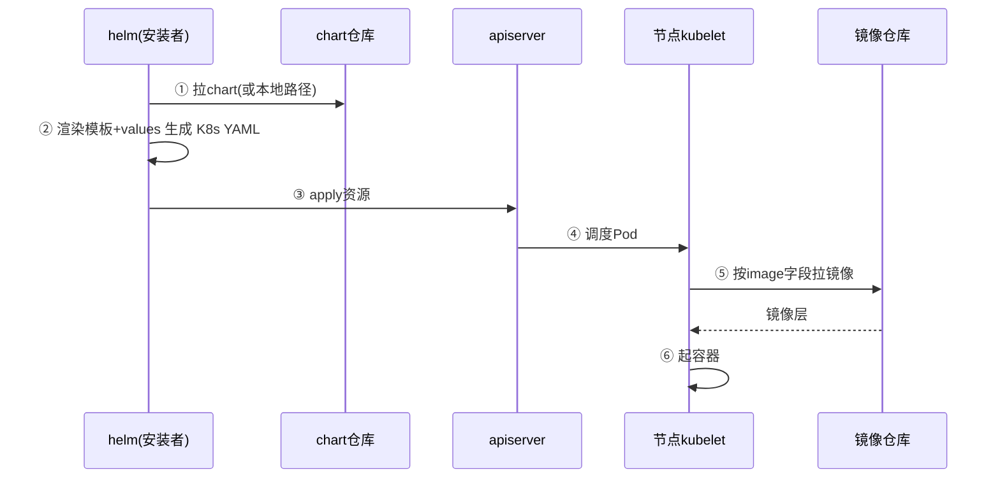
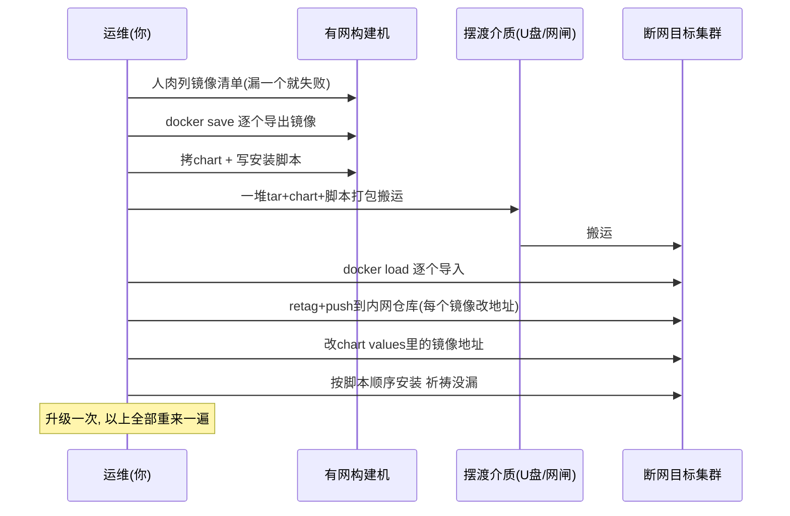
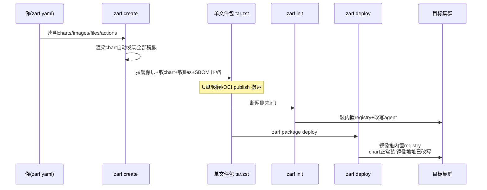
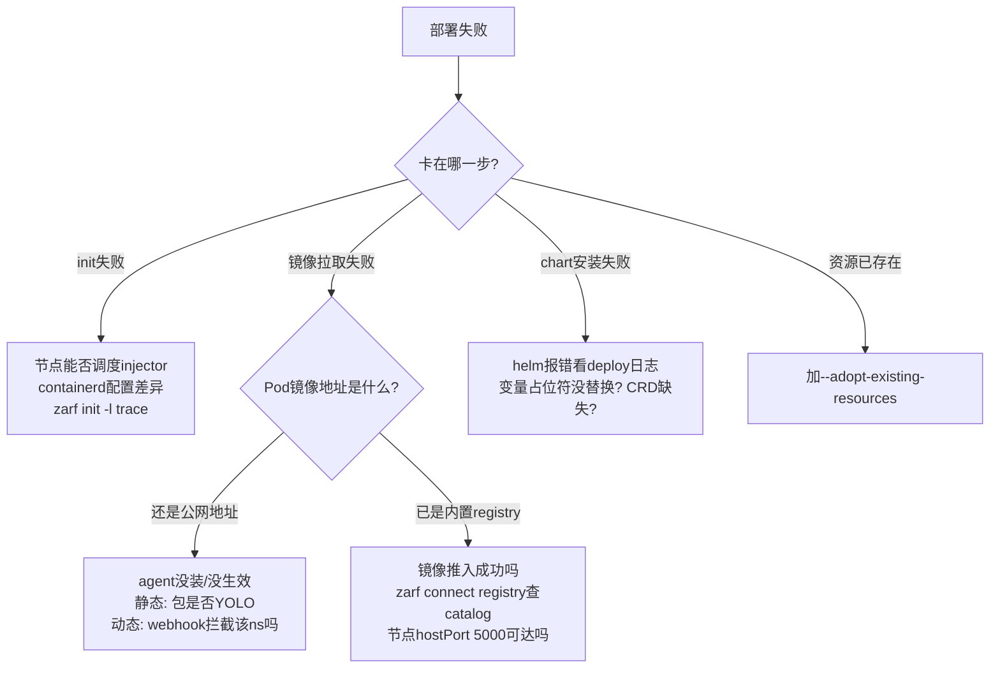

---
tags:
  - 平台组件
  - zarf
  - 离线交付
  - OCI
  - 打包
  - 教学
created: 2026-11-23
---

# 📖 Zarf

> 一条线索展开：**装一个软件隐含依赖什么、断网了手工怎么搬 → 手工方式为什么撑不住 → zarf 怎么解决 → 包声明实例步步深入 → 镜像改写与生命周期深水区 → 排障**。项目内的双重角色（离线底座 + 元数据集装箱）见 [[Zarf项目实战]]。

## 一、先搞懂"装软件"依赖什么

### 1.1 在线安装：三个隐含依赖

`helm install myapp ./chart` 一条命令背后，实际发生了一串跨网络的动作：



三个隐含依赖，在线时感觉不到，断网时全断：

| 依赖 | 在线时 | 断网时 |
|---|---|---|
| chart 可达 | 仓库随便拉 | 拉不到 |
| **镜像可达** | kubelet 自动拉 | **ImagePullBackOff** |
| 安装者知道怎么装 | helm 一条命令 | 脚本/顺序/前置全靠人脑 |

### 1.2 交付单位：不是 chart，是"一切"

一个软件跑起来需要的远不止 chart：**chart + 全部镜像 + 配置文件 + 安装编排**，四样凑齐才叫"能装"。Zarf 的包就是把这四样打成一个文件——这是理解后面一切的前提。

## 二、没有 zarf 的日子：手工离线交付



## 三、问题来了：手工方式为什么撑不住

1. **镜像清单必漏**：子 chart 镜像、initContainer、operator 运行时派生的镜像——人肉枚举顾头不顾腚，漏一个就是部署中途 ImagePullBackOff；
2. **retag 地狱**：每个镜像都要 load → retag → push → 改 values 引用，几十上百个镜像纯体力活；
3. **编排散落**：前置 namespace、CRD 顺序、装后校验全在脚本里，换个人接手就读不懂；
4. **架构暗雷**：amd64 镜像搬到 arm 集群，装到一半才发现层不匹配；
5. **无审计物料**：交付了什么版本、含哪些组件，没有清单可查（合规场景硬伤）。

归纳成四句需求：**声明要交付什么而非执行步骤；镜像自动发现；地址自动改写；单文件可搬运可审计**。这正是 zarf 做的事。

## 四、zarf 的解法：声明式打包 + 两段式管线

### 4.1 它是什么

一个 **CLI + Go SDK**（不是集群常驻组件，与 cert-manager 那种 controller 不同）——只在打包和部署两个时刻干活，装完就退场：

| 阶段 | 命令 | 在哪执行 |
|---|---|---|
| 打包 | `zarf package create` | 有网构建机 |
| 部署 | `zarf init` + `zarf package deploy` | 断网目标侧 |

### 4.2 核心机制：你声明，它跑腿



对照 §二：**列清单、docker save、retag、改 values 这些"你的戏份"全部消失**，只剩第一步声明。

### 4.3 init 装了什么（理解离线链路的前提）

| 组件 | 作用 |
|---|---|
| zarf-injector | 引导用：把 seed registry 镜像塞进节点——解决"装 registry 需要镜像、拉镜像需要 registry"的鸡蛋问题 |
| zarf-registry | 集群内置镜像仓库（集群内 `127.0.0.1:5000` hostPort 寻址） |
| **zarf-agent** | mutating webhook：Pod 镜像地址自动改写到内置 registry——**operator 动态创建的 Pod 也能离线跑**的关键（§6.1） |
| gitea（可选） | 内置 Git 服务器，离线 GitOps 用 |

**init 包也要提前在有网侧打好**——断网侧没有它，一切免谈。

## 五、包声明实例步步深入

核心对象就一个：`zarf.yaml`（ZarfPackageConfig）。四个载荷段各管一摊：

| 载荷 | 内容 | 部署时行为 |
|---|---|---|
| `charts` | Helm chart | 正常 helm install，镜像地址被改写 |
| `images` | 镜像清单 | create 拉进包，deploy 推内置 registry |
| `files` | 任意文件 | 解包到目标路径，供 actions 用 |
| `manifests` | 裸 K8s YAML | 直接 apply，镜像同样改写 |

### 5.1 第一个包：最小闭环

```yaml
kind: ZarfPackageConfig
metadata:
  name: myapp
  version: 1.2.0
  architecture: amd64            # 包是单架构的, 多架构各打一份
components:
  - name: myapp
    required: true
    charts:
      - name: myapp
        version: 1.2.0
        url: https://charts.example.com
        namespace: myapp
        valuesFiles: [values-prod.yaml]
    images:
      - registry.example.com/myapp/api:1.2.0
```

`zarf package create . --confirm` 产出单文件包，`zarf package deploy pkg.tar.zst --confirm` 装进集群。最小闭环成立——但 images 手写埋着 §三痛点 1 的雷，下一例解决。

### 5.2 镜像清单：别手写，用 find-images

```bash
zarf dev find-images ./chart-dir     # 渲染chart, 遍历全部image字段
```

原理：helm template 渲染后扫所有 image 字段（含 initContainers/CRD 内嵌镜像），可选 cosign 查询带上签名关联镜像。输出直接贴进 images 段。**子 chart、operator 派生、init 容器这三类漏网高发区，机器扫比人肉列可靠**。

### 5.3 变量与常量：同一个包走多个环境

```yaml
variables:                        # deploy时可改(--set或交互prompt)
  - name: REPLICAS
    default: "2"
constants:                        # create时固化, deploy不可改
  - name: REGISTRY
    value: registry.example.com
```

valuesFiles/manifests 里用 `###ZARF_VAR_REPLICAS###`、`###ZARF_CONST_REGISTRY###` 引用。规则一句话：**环境相关的用 variable，构建期确定的用 constant**。

### 5.4 files + actions：把安装编排收进包里

```yaml
files:
  - source: ./manifests/extra-config.yaml
    target: ~/extra-config.yaml
actions:
  onCreate:                      # 打包机执行(有网)
    before:
      - cmd: ./scripts/generate-manifests.sh
  onDeploy:                      # 目标侧执行
    before:
      - cmd: kubectl create namespace myapp --dry-run=client -o yaml | kubectl apply -f -
    after:
      - cmd: kubectl apply -f ~/extra-config.yaml
  onRemove:                      # package remove时执行
    after:
      - cmd: kubectl delete namespace myapp
```

§三痛点 3 的解法：前置/装后/卸载脚本随包交付，不再散落。脚本里可用 `zarf tools` 子命令（内置 kubectl/helm/crane）——**离线机不装任何工具也能跑**。

### 5.5 OCI 分发：摆渡不止 U 盘

```bash
zarf package publish ./pkg.tar.zst oci://ghcr.io/<org> --confirm
zarf package deploy oci://ghcr.io/<org>/myapp:1.2.0 --confirm
```

包像镜像一样推拉，适合"有内网 registry 但无公网"的半隔离环境。注意：**zarf 包的 OCI 布局与 Helm chart OCI 制品不通用**——`helm pull` 拉不了 zarf 包，反之亦然。

## 六、深水区：镜像改写与生命周期边界

### 6.1 镜像改写的两条路（最高频暗雷）

| 路 | 覆盖谁 | 机制 |
|---|---|---|
| 静态改写 | chart/manifest 里写死的 image 字段 | deploy 过程直接替换 |
| **agent 兜底** | **运行时动态创建的 Pod**（operator 派生、Job） | zarf-agent webhook 拦截改写 |

没装 agent 时前者能跑后者挂——**"主应用装好了，operator 起的 Pod 却 ImagePullBackOff"就是这个原因**。排查先问：这个 Pod 的镜像地址是谁改的？

### 6.2 YOLO 模式：只借打包，不 init

`metadata.yolo: true` 跳过 init/agent/内置 registry：镜像地址不改写，**前提是目标环境本来就能拉到镜像**（已有 mirror 或在线）。适合只借 zarf 的打包编排能力、镜像可达性自己保证的场景——项目在线部署走的就是这条路的定制版（见 [[Zarf项目实战]]）。

### 6.3 生命周期：状态在集群，回滚靠重部署

```bash
zarf package list                     # 状态存集群内zarf-state Secret, 换机器照样查
zarf package deploy pkg --adopt-existing-resources   # 重装/升级必加: 接管已有同名资源
zarf package remove myapp --confirm   # 按清单卸载(执行onRemove)
zarf destroy --confirm                # 连init一起拆(测试清场, 生产禁用)
```

三个边界认知：

- **remove 不是 Helm 式 revision 回滚**——升级 = deploy 新包，回滚 = deploy 旧包；
- `--adopt-existing-resources` 接管后资源归 zarf 管，remove 会删它们；
- **zarf 不管持续对账**：装完手改集群不会被纠正——那是 Flux/ArgoCD 的活（[[GitOps 与 FluxCD]]）。Zarf 管"第一次装进去"，GitOps 管"之后一直对"，可组合。

## 七、排障：沿部署链下钻



```bash
zarf init -l trace                  # init排障必开
zarf connect registry               # 本地隧道到内置registry
zarf tools registry catalog         # 列内置registry镜像
zarf tools get-creds                # registry/git凭据
zarf tools kubectl get pods -A      # 内置kubectl, 离线机免装工具
zarf package inspect ./pkg.tar.zst  # 部署前验包
zarf package definition ./pkg.tar.zst  # 核对变量声明
```

高频坑浓缩：

1. 手写 images 必漏——find-images 机器扫（§5.2）；
2. 包是单架构的，amd64 包上 arm 集群必失败；
3. init 没装好离线全挂，先 `zarf package list` 确认 init 包在；
4. 静态改写了动态没改写——查 agent（§6.1）；
5. zarf 包 ≠ Helm chart OCI，helm pull 报错不是 bug；
6. cosign 查询拖慢打包——不需要签名镜像时显式关闭；
7. `###ZARF_VAR_X###` 原样出现 = 变量名拼错或没声明；
8. 自签 registry 要 `--insecure` 或信任 CA，否则 x509；
9. SBOM 是合规审计物料，`--skip-sbom` 提速的包别用于交付审计。

## 八、与项目形态的对照指引

| 本文机制 | 项目内的具体化 |
|---|---|
| CLI 打包/部署（§四） | Go SDK 内嵌替代 CLI，构建期程序化生成 zarf.yaml |
| YOLO 模式（§6.2） | `--only-manifest` 包当元数据集装箱，在线部署借打包不借 registry |
| OCI 分发（§5.5） | 双制品体系：chart OCI + kapp OCI，PartialPull 按层拉取 |
| 镜像自动发现（§5.2） | cosign 默认关的提速策略 |
| 不管持续对账（§6.3） | 部署交给 Flux：pevent 拉包渲染 CR，Flux 安装与对账 |

详见 [[Zarf项目实战]]——本篇通用机制的项目定制应用，单源引用不重复。

## 相关

- 上游：[[平台组件]] · [[云原生]] · [[Kubernetes]]
- 项目用法：[[Zarf项目实战]]（SDK 内嵌、元数据集装箱、在线/离线双路径）
- 交付链下游：[[GitOps 与 FluxCD]]（chart 的持续管理者）· [[FluxCD项目实战]]（pevent 拉包到 Flux 安装链路）
- 打包基础：[[Helm&Kustomize]]（chart 与 values 的构建基础）