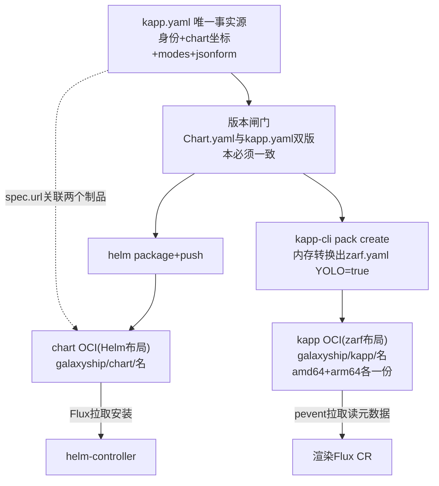
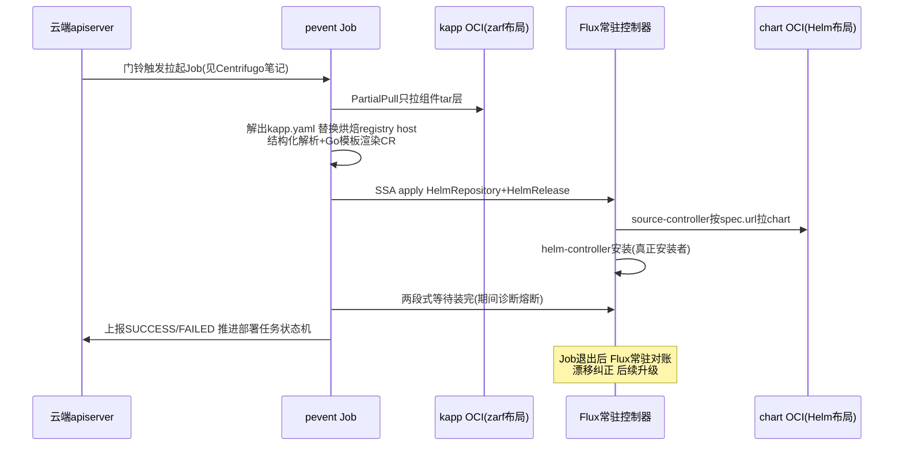
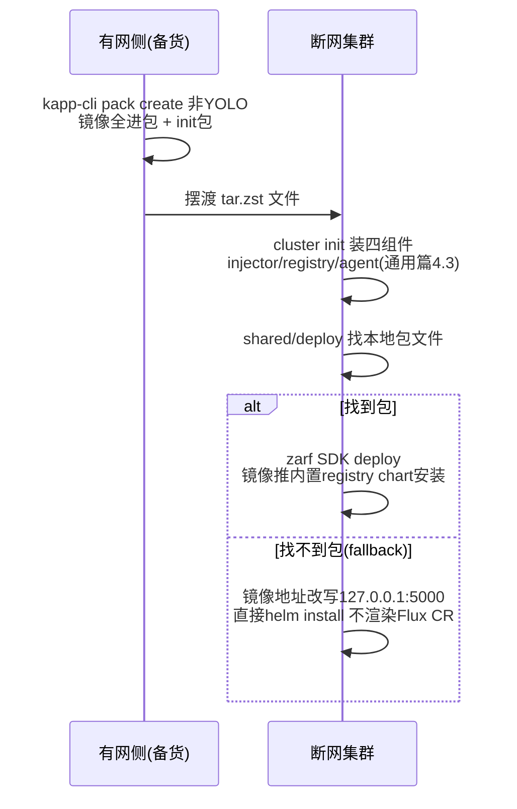

---
tags:
  - 平台组件
  - zarf
  - 离线交付
  - 双制品
  - 实战
created: 2026-11-23
---

# 📦 Zarf 项目实战

> 通用篇 [[Zarf]] 回答了"zarf 怎么打包、怎么离线装"；本篇回答下一个问题：**本项目为什么有两种截然不同的 zarf 用法——在线借壳、离线全套**。
> 一条线索：两种交付难题 → 双制品体系 → 在线链（元数据集装箱）→ 离线链（airgap 底座）→ 边界与踩坑。通用机制（zarf.yaml 语法/init 四件套/镜像改写/命令）一律单源引用通用篇。

## 一、项目的问题：两种交付，缺的东西不一样

| 场景 | 客户集群状态 | 缺什么 | 安装者 |
|---|---|---|---|
| **在线** | 能连平台、能拉镜像 | 缺"部署元数据"（chart 坐标/values 模式/系统参数） | **Flux** |
| **离线** | airgap，chart/镜像/工具全断 | 缺"一切" | **zarf SDK** |

核心架构决策：**打包与安装分离**——zarf 只负责"把东西可靠地装进包、运到位"，安装这件事在线交给 Flux、离线才用 zarf 自己的部署能力。源码注释原话："zarf 在这里只是用于编排包"。

由此推出两种用法：**在线 = YOLO 元数据集装箱（借壳）；离线 = 非 YOLO 全量包（全套）**。同一个转换函数，一个开关切换。

## 二、双制品体系：一个事实源，两个投影

**问题**：Flux 只认 chart，但平台元数据（部署模式、values 合并规则、控制台表单）在 chart 里没有容身之处。

**决策**：kapp.yaml 当唯一事实源，构建期投影成两个 OCI 制品——**chart 包给 Flux 装应用，kapp 包给 pevent 读元数据**：



三个要点：

1. **zarf.yaml 不入库**——它是构建期现生成的"编译产物"，仓库里找不到是正常的（例外：k3s/fluentbit/clickhouse/grafana 手写 zarf.yaml，走 zarf 直接部署路径）；
2. **jsonform 不进包**——push 时经 `--kapp-server` 注册到平台给控制台 UI 用，与部署链无关；
3. **两种 OCI 布局不通用**（通用篇 §5.5）——同一 registry 里 `galaxyship/chart/*` 和 `galaxyship/kapp/*` 是两种东西，helm pull 拉不了 kapp 包。

### 2.1 kapp 包解剖：面单 + 货箱

```
OCI包
├── zarf.yaml 层        ← 面单: YOLO声明+files清单(给zarf工具拆包用)
├── checksums.txt 层
├── components/名.tar 层 ← 货箱:
│     ├── 名/files/0/kapp.yaml      ← 货物清单(给pevent部署用)
│     └── 名/files/1/default.yaml   ← 各模式values
└── SBOM 层
```

**zarf 的声明式部署能力被刻意架空**：images/charts 段全空，zarf.yaml 退化成纯搬运描述；真正的部署语义全在货箱里的 kapp.yaml。pevent 按层标题定位组件 tar（PartialPull 只拉这一层，不拉整包），解包读 kapp.yaml 干活。

## 三、在线链：zarf 只是元数据集装箱

**问题**：云端发起部署，怎么把"这个组件怎么装"的元数据送达客户集群，并触发安装、拿到结果？

**决策**：元数据打 zarf 包走 OCI 分发，pevent 当"翻译官"（元数据→Flux CR），Flux 当安装者：



三个易错认知：

1. **pevent 不拉 chart**——它把 spec.url 写进 HelmRepository 就移交，拉 chart 的是 Flux；
2. **pevent 不是"拼装完就退出"**——apply 后阻塞等待 Flux 装完、上报状态，Job 才 completed；
3. **zarf 包不常驻集群**——只活在 pevent Job 生命周期内，退出后管理权全在 Flux。

CR 渲染与等待机制细节见 [[FluxCD项目实战]]，本篇不展开。

## 四、离线链：zarf 的全套看家本领

**问题**：airgap 集群三个隐含依赖全断（通用篇 §一），在线链的"客户自己拉镜像"前提不成立。

**决策**：启用 zarf 完整能力——全量包备货 + init 建内置 registry + SDK 部署。**注意这是另一条代码路径（shared/deploy），不走 pevent/Flux 主链**：



与在线链的对照（两条链别混）：

| | 在线 | 离线 |
|---|---|---|
| 包形态 | YOLO 元数据箱（KB 级） | 非 YOLO 全量包（GB 级含镜像） |
| 包来源 | 远程 OCI 拉 | **本地文件**（人工提前备货摆渡） |
| 安装者 | Flux | zarf SDK / fallback 直接 helm |
| Flux CR | 渲染 | **不渲染** |
| 镜像可达 | 客户集群自己保证 | init 的内置 registry + agent 改写 |

"人工"体现在**备货和摆渡**，不在手写 zarf.yaml——打包工具仍是 kapp-cli（同一个 ConvertToZarfPkg，关掉 onlyManifest 开关，镜像清单从 kapp.yaml 带入）。

## 五、边界与工程决策

| 决策 | 内容 | 理由 |
|---|---|---|
| **SDK 内嵌为主** | 打包/部署全进程内执行，CLI 二进制仅一处（init 的 registry-proxy 模式） | 与 Helm SDK 内嵌同一哲学：能内嵌就不依赖外部工具 |
| **zarf 不管持续对账** | 装完手改集群不会被纠正 | 那是 Flux 的活（通用篇 §6.3），在线链装完即移交 |
| cosign 查询默认关 | 镜像发现不查签名关联镜像 | 实测串行查询拖慢打包数十秒，需要时显式开启 |
| PartialPull 按层拉 | 只取组件 tar 层，64MiB 上限 fail-loud | 元数据箱没有镜像层，整包拉取浪费；超限即报错不静默 |
| 版本闸门 | Chart.yaml 与 kapp.yaml 双版本不一致构建直接失败 | 双制品必须同源同版本，否则 Flux 装的 chart 和 pevent 读的元数据对不上 |

## 六、踩坑（只列项目特有）

通用坑（单架构包/OCI 布局不通用/adopt 接管/变量占位符）见通用篇 §七。项目特有的：

1. **仓库里找不到 zarf.yaml 是正常的**——构建期现生成；手写的几个组件走另一条直接部署路径；
2. **kapp 包里没有镜像和 chart**——YOLO 元数据箱，别指望从里面拿镜像；
3. **组件 tar 内文件路径是扁平化的**（`名/files/序号/`）——手工解包要按 Files 顺序重映射，直接按原路径找会找不到；
4. **pevent 主链与 shared/deploy 离线链别混**——前者渲染 Flux CR，后者 fallback 直接 helm；
5. **spec.url 是 chart 地址的唯一包内来源**——适配私有仓改 kapp.yaml 的 registry host 一处即可，别去改 values 里的镜像地址指望影响 HelmRepository；
6. **离线 init 没装好全挂**——fallback 的地址替换依赖内置 registry（127.0.0.1:5000），先确认 init 四组件在；
7. **zarf 包不常驻**——Job 退出后集群里没有 zarf 状态，管理权在 Flux；别用 `zarf package list` 找在线部署的组件。

## 七、文件索引（极简）

| 内容 | 位置 |
|---|---|
| SDK 封装与转换 | kapp/internal/apps/zarfwrap/（ConvertToZarfPkg/FindImages） |
| 构建脚本 | packages/build/build.sh、push.sh |
| 在线部署 | kapp/internal/apps/kapp/deploy/（渲染）、pkg/kapp/fluxcd/（CR 模板） |
| 离线/初始化 | kapp/internal/apps/shared/deploy/zarf.go、cli/cluster/init.go |
| 部分拉取 | kapp/internal/apps/jsonformoci/partialpull.go |

## 相关

- [[平台组件]]（MOC）
- [[Zarf]]——通用机制单源：打包/镜像发现/init/改写/命令，本篇不重复
- [[FluxCD项目实战]]——chart 的真正安装者；CR 渲染/等待/超时细节
- [[Centrifugo项目实战]]——pevent Job 的门铃触发链