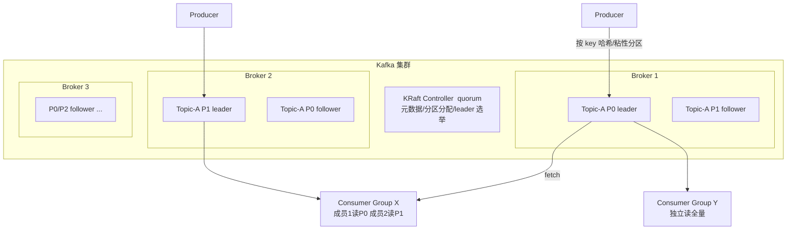

---
tags:
  - 平台组件
  - kafka
  - 消息队列
  - 事件流
  - 教学
created: 2026-11-23
---

# 📖 Kafka

> 通用学习笔记：原理线讲清 Kafka 为什么快、为什么可靠、顺序与一致性的边界；实战线覆盖部署、生产/消费代码、运维命令与调优。不涉及具体项目。

## 一、定位：事件流平台，不只是消息队列

Kafka 是**分布式的提交日志（commit log）+ 流处理平台**。与传统消息队列的本质区别：

| 维度 | 传统 MQ（RabbitMQ 等） | Kafka |
|---|---|---|
| 消息消费后 | 删除（消费即出队） | **保留**（按 retention 策略），消费只是移动 offset 指针 |
| 多消费方 | 竞争消费为主，广播要额外机制 | 天然多订阅：每个 consumer group 独立读全量数据 |
| 回溯 | 不支持 | 重置 offset 即可重放历史 |
| 吞吐取向 | 复杂路由、低延迟单条 | 顺序写 + 批量，百万级 TPS |
| 典型场景 | 任务分发、RPC 解耦 | 事件溯源、日志管道、流处理、数据集成 |

一句话心智模型：**Kafka 是"只能追加、按 offset 读取的分布式文件"，消息队列语义是它之上的一种用法**。这解释了它的一切特性——可重放、多订阅、高吞吐、但单条消息的灵活路由不如传统 MQ。

四大典型用途：异步解耦与削峰、活动跟踪/日志管道、事件溯源（状态 = 事件流的重放）、流处理（Kafka Streams/Connect 生态）。

## 二、核心概念与架构

### 2.1 概念速查

| 概念 | 语义 |
|---|---|
| Broker | 一个 Kafka 服务节点 |
| Topic | 逻辑消息类别 |
| **Partition** | topic 的物理分片，**并行与顺序的基本单位**；每 partition 是一个有序 append-only 日志 |
| Offset | 消息在 partition 内的递增序号；消费进度 = 已提交的 offset |
| Replica | partition 的副本，分 leader（读写）与 follower（同步） |
| Consumer Group | 一组消费者分摊订阅 topic 的 partition；**组内一个 partition 只分给一个成员** |

### 2.2 架构图



三个关键推论：

1. **顺序性只在 partition 内成立**：同 key 消息进同 partition 才保序；topic 全局有序 = 只有一个 partition = 放弃并行；
2. **消费并行度上限 = partition 数**：consumer group 成员多于 partition 数时多余成员空闲——扩容消费能力要先扩 partition；
3. **读写都走 leader**：follower 只做同步与故障切换（KIP-392 允许 follower 就近读，但默认关闭）。

## 三、存储原理：为什么这么快

### 3.1 日志分段与索引

每个 partition 物理上是一组 segment 文件：

```
topic-a-0/
├── 00000000000000000000.log        # 消息本体(顺序追加)
├── 00000000000000000000.index      # offset → 物理位置 稀疏索引
├── 00000000000000000000.timeindex  # 时间戳 → offset 稀疏索引
└── 00000000000000123456.log        # 写满 rollover 新段
```

- **顺序写盘**：append-only，磁盘顺序写吞吐接近内存随机写；
- **稀疏索引**：不是每条消息都建索引，定位时先二分找索引项再顺序扫少量消息——索引小到可以常驻内存；
- **page cache**：写入先进 OS 页缓存，读热数据基本不碰磁盘；Kafka 不自建缓存，把内存管理交给 OS（重启进程缓存还在）；
- **零拷贝（sendfile）**：消费读取时数据从页缓存直达网卡，跳过用户态两次拷贝——`磁盘 → 内核缓冲 → 用户缓冲 → socket` 缩短为 `页缓存 → 网卡`。

### 3.2 保留策略：delete vs compact

| 策略 | 行为 | 适用 |
|---|---|---|
| `cleanup.policy=delete`（默认） | 按时间（retention.ms）或大小（retention.bytes）删旧 segment | 日志、事件流 |
| `cleanup.policy=compact` | **每个 key 只保留最新值**，旧 value 异步清理；value=null 是墓碑（删除标记） | 状态快照类：用户资料变更、配置分发、KTable 物化 |

compact 的语义要点：清理是后台异步的，**读到旧 value 是正常现象**；它保证的是"最终每个 key 只剩最新"，不是实时去重。`__consumer_offsets` 内部 topic 就是 compact 的。

## 四、副本与一致性原理（可靠性的核心）

### 4.1 ISR 机制

**ISR（In-Sync Replicas）**= 与 leader 保持同步的副本集合（含 leader）。follower 落后超过 `replica.lag.time.max.ms` 被踢出 ISR，追上后重新加入。

- leader 挂了，**只从 ISR 里选新 leader**——保证已确认数据不丢（前提配置正确）；
- `unclean.leader.election.enable=true` 允许非 ISR 副本上位：**可用性优先，接受丢数据**。默认 false，别开。

### 4.2 HW 与 LEO

- **LEO（Log End Offset）**：每个副本下一条要写的 offset；
- **HW（High Watermark）**：ISR 中所有副本都已同步到的最小 LEO——**消费者只能读到 HW 之前的消息**。

这保证了：消费者读到的消息一定已在 ISR 全体落盘，leader 切换后不会读到"消失的消息"。

### 4.3 可靠性配置三角（必背）

数据是否丢，由三个配置联合决定：

| 配置 | 值 | 语义 |
|---|---|---|
| producer `acks` | `0` | 发完不管，可能丢 |
| | `1` | leader 落盘即确认；leader 挂了未同步的数据丢 |
| | `all`(-1) | **ISR 全体**落盘才确认 |
| broker `min.insync.replicas` | 2（RF=3 时） | ISR 不足 2 个时拒绝写入（producer 收到 NotEnoughReplicas） |
| broker `unclean.leader.election.enable` | false | 禁止落后副本上位 |

**生产可靠配置 = `acks=all` + `replication.factor=3` + `min.insync.replicas=2` + unclean 关闭**。语义：容忍 1 副本故障仍可写，2 副本故障时拒写保数据（CP 取舍）。只设 acks=all 而 min.insync=1 是常见假安全——ISR 缩到只剩 leader 时 all 退化成 1。

## 五、Producer 实战

### 5.1 关键机制与配置

| 机制 | 配置 | 要点 |
|---|---|---|
| 分区策略 | 默认：有 key 按 murmur2 哈希；无 key 粘性分区（sticky） | **保序靠 key**；同 key 永远同 partition（partition 数不变时） |
| 批量 | `linger.ms`（等待攒批）+ `batch.size` | linger.ms=0 时来一条发一条；设 5~100ms 换吞吐 |
| 压缩 | `compression.type=lz4/zstd` | 压缩在批级别做，批量越大压缩比越好；broker 端可原样存储 |
| 幂等 | `enable.idempotence=true`（新版默认开） | PID + 序列号去重，**重试不产生重复**（单分区单会话内） |
| 重试与顺序 | `retries` + `max.in.flight.requests.per.connection` | 幂等开启时 flight≤5 仍保序；幂等关闭时重试可能乱序（flight>1） |
| 事务 | `transactional.id` + initTransactions | 跨分区原子写 + 消费-处理-生产 EOS（read_committed 消费端配合） |

**Exactly-once 的边界**：Kafka 事务保证"Kafka 到 Kafka"的 EOS；落到外部系统（写 DB）要靠幂等消费或 outbox 模式，Kafka 事务管不到外部副作用。

### 5.2 Go 生产示例（segmentio/kafka-go）

```go
w := &kafka.Writer{
    Addr:         kafka.TCP("broker1:9092", "broker2:9092"),
    Topic:        "orders",
    Balancer:     &kafka.Hash{},        // 按 key 哈希分区(保序)
    RequiredAcks: kafka.RequireAll,     // acks=all
    BatchTimeout: 10 * time.Millisecond, // linger.ms
    Compression:  kafka.Lz4,
    Async:        false,                // 同步写, 拿得到错误
}
err := w.WriteMessages(ctx, kafka.Message{
    Key:   []byte(orderID),             // 同订单进同分区 → 订单内事件有序
    Value: payload,
})
```

## 六、Consumer 实战

### 6.1 消费语义三档

| 语义 | 实现 | 代价 |
|---|---|---|
| at-most-once | 先提交 offset 再处理 | 崩溃丢消息 |
| **at-least-once**（默认推荐） | **先处理成功再提交 offset** | 崩溃后重复消费 → 业务必须幂等 |
| exactly-once | Kafka 事务（Kafka→Kafka）或业务幂等兜底 | 复杂度最高 |

工程共识：**at-least-once + 幂等消费**是性价比最高的组合。幂等靠业务唯一键（订单号/事件 ID 去重表、DB upsert），不要指望 MQ 帮你去重。

### 6.2 offset 提交

- `enable.auto.commit=true`：poll 时按间隔自动提交**上一次 poll 的位置**——处理未完成就提交会丢消息，自动提交只适合可容忍丢失的场景；
- 手动提交：处理完成后 commit（同步/异步），崩溃窗口内的消息会重放；
- offset 存在内部 topic `__consumer_offsets`（compact），按 group+topic+partition 记录。

### 6.3 Rebalance：组内分区再分配

触发：成员加入/退出/崩溃、partition 数变化、订阅 topic 变化。

- **eager 协议**（旧）：rebalance 时全员先放弃所有 partition（stop-the-world），大组抖动明显；
- **cooperative 增量协议**（新版默认）：只迁移需要变动的 partition，其余继续消费；
- **静态成员**（`group.instance.id`）：滚动重启不触发 rebalance（session 超时内回归拿回原分区）——K8s 部署 StatefulSet + 静态成员是标配；
- 两个超时别混：`session.timeout.ms`（心跳判活）vs **`max.poll.interval.ms`（两次 poll 最大间隔，处理太慢会被判死踢出组**——消费逻辑重时调大它，而不是调心跳）。

### 6.4 Go 消费示例

```go
r := kafka.NewReader(kafka.ReaderConfig{
    Brokers:        []string{"broker1:9092", "broker2:9092"},
    GroupID:        "order-processor",
    Topic:          "orders",
    MinBytes:       10e3,              // fetch 攒批下限
    MaxWait:        500 * time.Millisecond,
    CommitInterval: time.Second,       // 异步提交间隔; 0 = 同步提交
})
for {
    m, err := r.FetchMessage(ctx)      // 取消息(不自动提交)
    if err != nil { break }
    if err := process(m); err != nil { // 处理失败不提交 → 重放
        continue                       // 注意: 需配合重试上限/死信, 防单条毒消息卡死
    }
    r.CommitMessages(ctx, m)           // 处理成功才提交 = at-least-once
}
```

**毒消息（poison message）**：一条永远处理失败的消息会无限重放卡住分区。生产必备：重试 N 次后写入死信 topic（DLQ）+ 告警，跳过继续。

## 七、部署实战

### 7.1 KRaft 取代 ZooKeeper

Kafka 3.3+ KRaft 生产可用，**4.0 彻底移除 ZooKeeper**。KRaft = 内置 Raft quorum 管理元数据（controller 角色），收益：少一套外部依赖、元数据操作更快、百万分区级扩展。新部署一律 KRaft；存量 ZK 集群走官方迁移流程。

### 7.2 Docker 快速体验

```bash
docker run -d --name kafka -p 9092:9092 apache/kafka:latest
# 镜像内置 KRaft 单节点配置, 开箱即用

docker exec -it kafka /opt/kafka/bin/kafka-topics.sh \
  --bootstrap-server localhost:9092 \
  --create --topic demo --partitions 3 --replication-factor 1
```

### 7.3 K8s 生产形态：Strimzi Operator

```bash
helm install strimzi oci://quay.io/strimzi-helm/strimzi-kafka-operator -n kafka --create-namespace
```

```yaml
apiVersion: kafka.strimzi.io/v1beta2
kind: Kafka
metadata: { name: my-cluster, namespace: kafka }
spec:
  kafka:
    replicas: 3
    listeners:
      - name: plain
        port: 9092
        type: internal
        tls: false
    config:
      offsets.topic.replication.factor: 3
      transaction.state.log.replication.factor: 3
      transaction.state.log.min.isr: 2
      default.replication.factor: 3
      min.insync.replicas: 2
    storage:
      type: jbod
      volumes:
        - id: 0
          type: persistent-claim
          size: 100Gi
  # KRaft 模式用 KafkaNodePool 资源声明 broker/controller 节点池
```

配套 CR：`KafkaTopic`（声明式建 topic）、`KafkaUser`（SCRAM/TLS 认证与 ACL）、`KafkaConnect`/`KafkaMirrorMaker2`。**topic 用 CR 管理而不是 CLI 手建**——配置进 Git，operator 对账（与 Flux 管 HelmRelease 同一哲学，见 [[GitOps 与 FluxCD]]）。

容量规划要点：磁盘 = 日增量 × retention × RF × 1.2（索引/段开销）；partition 总数每 broker 建议数千以内（KRaft 放宽但控制器压力仍在）；堆内存 6~8G 足够（**Kafka 吃的是 page cache，不是 JVM 堆**，内存大头留给 OS）。

## 八、运维命令速查

```bash
BS="--bootstrap-server broker1:9092"

# topic 管理
kafka-topics.sh $BS --describe --topic orders        # 分区/leader/ISR 一览
kafka-topics.sh $BS --alter --topic orders --partitions 6   # 扩分区(只能增不能减!)
kafka-configs.sh $BS --entity-type topics --entity-name orders \
  --alter --add-config retention.ms=604800000

# 消费组与 lag(排障核心)
kafka-consumer-groups.sh $BS --describe --group order-processor
# LAG 列 = HW - 已提交offset; 持续增长 = 消费能力不足
kafka-consumer-groups.sh $BS --group order-processor \
  --reset-offsets --to-earliest --topic orders --execute    # 重放(先停消费者)
kafka-consumer-groups.sh $BS --group order-processor \
  --reset-offsets --to-datetime 2026-11-23T00:00:00.000 --topic orders --execute

# 收发测试
kafka-console-producer.sh $BS --topic demo --property parse.key=true --property key.separator=:
kafka-console-consumer.sh $BS --topic demo --from-beginning --group test

# 副本健康
kafka-topics.sh $BS --describe --under-replicated-partitions   # 非空 = 有副本掉队
kafka-topics.sh $BS --describe --unavailable-partitions        # 非空 = 有分区无 leader

# kcat(原 kafkacat, 更顺手的第三方 CLI)
kcat -b broker1:9092 -t orders -C -o beginning -e
```

核心监控指标：`UnderReplicatedPartitions`（>0 告警）、`ActiveControllerCount`（全集群应=1）、**consumer lag**（业务侧最重要）、请求延迟分位数、网络/磁盘吞吐。

## 九、常见坑清单

1. **假安全配置**：acks=all 但 min.insync.replicas=1，ISR 缩水后 all 退化成 leader 单副本确认；
2. **扩分区破坏保序**：同 key 哈希结果变了，新旧消息进不同分区——保序 topic 扩分区要停写迁移或接受乱序窗口；
3. **消费者多于分区**：多出来的成员纯空闲，扩容消费先扩 partition；
4. **max.poll.interval 超时被踢**：单批处理太慢 → 判死 → rebalance → 重复消费 → 更慢，恶性循环；调大间隔或减小 max.poll.records；
5. **rebalance 风暴**：无静态成员 + 频繁滚动重启，每次全组停顿；StatefulSet + group.instance.id + cooperative 协议；
6. **自动提交丢消息**：auto.commit 提交的是"已 poll"不是"已处理"，关键业务手动提交；
7. **毒消息卡分区**：失败无限重试阻塞后续消息，必须有重试上限 + 死信 topic；
8. **全局有序幻想**：topic 级有序不存在（除非单分区），需求应建模为"按业务 key 有序"；
9. **compact 不是实时去重**：读到同 key 旧值是正常窗口，消费端按 key 取最新或容忍；
10. **删 topic 数据还在**：delete.topic.enable 与标记删除机制，磁盘释放有延迟；retention 改了同样要等段滚动；
11. **JVM 堆调太大**：挤占 page cache 反而降吞吐，堆 6~8G 封顶，内存留给 OS；
12. **跨机房直接拉伸集群**：副本同步跨 WAN 延迟会拖垮 ISR；多机房用 MirrorMaker2 做集群间复制，不是一个集群跨机房。

## 十、生态与选型边界

| 组件 | 职责 |
|---|---|
| Kafka Connect | 声明式数据集成（source/sink connector：DB CDC、S3、ES…），不写代码搬数据 |
| Kafka Streams | 库形态流处理（嵌入应用进程），KTable/KStream 语义，状态存本地 + changelog topic |
| Schema Registry | Avro/Protobuf/JSON Schema 的版本化契约治理（Confluent 系，非 Apache 本体） |
| MirrorMaker2 | 跨集群复制（容灾/多活/聚合） |

选型对照：需要复杂路由/单条低延迟/任务队列语义 → RabbitMQ；需要超高吞吐 + 重放 + 流处理 → Kafka；需要多租户/分层存储/队列+流一体 → Pulsar。Kafka 的护城河是**日志抽象带来的重放能力与生态成熟度**。

## 相关

- 上游：[[平台组件]] · [[云原生]] · [[Kubernetes]]
- 交付机制：[[GitOps 与 FluxCD]]（Strimzi CR 的声明式管理与 Flux 交付）
- 打包基础：[[Helm&Kustomize]]（operator 与集群 chart 安装）
- 观测配合：[[KPS 与 Keep]]（kafka-exporter 指标接入与告警）