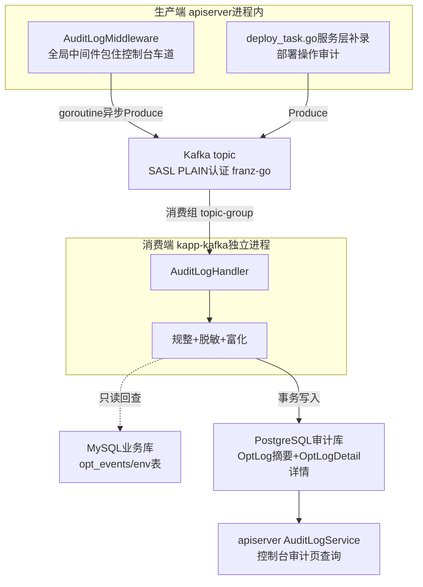
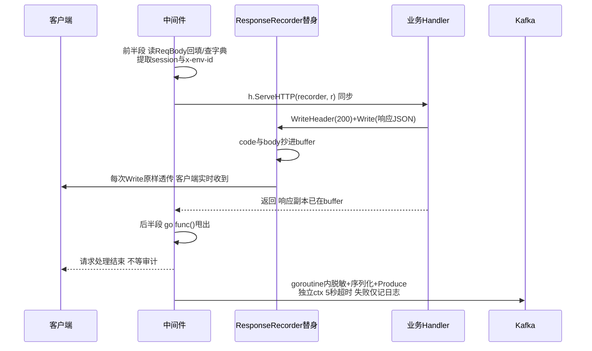
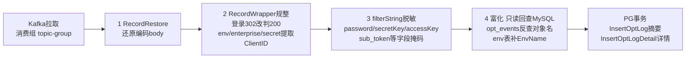

---
tags:
  - 平台组件
  - kafka
  - 审计日志
  - 异步管道
  - 实战
created: 2026-11-23
---

# 📨 Kafka 项目实战

> 本篇聚焦本项目 Kafka 的核心用途：**审计日志的异步传送带**——apiserver 产、独立 kapp-kafka 进程消费、脱敏富化后落 PostgreSQL。
> 通用原理见 [[Kafka]]；组件交付路径见 [[FluxCD项目实战]]。

## 一、定位：为什么审计要过 Kafka

审计日志记录"谁在何时对什么对象做了什么"，素材是**每个控制台 API 的完整请求/响应 body**。这带来两个矛盾：

1. 写审计是重操作（脱敏、富化、落库），但 API 主路径不能被拖慢；
2. 审计允许秒级延迟，不允许丢失或拖垮业务。

解法就是 Kafka 做异步分界：**主路径只留一次轻量投递，重活全在消费端**。

角色边界（防混淆）：

| 角色 | 是什么 | 本篇范围 |
|---|---|---|
| **平台审计管道** | 云端自用，cfg.Kafka 指向的 broker | ✅ 核心 |
| kafka-stack 组件 | 卖给客户的中间件商品（实际是 AutoMQ，Bitnami chart 32.4.3，kafka-system 命名空间，表单切单机/高可用） | 仅边界说明，走标准双制品交付 |
| 组件配置注入 | mc 模板把 log.kafka.ip_port 作为系统参数下发给需要的组件 | 一句话带过 |

worker/plog/alert/xwei/kapp-agent **均不依赖 Kafka**——部署指令走 CloudEvents+Centrifugo，监控走 KPS/SigNoz，Kafka 只管审计这一条管道。

## 二、全链路架构



技术栈：客户端 **twmb/franz-go**（[pkg/mq/kafka.go](file:///home/lisong/projects/kapp/pkg/mq/kafka.go) 封装，生产/消费共用 KafkaClient，SASL PLAIN，设了 Group 才是消费者）；配置 toml `[kafka]` server/user/password/topic，云端 kapp-server 的 configmap/secret 模板注入。

## 三、生产端：全局中间件 + 事件字典（不是每接口挂载）

### 3.1 哪些接口要审计？字典说了算

中间件只挂一次：`authMid.Then(connectapi)` 包住整条控制台车道（30+ 服务）。筛选靠 **opt_events 事件字典表**：

```go
eventId, err := auditLogServiceHandler.GetOptEventID(ctx, r.URL.Path, reqBodyBytes)
if eventId == "" {
    h.ServeHTTP(w, r)   // 字典没注册 → 直接放行不记录
    return
}
```

**给新接口加审计 = 往 opt_events 表注册一条事件，零代码改动**。这是配置驱动而非挂载点驱动。

### 3.2 响应怎么拿到：洋葱模型 + ResponseRecorder 偷录

中间件不是前置钩子，是包裹结构——`h.ServeHTTP(recorder, r)` **同步执行完业务**，返回时响应已完整产生：



tee 模式核心（[audit_log.go](file:///home/lisong/projects/kapp/internal/apps/apiserver/server/middlewares/audit_log.go)）：

```go
func (r *ResponseRecorder) Write(b []byte) (int, error) {
    r.body.Write(b)                   // 抄一份进审计buffer
    return r.ResponseWriter.Write(b)  // 原件照常给客户端
}
```

### 3.3 生产端工程细节（源码实证）

| 细节 | 机制 | 为什么 |
|---|---|---|
| **session 必须在异步前提取** | 前半段同步读 sessm.Get | Request Context 在 Handler 结束后取消，goroutine 里拿不到 |
| **body 上限 2MiB** | MaxLogBodySize，超限 buffer 替换为占位 JSON | 大响应不撑爆内存；透传给客户端的仍是完整原件 |
| **二进制响应不录** | isContentTypeLoggable 判 Content-Type | 下载接口不把文件灌进 Kafka |
| **证书私钥前置剔除** | redactCertificateKeyForAudit 在捕获时执行 | 私钥根本不进 Kafka（第一道脱敏） |
| **Flush 透传** | ResponseRecorder 实现 http.Flusher | SSE/流式响应不被憋住 |
| **审计响应头覆盖** | applyAuditHeaderOverrides | handler 可通过约定响应头补充环境上下文 |
| **雪花 ID 单例** | 中间件构造时初始化一次 | 避免每请求重建 |
| **fire-and-forget** | goroutine + 5s 独立 ctx，失败仅 slog | Kafka 挂了不影响 API；代价是进程崩溃瞬间未发出的审计会丢（可接受） |

第二生产者是 [deploy_task.go](file:///home/lisong/projects/kapp/internal/apps/apiserver/services/deploy_task.go) 服务层补录——部署操作不走 HTTP 中间件的场景，组装同款 LogRecord 直接 Produce。

## 四、消费端：独立进程的四步加工链

**kapp-kafka 是独立二进制**（[cmd/kafka](file:///home/lisong/projects/kapp/cmd/kafka) + [kafka.Dockerfile](file:///home/lisong/projects/kapp/kafka.Dockerfile)，kestra CI 专门构建流），不与 apiserver 同进程——崩了不影响 API，积压恢复后继续消费。



- **规整**（[wrapper.go](file:///home/lisong/projects/kapp/internal/apps/kafka/wrapper.go)）：登录回调的 302 重定向改判 200（否则审计里全是"失败"）；按接口路径从 body 提取 ClientID/对象信息；
- **脱敏**（[sensitive.go](file:///home/lisong/projects/kapp/internal/apps/kafka/sensitive.go)）：字段名清单掩码——password/secretKey/accessKey/sub_token/postgres_password/zkUrl/jvmOptions 等，ReqBody 与 RespBody 都过。**Kafka 里存的已是半脱敏数据**（私钥前置剔除 + 消费端掩码 = 两道防线）；
- **富化**：EventId 反查 opt_events 拿对象名、EnvId 查 env 表补环境名；
- **落库**：PG 事务写两表（摘要 + 详情），[audit_log.go](file:///home/lisong/projects/kapp/internal/apps/kafka/audit_log.go) AuditLogHandler。

**已知静默失败点**（源码注释明示）：EventId 在 opt_events 缺失时仅 Warn 继续落库——审计记录对象名为空，列表页无法反查对象，不阻断管道但损失可读性。

## 五、存储与查询：读写分离

| 库 | 角色 | 操作 |
|---|---|---|
| MySQL 业务库 | 只被消费端**回查**富化 | 零审计写入 |
| PostgreSQL 审计库 | append-only 流水 | OptLog 摘要 + OptLogDetail 详情 |

查询链**不经过 Kafka**：控制台审计页 → AuditLogServiceHandler（走控制台车道 session+SpiceDB 鉴权）→ [AuditLogService](file:///home/lisong/projects/kapp/internal/apps/apiserver/services/auditlog/auditlog.go) 读 PG。所以 Kafka 故障只影响"新审计入库"，历史查询照常。

审计存 PG 不存 MySQL 的理由：大量 append-only 写入与业务热数据分离，互不拖累。

## 六、实战速查

```bash
# 配置定位
grep -A5 "\[kafka\]" apiserver.toml        # server/user/password/topic
# 云端部署注入: deploy/k8s/kapp-server/configmap.tpl.yaml + secret.tpl.yaml

# 新接口接入审计: 往opt_events表注册事件(路径→事件名), 无需改代码
# 验证是否生效: 调一次接口, 看kapp-kafka日志与PG OptLog表

# 消费积压排查(Kafka侧)
kafka-consumer-groups.sh --bootstrap-server <broker> \
  --describe --group <topic>-group         # LAG列=积压量
# 消费端排查: kapp-kafka Pod日志
#   "audit log event id missing" → 字典缺注册(静默失败点)
#   "produce audit log failed"   → 生产端投递失败(在apiserver日志)

# 脱敏验证: PG里查一条含密码字段的记录, 确认已掩码
# 大body验证: 超2MiB的请求, req_body应为content exceeds limit占位
```

排障顺序：审计页没记录 → ①opt_events 字典注册了吗（eventId 为空直接放行）→ ②apiserver 日志 produce 失败吗 → ③消费组 LAG 积压吗 → ④kapp-kafka 日志加工报错吗 → ⑤PG 落库了吗。

## 七、踩坑清单

1. **审计不是每接口挂中间件**：全局一个，靠 opt_events 字典筛选；新接口没审计先查字典，不是查代码；
2. **Produce 在 goroutine 里**：主路径连 Produce 都不等；进程崩溃瞬间未发出的审计会丢——fire-and-forget 的代价，审计场景可接受；
3. **session 提取必须同步在前**：ctx 在 Handler 结束后取消，异步里读 session 是经典坑；
4. **302 不是失败**：登录回调重定向被消费端改判 200，直接看原始状态码会误判；
5. **两道脱敏位置不同**：私钥在捕获时剔除（不进 Kafka），密码类在消费端掩码（Kafka 里是半脱敏）——排查泄露面时分清；
6. **对象名为空是静默失败**：opt_events 缺 EventId 只 Warn，审计列表反查不到对象——补字典注册，历史记录的名称不会自动回填；
7. **审计在 PG 不在 MySQL**：查审计连错库是最常见的排障乌龙；
8. **查询不走 Kafka**：Kafka 挂了历史审计照常可查，别把查询故障归因到 Kafka；
9. **消费组名是 `<topic>-group`**：多副本 kapp-kafka 同组分摊分区；改 topic 名等于换消费组，offset 从头开始；
10. **kafka-stack 组件与平台 Kafka 是两回事**：客户集群装的 AutoMQ 服务客户业务，平台审计用云端配置的 broker；
11. **二进制/超大 body 是占位符**：resp_body 为 "binary or non-text data" 不是丢数据，是刻意不录；
12. **franz-go 不是 sarama**：搜依赖/文档认准 twmb/franz-go，KafkaClient 生产消费共用，Group 非空才是消费者。

## 八、文件索引

| 内容 | 位置 |
|---|---|
| 客户端封装 | [pkg/mq/kafka.go](file:///home/lisong/projects/kapp/pkg/mq/kafka.go)（franz-go/SASL） |
| 生产中间件 | [middlewares/audit_log.go](file:///home/lisong/projects/kapp/internal/apps/apiserver/server/middlewares/audit_log.go)（字典筛选/ResponseRecorder/goroutine） |
| 服务层补录 | [services/deploy_task.go](file:///home/lisong/projects/kapp/internal/apps/apiserver/services/deploy_task.go) L870 |
| 消费进程 | [internal/apps/kafka/](file:///home/lisong/projects/kapp/internal/apps/kafka/main.go)（main/audit_log/wrapper/sensitive）、cmd/kafka |
| 消费镜像 | [kafka.Dockerfile](file:///home/lisong/projects/kapp/kafka.Dockerfile)、deploy/kestra/docker-build-kapp-kafka.yaml |
| 查询服务 | [services/auditlog/auditlog.go](file:///home/lisong/projects/kapp/internal/apps/apiserver/services/auditlog/auditlog.go)（PG） |
| 云端配置注入 | deploy/k8s/kapp-server/configmap.tpl.yaml、secret.tpl.yaml |
| 商品组件 | [packages/kafka-stack/](file:///home/lisong/projects/packages/kafka-stack/kapp.yaml)（AutoMQ） |
| 组件配置注入 | internal/mc/zk_config_tpl.go（log.kafka.ip_port） |

## 相关

- [[平台组件]]（MOC）
- [[Kafka]]（通用原理：分区/消费组/offset）
- [[FluxCD项目实战]]——kafka-stack 商品组件的交付路径