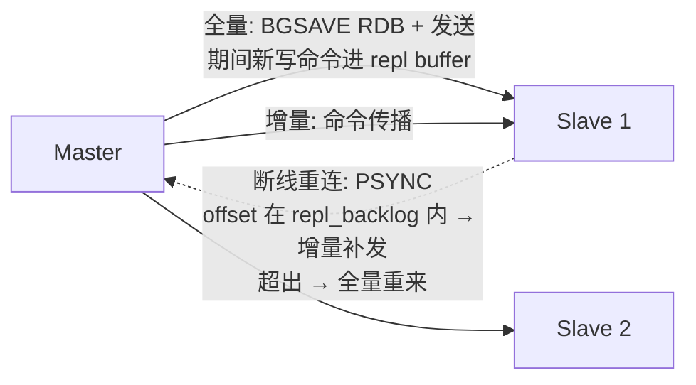

---
tags:
  - 平台组件
  - redis
  - 缓存
  - 数据结构
  - 教学
created: 2026-11-23
---

# 📖 Redis

> 通用学习笔记：原理线讲清 Redis 为什么快、数据结构底层编码、过期/持久化/复制的机制边界；实战线覆盖典型场景代码、高可用部署与运维排障。不涉及具体项目。

## 一、定位与线程模型

Redis 是**内存数据结构存储**，三种用法：缓存（主业）、轻量数据库（持久化 + 丰富结构）、消息设施（list/stream/pubsub）。与 Kafka 的边界：Redis 的 stream 能做轻量消息队列，但重放能力、吞吐、生态远不及专业事件流平台（见 [[Kafka]]）——**别拿 Redis 当核心消息总线**。

### 为什么快（四个原因，按重要性）

1. **纯内存操作**——数量级优势的根本来源；
2. **高效数据结构**——SDS、跳表、压缩列表等按场景定制（§二）；
3. **单线程执行命令**——无锁、无上下文切换、无竞态；"单线程"指**命令执行**环节；
4. **IO 多路复用**（epoll）——单线程处理海量连接。

版本演进：6.0 引入 **IO 线程**（网络读写/协议解析并行，命令执行仍单线程）；后台任务（RDB fork、AOF 刷盘、大 key 异步删除 UNLINK）一直是独立线程/进程。推论：**一条慢命令阻塞所有客户端**——这是后面一切运维纪律（禁 KEYS、拆 bigkey）的根源。

## 二、数据结构：类型、底层编码与场景

### 2.1 五大基础类型 + 底层编码

| 类型 | 底层编码（小→大自动转换） | 典型场景 |
|---|---|---|
| String | int / embstr(≤44B) / raw(SDS) | 缓存对象 JSON、计数器 INCR、分布式锁 SET NX、位图 BITMAP |
| List | quicklist（listpack 节点的双向链表） | 消息队列 LPUSH/BRPOP、最新列表 |
| Hash | listpack → hashtable | 对象字段级读写（购物车：user → {sku: count}） |
| Set | intset / listpack → hashtable | 去重、交并差（共同关注 SINTER） |
| ZSet | listpack → **skiplist + dict** | 排行榜、延迟队列（score=执行时间）、滑动窗口限流 |

要点：

- **编码转换是单向的**：元素数/值大小超过阈值（`hash-max-listpack-entries` 等）转大编码，缩回去不会降级——小对象用 listpack 省内存是设计意图；
- **ZSet = 跳表（范围查询 O(logN)）+ 哈希表（单元素 O(1)）**，双结构空间换时间；跳表相比红黑树实现简单、范围操作友好；
- SDS 相比 C 字符串：O(1) 长度、二进制安全、预分配防溢出。

### 2.2 三个扩展结构

| 结构 | 原理 | 场景 |
|---|---|---|
| Bitmap | String 按位操作 | 签到/活跃标记（1 亿用户 12MB） |
| HyperLogLog | 概率基数估计（误差 ~0.81%） | UV 统计（固定 12KB，不存明细） |
| Stream | 持久化消息日志 + 消费组（XADD/XREADGROUP/XACK） | 轻量 MQ，语义向 Kafka 看齐但能力有限 |

### 2.3 高频命令实战

```bash
SET session:abc '{"uid":1}' EX 3600 NX     # 原子: 不存在才写 + 过期(锁/幂等的基础)
INCRBY quota:user1 5                       # 原子计数
HSET cart:user1 sku-9 2                    # 字段级更新, 不用读改写整个对象
ZADD rank 100 alice 200 bob
ZREVRANGE rank 0 9 WITHSCORES              # Top10
ZREMRANGEBYSCORE delay 0 <now-ts>          # 延迟队列: 取出到期任务
EXPIRE key 60                              # 补过期(TTL 是 key 级不是 field 级! 7.4 前 hash 字段不能单独过期)
```

## 三、过期与淘汰原理

### 3.1 过期删除：惰性 + 定期

- **惰性删除**：访问 key 时检查过期，过期则删——CPU 友好但内存不友好（冷 key 永不访问就永不删）；
- **定期删除**：后台每 100ms 抽样检查带过期时间的 key，过期比例高则继续抽——两者互补，仍可能有漏网；
- 兜底靠**内存淘汰**。

### 3.2 八种淘汰策略（maxmemory-policy）

| 策略 | 范围 | 算法 |
|---|---|---|
| noeviction（默认） | — | 不淘汰，写报错（读正常） |
| allkeys-lru / volatile-lru | 全部 / 仅带 TTL | 近似 LRU（采样淘汰最久未访问） |
| allkeys-lfu / volatile-lfu | 全部 / 仅带 TTL | 近似 LFU（访问频率，4.0+） |
| allkeys-random / volatile-random | 全部 / 仅带 TTL | 随机 |
| volatile-ttl | 仅带 TTL | 剩余 TTL 最短优先 |

**纯缓存场景选 allkeys-lru/lfu**（热点数据留得住）；缓存+存储混用选 volatile-*（只淘汰声明了 TTL 的）。注意 LRU/LFU 都是**采样近似**（默认采 5 个），不是全局精确——省内存的代价。

### 3.3 缓存三大经典问题

| 问题 | 定义 | 对策 |
|---|---|---|
| **穿透** | 查**不存在**的数据，缓存和 DB 都没有，请求直达 DB | 缓存空值（短 TTL）/ 布隆过滤器前置 |
| **击穿** | **单个热点 key** 过期瞬间，并发全打 DB | 互斥重建（SET NX 抢锁）/ 热点逻辑过期不真删 |
| **雪崩** | **大批 key 同时过期**或 Redis 宕机 | TTL 加随机抖动 / 高可用架构 / 限流降级 |

记忆锚点：穿透=数据本不存在，击穿=一个热点失效，雪崩=一片失效。

## 四、持久化原理

### 4.1 RDB：快照

`BGSAVE` **fork 子进程**写全量二进制快照，主进程靠 **COW（写时复制）**继续服务：fork 后父子共享内存页，主进程写哪页才复制哪页。

- 优点：文件紧凑、恢复快、适合备份/主从全量同步；
- 缺点：**两次快照之间的数据会丢**；fork 瞬间阻塞（内存越大页表越大，几十 GB 实例 fork 可达秒级）；写密集时 COW 内存翻倍风险。

### 4.2 AOF：命令日志

先执行命令再写日志（与 WAL 相反），刷盘策略 `appendfsync`：

| 策略 | 语义 | 丢失窗口 |
|---|---|---|
| always | 每条 fsync | 不丢（最慢） |
| **everysec**（默认） | 每秒 fsync | 最多 1 秒 |
| no | 交给 OS | 不可控 |

**AOF 重写**：日志膨胀后 fork 子进程按当前内存状态生成最小命令集（100 次 INCR → 1 次 SET），期间增量写缓冲。

### 4.3 混合持久化与恢复

4.0+ `aof-use-rdb-preamble yes`：AOF 重写时前半段 RDB 格式 + 后半段增量命令——**恢复速度接近 RDB，丢失窗口接近 AOF**。重启恢复优先加载 AOF（更全）。

决策：纯缓存可全关（重启回源）；有状态用法开混合持久化 + everysec；**把 Redis 当唯一数据库用之前，先接受"最多丢 1 秒 + 主从切换可能丢更多"的事实**。

## 五、原子性、事务与分布式锁

### 5.1 事务与 Lua 的边界

- `MULTI/EXEC`：命令入队后一次性顺序执行，**隔离靠单线程，但没有回滚**——入队语法错全不执行；执行期错误（如对 string 做 LPUSH）只有那条失败，其余照常。不是关系型事务；
- `WATCH` + MULTI：乐观锁，被 watch 的 key 变了则 EXEC 返回 nil；
- **Lua 脚本**：整段原子执行（单线程红利），是"读-判断-写"复合逻辑的标准做法。注意脚本里别写死循环（`lua-time-limit` 后只能 SCRIPT KILL 只读脚本）。

### 5.2 分布式锁实战

```bash
# 加锁: 原子 NX+PX, value 必须是唯一标识(防误删别人的锁)
SET lock:order-42 <uuid> NX PX 30000
```

```lua
-- 解锁: 判断+删除必须原子, 否则误删他人锁
if redis.call("GET", KEYS[1]) == ARGV[1] then
    return redis.call("DEL", KEYS[1])
else
    return 0
end
```

三个必须想清楚的问题：

1. **锁过期但业务没做完** → 需要续期（watchdog 定时 PEXPIRE）或把 TTL 设成业务上界 + 幂等兜底；
2. **主从切换丢锁**：锁写到 master 还没同步就故障切换，新 master 没有锁 → 两个客户端同时持锁。**Redlock**（多数独立节点加锁）是官方答案但有争议（依赖时钟假设）；工程共识：**Redis 锁做"效率优化"（防重复劳动）可以，做"正确性保证"（绝不能双写）要配 fencing token 或换 etcd/ZooKeeper**；
3. 可重入/公平锁等高级语义自己实现成本高，直接用成熟库（Redisson 等）。

## 六、高可用架构原理

### 6.1 主从复制



- 复制是**异步**的——主从有延迟，故障切换可能丢已确认写入（与 Kafka ISR 的同步语义不同，见 [[Kafka]] §四）；
- `repl-backlog-size` 决定断线多久内能增量续传，网络抖动频繁的环境调大；
- 从节点默认只读；**读写分离要容忍读到旧数据**（会话一致性场景别读从）。

### 6.2 Sentinel：自动故障转移

Sentinel 集群（≥3 奇数节点）监控主从：主观下线（单个 sentinel 判）→ 客观下线（quorum 个同意）→ sentinel 间 Raft 式选领导 → 挑最优 slave 提升 → 通知客户端新 master。

- 客户端连的是 **sentinel 拿 master 地址**（不是直连），切换后自动更新；
- `min-replicas-to-write`/`max-lag`：master 健康副本不足时拒写，缩小丢数据窗口（CP 取舍，同 Kafka min.insync 思想）；
- 脑裂防护：旧 master 恢复后降为 slave，期间写入丢失——客户端侧靠上述拒写配置兜底。

### 6.3 Cluster：分片

- **16384 个哈希槽**，key 按 CRC16(key) mod 16384 定位；每个 master 负责一段槽，带自己的 slave；
- 节点间 **gossip** 交换状态；客户端可直连任意节点，错了收 `MOVED`（槽已迁走，更新路由）/`ASK`（迁移中，临时跳转）；
- **多 key 操作（MSET/事务/Lua）要求同槽** → hash tag：`user:{1000}.profile` 与 `user:{1000}.cart` 只对 `{1000}` 哈希，强制同槽；
- 扩缩容 = 槽迁移，在线进行；smart 客户端（go-redis/jedis）本地缓存槽表。

### 6.4 选型

| 形态 | 适用 | 不适用 |
|---|---|---|
| 单机 + 持久化 | 开发/小业务缓存 | 有可用性要求 |
| 主从 + Sentinel | 中小规模 HA，数据量单机装得下 | 写吞吐/容量超单机 |
| Cluster | 大容量/高吞吐水平扩展 | 多 key 事务密集、运维复杂度敏感 |

## 七、实战

### 7.1 快速上手与 K8s 部署

```bash
docker run -d -p 6379:6379 redis:7 redis-server --appendonly yes --maxmemory 512mb --maxmemory-policy allkeys-lru
redis-cli ping
```

K8s 生产：bitnami redis chart（standalone/replication 两架构，sentinel 可选）或 redis-operator；Cluster 形态用 bitnami redis-cluster chart。**StatefulSet + PVC（AOF/RDB 落盘）+ PDB + 反亲和**是标配；资源给足内存并预留 COW/fork 余量（limit 别贴着 maxmemory 设）。

### 7.2 Go 实战（go-redis）：Cache-Aside + pipeline + 锁

```go
rdb := redis.NewClient(&redis.Options{Addr: "redis:6379"})

// Cache-Aside 读: 缓存 miss 回源并回填(TTL 加抖动防雪崩)
func GetUser(ctx context.Context, id string) (*User, error) {
    val, err := rdb.Get(ctx, "user:"+id).Result()
    if err == nil { var u User; json.Unmarshal([]byte(val), &u); return &u, nil }
    if err != redis.Nil { return nil, err }          // 真错误, 不是 miss
    u, err := db.QueryUser(id)                        // 回源
    if err != nil { return nil, err }
    ttl := 30*time.Minute + time.Duration(rand.Intn(300))*time.Second
    rdb.Set(ctx, "user:"+id, marshal(u), ttl)
    return u, nil
}

// Pipeline: 批量命令一次往返(非原子, 要原子用 TxPipeline/Lua)
pipe := rdb.Pipeline()
for _, k := range keys { pipe.Get(ctx, k) }
cmds, _ := pipe.Exec(ctx)

// 分布式锁(简化版, 生产用带续期的成熟库)
ok, _ := rdb.SetNX(ctx, "lock:job", uuid, 30*time.Second).Result()
if ok { defer rdb.Eval(ctx, unlockLua, []string{"lock:job"}, uuid) }
```

**Cache-Aside 的写侧纪律**：更新 DB 后**删除**缓存（不是更新缓存）——删除让下次读回源，避免并发写下的旧值覆盖；"延迟双删"缓解主从延迟窗口但不完美，强一致需求走 binlog 订阅失效（Canal 等）或干脆不缓存。

### 7.3 运维命令速查

```bash
redis-cli INFO memory            # used_memory / mem_fragmentation_ratio(>1.5 关注)
redis-cli INFO stats             # keyspace_hits/misses → 命中率
redis-cli INFO replication       # 主从 offset 差 = 复制延迟
redis-cli --bigkeys              # 扫描大 key(按类型 Top1, SCAN 实现不阻塞)
redis-cli --hotkeys              # 热 key(需 maxmemory-policy 为 lfu)
redis-cli --latency              # 延迟基线
redis-cli SLOWLOG GET 10         # 慢命令(默认 >10ms 记录)
redis-cli SCAN 0 MATCH 'user:*' COUNT 100   # 遍历用 SCAN, 永远别用 KEYS
redis-cli UNLINK bigkey          # 异步删除(DEL 大 key 会阻塞主线程)
redis-cli CLIENT LIST            # 连接明细(查连接泄漏)
redis-cli MEMORY USAGE key       # 单 key 内存
```

核心监控：命中率、used_memory 与碎片率、connected_clients、rejected_connections、主从 offset 差、慢日志数量。

## 八、常见坑清单

1. **KEYS \* 阻塞全服**：O(N) 遍历在单线程里跑，百万 key 卡秒级；一律 SCAN（游标分批，弱一致但不断服务）；
2. **DEL 大 key 同样阻塞**：百万元素的 hash/zset 删除是 O(N)，用 UNLINK 异步释放；
3. **bigkey 的连锁伤害**：单 key 几十 MB → 网络打满、删除阻塞、集群槽迁移超时、主从同步抖动；设计期就拆（hash 分桶）；
4. **热 key 打爆单分片**：集群也救不了单 key 热点（只在一个槽）；本地缓存（进程内 L1）+ 热 key 探测是正解；
5. **TTL 集中过期 = 自制雪崩**：批量回填统一 TTL，到期瞬间全 miss；TTL 加随机抖动；
6. **缓存与 DB 双写不一致**：先更缓存后更 DB、或并发读写交错都会留旧值；Cache-Aside + 删除 + 短 TTL 是基线，强一致别用缓存；
7. **主从延迟读到旧值**：写 master 后立刻读 slave 可能 miss/旧数据；会话内读己之写走 master；
8. **分布式锁当正确性保证**：异步复制下故障切换必丢锁窗口；正确性场景加 fencing token 或换 CP 系统（§5.2）；
9. **集群多 key 跨槽报错**：MSET/Lua/事务的 key 不同槽直接 CROSSSLOT；hash tag 规划要在建模期做，事后改 key 等于迁数据；
10. **maxmemory 贴着容器 limit**：fork COW、客户端缓冲、碎片都在 maxmemory 统计之外，容器 OOMKill；limit 留 25%+ 余量；
11. **无持久化却当存储用**：重启全丢还以为是 bug；缓存定位就接受丢，存储定位开混合持久化；
12. **pubsub 当可靠消息**：fire-and-forget，离线订阅者丢消息、无 ACK 无重放；可靠消息用 Stream（仍有限）或专业 MQ（见 [[Kafka]]）。

## 九、生态与选型边界

| 方案 | 定位 |
|---|---|
| **Valkey** | Redis 7.2 后许可证变更（RSALv2/SSPL）引发的 Linux Foundation 分叉，协议兼容，云厂商普遍转向；技术栈与 Redis 同源 |
| KeyDB / Dragonfly | 多线程实现的兼容替代，单机吞吐取向 |
| Memcached | 纯缓存、多线程、无持久化无复杂结构；只要简单 KV 缓存时更轻 |
| etcd / ZooKeeper | CP 系统：分布式锁/选主的正确性保证场景（Redis 是 AP 取向） |

选型一句话：**缓存与内存数据结构 → Redis/Valkey；正确性敏感的协调 → etcd；事件流与重放 → Kafka**。

## 相关

- 上游：[[平台组件]] · [[云原生]] · [[Kubernetes]]
- 消息边界：[[Kafka]]（Stream/pubsub 与专业事件流的分工、复制一致性语义对照）
- 交付机制：[[GitOps 与 FluxCD]] · [[Helm&Kustomize]]（bitnami chart / operator 部署）
- 观测配合：[[KPS 与 Keep]]（redis-exporter 指标与告警）