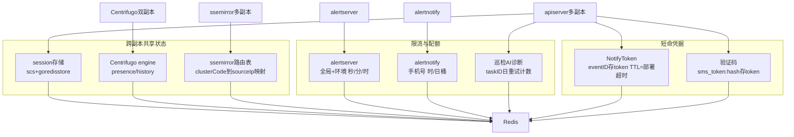
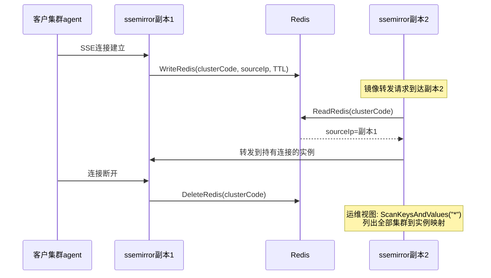
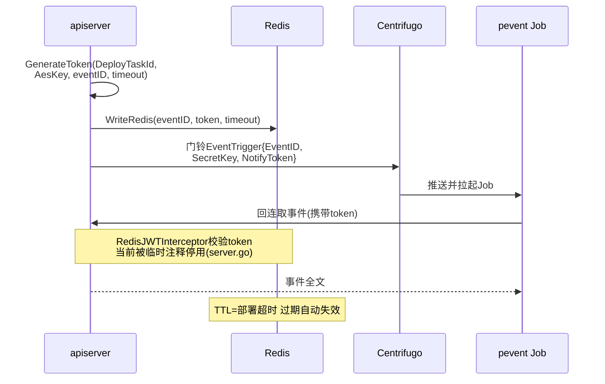

---
tags:
  - 平台组件
  - redis
  - 共享状态
  - 限流
  - 实战
created: 2026-11-23
---

# 🗃️ Redis 项目实战

> 本篇讲 Redis 作为**云端平台共享状态基础设施**的 9 个使用点。通用原理见 [[Redis]]；门铃触发链见 [[Centrifugo项目实战]]，部署事件机制见 [[Kafka项目实战]] 同级的 CloudEvents 体系。
> 客户集群里卖的 redis 商品组件是另一回事，见第六节边界说明。

## 一、定位：三类用法，全部带 TTL

本项目 Redis 用法高度收敛，**没有分布式锁、没有 DB 查询缓存、没有消息队列**（队列职责在 Kafka/Temporal）——只管"小而快、会过期、要共享"的状态：

| 模式 | 使用点 | 共同特征 |
|---|---|---|
| **跨副本共享状态** | 登录 session / Centrifugo engine / ssemirror 路由表 | 多副本部署的粘合剂 |
| **限流与配额计数** | alertserver 三级限流 / alertnotify 短信桶 / 巡检 AI 日重试 | Incr+Expire 或 limiter 库 |
| **短命凭据** | 部署一次性 NotifyToken / 短信邮件验证码 | TTL 即安全策略 |

技术栈：**go-redis/v9 v9.14.0**，[pkg/db/redis.go](file:///home/lisong/projects/kapp/pkg/db/redis.go) 统一封装（RedisOption toml 配置），apiserver 侧再包一层 [RedisManager](file:///home/lisong/projects/kapp/internal/apps/apiserver/services/redis/redis.go)（Write/Read/Scan/Delete/Check）；测试用 miniredis 内嵌模拟。

## 二、全景图



## 三、跨副本共享状态：多副本部署的前提

### 3.1 登录 session（[oauth/session.go](file:///home/lisong/projects/kapp/internal/apps/apiserver/services/oauth/session.go)）

`sesm.Store = goredisstore.New(redisClient)`——scs 会话框架的 Redis 后端。**apiserver 能多副本部署的前提**：session 不在进程内存，任何副本都能验证登录态。ConnectRPC 控制台车道的 session 鉴权中间件，读的就是这里。

### 3.2 Centrifugo Redis engine

生产配置 [huawei.yaml](file:///home/lisong/projects/packages/centrifugo/huawei.yaml) `engine: redis`——presence（谁在线）与 history（消息回放）跨 Pod 共享，支撑双副本；dev.yaml 是 `engine: memory`（chart 注释明示：内存 engine 只能单 Pod）。**Redis 在这里不是缓存，是 Centrifugo 的分布式状态后端**。

### 3.3 ssemirror 路由表（[mirror.go](file:///home/lisong/projects/kapp/internal/apps/ssemirror/handlers/mirror.go)）

多副本 ssemirror 要回答"这个集群的 SSE 连接挂在哪个实例上"：



TTL 兜底：实例崩溃没来得及 Delete，key 也会过期，不会留下永久死路由。

## 四、短命凭据：TTL 即安全策略

### 4.1 部署门铃一次性 NotifyToken（[deploy.go](file:///home/lisong/projects/kapp/internal/apps/apiserver/services/deploy.go) L214-228）



三个要点：

- **key 是 eventID**：token 与事件一一绑定，TTL 与部署超时对齐——部署窗口外 token 自动作废；
- **Redis 是一次性凭据的保险箱**：与 CloudEvent 的"信封明文载荷加密"配套，token 是回连取件的身份凭据；
- **现状注意**：校验侧 `RedisJWTInterceptor` 在 server.go 被临时注释（"优化拦截后再发布，不更新 token 镜像前都不会有问题"）——**token 照发照存，校验闸门暂时开着**，agent 车道目前靠 SSEServerKey JWT 鉴权兜底。

### 4.2 短信/邮件验证码（[utils/sms/serve.go](file:///home/lisong/projects/kapp/internal/utils/sms/serve.go)、email 同构）

key = `sms_token:` + 哈希前 8 字节 hex——**不拿手机号明文当 key**（防枚举/泄露面），验证码 token 短 TTL 存 Redis，校验时比对。

## 五、限流与配额：三个计数器，三种写法

| 场景 | 库/写法 | 桶维度 | 降级/防御 |
|---|---|---|---|
| alertserver 告警限流 | ulule/limiter + redisstore | 全局+按环境，各秒/分/时三级 | **没配 Redis 降级 memstore**（单副本限流） |
| alertnotify 短信限流 | limiter redisstore | 同一手机号，时/日两级 | 固定北京时间分桶 |
| 巡检 AI 诊断日重试 | 裸 Incr+Expire | taskID+日期 | **Expire 失败 Del 回滚** |

### 5.1 alertserver（[rate_limit.go](file:///home/lisong/projects/kapp/internal/apps/alertserver/services/alert/rate_limit.go)）

前缀 `alert_rate_limit:`，GlobalLimiter + EnvLimiter（带 LastSeen 清理闲置环境桶）——防告警风暴打爆通知渠道。降级 memstore 的代价：**多副本各限各的**，全局阈值实际放大 N 倍。

### 5.2 alertnotify（[smsRateLimit.go](file:///home/lisong/projects/kapp/internal/apps/alertnotify/notify/smsRateLimit.go)）

前缀 `alertnotify:sms:rate:`，超限时区分 hourly_limit/daily_limit 原因码。源码注释明示："**每日限流按北京时间自然日分桶；固定东八区避免运行环境缺少 tzdata**"——容器镜像没有时区库这个坑被显式防了（time.LoadLocation 失败会静默退回 UTC，日桶边界就错了）。

### 5.3 巡检日重试（[inspection.go](file:///home/lisong/projects/kapp/internal/apps/apiserver/services/inspection.go)）

```go
count, err := s.redis.Incr(ctx, key)
if count == 1 {
    if err := s.redis.Expire(ctx, key, durationUntilNextLocalDay(now)); err != nil {
        _, _ = s.redis.Del(ctx, key)   // 回滚！
        return count, false, err
    }
}
return count, count <= aiDiagnosisDailyRetryLimit, nil
```

**Expire 失败必须 Del 回滚**——否则留下永不过期的 key，把该任务当天的重试配额永久锁死。这是 Redis 计数器的标准防御写法，值得抄。

## 六、边界：商品 redis 与"假命中"

- [packages/redis](file:///home/lisong/projects/packages/redis/kapp.yaml)：Bitnami chart 20.0.1，标准双制品交付给**客户集群**的商品，与平台自用 Redis 无关；
- `deployplan/transformer/processer/redis.go`、mc/zk_config_tpl.go、compconfig：redis **商品的配置渲染**（部署计划转换、地址注入）；
- **假命中警示**：[proxyk8s/server.go](file:///home/lisong/projects/kapp/pkg/proxyk8s/server.go) 里的 "redis" 是查客户集群 `redis-system` 命名空间的 Pod——平台通过隧道**代理客户的 redis 组件运维**，不是平台在用 Redis；
- **不用 Redis 的仓库**：kapp-agent（集群侧不碰平台 Redis）、xwei（自身代码无，node_modules 只有 OTel 埋点包）、migrate（memory_queue 注释"后面可以对接 redis"，目前纯内存）。

## 七、实战速查

```bash
# key前缀地图(排障按图索骥)
# scs session键        → 登录态问题
# <eventID>            → 部署token(TTL=部署超时)
# <clusterCode>        → ssemirror路由(值=sourceIp)
# alert_rate_limit:*   → 告警限流计数
# alertnotify:sms:rate:* → 短信时/日桶
# sms_token:<hash8>    → 验证码
# AI诊断日重试key(taskID+日期) → 巡检配额

# 常用排查
redis-cli -a <password> TTL <eventID>          # 部署token还剩多久
redis-cli -a <password> GET <clusterCode>      # 集群SSE挂在哪个ssemirror实例
redis-cli -a <password> --scan --pattern "alertnotify:sms:rate:*"  # 短信桶
redis-cli -a <password> INFO keyspace          # 各db key量
# 连接配置: 各服务toml [redis] address/password, envPrefix REDIS_
# Centrifugo engine: packages/centrifugo/huawei.yaml(生产redis) vs dev.yaml(memory)
```

排障思路：登录态跨副本丢失 → 查 session Redis 连通性；presence 不准/双副本消息丢 → 查 Centrifugo engine 是否误配 memory；镜像转发找不到集群 → 查路由表 key 是否过期/被误删；限流不生效 → 查是否降级了 memstore。

## 八、踩坑清单

1. **Centrifugo 内存 engine 只能单 Pod**：扩副本前必须切 redis engine，否则 presence/history 各副本各一份；
2. **NotifyToken 校验拦截器当前停用**：server.go 临时注释，排障时别假设 token 校验在生效；恢复上线前需同步更新 agent 镜像；
3. **限流降级 memstore 是静默的**：没配 Redis 不报错，多副本下全局阈值放大 N 倍——告警风暴限不住先查这里；
4. **日桶时区坑**：容器缺 tzdata 时 LoadLocation 静默退回 UTC，北京时间日桶边界错 8 小时——alertnotify 已固定东八区，自己写计数器要照抄；
5. **Incr 后 Expire 失败要 Del 回滚**：否则 key 永不过期，配额永久锁死；
6. **ssemirror 路由靠 TTL 兜底**：实例崩溃不会留死路由，但 TTL 窗口内转发会失败——重连后路由重建；
7. **验证码 key 是哈希不是手机号**：redis-cli 按手机号查不到 key 是正常的；
8. **proxyk8s 里的 redis 是假命中**：那是客户集群的 redis 商品 Pod，别当成平台依赖；
9. **session 在 Redis 不在内存**：重启 apiserver 不掉登录态；反过来 Redis 清了全员掉线；
10. **wf 的 RedisManager 已注入未见调用**：tofu workflow 预留位，别以为工作流状态在 Redis 里（Temporal 自己管状态）；
11. **go-redis v9 的 ctx 语义**：所有命令带 ctx，超时由调用方控制——RedisManager 封装里没有默认超时，慢查询会拖住请求；
12. **平台 Redis 与客户 redis 商品两套**：配置、凭据、命名空间完全独立，排障先分清是哪套。

## 九、文件索引

| 内容 | 位置 |
|---|---|
| 连接封装 | [pkg/db/redis.go](file:///home/lisong/projects/kapp/pkg/db/redis.go)、apiserver/services/redis/redis.go（RedisManager） |
| session | [services/oauth/session.go](file:///home/lisong/projects/kapp/internal/apps/apiserver/services/oauth/session.go)（scs+goredisstore） |
| 部署 token | [services/deploy.go](file:///home/lisong/projects/kapp/internal/apps/apiserver/services/deploy.go) L214-228、server.go（停用的拦截器） |
| ssemirror 路由 | [ssemirror/handlers/mirror.go](file:///home/lisong/projects/kapp/internal/apps/ssemirror/handlers/mirror.go) L296-357 |
| 告警限流 | [alertserver/services/alert/rate_limit.go](file:///home/lisong/projects/kapp/internal/apps/alertserver/services/alert/rate_limit.go) |
| 短信限流 | [alertnotify/notify/smsRateLimit.go](file:///home/lisong/projects/kapp/internal/apps/alertnotify/notify/smsRateLimit.go) |
| 验证码 | internal/utils/sms/serve.go、internal/utils/email/serve.go |
| 巡检计数 | [services/inspection.go](file:///home/lisong/projects/kapp/internal/apps/apiserver/services/inspection.go)（reserveAIDiagnosisDailyRetry） |
| Centrifugo engine | [packages/centrifugo/huawei.yaml](file:///home/lisong/projects/packages/centrifugo/huawei.yaml)、dev.yaml |
| 商品组件 | [packages/redis/](file:///home/lisong/projects/packages/redis/kapp.yaml)、deployplan/transformer/processer/redis.go |

## 相关

- [[平台组件]]（MOC）
- [[Redis]]（通用原理：数据结构/持久化/过期策略）
- [[Centrifugo项目实战]]——engine 与 presence 的消费方视角
- [[Kafka项目实战]]——另一条异步管道（审计），与 Redis 职责互不重叠