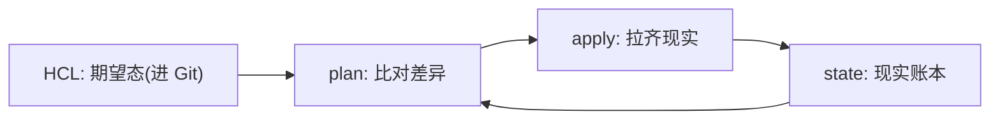
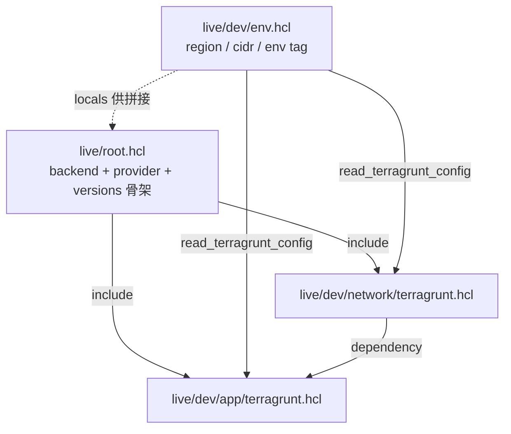
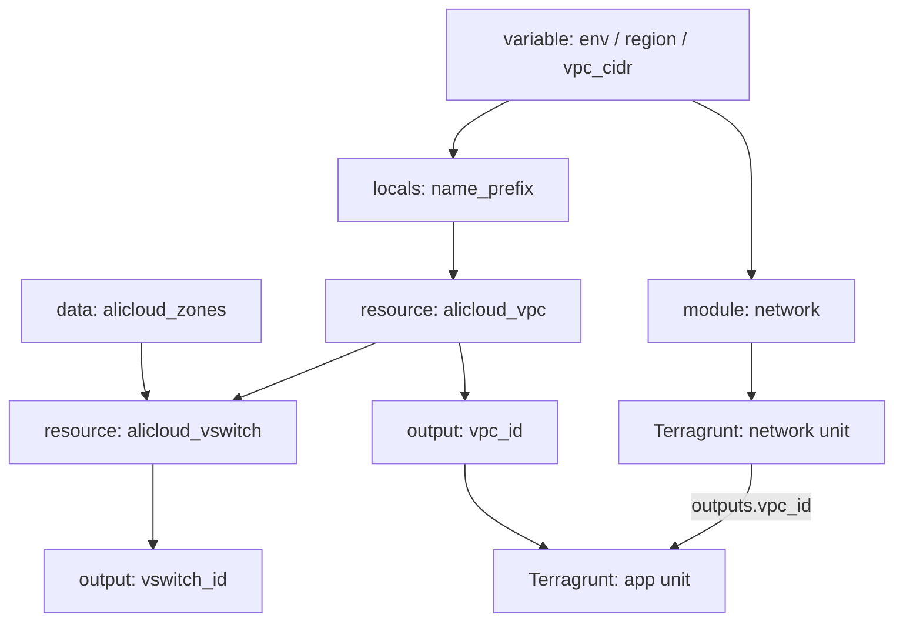

---
tags:
  - 平台组件
  - opentofu
  - terragrunt
  - IaC
  - 教学
created: 2026-11-27
---

# 🏗️ OpenTofu 与 Terragrunt

> 故事线：手工管基础设施的病 → 请出 OpenTofu（单模块 IaC）→ 规模一上来再请 Terragrunt（多模块编排）。第二章顺着"上手跑通 → 八大块 → 最小 OpenTofu 工程 → 撞规模问题 → Terragrunt 补位 → 最小 Terragrunt 工程 → 命令速查"走一遍。示例统一用**阿里云**（provider `aliyun/alicloud`，backend `oss`）。

## 一、为什么要引入

### 1.1 现实问题：手工管基础设施

| 痛点 | 具体场景 |
|---|---|
| 环境漂移 | 测试/预发/生产各手工搭一遍，配置悄悄不一致 |
| 不可审计 | 出事想查"谁在什么时候改了啥"，翻遍终端历史也拼不出来 |
| 回滚难 | 改坏了只能凭记忆手动恢复 |
| 协作冲突 | 多人同时操作，资源重复创建或误删 |
| 雪花服务器 | 平时上手改点东西，改完就忘，最后没人能重现这台机器 |

### 1.2 OpenTofu 怎么解：像 GitOps 那样，把基础设施写成代码

跟 GitOps 同思路——**代码是唯一事实源，工具负责让现实对齐代码**：



一句话：**写代码 → 存 Git → state 记账 → plan 对账 → apply 拉齐**。手工管理基础设施那堆问题，在**单模块尺度上**基本都能靠这套流程消解；多模块的规模问题留到 1.3。


### 1.3 规模上来，为什么还要 Terragrunt

OpenTofu 把"一块基础设施写成代码"已经很好用；但一旦叠到 **几十个模块 × 多环境**，它自己治不了的病就冒出来了——Terragrunt 就是为补这些位而生：

| OpenTofu 的窘境 | Terragrunt 怎么补 |
|---|---|
| 每个模块都得抄一份 backend / provider / 版本约束，N×M 份重复 | `include` 一份 root 配置 + `generate` 自动注入到各 unit |
| 跨模块传值只能手抄 output 或用 `terraform_remote_state` 读别家 state | `dependency` 直接读对方 outputs，还自动排好执行序 |
| 批量 apply 多模块得自己写 shell 按序跑 | `run --all` 按依赖 DAG 并行/串行批量执行 |
| 单一大 state 管太多资源，误操作爆炸半径大 | 拆成小 unit，各自独立 state |

**一句话**：OpenTofu 是"引擎"，Terragrunt 是"把很多引擎组织成一条生产线的编排外壳"。

## 二、从八大块到最小工程

### 2.0 先跑起来：装 → 配凭据 → 第一次 apply

**① 装** —— 两个都是单个二进制，放进 `PATH` 就能用：

```bash
# OpenTofu：官方安装脚本（deb/rpm/brew 都支持）
curl -fsSL https://get.opentofu.org/install-opentofu.sh | sh
# Terragrunt：GitHub releases 拉对应平台的二进制
wget -O /usr/local/bin/terragrunt \
  https://github.com/gruntwork-io/terragrunt/releases/latest/download/terragrunt_linux_amd64
chmod +x /usr/local/bin/terragrunt

tofu version && terragrunt --version   # 验证
```

**② 配阿里云凭据** —— 只走环境变量，AK/SK 绝不写进 `.tf`（在 RAM 控制台创建子账号并授权，别用主账号 AK）：

```bash
export ALICLOUD_ACCESS_KEY="<你的 AK>"
export ALICLOUD_SECRET_KEY="<你的 SK>"
export ALICLOUD_REGION="cn-hangzhou"
```

**③ 第一次跑**（在一份含 `main.tf` 的目录里，四步固定仪式）：

```bash
tofu init     # 装 alicloud provider、初始化 backend，顺手生成 .terraform.lock.hcl
tofu plan     # 预览要建什么，不碰云端任何资源
tofu apply    # 贴出 plan 后要你输入 yes 才真调 OpenAPI
tofu output   # 看建出来的结果（如 vpc_id）
```

**哪些文件要提交 Git**（新手最容易搞混）：

| 文件 | 提交？ | 原因 |
|---|---|---|
| `*.tf` / `*.hcl` / `modules/` | ✅ | 源码本身 |
| `.terraform.lock.hcl` | ✅ | 锁 provider 版本，全团队行为一致 |
| `.terraform/` | ❌ | 本地缓存，`tofu init` 随时重建 |
| `terraform.tfstate` | ❌ | 含所有资源属性**明文**（密码、连接串）；生产存 OSS，本地不留 |
| `terraform.tfvars` | ❌ | 可能含敏感值；非敏感的共享参数改名 `*.auto.tfvars` 再提交 |

### 2.1 OpenTofu 八大块速览

**① terraform 块** —— 文件最开头的"元配置"，回答三个问题：引擎版本多少、要装哪些 provider、state 存在哪。

```hcl
terraform {
  required_version = ">= 1.9.0"
  required_providers {
    alicloud = { source = "aliyun/alicloud", version = "~> 1.230" }
  }
  backend "oss" {
    bucket = "my-tofu-state"
    key    = "prod/network.tfstate"
    region = "cn-hangzhou"
  }
}
```

> 这段：OpenTofu ≥ 1.9；装 `aliyun/alicloud` provider；state 放到 OSS 桶 `my-tofu-state` 的 `prod/network.tfstate`。

**② provider** —— 真正调云服务 OpenAPI 的插件；`provider` 块填"怎么连"：region、凭据来源（AK/SK 已在 2.0 ② 配成环境变量，**绝不写进代码**）。

```hcl
provider "alicloud" {
  region = var.region
}
```

> 这段：默认操作 `var.region` 那个地域（入参在 ③ 里声明）。

**③ variable** —— 把 region、cidr 这些**参数留空**，别写死在 .tf 里，dev / prod 传不同值就能复用同一份代码。取值优先级（高覆盖低）：命令行 `-var` / `-var-file` > 环境变量 `TF_VAR_*` > `terraform.tfvars` > `*.auto.tfvars` > 代码里的 `default`。

```hcl
variable "env"      { type = string, default = "dev" }
variable "region"   { type = string, default = "cn-hangzhou" }
variable "vpc_cidr" { type = string, default = "10.0.0.0/16" }
```

> 这段：声明 3 个入参 `env` / `region` / `vpc_cidr`，各自带 default；不传就用 default。

**④ locals** —— 内部**加工中间值**的地方：把 variable / 别的 locals 拼一次算好，到处用；**不能从外部赋值**（那是 variable 的活）。

```hcl
locals {
  name_prefix = "${var.env}-demo"
}
```

> 这段：拼出资源名前缀（dev 环境 = `dev-demo`），下面 resource 里统一用 `local.name_prefix` 引用。

**⑤ resource** —— 你想**创建并维护的东西**：`tofu apply` 时建、进 state 记账、`tofu destroy` 时删。属性里直接写 `alicloud_vpc.main.id` 就是引用另一个 resource，OpenTofu 会自动排创建顺序。

```hcl
resource "alicloud_vpc" "main" {
  vpc_name   = "${local.name_prefix}-vpc"
  cidr_block = var.vpc_cidr
}

resource "alicloud_vswitch" "a" {
  vpc_id       = alicloud_vpc.main.id
  zone_id      = data.alicloud_zones.default.zones[0].id
  cidr_block   = "10.0.1.0/24"
  vswitch_name = "${local.name_prefix}-vsw-a"
}
```

> 这段：先建一个 VPC；再建一个 vSwitch，把上面 VPC 的 `id` 和 ⑥ 拿到的可用区 id 塞进去——OpenTofu 会先建 VPC 再建 vSwitch。

**⑥ data** —— 拿云上**已经存在的信息**（可用区、镜像、别人建好的 VPC……），但不让 OpenTofu 接管它的生死。写法几乎和 resource 一样，只是关键字换成 `data`：`tofu plan` 时**查**一次、结果记进 state；`tofu destroy` 只清 state 里的记录，**不动真实资源**。

```hcl
data "alicloud_zones" "default" {
  available_resource_creation = "VSwitch"   # 只保留支持建 vSwitch 的可用区
}
```

> 这段：调一次阿里云 `DescribeZones`，返回 `zones` 列表；⑤ 里 `data.alicloud_zones.default.zones[0].id` 就是取第一个可用区 id。

**⑦ output** —— 模块**对外交代结果**的地方；命令行 `tofu output` 和跨模块传值都靠它。

```hcl
output "vpc_id"     { value = alicloud_vpc.main.id }
output "vswitch_id" { value = alicloud_vswitch.a.id }
```

> 这段：把刚建的 VPC / vSwitch 的 id 暴露出去；`tofu output vpc_id` 能直接看，别的模块也能引用。

**⑧ module** —— 把一堆 resource 打包成"带入参和产出的函数"，对外只露 variable 和 output，内部细节全藏起来。`source` 可本地路径 / registry / git。

```hcl
module "network" {
  source   = "./modules/network"
  env      = var.env
  region   = var.region
  vpc_cidr = var.vpc_cidr
}
```

> 这段：调 `./modules/network` 里的 module，传三个入参；取它的 output 用 `module.network.vpc_id`。


### 2.2 用 OpenTofu 撑起"多模块 × 多环境"（先感受痛）

场景：一个业务上线需要 **network（VPC / vSwitch） + app（安全组）** 两个模块，各自部署到 **dev / staging / prod** 三个环境 → 6 份基础设施。OpenTofu 的玩法：**一份 state = 一个 root = 一个目录**，于是：

```
project/
├── modules/                            # 真正的业务代码，写一次就行
│   ├── network/
│   │   └── main.tf                     # variable + locals + resource(vpc + vswitch) + output
│   └── app/
│       └── main.tf                     # variable + resource(security group) + output
└── live/                               # 6 个独立 root
    ├── dev/
    │   ├── network/
    │   │   ├── versions.tf             # terraform 块: required_providers + backend(oss, key=dev/network.tfstate)
    │   │   ├── providers.tf            # provider "alicloud" { region = "cn-hangzhou" }
    │   │   └── main.tf                 # module "network" { source = "../../../modules/network" }
    │   └── app/
    │       ├── versions.tf             # 同上, 只 backend.key 换成 dev/app.tfstate
    │       ├── providers.tf            # 同上, 一字不差
    │       └── main.tf                 # data "terraform_remote_state" + module "app"
    ├── staging/
    │   ├── network/                    # 3 个文件，只 backend.key 和 env tag 变
    │   └── app/                        # 3 个文件，同上 + remote_state.key 变
    └── prod/
        ├── network/                    # 3 个文件
        └── app/                        # 3 个文件
```

**`modules/network/main.tf`**（3 个 env 都直接 `source = "../../../modules/network"` 复用）：

```hcl
variable "env"      { type = string }
variable "vpc_cidr" { type = string }
variable "zone_id"  { type = string }
locals { name_prefix = "${var.env}-demo" }

resource "alicloud_vpc" "main" {
  vpc_name   = "${local.name_prefix}-vpc"
  cidr_block = var.vpc_cidr
}
resource "alicloud_vswitch" "a" {
  vpc_id       = alicloud_vpc.main.id
  zone_id      = var.zone_id
  cidr_block   = cidrsubnet(var.vpc_cidr, 8, 1)
  vswitch_name = "${local.name_prefix}-vsw-a"
}
output "vpc_id" { value = alicloud_vpc.main.id }
```

**痛点不在这里，在 root 层**：`live/` 下 **6 个 root 都得写同样三份样板**——`versions.tf` / `providers.tf` / `main.tf`。以 `live/dev/network/` 为例：

```hcl
# versions.tf —— 6 份里唯一变的一行是 backend.key
terraform {
  required_version = ">= 1.9.0"
  required_providers {
    alicloud = { source = "aliyun/alicloud", version = "~> 1.230" }
  }
  backend "oss" {
    bucket = "my-tofu-state"
    key    = "dev/network.tfstate"
    region = "cn-hangzhou"
  }
}
```

```hcl
# providers.tf
provider "alicloud" { region = "cn-hangzhou" }
```

```hcl
# main.tf
module "network" {
  source   = "../../../modules/network"
  env      = "dev"
  vpc_cidr = "10.0.0.0/16"
  zone_id  = "cn-hangzhou-h"
}
```

**`live/dev/app/` 还得跨 root 拿 network 的 vpc_id**——OpenTofu 不能直接拿另一个 root 的 output，只能手动写一份 `terraform_remote_state` 再指回别家的 OSS 文件：

```hcl
# live/dev/app/main.tf
data "terraform_remote_state" "network" {
  backend = "oss"
  config  = {
    bucket = "my-tofu-state"
    key    = "dev/network.tfstate"      # ← 硬编码，跟上面 backend 必须同步
    region = "cn-hangzhou"
  }
}
module "app" {
  source = "../../../modules/app"
  env    = "dev"
  vpc_id = data.terraform_remote_state.network.outputs.vpc_id
}
```

**跑一次**，得按依赖顺序 cd 6 次（写个 shell 兜住）：

```bash
for env in dev staging prod; do
  (cd live/$env/network && tofu init && tofu apply -auto-approve)
  (cd live/$env/app     && tofu init && tofu apply -auto-approve)
done
```

能跑，但你能看到——**6 份样板、同一份 bucket 名字写了 9 遍**（backend 6 + remote_state 3）。

### 2.3 数一数这有多痛

| 一个改动 / 一件事 | 得动多少地方 |
|---|---|
| provider 升级 `~> 1.230` → `~> 1.240` | 6 份 `versions.tf` |
| OSS bucket 改名 | 6 份 `backend` + 3 份 `data.terraform_remote_state` = **9 处** |
| 新加一个 `audit` 环境 | 新建 2 个 root × 3 个样板文件 = **6 个新文件** |
| region 想按环境自动切 | backend 块传统不能引变量（OpenTofu early eval 缓解但样板本身仍 6 份） |
| 按顺序 apply | 得自己写 shell；并行 / 失败重试 / 跳过未变更单元全部自己造轮 |
| 一个 root 写错 → 想回滚 | 6 份 state 彼此不知道对方情况，得 `tofu state list` 一个个看 |

**核心**：`module` 已经尽力了——resource 层的逻辑它复用了；但 **root 层的 backend / provider / versions、跨 root 传值、批量编排** 它管不到——因为每个 root 在 OpenTofu 眼里都是"一个完全独立的工程"。这就是 Terragrunt 要补的位。

### 2.4 Terragrunt 怎么补位

Terragrunt 是个**薄壳**，自己**不 provisioning**，只做两件事：

1. **把公共样板一次性生成到每个 unit 目录**（`backend.tf` / `provider.tf` / `versions.tf`），OpenTofu 看到的就是普通 root；
2. **按 `dependency` 声明的 DAG 排队调 `tofu init/plan/apply`**，unit 之间 output→input 自动串。

核心设计：**把 2.2 里那 3 份样板按"作用域"拆成三层**，每层只写自己那部分：

| 层 | 文件 | 多少份 | 放什么 | 顶替 2.2 里的 |
|---|---|---|---|---|
| **全局** | `live/root.hcl` | 整个项目一份 | backend 骨架（bucket / tablestore / 锁）、provider 骨架（`required_providers` + `provider` 块）、`terraform_binary = "tofu"` | 6 份 `versions.tf` + 6 份 `providers.tf` |
| **环境** | `live/<env>/env.hcl` | 每个环境一份 | 环境元数据：region、cidr、默认 tags | 6 份样板里那些"其实按 env 变"的字段 |
| **单元** | `live/<env>/<unit>/terragrunt.hcl` | 每个 unit 一份 | `include` + `terraform.source` + `inputs` + `dependency` | 6 份 `main.tf` 里的 module 调用 |

**三层怎么串起来**：



- **unit → root.hcl**：unit 里写 `include "root" { path = find_in_parent_folders("root.hcl") }`，Terragrunt 把 root 里的 `remote_state` / `generate` 展开到本 unit。
- **unit → env.hcl**：unit 里用 `locals { env = read_terragrunt_config(find_in_parent_folders("env.hcl")) }` 把本环境的 region / cidr 读进来，`inputs` 直接 `local.env.locals.xxx` 取。
- **root.hcl → env.hcl**：root 里同样能 `read_terragrunt_config` 拿到 env，把 `provider "alicloud" { region = ... }` 这类字段按环境注入。
- **unit → unit**：`dependency "network" { config_path = "../network" }` 就能读上游 outputs，Terragrunt 自己排执行顺序。

**unit 目录实际被展开成什么**（以 `live/dev/network/` 为例）：

| Terragrunt 生成物 | 来源 |
|---|---|
| `backend.tf` | root.hcl 里的 `remote_state` + `generate = { path = "backend.tf" }` |
| `provider.tf` | root.hcl 里的 `generate "provider"` heredoc |
| `terraform.tfvars.json` | unit 里的 `inputs = { ... }`（等价于 `TF_VAR_*`） |
| `main.tf` / `variables.tf` / `outputs.tf` | `terraform { source = "../../../modules/network" }` 拷进来 |

OpenTofu 在这个目录里 `init/plan/apply` 时，完全感知不到 Terragrunt——**它只看到一份普通的 root**。这就是"薄壳"的意思。

**核心概念速查**：

| 概念 | 是什么 |
|---|---|
| `include` | 引入另一份 HCL（一般是 root.hcl），支持 `merge` / `partial` 两种策略 |
| `find_in_parent_folders(...)` | 从当前目录往上找文件，用来定位 root.hcl / env.hcl |
| `path_relative_to_include()` | 从 include 位置算出的相对路径，用来自动切 `backend.key` |
| `read_terragrunt_config(...)` | 把另一份 HCL 当对象读进来，供 locals / inputs 使用 |
| `dependency` | 声明 unit 依赖 + 读对方 outputs |
| `generate` | 把内容块写成 `.tf` 文件注入到 unit 目录 |
| `inputs` | 喂给底层 module 的 variable，Terragrunt 转成 tfvars |

### 2.5 最小可用 Terragrunt：三层配置各自长什么样

`live/` 保持和 2.2 一样的 6 unit 布局，只是文件从"每 unit 3 份"变成 **全局 root.hcl + 每 env env.hcl + 每 unit terragrunt.hcl**：

```
project/
├── modules/                            # 和 2.2 完全一样, 一字不改
│   ├── network/main.tf
│   └── app/main.tf
└── live/
    ├── root.hcl                        # 全局样板：backend + provider + versions
    ├── dev/
    │   ├── env.hcl                     # 环境元数据：region / cidr / env tag
    │   ├── network/terragrunt.hcl      # 5-7 行
    │   └── app/terragrunt.hcl          # 8 行, 含 dependency
    ├── staging/
    │   ├── env.hcl                     # 换个 region / cidr
    │   ├── network/terragrunt.hcl
    │   └── app/terragrunt.hcl
    └── prod/
        ├── env.hcl
        ├── network/terragrunt.hcl
        └── app/terragrunt.hcl
```

**`live/root.hcl`** —— 替掉了 2.2 里 6 份 `versions.tf` + 6 份 `providers.tf`：

```hcl
terraform_binary = "tofu"

locals {
  env = read_terragrunt_config(find_in_parent_folders("env.hcl"))
}

remote_state {
  backend = "oss"
  config = {
    bucket              = "my-tofu-state"
    key                 = "${path_relative_to_include()}/terraform.tfstate"  # 自动 = dev/network、prod/app……
    region              = local.env.locals.region
    tablestore_endpoint = "https://tofu-lock-${local.env.locals.region}.ots.aliyuncs.com"
    tablestore_table    = "terraform_locks"
  }
  generate = { path = "backend.tf", if_exists = "overwrite_terragrunt" }
}

generate "provider" {
  path      = "provider.tf"
  if_exists = "overwrite_terragrunt"
  contents  = <<-EOF
    terraform {
      required_version = ">= 1.9.0"
      required_providers {
        alicloud = { source = "aliyun/alicloud", version = "~> 1.230" }
      }
    }
    provider "alicloud" { region = "${local.env.locals.region}" }
  EOF
}
```

**`live/dev/env.hcl`** —— 每个环境一份；staging / prod 想换 region，只改这几行：

```hcl
locals {
  env      = "dev"
  region   = "cn-hangzhou"
  zone_id  = "cn-hangzhou-h"
  vpc_cidr = "10.0.0.0/16"
}
```

**`live/dev/network/terragrunt.hcl`** —— 每个 unit 一份，只写 source + inputs：

```hcl
include "root" { path = find_in_parent_folders("root.hcl") }
locals    { env = read_terragrunt_config(find_in_parent_folders("env.hcl")) }
terraform { source = "../../../modules/network" }
inputs = {
  env      = local.env.locals.env
  vpc_cidr = local.env.locals.vpc_cidr
  zone_id  = local.env.locals.zone_id
}
```

**`live/dev/app/terragrunt.hcl`** —— 有跨 unit 依赖时多一个 `dependency` 块，替掉了 2.2 里那段硬编码的 `data.terraform_remote_state`：

```hcl
include "root" { path = find_in_parent_folders("root.hcl") }
locals     { env = read_terragrunt_config(find_in_parent_folders("env.hcl")) }
terraform  { source = "../../../modules/app" }
dependency "network" { config_path = "../network" }
inputs = {
  env    = local.env.locals.env
  vpc_id = dependency.network.outputs.vpc_id
}
```

`staging/` `prod/` 里的 unit `terragrunt.hcl` **结构一字不差**，只改对应 env.hcl 里的字段即可。

**跑一次**：

```bash
cd live && terragrunt run --all apply
# Terragrunt 按 dependency 排序：同环境内 network 先于 app；
# 三个环境之间互不依赖，默认并行执行
```

**对照 2.3 的痛点表**：

| 2.3 的痛 | 靠哪一层解决 |
|---|---|
| provider 升级改 6 处 | **root.hcl** `generate "provider"` 一处 |
| bucket 改名改 9 处 | **root.hcl** `remote_state.config.bucket` 一处；`dependency` 自动定位对方 unit |
| 新加 `audit` 环境 → 6 个新文件 | **1 份 env.hcl + 2 份 terragrunt.hcl = 3 个新文件** |
| backend key 按 env 切 | **root.hcl** 里 `${path_relative_to_include()}` 自动切 |
| region 按 env 切 | **env.hcl** 一处声明，root.hcl 与 unit inputs 都能读到 |
| 手写 shell 按序 apply | unit 里的 `dependency` + `terragrunt run --all` 自动按 DAG 跑 |

### 2.6 命令速查

**OpenTofu**（在单个 root / module 目录下）

| 命令 | 干啥 | 常用 flag |
|---|---|---|
| `tofu init` | 装 provider、初始化 backend、拉 module | `-upgrade` |
| `tofu validate` | 只查语法/内部一致性，不连 API | |
| `tofu fmt` | 格式化 HCL | `-recursive` |
| `tofu plan` | 比对 state 与现实，预览增删改 | `-out=tfplan` |
| `tofu apply` | 执行变更 | `-auto-approve` / 接 `tfplan` |
| `tofu output` | 读 output | `-json` |
| `tofu destroy` | 拆除全部受管资源 | `-auto-approve` |
| `tofu state list/show/mv/rm` | 查/改账本 | |
| `tofu import` | 把已存在的资源纳管（如已有 VPC 想接进来） | 两个位置参数：`tofu import alicloud_vpc.main vpc-bp1***` |
| `tofu graph` | 输出依赖图（DOT） | |

日常三板斧 `init → plan → apply`；`state` 子命令直接改账本，慎用。

**Terragrunt**（单 unit 透传；`live/` 顶层批跑）

| 命令 | 干啥 |
|---|---|
| `terragrunt plan/apply/destroy` | 在单个 unit 里透传给 tofu |
| `terragrunt run --all plan/apply` | 按依赖序批量跑（旧写法 `run-all`） |
| `terragrunt run --all --filter=...` | 只跑匹配的子集 |
| `terragrunt graph-dependencies` | 输出 unit 依赖图（DOT） |
| `terragrunt hclfmt` | 格式化 terragrunt.hcl |
| `terragrunt render-json` | 把解析后的配置渲染成 JSON 排错 |

**一句话**：OpenTofu 命令是"引擎操作"，Terragrunt 命令是"多引擎调度台"。

**plan 输出怎么看**：

- 每行开头的符号：`+` 新建 / `-` 删除 / `~` 原地修改（成对显示 旧值 → 新值）/ `-/+` 替换（该属性只能推倒重建，先建新再删旧）；
- **看到不在预期里的 `-` 或 `-/+` 就停下**——多半是资源块被删了或改了名字（改名在 OpenTofu 眼里就是"删旧建新"；想改名不重建，用 `moved` 块）；
- 生产 / CI 永远用 `tofu plan -out=tfplan && tofu apply tfplan`——保证执行的就是刚审过的那份，中间不会重新算。

**新手最常撞的三个报错**：

| 报错关键词 | 原因 / 处置 |
|---|---|
| `InvalidAccessKeyId.NotFound` / `SignatureDoesNotMatch` | AK/SK 不对或环境变量没生效，`echo $ALICLOUD_ACCESS_KEY` 检查 |
| `NoSuchKey` / state 加载失败 | 第一次跑时 OSS 里还没有这个 key，正常，`apply` 后就会写入；若 bucket 名写错了才真需改配置 |
| `Lock resource ... already locked` | 上次跑崩没释放锁；确认没别人在跑，`tofu force-unlock <锁ID>` |

## 三、整体总结

### 3.1 总对照表

| 块 | 作用 | 输入来自 | 输出去向 | 关键命令 |
|---|---|---|---|---|
| terraform | 引擎/provider/backend 声明 | — | init 行为 | `tofu init` |
| provider | API 翻译官 | required_providers | resource 调用 | （随 init 装） |
| variable | 外部输入 | tfvars/env/-var | locals/resource/module | `-var` |
| locals | 内部中间量 | variable/resource | resource/output | （自动求值） |
| resource | 受管实体 | locals/别的 resource | data/output/state | `tofu apply` |
| data | 只读查询 | resource/外部 | output | （plan 时读） |
| output | 对外接口 | resource/data/module | CLI/跨模块 | `tofu output` |
| module | 封装复用 | variable(inputs) | output | `tofu init` |
| Terragrunt | DRY+依赖+批量 | unit outputs | inputs/执行序 | `terragrunt run --all` |

### 3.2 一张 DAG 串起来



左半是单模块内八大块的依赖链，右半是 Terragrunt 把多个 unit 的 output→input 接成更大的 DAG。**OpenTofu 织单模块的图，Terragrunt 织跨模块的图**——这是两者的根本分工。

## 相关

- 上游：[[平台组件]]（MOC）
- 配置复用对照：[[Helm&Kustomize]]（YAML 侧的复用与多环境，思路相通）
- 官方文档：[OpenTofu](https://opentofu.org/docs/) · [Terragrunt](https://terragrunt.gruntwork.io/docs/) · [alicloud provider](https://registry.terraform.io/providers/aliyun/alicloud/latest/docs)
