---
tags:
  - 平台组件
  - opentofu
  - terragrunt
  - IaC
  - 教学
created: 2026-11-27
---

# 🏗️ OpenTofu 与 Terragrunt

> 讲师视角的通用学习笔记，**抛开本项目不谈**。基于 OpenTofu 1.9 / Terragrunt 1.x 官方文档整理。
> 代码按文档编写、未实测，预期输出为推演；provider 版本随 registry 实际解析。咱用一个贯穿例子把八大块串起来：**生成一个带随机后缀的问候文件**，前一块的产出喂给后一块。
> 故事线：手工管基础设施的病 → 请出 OpenTofu → 顺着"声明→干活→输入→加工→创建→读取→暴露→复用"把八大块用一遍 → 模块多了再请出 Terragrunt。

## 一、为什么要引入

### 1.1 现实问题：手工管基础设施

| 痛点 | 具体场景 |
|---|---|
| 环境漂移 | 测试/预发/生产各手工搭一遍，配置悄悄不一致 |
| 不可审计 | 谁改了什么、何时改的，无记录，出事查不到 |
| 回滚难 | 改坏了只能凭记忆手动恢复 |
| 协作冲突 | 多人同时操作，资源重复创建或误删 |
| 雪花服务器 | 每台机器都"独一份"，文档永远追不上实际 |

### 1.2 OpenTofu 怎么解：声明式 + 账本

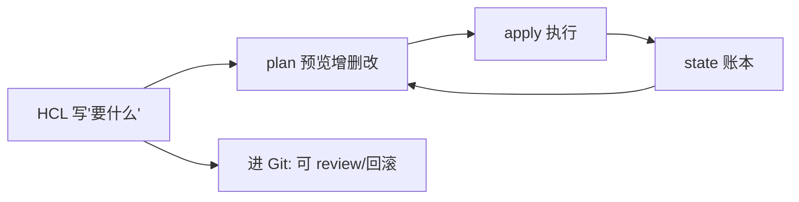

| 现实问题 | OpenTofu 解法 |
|---|---|
| 环境漂移 | 同一份 HCL 套不同 variable，环境一致 |
| 不可审计 | 配置进 Git，每次变更有 commit/review |
| 回滚难 | 改回旧配置重新 apply，state 对齐 |
| 协作冲突 | state 锁 + plan 审批，先看清再动手 |
| 雪花服务器 | 声明式描述期望态，引擎负责对齐现实 |

核心：**写"要什么"（声明式），不写"怎么做"；state 当账本，plan 先预览再执行**。

### 1.3 为什么是 OpenTofu，不是 Terraform

2023 年 HashiCorp 把 Terraform 许可证改成 BSL（不再开源）。OpenTofu 是社区 fork：**MPL-2.0 真开源、Linux Foundation 托管**，兼容 HCL/provider/state，迁移成本低。本笔记用 OpenTofu，语法与 Terraform 基本互通。

### 1.4 规模上来，为什么还要 Terragrunt

OpenTofu 管好"一个模块"很够用；但几十模块 × 多环境时，backend/provider 重复、跨模块传值、批量编排它不管（详见 2.9）。于是分层：

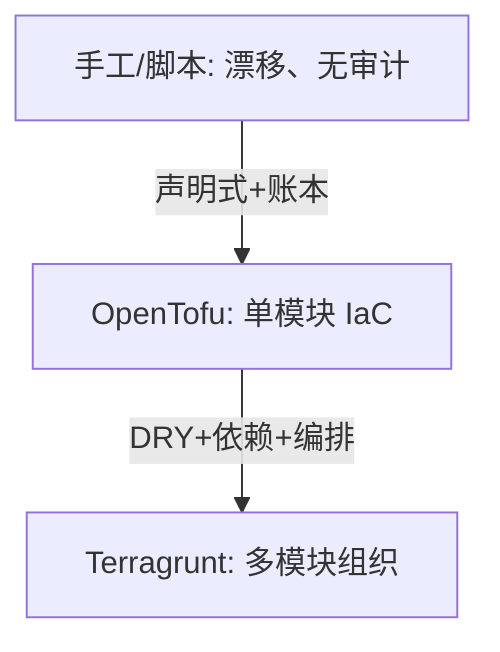

**OpenTofu 解决"怎么声明式建基础设施"，Terragrunt 解决"怎么组织一大摊模块"**——后者以前者为引擎。

### 1.5 故事路线图（各节速览）

| # | 你会撞上的问题 | 对应节 |
|---|---|---|
| 0 | HCL 写好了，敲哪些命令、什么顺序？state 怎么管？ | 2.0 OpenTofu CLI |
| 1 | 用哪个引擎、状态存哪、要装哪些 provider，在哪声明？ | 2.1 terraform 块 |
| 2 | 怎么跟某个 API（云/本地）打交道？ | 2.2 provider |
| 3 | 环境名、规格这些外部输入怎么传进来？ | 2.3 variable |
| 4 | 中间拼出来的值不想重复写，放哪？ | 2.4 locals |
| 5 | 真正要创建的东西怎么写？ | 2.5 resource |
| 6 | 只想读已存在的数据，不想创建，怎么办？ | 2.6 data |
| 7 | 怎么把结果暴露给别的模块/命令行？ | 2.7 output |
| 8 | 一套配置想封装复用，怎么搞？ | 2.8 module |
| 9 | 几十个模块重复 backend/provider、还要跨模块传值、批量跑？ | 2.9 Terragrunt |

## 二、逐个展开

### 2.0 先会用工具：OpenTofu CLI 生命周期

故事从手里的工具开始。OpenTofu 装好后，日常就围着这几个命令转——先认全它们，后面写配置才知道怎么跑。

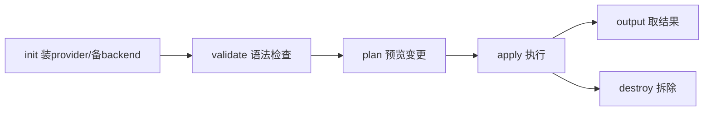

| 命令 | 干啥 | 常用 flag |
|---|---|---|
| `tofu init` | 装 provider、初始化 backend、拉 module | `-upgrade` |
| `tofu validate` | 只查语法/内部一致性，不连 API | |
| `tofu fmt` | 格式化 HCL | `-recursive` |
| `tofu plan` | 比对 state 与现实，预览增删改 | `-out=tfplan` |
| `tofu apply` | 执行变更 | `-auto-approve` / 接 `tfplan` |
| `tofu output` | 读 output | `-json` |
| `tofu destroy` | 拆除全部受管资源 | `-auto-approve` |
| `tofu state list/show/mv/rm` | 查/改账本 | |
| `tofu import` | 把已存在的资源纳管 | |
| `tofu graph` | 输出依赖图（DOT） | |

```bash
tofu plan -out=tfplan     # 生成计划文件
tofu apply tfplan         # 严格按该计划执行, 不再重新 plan
tofu state list           # 看账本里有哪些资源
# 预期: random_id.suffix / local_file.greeting / data.local_file.read
```

> **plan/apply 分离**：`-out` 把计划存盘，apply 接文件保证"批的就是跑的"，适合 CI 审批流。`state` 子命令直接改账本，慎用。

**一句话**：OpenTofu 日常是 `init → plan → apply` 三板斧，state/output/graph 是账本与调试工具。

### 2.1 terraform 块：声明"用谁、存哪"

认完命令，开始写配置。第一行得告诉 OpenTofu"用哪个引擎、装哪些 provider、状态存哪"——这就是 terraform 块，一切的起点。

| 子块 | 管什么 |
|---|---|
| `required_version` | 引擎版本约束 |
| `required_providers` | provider 来源 + 版本 |
| `backend` | 状态（state）存哪、怎么锁 |

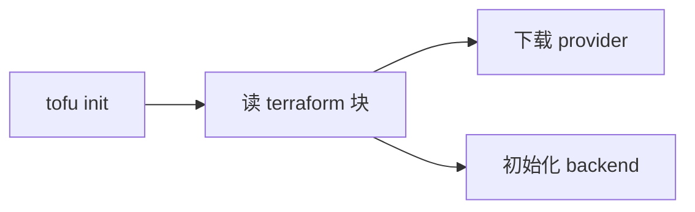

```hcl
# demo/versions.tf
terraform {
  required_version = ">= 1.9.0"
  required_providers {
    random = { source = "hashicorp/random", version = "~> 3.6" }
    local  = { source = "hashicorp/local",  version = "~> 2.5" }
  }
  backend "local" { path = "terraform.tfstate" }
}
```

```bash
cd demo && tofu init
# 预期: Installing hashicorp/random v3.6.x ... OpenTofu has been successfully initialized!
```

> **state 是账本**：记录"我创建了啥、属性是啥"，plan 拿它和现实比对。backend 决定账本放哪（local 文件 / S3 等远端）+ 并发锁。backend 配置传统上不能引变量（Terraform 至今如此；OpenTofu 1.8+ 用 early evaluation 放开了变量/locals），但跨环境跨模块仍重复——Terragrunt 要解决的痛点之一。

**一句话**：terraform 块是"引擎与账本的说明书"，`tofu init` 照它装 provider、备 backend。

### 2.2 provider：和某个 API 打交道

terraform 块声明了要装 random/local，可它们到底是谁、怎么干活？provider 就是真正调 API 的插件——声明归声明，干活归它。

provider 是**插件**，把 OpenTofu 的 CRUD 翻译成具体 API 调用。`required_providers` 声明装谁，`provider` 块配置怎么连。


```hcl
# demo/providers.tf
provider "random" {}   # 随机数, 无需配置
provider "local" {}    # 本地文件, 无需配置
```

云 provider 才需要填 region/凭据（如 `provider "aws" { region = "..." }`）。本例用 random/local，**离线可跑、不碰云**。

**一句话**：provider 是"翻译官"，resource 的每个动作都经它落到真实 API。

### 2.3 variable：外部输入

provider 就位，但创建东西总得有参数（名字、规格）。写死在代码里就没法换环境复用，于是用 variable 把参数从外面传进来。

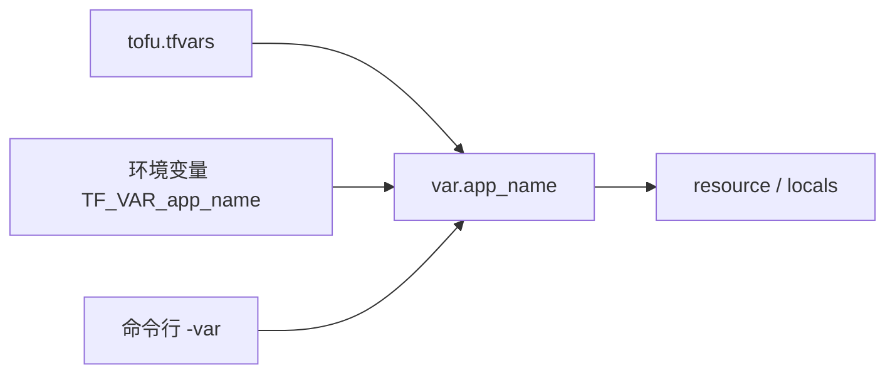

```hcl
# demo/variables.tf
variable "app_name" {
  type    = string
  default = "hello"
}
```

```bash
tofu plan -var="app_name=world"     # 命令行
TF_VAR_app_name=world tofu plan     # 环境变量
# 优先级: 命令行 > tfvars > 环境变量 > default
```

`type` 可约束 string/number/list/map/object，还能加 `validation` 校验、`sensitive` 脱敏。

**一句话**：variable 是"对外的旋钮"，让同一份配置适配不同环境。

### 2.4 locals：内部中间量

variable 传进来的值常要拼接加工后再用，这串拼接到处重复写很难维护——locals 就是收敛它的地方。

locals 是**只读中间变量**，吃 variable/resource 的产出，算一次到处用。

```hcl
# demo/locals.tf
locals {
  name = var.app_name        # ← 吃 2.3 variable 的产出
}
```

没有命令，plan 时自动求值。注意 locals **不能从外部赋值**（那是 variable 的活）。

**一句话**：locals 是"内部草稿纸"，收敛重复表达式，改一处全局生效。

### 2.5 resource：真正创建的东西

输入备齐（variable 进、locals 加工），终于到真正创建东西的环节——resource。前面都是铺垫，它才是账本上登记的主角。

resource 是**被管理的实体**，OpenTofu 负责它的生老病死。

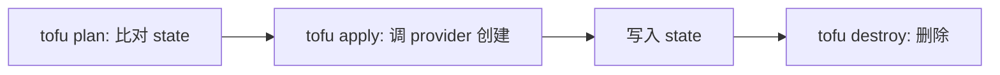

```hcl
# demo/main.tf
resource "random_id" "suffix" {
  byte_length = 4
}
resource "local_file" "greeting" {
  filename = "${path.module}/${local.name}-${random_id.suffix.hex}.txt"
  content  = "hi ${local.name}"     # ← 吃 locals + random_id 的产出
}
```

```bash
tofu apply -auto-approve
# 预期: Apply complete! Resources: 2 added, 0 changed, 0 destroyed.
```

引用别的 resource 用 `<类型>.<名>.<属性>`（如 `random_id.suffix.hex`），**引用即依赖**，OpenTofu 自动排顺序。`count`/`for_each` 批量创建，`lifecycle` 控制重建/忽略变更。

**一句话**：resource 是"账本上登记的实体"，引用关系自动织成依赖图。

### 2.6 data：只读已有数据

resource 创建并管理实体；但有时你只想读一个已存在的东西（比如刚生成的文件），不想再创建它——这时用 data，只读不建。

| | resource | data |
|---|---|---|
| 语义 | 创建并管理 | 只读查询 |
| 进 state | 是（受管） | 是（仅缓存读数） |
| destroy | 会删 | 不删（不是它建的） |

```hcl
# demo/main.tf 追加
data "local_file" "read" {
  filename   = local_file.greeting.filename   # ← 吃 2.5 resource 的产出
  depends_on = [local_file.greeting]          # 确保先写后读
}
```

plan 时读取，`data.local_file.read.content` 拿到内容。

**一句话**：data 是"只读窗口"，查别人建的东西，自己不负责创建。

### 2.7 output：对外暴露

东西建好、数据读到，结果（文件路径、内容）得能交出去给命令行或别的模块用——output 就是模块对外的唯一出口。

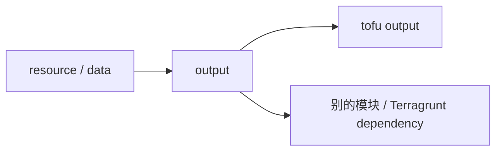

```hcl
# demo/outputs.tf
output "content" {
  value = data.local_file.read.content   # ← 吃 2.6 data 的产出
}
output "filename" {
  value = local_file.greeting.filename
}
```

```bash
tofu output content
# 预期: "hi hello"
```

`sensitive = true` 脱敏；output 是**跨模块传值的唯一出口**（Terragrunt 的 dependency 读的就是它）。

**一句话**：output 是"对外的接口"，模块间传值全靠它。

### 2.8 module：封装复用

到这里八大块齐了，一个模块能跑通。但同一套配置想在多处复用、还想隐藏内部细节，就把它包成 module——variable 进、output 出，像个函数。

module 把内部 resource 藏起来，对外只露入参（variable）和产出（output）。

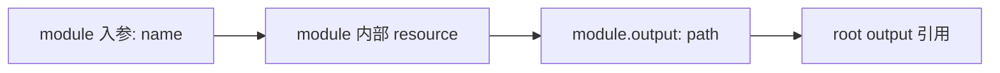

```hcl
# demo/modules/greeting/main.tf
variable "name" { type = string }
resource "local_file" "file" {
  filename = "${path.module}/${var.name}.txt"
  content  = "hello ${var.name}"
}
output "path" { value = local_file.file.filename }
```

```hcl
# demo/main.tf 追加
module "greeting" {
  source = "./modules/greeting"
  name   = var.app_name          # ← 把 root 的 variable 喂进 module
}
output "mod_path" {
  value = module.greeting.path   # ← 吃 module 的 output
}
```

```bash
tofu init          # 拉取/链接 module
tofu apply -auto-approve
tofu output mod_path
# 预期: ".../modules/greeting/hello.txt"
```

`source` 可本地路径/registry/git。至此八大块串成链：**variable → locals → resource → data → output → module**。

**一句话**：module 是"带输入输出的函数"，封装细节、复用配置。

### 2.9 Terragrunt：为什么光用 OpenTofu 不行

module 解决了"一套配置复用"。可当你有几十个大模块、还要分多环境时，新的病又冒出来——plain OpenTofu 有五个治不了的痛点：

| 痛点 | 光用 OpenTofu 的窘境 | Terragrunt 解法 |
|---|---|---|
| backend 重复 | N 环境×M 模块各抄一份 bucket/key/锁（Terraform 不能引变量；OpenTofu early eval 缓解但仍重复） | `include` + `remote_state` 一处定义，按路径自动生成 |
| provider 重复 | 每个 root 重写 provider/版本 | `generate` 统一生成 provider.tf |
| 跨模块传值 | 不同 root 不共享图，只能 `terraform_remote_state` 读别家 state 或手抄 output | `dependency` 直接读对方 outputs，还自动排序 |
| 批量执行 | 无跨目录编排，得写 shell 手动按序跑 | `run --all` 按 DAG 排序、可并行 |
| 爆炸半径 | 单一大 state 管太多，误操作影响面大 | 拆成小 unit，各自独立 state |

> module 能复用 resource 逻辑，但 **root module 的 backend/provider/版本照样重复**——这正是 Terragrunt 补的位。

Terragrunt 核心概念：

| 概念 | 是什么 | 放哪 |
|---|---|---|
| unit | 一份独立 state 的基础设施 | 一个含 `terragrunt.hcl` 的目录 |
| root 配置 | 共享的 backend/provider | `root.hcl`，靠 `include` 引入 |
| dependency | 读别的 unit 的 output + 排序 | unit 里的 `dependency` 块 |
| inputs | 喂给 module 的 variable | `inputs`，转成 `TF_VAR_` |

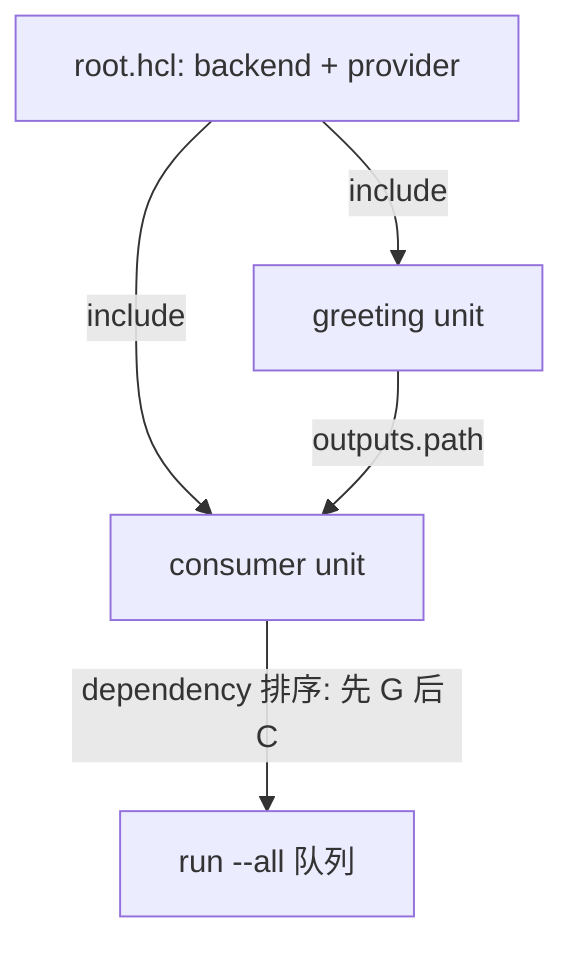

```hcl
# live/root.hcl
terraform_binary = "tofu"        # 用 OpenTofu 当引擎(也可 export TG_TF_PATH=tofu)
remote_state {
  backend = "local"
  config  = { path = "${path_relative_to_include()}/terraform.tfstate" }
  generate = { path = "backend.tf", if_exists = "overwrite_terragrunt" }
}
generate "provider" {
  path      = "provider.tf"
  if_exists = "overwrite_terragrunt"
  contents  = <<EOF
provider "local" {}
provider "random" {}
EOF
}
```

```hcl
# live/greeting/terragrunt.hcl
include "root" { path = find_in_parent_folders("root.hcl") }
terraform { source = "../../demo/modules/greeting" }
inputs = { name = "tg" }
```

```hcl
# demo/modules/consumer/main.tf
variable "upstream_path" { type = string }
data "local_file" "upstream" { filename = var.upstream_path }
output "content" { value = data.local_file.upstream.content }
```

```hcl
# live/consumer/terragrunt.hcl
include "root" { path = find_in_parent_folders("root.hcl") }
terraform { source = "../../demo/modules/consumer" }
dependency "greeting" { config_path = "../greeting" }
inputs = { upstream_path = dependency.greeting.outputs.path }  # ← 吃 greeting 的 output
```

```bash
cd live && terragrunt run --all apply
# 预期: 先 apply greeting(生成 hello tg 文件), 再 apply consumer(读到 "hello tg")
```

**Terragrunt 自己也是工具**，常用命令：

| 命令 | 干啥 |
|---|---|
| `terragrunt plan/apply/destroy` | 在单个 unit 里透传给 tofu |
| `terragrunt run --all plan/apply` | 按依赖序批量跑（旧写法 `run-all`） |
| `terragrunt run --all --filter=...` | 只跑匹配的子集 |
| `terragrunt graph-dependencies` | 输出 unit 依赖图（DOT） |
| `terragrunt hclfmt` | 格式化 terragrunt.hcl |
| `terragrunt render-json` | 把解析后的配置渲染成 JSON 排错 |

它的工作机制（**不自己 provisioning**）：

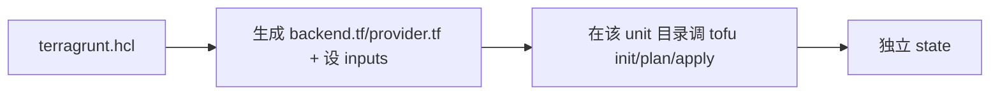

**一句话**：Terragrunt 是"OpenTofu 的编排外壳"，治重复、传跨模块值、按 DAG 批量跑。

## 三、整体总结

### 3.1 总对照表

| 块 | 作用 | 输入来自 | 输出去向 | 关键命令 |
|---|---|---|---|---|
| terraform | 引擎/provider/backend 声明 | — | init 行为 | `tofu init` |
| provider | API 翻译官 | required_providers | resource 调用 | （随 init 装） |
| variable | 外部输入 | tfvars/env/-var | locals/resource/module | `-var` |
| locals | 内部中间量 | variable/resource | resource/output | （自动求值） |
| resource | 受管实体 | locals/别的 resource | data/output/state | `tofu apply` |
| data | 只读查询 | resource/外部 | output | （plan 时读） |
| output | 对外接口 | resource/data/module | CLI/跨模块 | `tofu output` |
| module | 封装复用 | variable(inputs) | output | `tofu init` |
| Terragrunt | DRY+依赖+批量 | unit outputs | inputs/执行序 | `terragrunt run --all` |

### 3.2 一张 DAG 串起来

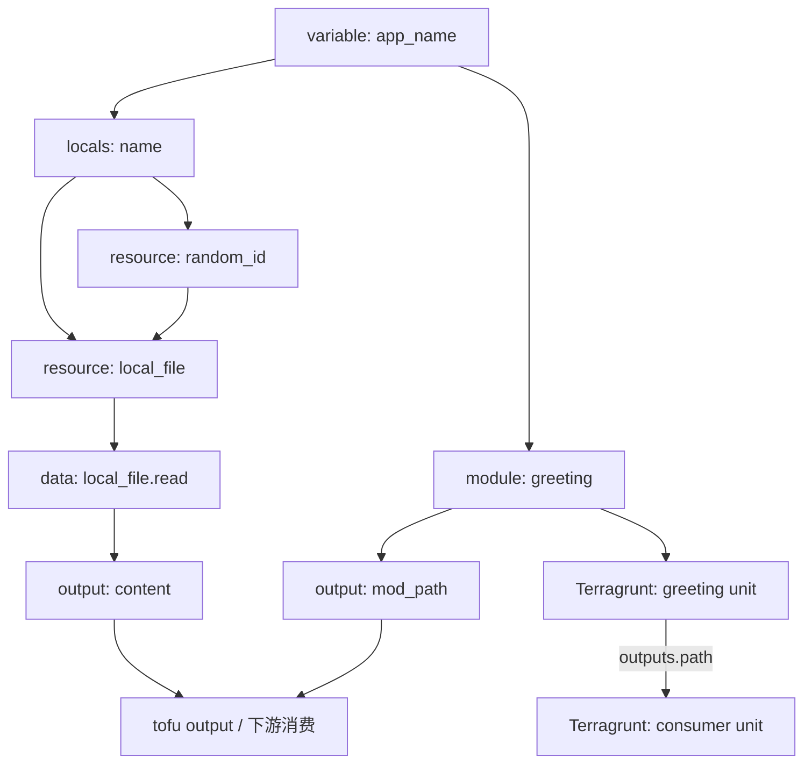

左半是单模块内八大块的依赖链，右半是 Terragrunt 把多个 unit 的 output→input 接成更大的 DAG。**OpenTofu 织单模块的图，Terragrunt 织跨模块的图**——这是两者的根本分工。

## 相关

- 上游：[[平台组件]]（MOC）
- 配置复用对照：[[Helm&Kustomize]]（YAML 侧的复用与多环境，思路相通）
- 官方文档：[OpenTofu](https://opentofu.org/docs/) · [Terragrunt](https://terragrunt.gruntwork.io/docs/)