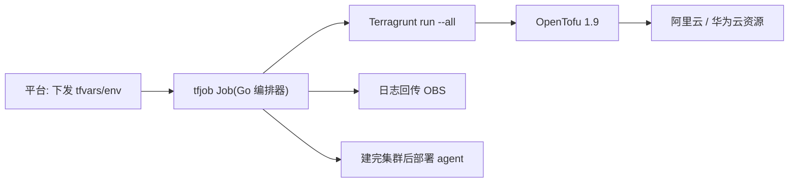
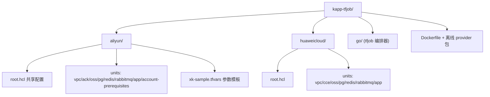
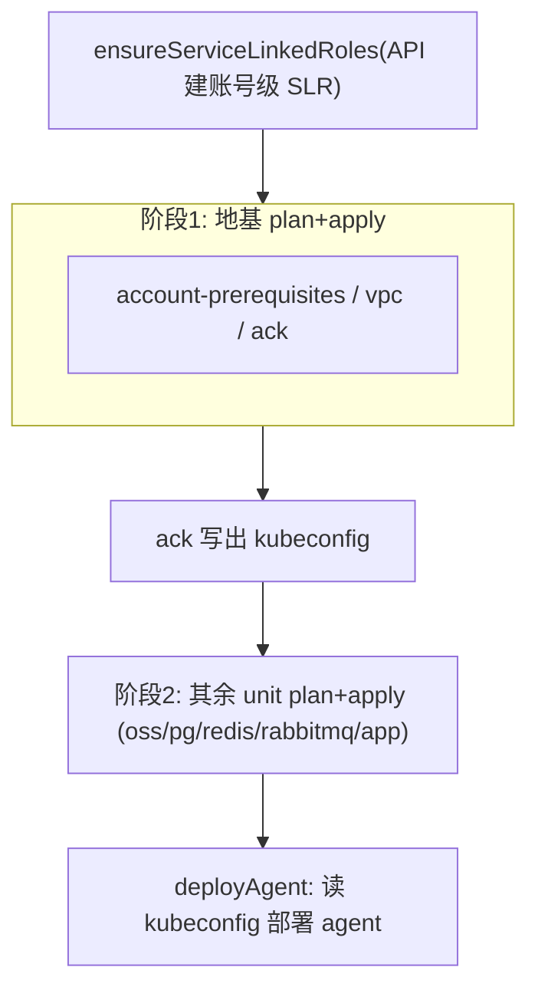

---
tags:
  - 平台组件
  - opentofu
  - terragrunt
  - IaC
  - 实战
created: 2026-11-27
---

# 🏗️ OpenTofu 与 Terragrunt 项目实战

> 本篇只讲**本项目怎么用**，语法与概念（variable/resource/output/dependency 是什么）请看 [[OpenTofu与Terragrunt]]，这里不重复。
> 证据来自 `kapp-tfjob/`（Cloud-infra-tf）：双云 `root.hcl`、各 unit 的 `terragrunt.hcl`、Go 编排器 `go/pkg/tfjob.go`、`Dockerfile`、`account-prerequisites/main.tf`。版本：OpenTofu **1.9.0**、Terragrunt **v0.78.4**、alicloud provider **1.288.0**。

## 一、kapp-tfjob 在平台里干嘛

通用笔记解决"OpenTofu/Terragrunt 是什么"；本项目要解决的是：**给一个 kapp 环境，在阿里云或华为云上把整套基础设施一键拉起来**——VPC、K8s 集群（ACK/CCE）、OSS、PostgreSQL、Redis、RabbitMQ，最后部署 agent。

它不是手工敲 `tofu apply`，而是打成一个 **K8s Job 镜像（tfjob）**：平台下发 tfvars → Job 里的 Go 编排器调 Terragrunt → Terragrunt 调 OpenTofu → 建云资源 → 日志回传对象存储。



**一句话**：kapp-tfjob 是"多云基础设施的自动化交付 Job"，OpenTofu 是引擎、Terragrunt 是编排、Go 负责调度与时序护栏。

## 二、工程布局：双云对称

承接上节——Job 里跑的到底是什么目录？两套云各一棵树，结构对称：



| 层 | 阿里云 | 华为云 | 职责 |
|---|---|---|---|
| 共享配置 | `aliyun/root.hcl` | `huaweicloud/root.hcl` | backend/provider/inputs，靠 include 下发 |
| 网络 | `vpc/` | `vpc/` | VPC + 交换机 |
| 集群 | `ack/` | `cce/` | 托管 K8s，apply 时写出 kubeconfig |
| 存储/中间件 | `oss/ pg/ redis/ rabbitmq/` | 同名 | 对象存储、数据库、缓存、消息队列 |
| 账号前置 | `account-prerequisites/` | —（无） | SLR 验证 + PrivateLink 开通（见 §五） |
| 业务 | `app/` | `app/` | 读集群 kubeconfig 部署应用 |

每个 unit 一个 `terragrunt.hcl` + `main.tf`，**各自独立 state**（爆炸半径小，通用笔记 §2.9 的原则在此落地）。

**一句话**：双云对称目录 + 每 unit 独立 state，root.hcl 收敛重复——正是 Terragrunt 的标准姿势。

## 三、root.hcl：一份共享配置怎么落地

布局清楚了，看共享配置实际写了什么。`aliyun/root.hcl` 把通用笔记讲的 backend/provider/inputs 三件事一次性配齐，且全是**项目特化**：

```hcl
# kapp-tfjob/aliyun/root.hcl（节选）
locals {
  plugin_dir = "/tmp/.terraform-plugin-dir"                       # 离线 provider 目录
  inputs     = jsondecode(read_tfvars_file(get_env("TERRAGRUNT_TFVARS_FILE", "/tmp/project.tfvars")))
  s3_backend_endpoint = get_env("TERRAFORM_S3_BACKEND_ENDPOINT")
  # ... bucket / key / access_key 等均从 env 读
}

generate "provider" {                                            # 统一生成 provider.tf
  path     = "provider.tf"
  contents = <<-EOF
  terraform { required_providers {
    alicloud   = { source = "opentofu/alicloud", version = "1.288.0" }
    kubernetes = { source = "hashicorp/kubernetes", version = "2.37.1" }
  } }
  provider "alicloud" { region = "${local.inputs.region_id}" }
  EOF
}

remote_state {
  backend = "s3"
  config = {
    endpoint = local.s3_backend_endpoint
    bucket   = local.s3_backend_bucket
    key      = "${local.s3_backend_state_file_key}/${path_relative_to_include()}/tofu.tfstate"
    force_path_style = true            # 兼容 Garage 等 S3 协议存储
    skip_credentials_validation = true # 跳过 AWS 专有校验
    skip_region_validation      = true
    # ... 一组 skip_* 适配非 AWS 的 S3 后端
  }
  generate = { path = "root.gen.tf", if_exists = "overwrite_terragrunt" }
}

inputs = merge(local.inputs, { aliyun_access_key = ..., kubeconfig_path = ... })
```

四个项目特化点（通用笔记没讲的）：

| 点 | 做法 | 为什么 |
|---|---|---|
| 后端不是 AWS S3 | `backend "s3"` + 一组 `skip_*` + `force_path_style` | 状态存 **Garage** 等 S3 协议存储，须跳过 AWS 专有校验 |
| state key 按 unit 分 | `.../${path_relative_to_include()}/tofu.tfstate` | 每 unit 一份 state，互不牵连 |
| provider 锁版本 | alicloud **1.288.0** | 该版修复了 serverless AMQP 刚建就 CreateVirtualHost 的瞬态错误（PR #10147），旧版会失败 |
| 离线 init | `extra_arguments` 给 init 加 `-plugin-dir=/tmp/.terraform-plugin-dir` | 镜像内预置 provider，**不联网下载** |

inputs 来源也特化：`jsondecode(read_tfvars_file(...))` 读平台下发的 `project.tfvars`，凭据从 env 注入，**不写死在仓库**。

**一句话**：root.hcl 把"S3 兼容后端 + 锁版本 provider + 离线 plugin-dir + 外部 tfvars"四件事收敛成一份，include 给所有 unit。

## 四、依赖编排：mock 兜底 + 两阶段时序

配置就位，但 unit 之间有依赖（ack 依赖 vpc、app 依赖 ack 的 kubeconfig）。本项目用两招解决"依赖还没建好就要 plan"和"apply 时序"。

### 4.1 dependency + mock_outputs：plan 阶段兜底

```hcl
# kapp-tfjob/aliyun/ack/terragrunt.hcl
include "root" { path = find_in_parent_folders("root.hcl") }
dependency "vpc" {
  config_path = "../vpc"
  mock_outputs = { vpc_id = "mock-vpc-id", security_group_id = "mock-sg-id" }
  mock_outputs_allowed_terraform_commands = ["validate", "plan"]
  mock_outputs_merge_strategy_with_state  = "shallow"   # 关键
}
inputs = { vpc_id = dependency.vpc.outputs.vpc_id }
```

- `mock_outputs`：依赖还没 apply 时，plan/validate 用假值兜底，让整栈能先 plan 出来；
- **`shallow` 合并策略**是项目踩坑后的选择：state 里已有的属性用真实值、缺的用 mock。默认 `no_merge` 会在"vpc state 存在但缺 vpc_id"时原样返回空 outputs，导致 ack plan 报 `does not have an attribute named vpc_id`。

### 4.2 Go 编排器两阶段：先地基后上层

mock 只解决 plan；真正 apply 的时序由 Go 编排器（`go/pkg/tfjob.go`）保证。阿里云走**两阶段**：



```go
// kapp-tfjob/go/pkg/tfjob.go（节选）
func foundationDirs() []string {
    return []string{"./account-prerequisites", "./vpc", "./ack"}   // 必须先 apply
}
// buildCommand: terragrunt run --all <action> --parallelism 1 --non-interactive
//               --json-out-dir <dir> --queue-include-dir <dirs...>
```

为什么必须分阶段：**app 读的 kubeconfig 由 ack 在 apply 阶段才写出**。若对整栈一次性 `run --all plan`，app 处会报 kubeconfig not found。所以先把地基（含 ack）plan+apply 完，再跑下游。华为云无此依赖感知阶段，走 legacy 的 `runPlan + runApply`。

还有两道护栏：
- **`--parallelism 1`**：串行，避免云 API 限流与资源竞态；
- **破坏性绊线**（`protectedResources`）：plan JSON 里若 `alicloud_cs_managed_kubernetes.default` / `alicloud_vpc.default` / `alicloud_vswitch.vswitches` 出现 delete/replace，**直接中止**——防止误删集群/网络。

**一句话**：mock_outputs 让 plan 能先行，Go 两阶段 + 串行 + 绊线让 apply 时序正确且不误删地基。

## 五、账号级资源治理：SLR 为什么只验证不纳管

两阶段里有个特殊的 `account-prerequisites`，它体现本项目最重要的一条治理原则：**账号级共享资源，绝不放进单环境 state**。

问题：RabbitMQ 需要的 `AliyunServiceRoleForAMQPNetwork`、RDS 需要的 `AliyunServiceRoleForRdsPgsqlOnEcs` 是**整个云账号共享的单例**。若用 `resource` 纳管，它的 Delete 调的是账号级 `DeleteServiceLinkedRole`——**任一环境 `destroy` 会删掉全账号共享角色，打挂其它所有环境**。

解法分三层：

| 层 | 做法 | 代码位置 |
|---|---|---|
| 部署态只验证 | 用 `data "alicloud_ram_roles"` + `postcondition` 断言角色存在，**不创建不纳管** | `account-prerequisites/main.tf` |
| 创建走 API | Go `ensureServiceLinkedRoles` 直接调云 API 建角色，**不进任何 tf state** | `go/pkg/service_linked_roles.go` |
| CI 门禁 | `.woodpecker/check-account-global-resources.sh` 拦截 `aliyun/` 下任何 `alicloud_*_service_linked_role` 资源 | README |

```hcl
# kapp-tfjob/aliyun/account-prerequisites/main.tf（节选）
data "alicloud_ram_roles" "amqp_network" {
  name_regex = "^AliyunServiceRoleForAMQPNetwork$"   # 大小写敏感, 须精确
  lifecycle {
    postcondition {
      condition     = length(self.names) == 1
      error_message = "Missing ... Bootstrap it ONCE per account, outside deployment state ..."
    }
  }
}
```

PrivateLink 则相反——`data "alicloud_privatelink_service"` 是 **open-or-noop**（`enable="On"` 幂等开通并确认），默认自动开通，因为它是账号内一次性、无 destroy 爆炸半径。

> 历史包袱：pg 曾用 `resource` 建 RDS SLR，改为 verify-only 时用裸 `removed { from = ... }`（OpenTofu 1.9 语义＝移出 state 但**不销毁**）把既有资源移出账本。注意 `lifecycle { destroy = false }` 是 **1.12+** 才支持，1.9 上会报错——升级后须加回。

**一句话**：账号级单例"API 创建 + data 验证 + 门禁拦截"，把 destroy 爆炸半径挡在单环境 state 之外。

## 六、离线镜像与运行入口

治理原则讲完，看这一切怎么打包运行。`Dockerfile` 把引擎、编排器、provider、云目录全塞进一个镜像，**离线可跑**：

```dockerfile
# kapp-tfjob/Dockerfile（节选）
COPY ./terragrunt_linux_amd64        /usr/local/bin/terragrunt
COPY ./tofu_1.9.0_linux_amd64.tar.gz /tmp/tofu.tar.gz
COPY ./terraform-plugin-dir.tar.gz   /tmp/terraform-plugin-dir.tar.gz  # 预下载 provider
COPY ./kapp-cli                      /usr/local/bin/kapp-cli
COPY aliyun/      /galaxyship/aliyun
COPY huaweicloud/ /galaxyship/huaweicloud
ENTRYPOINT [ "/usr/local/bin/tfjob" ]
```

- provider 预先 `terragrunt run-all init` 下载后打成 `terraform-plugin-dir.tar.gz`，镜像内解压到 `/tmp/.terraform-plugin-dir`，配合 root.hcl 的 `-plugin-dir` 实现**离线 init**；
- 入口是 Go 编译的 `tfjob`（cobra CLI），`tfjob apply` 启动：拉 tfvars → 建 SLR → 两阶段 apply → 部署 agent，日志经 OBS logger 回传对象存储，60 分钟超时、监听 :8080。

**一句话**：一个镜像装齐 tofu+terragrunt+provider+云目录，tfjob 作入口，离线交付。

## 七、上手命令与坑清单

本地调试（非 Job）按 README 走：

```bash
cp .direnvrc.sample .direnvrc && direnv allow .
cp xk-sample.tfvars project.tfvars          # 填 region/规格/密码等
cd aliyun
# 手动栈流程（README 提供）
terragrunt stack generate
terragrunt stack run apply --working-dir xk -auto-approve
# 或单组件
terragrunt apply --all --working-dir app --queue-include-external --non-interactive
```

项目特有的坑（通用笔记不会讲）：

| 坑 | 现象 | 对策 |
|---|---|---|
| 整栈一次性 plan | app 报 kubeconfig not found | 走 Go 两阶段，或先 apply ack |
| dependency 空 outputs | ack plan 报缺 vpc_id 属性 | mock 合并策略设 `shallow` |
| destroy 删账号级 SLR | 打挂全账号其它环境 | SLR 只验证不纳管 + CI 门禁 |
| RDS 账号建库后无法 destroy | 提示禁止 | 先手动清库再 destroy 账号 |
| OSS 同名 bucket 重建 | 删除后 4–8h 内无法重建同名 | 等待或换名 |
| AMQP CreateVirtualHost 失败 | provider 旧版瞬态错误 | 锁 alicloud 1.288.0 |
| `lifecycle { destroy=false }` | 1.9 报 not expected here | 该子块 1.12+ 才支持 |

**一句话**：本地 direnv+tfvars 起步，时序/SLR/版本三类坑都有对应护栏。

## 八、总结：通用 vs 实战

| 维度 | 通用笔记 [[OpenTofu与Terragrunt]] | 本项目 kapp-tfjob |
|---|---|---|
| 例子 | local/random 问候文件 | 阿里云/华为云真实基础设施 |
| 后端 | local 文件 | S3 协议（Garage）+ skip_* |
| 编排 | `run --all` 概念 | Go 两阶段 + 串行 + 破坏性绊线 |
| 依赖 | dependency 读 outputs | + mock_outputs/shallow 兜底 plan |
| 账号级资源 | 未涉及 | SLR verify-only + API 创建 + 门禁 |
| 交付 | 命令行 | 离线 Job 镜像 + OBS 日志 |

**一句话**：通用笔记讲"语法与原理"，本篇讲"多云、离线、时序、爆炸半径治理"的工程落地——两者互补，不重复。

## 相关

- 上游：[[平台组件]]（MOC）
- 语法与概念：[[OpenTofu与Terragrunt]]（本篇不重复其知识点）
- 源码：`kapp-tfjob/aliyun/root.hcl`、`go/pkg/tfjob.go`、`go/pkg/service_linked_roles.go`、`aliyun/account-prerequisites/main.tf`、`Dockerfile`