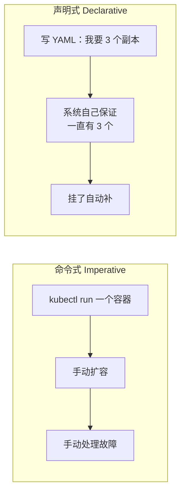
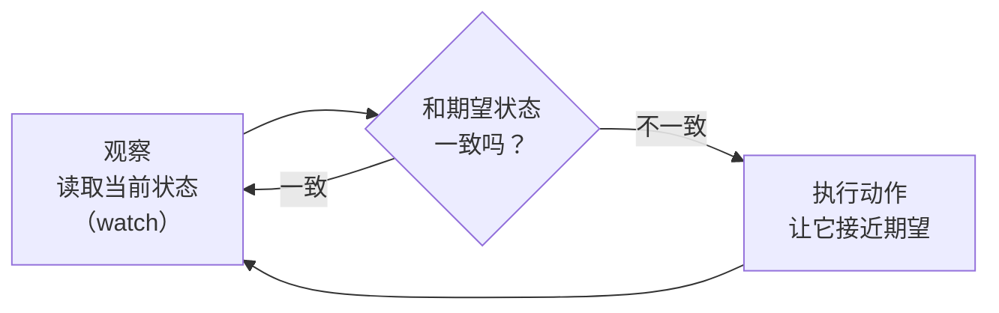
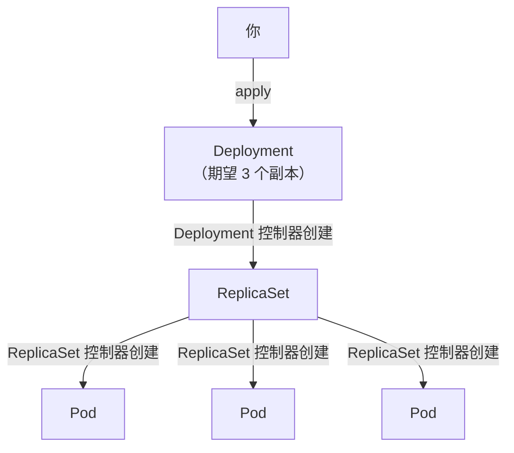

---
tags:
  - architecture
  - k8s
created: 2026-11-01
status: 已整理
---

# 声明式 API 与控制循环

K8s 最重要的设计思想：**声明式 API（Declarative API）+ 控制循环（Control Loop）**。理解这两点，整个 K8s 就通透了。

## 命令式 vs 声明式

- **命令式**：告诉系统「怎么做」（先启动这个、再改那个）。
- **声明式**：告诉系统「我想要什么状态」，怎么做由系统决定。

对应命令：`kubectl create` / `run`（命令式），`kubectl apply`（声明式）。**生产环境一律用 apply。**

## 控制循环（Control Loop / Reconcile）

声明式之所以能自愈，靠的是每个控制器都在跑一个无限循环：

这个「观察 → 对比 → 修正」的循环，官方叫 **Reconcile 循环**。两个要点：

- 循环**基于当前状态**（level-triggered），不是基于「发生了什么事件」（edge-triggered）——即使错过一次变化，下一次循环也会发现差异。
- 每次循环**幂等**：多做一次不会出错，这是它能反复重试、不怕崩溃重启的根基。

## 控制器模式（Controller Pattern）

一种资源由一个控制器负责，多个控制器分层协作：

- 你只写了一个 Deployment；**Deployment 控制器**创建 ReplicaSet，**ReplicaSet 控制器**创建 Pod，**kubelet** 负责真正把 Pod 跑起来。
- 每一层只负责自己的「期望 vs 实际」，职责单一——这就是「控制器模式」。

## 为什么这样设计

| 好处 | 解释 |
|---|---|
| 自愈 | 副本少了控制器自动补，进程挂了 kubelet 自动拉 |
| 幂等可恢复 | 控制器崩溃重启后，循环继续，不丢状态 |
| 可审计可版本化 | 期望状态就是 YAML，能进 Git → 天然适配 GitOps |
| 解耦 | 组件间不直接调用，只通过 apiserver 交换状态 |

## 相关

- 控制循环的具体实现 → [[控制器与 Reconcile 循环]]
- 控制器如何感知变化 → [[List-Watch 机制]]、[[Informer 与工作队列]]
- 对象结构 → [[核心对象与资源模型]]
