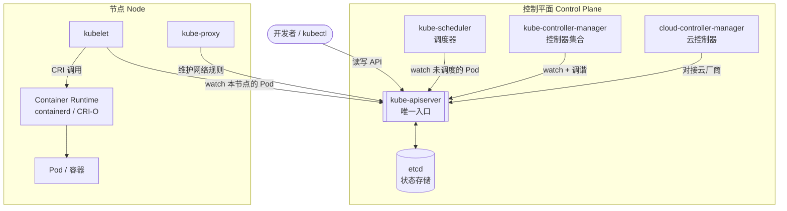
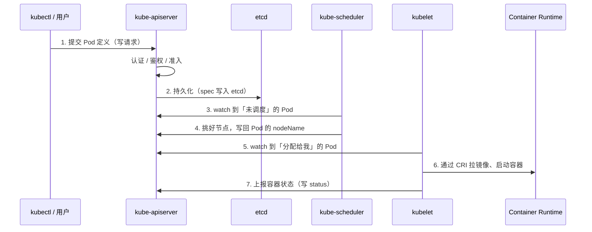

---
tags:
  - architecture
  - k8s
created: 2026-11-01
status: 已整理
---

# 架构总览

Kubernetes（K8s）是一个**容器编排系统**：把一批机器（节点）聚合成一个集群，你只需声明「要运行什么」，它负责把容器调度、启动、看护、自愈。

## 整体架构

集群分两部分：**控制平面（Control Plane)** 负责决策，**节点（Node）** 负责干活。

两条最关键的架构原则：

- **etcd 是唯一「有状态」组件**，保存集群全部状态；只有 apiserver 直接读写它。
- **所有组件都通过 apiserver 交互**，组件之间不直接通信——scheduler、controller-manager 从不直接操作节点，它们只「写期望」，由 kubelet 执行。（唯一例外：kubelet 通过本机 CRI 接口直接调用容器运行时，但这属于节点内部接口，不算集群组件间的通信。）

## 各组件职责

| 组件 | 位置 | 职责 |
|---|---|---|
| kube-apiserver | 控制平面 | 唯一入口；认证/鉴权/准入；所有状态读写都经它 |
| etcd | 控制平面 | 分布式键值存储，集群状态的唯一事实来源 |
| kube-scheduler | 控制平面 | 只做一件事：给「未调度」的 Pod 挑一个节点（写 `nodeName`） |
| kube-controller-manager | 控制平面 | 跑一堆控制器（Deployment、Node 等），把实际状态调到期望状态 |
| cloud-controller-manager | 控制平面 | 对接云厂商（云 LB、云节点等），本地集群可没有 |
| kubelet | 节点 | 节点「工头」：watch 到本节点的 Pod 后拉起容器并持续看护 |
| kube-proxy | 节点 | 维护节点网络规则（iptables/IPVS），实现 Service 负载均衡 |
| Container Runtime | 节点 | 真正运行容器（containerd / CRI-O；dockershim 已移除） |

## 一个 Pod 是如何被创建的

**看懂这张图就懂了 K8s 的核心**：调度器不启动容器，它只「改一行字段（nodeName）」；kubelet 才是真正启动容器的人。整个系统靠「watch + 写期望」解耦，而不是组件互相调用。

## 相关

- 组件逐一详解 → [[02-核心组件]]
- 「watch + 写期望」的机制 → [[List-Watch 机制]]、[[控制器与 Reconcile 循环]]
- 对象如何组织 → [[核心对象与资源模型]]
