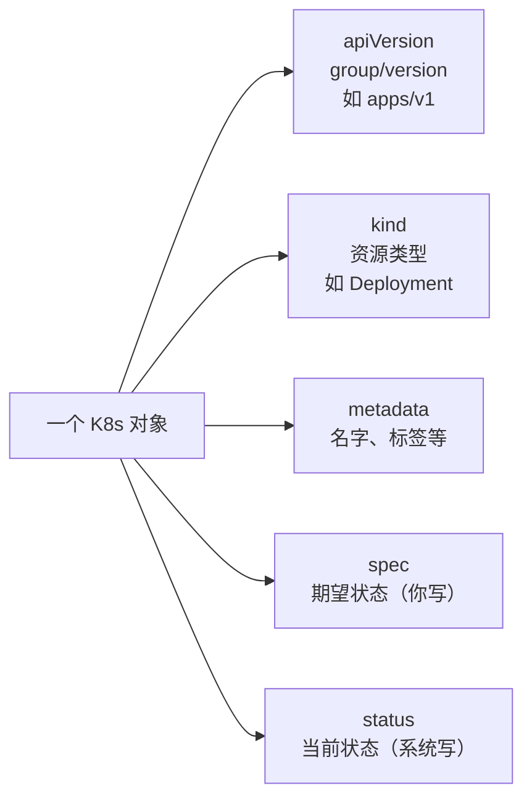
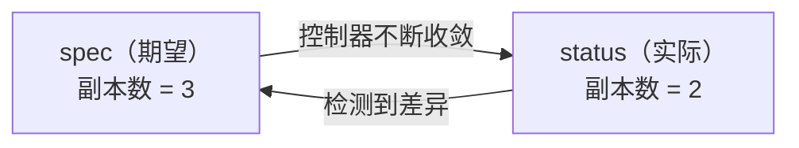
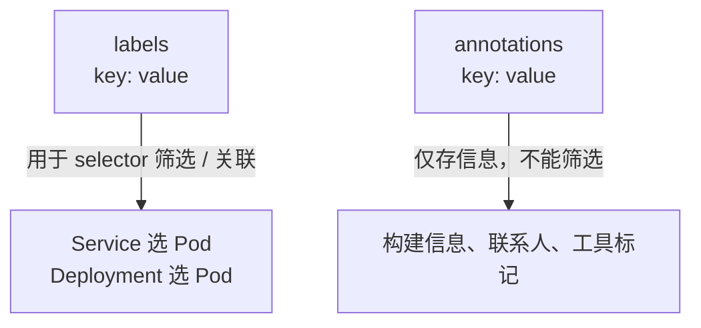
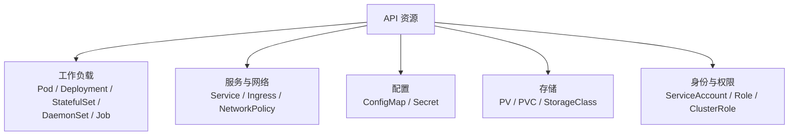

---
tags:
  - architecture
  - k8s
created: 2026-11-01
status: 已整理
---

# 核心对象与资源模型

K8s 的核心理念是 **「一切皆对象」**：集群里所有东西（Pod、Service、节点、甚至配置）都用统一的对象（API 资源）来描述。

## 一个对象长什么样

```yaml
apiVersion: v1
kind: Pod
metadata:
  name: nginx
  namespace: default
  labels:
    app: nginx
spec:              # 期望状态（你写）
  containers:
    - name: nginx
      image: nginx:1.25
status:            # 当前状态（系统写）
  phase: Running
```

所有对象都由这五部分组成：



- **apiVersion**：`group/version`，如 `v1`（核心组）、`apps/v1`、`networking.k8s.io/v1`。
- **kind**：对象类型，如 `Pod`、`Service`、`Deployment`。
- **metadata**：名字、命名空间、标签等元数据（详见下文）。
- **spec**：你声明「想要什么」。
- **status**：系统告诉你「现在是什么样」。**status 永远由系统维护，你只写 spec。**

## spec 与 status：K8s 的核心心智



你只描述**期望状态（spec）**，系统通过控制器循环把**实际状态（status）**不断拉向期望状态。两者有差异，系统就动作——这就是「自愈」的来源。

## metadata 里的重要字段

| 字段 | 作用 | 说明 |
|---|---|---|
| name | 唯一标识 | 同一 namespace 内唯一 |
| namespace | 命名空间 | 逻辑隔离；不写则默认 `default` |
| uid | 全局唯一 ID | 对象全生命周期不变，重建会变 |
| resourceVersion | 版本号 | etcd 维护的**全局递增**版本，每次写都变，用于乐观并发（→ [[resourceVersion 与乐观并发]]） |
| labels | 标签 | 用于筛选和关联（见下） |
| annotations | 注解 | 存元数据，不参与筛选 |
| ownerReferences | 所属关系 | 指向父对象，用于级联删除（→ [[OwnerReference 与垃圾回收]]） |

## labels vs annotations



- **labels 用来筛选**：Service 靠 label selector 找到后端 Pod；Deployment 靠 label 找到要管理的 Pod。
- **annotations 只存附加信息**（如 `kubectl.kubernetes.io/last-applied-configuration`），不能用于筛选。

## 常见资源分类



> 用 `kubectl api-resources` 可查看集群支持的所有资源类型。

## 相关

- spec/status 的收敛靠谁实现 → [[声明式 API 与控制循环]]、[[控制器与 Reconcile 循环]]
- resourceVersion 机制 → [[resourceVersion 与乐观并发]]
- ownerReferences → [[OwnerReference 与垃圾回收]]
