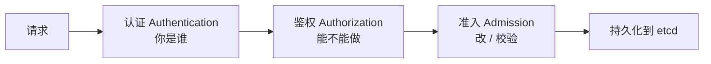
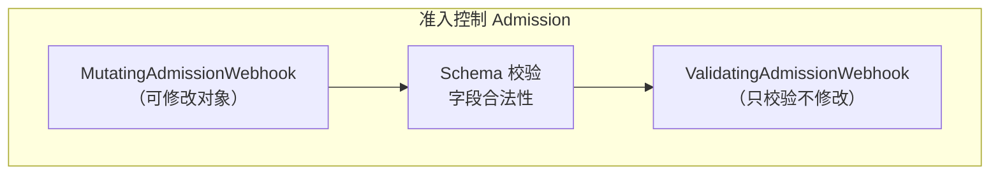
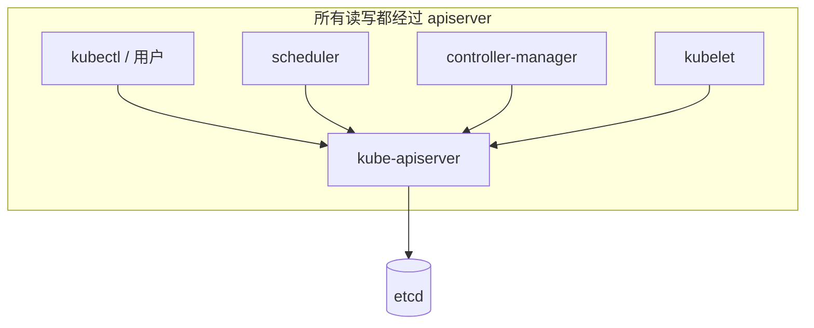

---
tags:
  - k8s
  - component
created: 2026-11-01
status: 已整理
---

# API Server

kube-apiserver 是整个集群的**唯一入口**，也是唯一能直接读写 etcd 的组件。所有组件（scheduler、controller、kubelet）和用户（kubectl）都通过它交换状态。

## 核心职责

- **暴露 REST API**：所有资源都是 REST 资源（`GET /api/v1/pods` 等）。
- **认证 / 鉴权 / 准入**：三道闸门，决定「你是谁、能不能做、合不合规」。
- **持久化到 etcd**：把对象写入/读出 etcd。
- **提供 watch**：客户端可订阅资源变化，这是整个 K8s 事件驱动的根基。

## 一次写请求的完整流程

准入又分三步：

- **认证**：识别身份（证书、token、OIDC 等）。
- **鉴权**：RBAC / Node / Webhook 等，判断有无权限。
- **准入**：可拦截或改写请求——`LimitRange`、`ResourceQuota` 就是内置准入器；webhook 是自定义扩展点。

## 为什么它是「唯一入口」

架构思想：

- **单一数据入口**：所有状态变更集中在一个点，才能做统一的认证、鉴权、审计（audit log）。
- **无状态**：apiserver 本身不存数据（数据在 etcd），可以随意水平扩容。
- **解耦**：其他组件只依赖 apiserver 的 API，不关心数据怎么存——将来换掉 etcd，组件也无感知。

## 相关

- 请求处理流程深入 → [[API Server 请求处理流程]]
- watch 如何支撑事件驱动 → [[List-Watch 机制]]
- 唯一有状态的兄弟 → [[etcd]]
