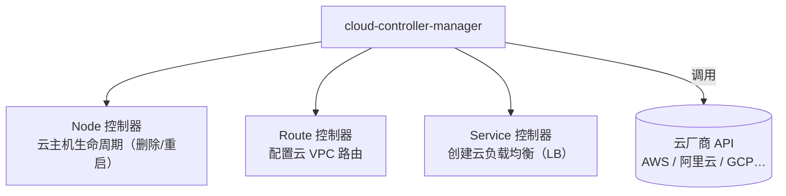

---
tags:
  - k8s
  - component
created: 2026-11-01
status: 已整理
---

# Cloud Controller Manager

cloud-controller-manager（CCM）把**依赖云厂商**的控制循环从核心 kube-controller-manager 里拆了出来，单独运行。**本地/私有集群没有这个组件。**

## 它负责什么

- 当一个节点在云上被销毁，CCM 的 Node 控制器负责把它从集群里摘掉。
- 创建 `type: LoadBalancer` 的 Service 时，是 CCM 去调云 API 建一个真正的云 LB。

## 为什么要拆出来

**架构思想——核心与厂商解耦**：

- 核心 K8s 团队不用维护各家云的对接代码。
- 云厂商可以**独立演进**自己的 CCM，跟随自己的 API 节奏发版，不影响 K8s 核心发布。
- 用户在不同云之间迁移，只换 CCM，核心组件不变。

## 相关

- 兄弟组件 → [[Controller Manager]]
- 负载均衡 Service → [[Service]]
