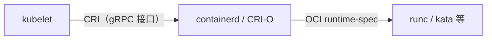
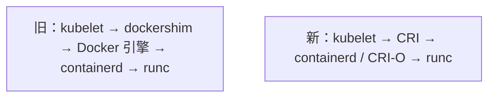

---
tags:
  - k8s
  - component
created: 2026-11-01
status: 已整理
---

# Container Runtime

容器运行时（Container Runtime）是真正运行容器的那一层。K8s 通过 **CRI**（Container Runtime Interface）这一标准接口来调用它，从而不绑定具体实现。

## CRI 解耦了 kubelet 与运行时

- **containerd**：CNCF 项目（源自 Docker），目前最主流；Docker 引擎底层本身也用它。
- **CRI-O**：Red Hat 主导，专为 K8s 设计的轻量 CRI 实现。

## 历史：dockershim 的移除

早期 K8s 通过一个叫 **dockershim** 的适配层支持 Docker，但 Docker 引擎太重（功能远超容器运行所需）。K8s 1.24 起移除了 dockershim，统一走 **CRI** 标准。

## 两个相关标准

| 规范 | 定义什么 | 组织 |
|---|---|---|
| CRI | kubelet 与运行时的接口 | Kubernetes |
| OCI | 镜像格式（image-spec）与运行时（runtime-spec） | 开放容器倡议 |

**架构思想——接口抽象**：定义接口而非绑定实现，K8s 才能同时支持多种运行时，生态才能百花齐放（普通容器 runc、安全容器 kata、机密计算容器等）。

## 相关

- 谁在调用它 → [[Kubelet]]
- 容器与镜像原理 → [[容器与镜像原理]]
