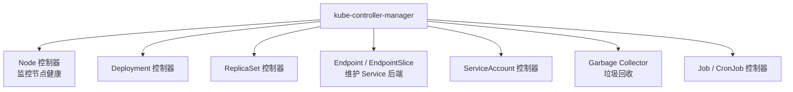
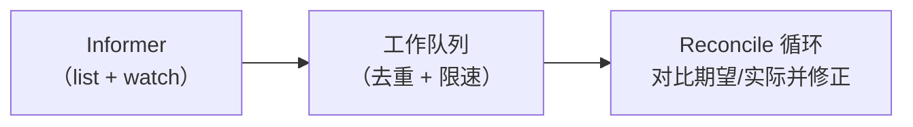

---
tags:
  - k8s
  - component
created: 2026-11-01
status: 已整理
---

# Controller Manager

kube-controller-manager 是**一堆控制器的集合**：一个进程里运行着几十个控制器，每个控制器负责一种资源，不断把实际状态调到期望状态。

## 内置的主要控制器

每个控制器内部结构都一样（→ [[控制器与 Reconcile 循环]]）：

## 为什么要合在一个进程

- **部署简单**：不用为每个控制器单独部署、单独扩缩容。
- **可以拆分**：这些控制器彼此独立，必要时也能拆出来单独跑。

## 领导选举（Leader Election）

同一时刻只需要一个 controller-manager 实例在工作（避免重复操作）。多副本部署时，它们通过 **抢锁（Lease）** 选出唯一 Leader，Leader 挂了再重新选举——既高可用、又不会重复干活。

## 架构思想

- **控制器模式**：每个控制器「一种资源、一个循环」，职责单一、可组合。
- **声明式收敛**：控制器不关心「发生了什么」，只关心「现状 vs 期望」，永远在把两者拉平。

## 相关

- 控制器内部机制 → [[控制器与 Reconcile 循环]]、[[Informer 与工作队列]]
- 云厂商相关控制器被拆到了 → [[Cloud Controller Manager]]
