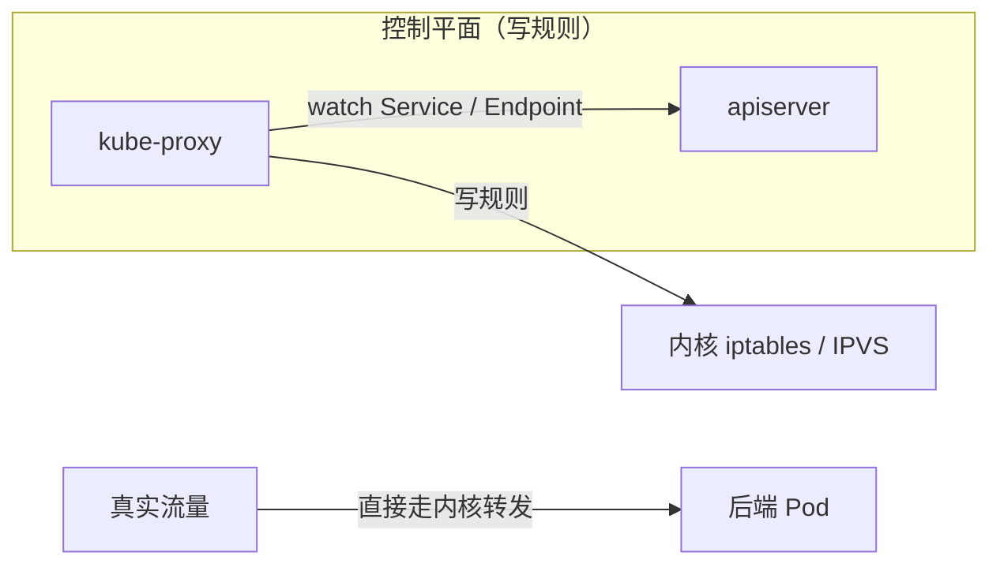
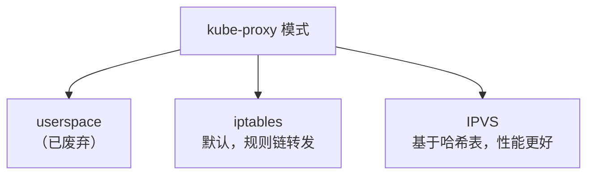

---
tags:
  - k8s
  - component
created: 2026-11-01
status: 已整理
---

# Kube-proxy

kube-proxy 负责在节点上**实现 Service 抽象**：它监听 Service 和 Endpoint 的变化，把「访问虚拟 IP → 转发到某个 Pod」的规则写到节点网络里。

## 它其实不「代理」流量

**架构思想——控制与数据分离**：kube-proxy 只写规则，真实流量由内核直接转发，不经过 kube-proxy 进程本身——所以它挂了短时间内流量也不断（规则还在内核里）。

## 三种工作模式

- **iptables**：把 Service 转成 iptables 规则链；规则很多时性能下降（线性匹配）。
- **IPVS**：内核级四层负载均衡（哈希表查找），大集群、高并发场景性能更好。

## 相关

- Service 是什么 → [[Service]]
- Service 如何找后端 → [[Endpoint 与 EndpointSlice]]
