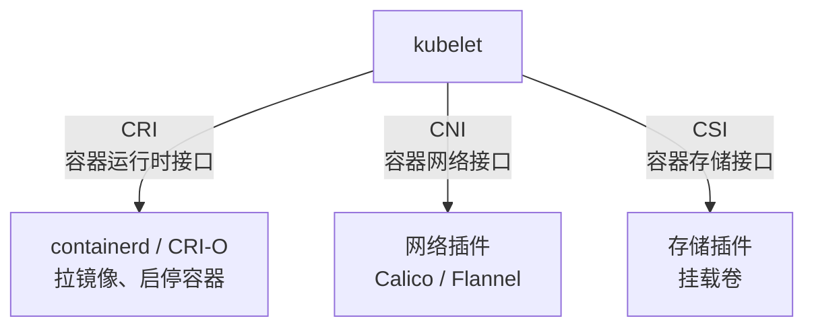
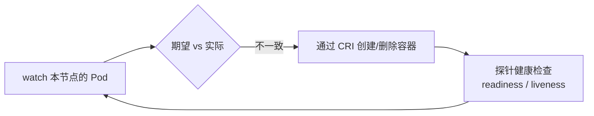

---
tags:
  - k8s
  - component
created: 2026-11-01
status: 已整理
---

# Kubelet

kubelet 是**每个节点上的「工头」**：控制平面只做决策，真正把 Pod 跑起来、看护起来的是它。它是控制平面指令的最终执行者。

## 内部架构：通过三大接口解耦

- **CRI**：管容器（拉镜像、创建/销毁容器）
- **CNI**：管网络（给 Pod 配 IP、网卡）
- **CSI**：管存储（挂载持久卷）

这套**接口抽象**让 kubelet 不绑定任何具体实现——换运行时、换网络插件都不影响 kubelet 本身。

## 核心工作循环

- kubelet 只认「分配给我这个节点」的 Pod（通过 nodeName 过滤）。
- 持续上报：容器状态、节点资源、健康信息都写回 apiserver（status）。

## 健康检查探针

| 探针 | 作用 | 失败后果 |
|---|---|---|
| liveness | 容器还活着吗 | 失败 → 重启容器 |
| readiness | 能接流量吗 | 失败 → 从 Service 摘除 |
| startup | 启动完成了吗 | 未完成前暂不启用前两者 |

## 架构思想

- **节点自治**：每个节点有自己的 agent，即使控制平面短暂故障，已运行的 Pod 仍由 kubelet 看护。
- **接口解耦**：CRI/CNI/CSI 让 K8s 成为一个「可插拔」系统。

## 相关

- 探针详解 → [[Pod 生命周期与探针]]
- 容器运行时 → [[Container Runtime]]
