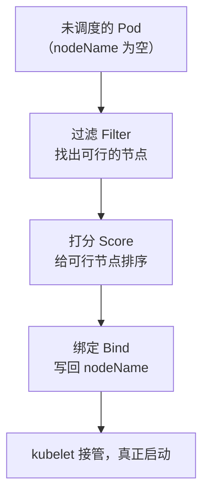
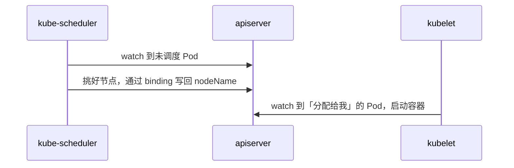

---
tags:
  - k8s
  - component
created: 2026-11-01
status: 已整理
---

# Scheduler

kube-scheduler 只做一件事：**给「未调度」的 Pod 挑一个合适的节点**。注意它不启动容器，只做一个决策——把节点名写回 Pod 的 `spec.nodeName`。

## 调度流程：两阶段

### 过滤（Filter）

排除不满足条件的节点，例如：

- 资源不够（CPU/内存请求超了）
- 节点有污点（taint）而 Pod 不满足容忍（toleration）
- Pod 的 nodeSelector / 亲和性不匹配

### 打分（Score）

对剩余节点打分排序，常见的如：资源越均衡分越高、镜像已缓存加分、尽量把同应用的 Pod 分散到不同节点等。

## 调度器只写 nodeName

**架构思想——决策与执行分离**：scheduler 不碰节点、不启动容器，它只改一行字段；真正的执行由节点上的 kubelet 完成。这样调度逻辑可以独立演进、独立扩展，甚至整个换成自定义调度器。

## 可插拔的调度框架

现代调度器基于 **Scheduling Framework**，把流程拆成多个**扩展点**（Filter、Score、Bind、Reserve 等），可以插入自定义插件实现专属调度策略。

## 高可用

和 controller-manager 一样，kube-scheduler 多副本部署时也用**领导选举（Leader Election）**——同一时刻只有一个 scheduler 在做调度决策，Leader 挂了由其他副本接管，避免重复调度。

## 相关

- 调度细节（亲和性、污点、拓扑、抢占）→ [[06-调度与资源管理]]
- 调度器如何感知 Pod → [[List-Watch 机制]]
