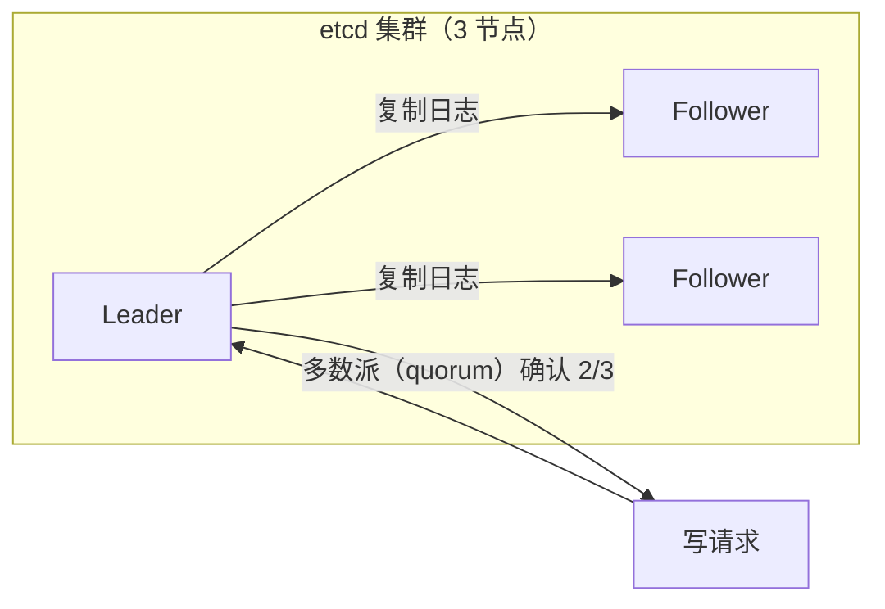
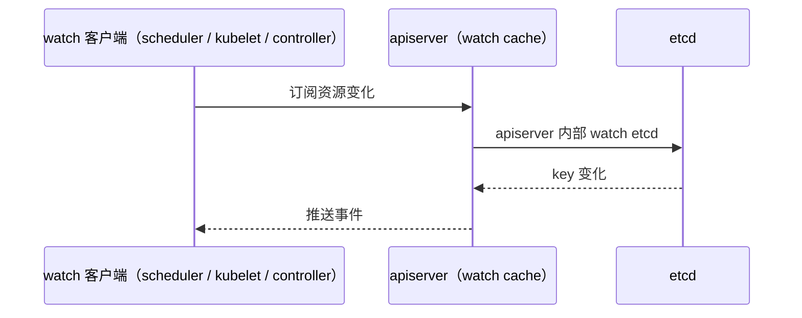

---
tags:
  - k8s
  - component
created: 2026-11-01
status: 已整理
---

# etcd

etcd 是一个**分布式一致性键值存储**（基于 Raft 协议），是 K8s 集群状态的**唯一事实来源**（single source of truth）。整个集群里，只有它是有状态组件。

## 它存什么

集群里所有对象最终都以 key-value 形式存在 etcd 里：

```
/registry/pods/default/nginx
/registry/deployments/default/myapp
/registry/services/default/nginx
```

> 只有 apiserver 直接读写 etcd；其他组件永远不碰它。

## Raft：如何保证强一致



- etcd 用 **Raft** 达成共识：一个 Leader 接收写请求，复制到多数派（quorum）节点即返回成功。
- 因此集群节点数通常是**奇数**（3 或 5），可容忍 `(n-1)/2` 个节点故障。

## watch：K8s 事件驱动的基石

etcd 原生支持 **watch**——订阅某个 key 前缀，变化时收到通知。但注意：**K8s 组件（scheduler/kubelet/controller）从不直接 watch etcd**，它们 watch 的是 apiserver；真正从 etcd watch 的只有 apiserver 自己。



- apiserver 为每类资源维护一个 **watch cache（cacher）**，客户端的 watch 实际是从这个缓存读，避免频繁打 etcd。
- 缓存的数据又来自 apiserver 对 etcd 的 watch，所以完整链路是 `etcd → apiserver(cacher) → 客户端`。
- 这正对应「只有 apiserver 直接访问 etcd」的架构原则，也是 K8s List-Watch 的基础（→ [[List-Watch 机制]]）。

## 架构思想与运维要点

- **单一数据源**：所有组件都从 etcd「读世界」，通过 apiserver「写世界」，状态不会在多个地方漂移。
- **它是唯一需要备份的组件**：etcd 丢了，集群状态就丢了（→ [[备份与恢复]]）。
- 写密集 + 强一致，生产环境建议用 SSD 独立部署，别和 apiserver 抢资源。

## 相关

- 数据如何进出 → [[API Server]]
- 备份恢复 → [[备份与恢复]]
