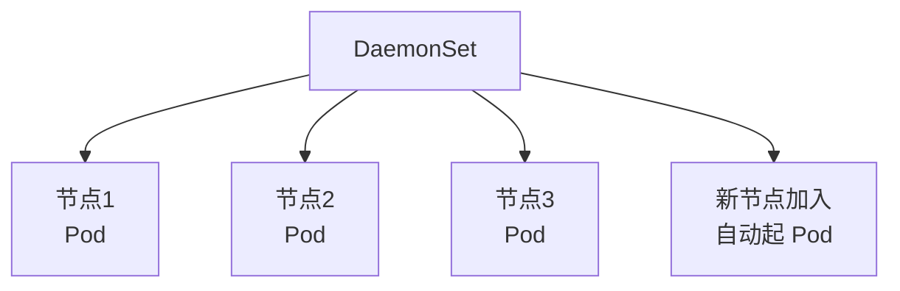

---
tags:
  - k8s
  - workload
created: 2026-11-01
status: 已整理
---

# DaemonSet

DaemonSet 保证**每个（符合条件的）节点上正好跑一个 Pod 副本**。新节点加入自动跑，节点移除自动删——天然跟随节点。

## 典型用途

都是「节点级常驻」场景：

- **日志采集**：fluentd / filebeat
- **监控**：node-exporter
- **网络**：CNI 插件（如 Calico）、kube-proxy（其实 DaemonSet 形式部署）
- **存储**：分布式存储客户端（如 Ceph）

## 怎么限制节点

默认所有节点都跑，可用以下筛选：

- `nodeSelector` / `nodeAffinity`：指定节点标签。
- `tolerations`：容忍污点（让 Pod 跑到被 tainted 的节点，比如 master）。

## 更新策略

- **RollingUpdate**（默认）：滚动更新节点上的 Pod。
- **OnDelete**：手动删一个旧 Pod 才会创建新的——适合需要严格控制节奏的场景。

## 相关

- 调度到节点 → [[调度流程与算法]]、[[亲和性污点与容忍]]
- 节点组件常以 DaemonSet 部署 → [[Kube-proxy]]
