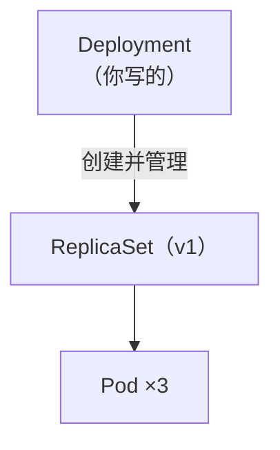
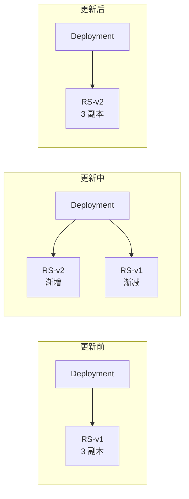
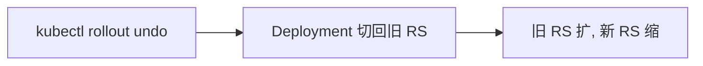

---
tags:
  - k8s
  - workload
created: 2026-11-01
status: 已整理
---

# Deployment

Deployment 是**最常用的无状态工作负载**：管理 ReplicaSet，提供滚动更新和回滚。你写 Deployment，它帮你管 RS 和 Pod。

## 层级关系

> 你永远只操作 Deployment，不碰 RS——RS 是 Deployment 的实现细节。

## 滚动更新

改了 Pod 模板（比如换镜像版本），Deployment 会**新建一个 RS，逐步把流量从旧 RS 切到新 RS**：

两个关键参数（`strategy.rollingUpdate`）：

- **maxSurge**：最多比期望多几个（默认 25%）——控制新 Pod 的「冒头」速度。
- **maxUnavailable**：最多比期望少几个（默认 25%）——控制旧 Pod 的「退场」速度，保证更新期间有足够可用副本。

## 回滚

- Deployment 保留多个历史 RS（`revisionHistoryLimit`，默认 10）。
- `kubectl rollout undo` 可指定回到某个 revision。
- ⚠️ 只有**改 Pod 模板**才会产生新版本；改 replicas 等不产生新 RS，不能回滚。

## 更新策略

- **RollingUpdate**（默认）：滚动，平滑切换。
- **Recreate**：先全删旧 Pod 再建新的——有停机，适合不能多版本并存的场景。

## 相关

- 底层 → [[ReplicaSet 与 ReplicationController]]
- 有状态应用对应物 → [[StatefulSet]]
- 更新期间的保护 → [[Pod 中断预算 PDB]]
