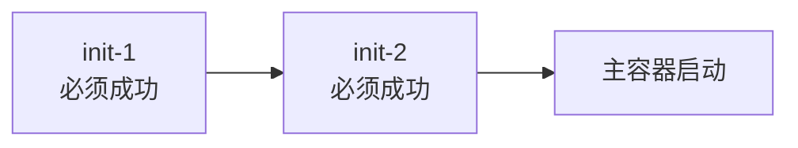
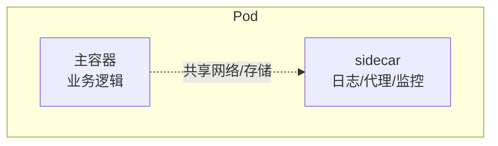
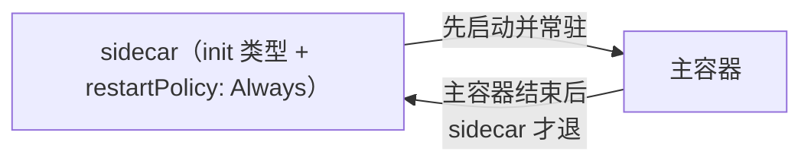

---
tags:
  - k8s
  - workload
created: 2026-11-01
status: 已整理
---

# Init Container 与 Sidecar

Pod 里除了主容器，还有两类辅助容器：**Init 容器**（启动前初始化）和 **Sidecar**（与主容器并行辅助）。两者解决「主容器不该干的事」。

## Init 容器：先初始化，再跑主容器

- **顺序执行**：init 容器一个个跑，前一个成功（exit 0）才跑下一个。
- **必须成功**：任一 init 失败，整个 Pod 重启（按 restartPolicy）。
- 典型用途：等依赖就绪、拉配置、做数据迁移、注册到服务发现。

> init 容器和主容器**不共享启动时机**，但**共享 Volume**——所以 init 写的文件，主容器能读到。

## Sidecar：和主容器一起跑

sidecar 和主容器**并行**运行，提供辅助能力：日志采集、Service Mesh 代理（Envoy）、配置热加载等。主容器专注业务，sidecar 专注横切关注点。

## ⚠️ 旧式 sidecar 的痛点

旧方式 sidecar 只是普通容器，**启动/退出顺序无法保证**：

- sidecar 可能在主容器之后才启动 → 主容器启动时 sidecar 还没准备好。
- 主容器退出时 sidecar 还在跑 → Pod 迟迟不结束。

## 原生 sidecar（K8s 1.28+）

把 sidecar 写成 `restartPolicy: Always` 的 **init 容器**——这样它**先于主容器启动、后于主容器退出**，启动/退出顺序问题被根治。新写法推荐用这个。

## 相关

- Pod 共享机制 → [[Pod]]
- 探针 → [[Pod 生命周期与探针]]
